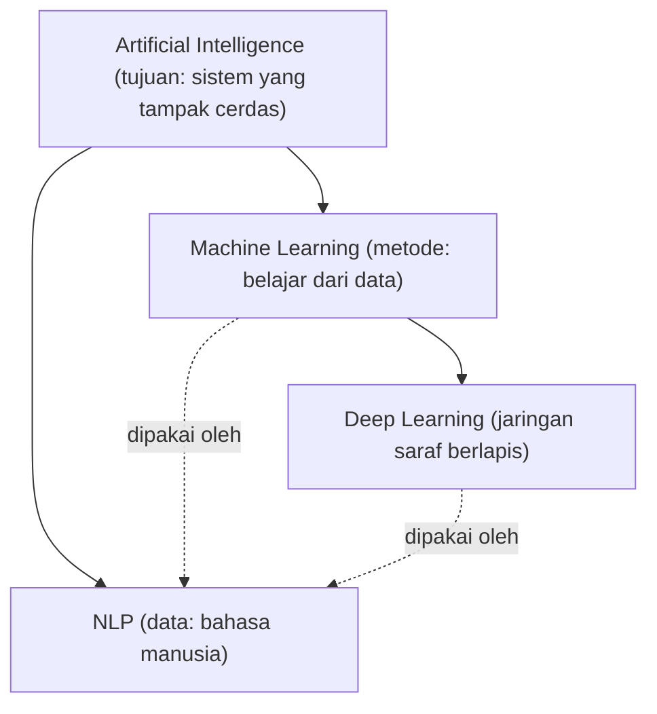

# AI, Machine Learning, Deep Learning, NLP, dan Text Mining

## Tujuan pembelajaran

Setelah halaman ini Anda mampu:

- [ ] Membedakan AI, machine learning (ML), deep learning (DL), NLP, dan text mining.
- [ ] Menempatkan klasifikasi pesan darurat pada peta bidang tersebut.
- [ ] Memberi contoh pendekatan berbasis aturan dan berbasis data untuk satu masalah yang sama.

## Prasyarat

Tidak ada. Halaman ini adalah titik awal kurikulum.

## Pengantar dan intuisi

Istilah AI, ML, DL, dan NLP sering dipakai bergantian di media, padahal
cakupannya berbeda. Bayangkan lingkaran-lingkaran yang saling melingkupi:
sebagian istilah menyebut *tujuan*, sebagian menyebut *metode*, dan sebagian
menyebut *jenis data*.



NLP berbeda dari yang lain karena ia ditentukan oleh **jenis data** (bahasa
manusia), bukan oleh metodenya. Sebuah sistem NLP bisa memakai aturan tulisan
tangan, ML klasik, atau deep learning.

## Konsep

| Istilah | Definisi singkat | Ciri pembeda |
|---|---|---|
| **Artificial Intelligence** | Bidang yang membuat sistem melakukan tugas yang biasanya butuh kecerdasan manusia | Cakupan terluas; mencakup sistem berbasis aturan |
| **Machine Learning** | Sistem yang memperbaiki kinerjanya dengan belajar dari data, bukan aturan eksplisit | Ada tahap *training* dari contoh |
| **Deep Learning** | ML dengan jaringan saraf berlapis banyak | Mempelajari representasi sendiri; butuh data dan komputasi lebih besar |
| **Natural Language Processing** | Pemrosesan dan pemahaman bahasa manusia oleh komputer | Datanya teks atau ucapan |
| **Text Mining** | Menggali pola dan informasi dari kumpulan teks | Berorientasi analisis korpus, misalnya topik dan tren |

NLP dan text mining beririsan besar. Secara praktis, NLP menekankan
*bagaimana mesin memproses bahasa* (tokenisasi, klasifikasi, terjemahan),
sedangkan text mining menekankan *temuan* dari kumpulan teks (apa yang
dibicarakan orang minggu ini?). Banyak buku memakai keduanya hampir sinonim;
yang penting adalah konsisten dalam satu proyek.

### Dua cara menyelesaikan masalah yang sama

Misalkan tugasnya: menandai postingan yang melaporkan kebakaran.

1. **Berbasis aturan**: tulis daftar kata kunci (`kebakaran`, `api`, `asap`).
   Cepat dibuat dan mudah dijelaskan, tetapi rapuh. "Semoga tidak ada kebakaran
   lagi" ikut tertandai.
2. **Berbasis data (ML)**: kumpulkan banyak postingan berlabel, lalu biarkan
   model menemukan pola kata dan konteks yang membedakan laporan dari
   bukan-laporan.

!!! tip "Kapan aturan masih masuk akal?"
    Untuk masalah sempit dengan pola jelas (misalnya mendeteksi URL), aturan
    atau regex sering lebih tepat daripada ML. Pendekatan ML justru bermanfaat
    ketika pola terlalu beragam untuk ditulis tangan.

## Contoh kontekstual kebencanaan

| Postingan | Pendekatan kata kunci "banjir" | Yang kita inginkan |
|---|---|---|
| "Banjir setinggi dada di Jl. Melati, mohon evakuasi" | Emergency | Emergency |
| "Banjir 2020 itu parah ya, jangan sampai terulang" | Emergency | Non-Emergency (kenangan, bukan kejadian berlangsung) |
| "Kemarin banjir sudah surut, jalan bisa dilewati" | Emergency | Non-Emergency (kondisi sudah pulih) |

Kata kunci saja menghasilkan *false positive*. Ini alasan masalah ini butuh
pemahaman konteks, dan alasan kita memakai ML.

## Contoh kode

Contoh ilustratif berikut hanya membandingkan dua pendekatan secara kasar. Ini
**bukan** eksperimen dan tidak menunjukkan kinerja nyata.

```python
postingan = [
    "Banjir setinggi dada di Jl. Melati, mohon evakuasi",
    "Banjir 2020 itu parah ya, jangan sampai terulang",
    "Kemarin banjir sudah surut, jalan bisa dilewati",
]

def tandai_dengan_kata_kunci(teks):
    return "banjir" in teks.lower()

for teks in postingan:
    print(tandai_dengan_kata_kunci(teks), "|", teks)
```

### Penjelasan kode

1. `postingan` adalah list berisi tiga string.
2. `tandai_dengan_kata_kunci` mengubah teks menjadi huruf kecil, lalu memeriksa apakah substring `"banjir"` ada.
3. Perulangan mencetak hasil `True`/`False` beserta teksnya.

### Output dan interpretasi

```text
True | Banjir setinggi dada di Jl. Melati, mohon evakuasi
True | Banjir 2020 itu parah ya, jangan sampai terulang
True | Kemarin banjir sudah surut, jalan bisa dilewati
```

Ketiganya `True`. Aturan sederhana ini tidak membedakan laporan yang sedang
berlangsung dari kenangan atau kondisi yang sudah pulih. Untuk memperbaikinya
kita perlu pendekatan yang mempelajari konteks dari data.

## Kesalahan umum

- **Menganggap AI sama dengan deep learning.** Deep learning hanya satu cabang dari ML, yang sendirinya hanya satu cabang AI.
- **Menganggap NLP selalu berarti model besar.** Banyak sistem NLP produktif memakai TF-IDF dan regresi logistik.
- **Menganggap ML otomatis lebih baik daripada aturan.** Tanpa data berlabel yang memadai, aturan bisa lebih andal.

## Latihan mandiri

1. Gambar ulang diagram himpunan AI/ML/DL/NLP dengan tangan, lalu beri satu contoh sistem untuk tiap area.
2. Tulis tiga postingan yang akan tertandai keliru oleh aturan kata kunci "gempa", dan tiga yang lolos padahal darurat.
3. Sebutkan satu masalah di sekitar Anda yang lebih baik diselesaikan dengan aturan daripada ML, dan jelaskan alasannya.

## Kuis singkat

**1.** Manakah yang paling tepat: NLP adalah bagian dari deep learning?

??? success "Jawaban"
    Tidak tepat. NLP ditentukan oleh jenis data (bahasa), bukan metode. Ia dapat memakai aturan, ML klasik, atau deep learning.

**2.** Mengapa aturan kata kunci "banjir" menghasilkan false positive pada kalimat kenangan banjir 2020?

??? success "Jawaban"
    Aturan hanya melihat keberadaan kata, bukan konteks waktu dan maksud kalimat.

**3.** Apa perbedaan penekanan NLP dan text mining?

??? success "Jawaban"
    NLP menekankan pemrosesan bahasa oleh mesin; text mining menekankan penggalian pola dan temuan dari kumpulan teks. Keduanya beririsan besar.

## Ringkasan

- AI adalah tujuan, ML adalah metode belajar dari data, DL adalah ML berbasis jaringan saraf berlapis.
- NLP didefinisikan oleh data bahasa dan dapat memakai metode apa pun.
- Aturan kata kunci cepat tetapi rapuh terhadap konteks.

## Referensi

- Jurafsky, D., & Martin, J. H. *Speech and Language Processing*, bab pengantar (draf daring).
- Imran, M., dkk. (2015). Processing social media messages in mass emergency: A survey. *ACM Computing Surveys*, 47(4).

Daftar lengkap: [Referensi](../referensi.md).

## Materi selanjutnya

[Hubungan NLP dengan Machine Learning](hubungan-nlp-ml.md)
