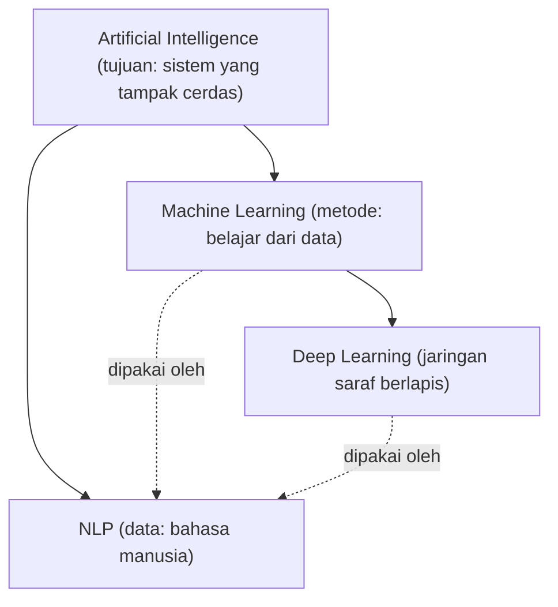
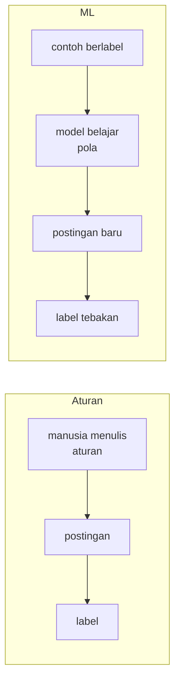

# AI, Machine Learning, Deep Learning, NLP, dan Text Mining

!!! abstract "Info materi"
    **Tingkat kesulitan:** Pemula (tanpa prasyarat). **Estimasi waktu:** 60–75 menit.
    **Jenis kode:** ilustratif (`examples/level-0-orientasi/kata_kunci.py`). Kode boleh dibaca saja; Anda belum perlu menjalankannya.

## Tujuan pembelajaran

- [ ] Membedakan AI, machine learning (ML), deep learning (DL), NLP, dan text mining.
- [ ] Menempatkan klasifikasi pesan darurat pada peta bidang tersebut.
- [ ] Memberi contoh pendekatan berbasis aturan dan berbasis data untuk satu masalah yang sama.
- [ ] Menjelaskan mengapa aturan kata kunci menghasilkan *false positive* dan *false negative*.

## Prasyarat

Tidak ada. Halaman ini adalah titik awal kurikulum.

## Pengantar dan motivasi

Istilah AI, ML, DL, dan NLP sering dipakai bergantian di media, padahal cakupannya berbeda. Memahami perbedaannya
penting sejak awal karena menentukan alat yang kita pilih. Untuk masalah kita (mengenali postingan media sosial yang
melaporkan keadaan darurat), pertanyaannya bukan "pakai AI atau tidak", tetapi **pendekatan apa yang cocok**
dan **bagaimana kita tahu pendekatan itu berhasil**.

## Konsep dasar

Bayangkan lingkaran-lingkaran yang saling melingkupi: sebagian istilah menyebut *tujuan*, sebagian *metode*, sebagian *jenis data*.



| Istilah | Definisi singkat | Ciri pembeda |
|---|---|---|
| **Artificial Intelligence** | Bidang yang membuat sistem melakukan tugas yang biasanya butuh kecerdasan manusia | Cakupan terluas; mencakup sistem berbasis aturan |
| **Machine Learning** | Sistem yang memperbaiki kinerjanya dengan belajar dari data, bukan aturan eksplisit | Ada tahap *training* dari contoh |
| **Deep Learning** | ML dengan jaringan saraf berlapis banyak | Mempelajari representasi sendiri; butuh data dan komputasi lebih besar |
| **Natural Language Processing** | Pemrosesan dan pemahaman bahasa manusia oleh komputer | Datanya teks atau ucapan |
| **Text Mining** | Menggali pola dan informasi dari kumpulan teks | Berorientasi analisis korpus, misalnya topik dan tren |

## Penjelasan mendalam

### NLP ditentukan oleh data, bukan metode

AI, ML, dan DL menyebut *tujuan* atau *cara kerja*. NLP berbeda: ia ditentukan oleh **jenis data** (bahasa manusia).
Sebuah sistem NLP bisa memakai aturan tulisan tangan, ML klasik, atau deep learning. Maka pernyataan
"NLP adalah bagian dari deep learning" tidak tepat.

### NLP dan text mining

Keduanya beririsan besar. Secara praktis, NLP menekankan *bagaimana mesin memproses bahasa* (tokenisasi, klasifikasi, terjemahan),
sedangkan text mining menekankan *temuan* dari kumpulan teks (apa yang dibicarakan orang minggu ini?). Banyak buku
memakainya hampir sinonim; yang penting adalah konsisten dalam satu proyek.

### Dua cara menyelesaikan masalah yang sama

Misalkan tugasnya: menandai postingan yang melaporkan banjir.

1. **Berbasis aturan:** tulis daftar kata kunci atau pola. Cepat dibuat dan mudah dijelaskan, tetapi rapuh terhadap konteks.
2. **Berbasis data (ML):** kumpulkan banyak postingan berlabel, lalu biarkan model menemukan pola kata dan konteks yang
   membedakan laporan dari bukan-laporan.

### Dua jenis kesalahan

| Jenis | Arti | Contoh pada masalah kita |
|---|---|---|
| ***False positive*** | Ditandai laporan, padahal bukan | "Banjir 2020 itu parah ya" ikut ditandai |
| ***False negative*** | Tidak ditandai, padahal laporan | "Tolong, air sudah masuk rumah" lolos karena tak memuat kata "banjir" |

Pada tanggap darurat, false negative bisa berarti pesan yang butuh bantuan tidak terbaca. Kedua jenis kesalahan akan terus kita
bahas, dan nanti kita ukur (Level 5).

!!! tip "Kapan aturan masih masuk akal?"
    Untuk masalah sempit dengan pola jelas (misalnya mendeteksi URL), aturan atau regex sering lebih tepat daripada ML. ML bermanfaat
    ketika pola terlalu beragam untuk ditulis tangan.

## Cara kerja atau alur proses

Pada aturan, manusia menuliskan logikanya; pada ML, logika dipelajari dari contoh:



## Contoh sederhana

Aturan: "jika kalimat memuat kata 'api', itu kebakaran." Kalimat "Api semangat belum padam" ikut tertandai.
Aturan terlalu longgar; menambah pengecualian membuat aturan makin panjang dan tetap tidak lengkap.

## Contoh dalam konteks Twitter/X kebencanaan

| Postingan (sintetis) | Kata kunci "banjir" | Yang kita inginkan |
|---|---|---|
| "Banjir setinggi dada di Jl. Melati, mohon evakuasi" | Emergency | Emergency |
| "Banjir 2020 itu parah ya, jangan sampai terulang" | Emergency | Non-Emergency (kenangan, bukan kejadian berlangsung) |
| "Kemarin banjir sudah surut, jalan bisa dilewati" | Emergency | Non-Emergency (kondisi sudah pulih) |

Contoh ini ilustrasi, bukan dataset beranotasi; label mengikuti definisi di [Masalah Emergency](masalah-emergency.md).

## Praktik Python

Anda belum perlu menulis kode di level ini. Potongan berikut hanya untuk **dibaca**. Berkas: `examples/level-0-orientasi/kata_kunci.py`.

!!! info "Catatan sintaks untuk pemula"
    - Tanda kurung siku `[...]` membuat **list** (daftar). Teks ditulis dalam tanda kutip `"..."`.
    - `def nama(teks):` membuat **fungsi**: blok kode bernama yang menerima masukan (`teks`) dan mengembalikan hasil lewat `return`.
    - `for teks in postingan:` mengulang blok di bawahnya untuk setiap elemen list.
    - `"banjir" in teks` bernilai `True` bila kata itu ada di dalam teks. `.lower()` mengubah teks menjadi huruf kecil.
    - `print(a, "|", b)` mencetak beberapa nilai dipisah spasi.
    Penjelasan lengkap ada di [Level 1](../level-1-python/index.md).

### Bagian 1 — Data

```python title="Bagian 1"
--8<-- "level-0-orientasi/kata_kunci.py:data"
```

Variabel `postingan` menyimpan tiga teks. Tidak ada keluaran karena tidak ada `print`.

### Bagian 2 — Aturan kata kunci

```python title="Bagian 2"
--8<-- "level-0-orientasi/kata_kunci.py:aturan1"
```

Fungsi `tandai_dengan_kata_kunci` mengubah teks menjadi huruf kecil lalu memeriksa apakah `"banjir"` ada. Perulangan mencetak hasil `True`/`False` dan teksnya.

```text title="Output nyata"
True | Banjir setinggi dada di Jl. Melati, mohon evakuasi
True | Banjir 2020 itu parah ya, jangan sampai terulang
True | Kemarin banjir sudah surut, jalan bisa dilewati
```

Interpretasi: ketiganya `True`. Padahal hanya yang pertama laporan yang sedang berlangsung; dua lainnya *false positive*. Aturan hanya melihat keberadaan kata, bukan konteks waktu dan maksud kalimat.

### Bagian 3 — Menambah petunjuk konteks

```python title="Bagian 3"
--8<-- "level-0-orientasi/kata_kunci.py:aturan2"
```

`PETUNJUK_LAMPAU` adalah daftar kata yang menandakan kejadian lampau. `any(p in kecil for p in PETUNJUK_LAMPAU)` bernilai `True` bila **salah satu** petunjuk ada; `not` membalikkannya.

```text title="Output nyata"
True | Banjir setinggi dada di Jl. Melati, mohon evakuasi
False | Banjir 2020 itu parah ya, jangan sampai terulang
False | Kemarin banjir sudah surut, jalan bisa dilewati
```

Interpretasi: tiga contoh tadi kini benar. Aturan berhasil karena kita menulis petunjuk yang kebetulan cocok dengan contoh yang kita lihat.

### Bagian 4 — Aturan yang diperbaiki tetap rapuh

```python title="Bagian 4"
--8<-- "level-0-orientasi/kata_kunci.py:gagal"
```

```text title="Output nyata"
True | Banjir bandang barusan, tolong kirim perahu karet
False | Banjir hari ini sudah surut tapi kami masih butuh makanan, tolong
False | Tolong, air sudah masuk rumah
```

Interpretasi: kalimat pertama benar. Kalimat kedua **seharusnya Emergency** (butuh makanan, minta tolong) tetapi `False` karena memuat "sudah surut". Kalimat ketiga juga seharusnya Emergency tetapi `False` karena tidak memuat kata "banjir". Dua *false negative* sekaligus. Setiap perbaikan aturan menambah pengecualian, dan pengecualian baru selalu muncul. Inilah alasan kita beralih ke pendekatan yang belajar dari data (halaman berikutnya).

### Skrip terpadu

Keempat bagian adalah satu skrip, `kata_kunci.py`. Keluarannya (sembilan baris) adalah gabungan tiga blok di atas.

## Kesalahan umum dan debugging

| Kesalahan | Penjelasan |
|---|---|
| Menganggap AI sama dengan deep learning | Deep learning hanya satu cabang ML, yang sendirinya satu cabang AI |
| Menganggap NLP selalu berarti model besar | Banyak sistem NLP produktif memakai TF-IDF dan regresi logistik |
| Menganggap ML otomatis lebih baik daripada aturan | Tanpa data berlabel memadai, aturan bisa lebih andal |
| Menilai aturan dari beberapa contoh yang sudah dilihat | Aturan hampir selalu tampak benar pada contoh yang dipakai menulisnya |
| Menganggap satu contoh yang benar membuktikan aturan benar | Perlu pengujian pada contoh baru dan evaluasi terukur |

## Kelebihan dan keterbatasan

**Aturan:** cepat dibuat, transparan, tanpa data berlabel. Keterbatasan: tidak mencakup variasi bahasa; harus dirawat manual.
**ML:** belajar pola dari data dan dapat menangani variasi. Keterbatasan: butuh data berlabel berkualitas; hasilnya bergantung data;
perlu evaluasi cermat (Level 5).

## Latihan bertahap

1. **Konseptual.** Apa beda AI, ML, dan DL? Susun dalam satu kalimat tiap istilah.
2. **Membaca kode.** Pada Bagian 2, mengapa `"Kemarin banjir sudah surut, ..."` bernilai `True`?
3. **Klasifikasi kesalahan.** Pada Bagian 4, teks mana yang *false negative*, dan mengapa?
4. **Analisis.** Tulis tiga postingan yang akan tertandai keliru oleh aturan kata kunci "gempa" (*false positive*) dan tiga yang lolos padahal darurat (*false negative*).
5. **Mini-proyek.** Sebutkan satu masalah di sekitar Anda yang lebih baik diselesaikan dengan aturan daripada ML, dan satu yang lebih cocok ML. Jelaskan alasannya.

## Kunci jawaban dan pembahasan

??? success "Jawaban 1"
    AI: bidang membuat sistem melakukan tugas yang butuh kecerdasan. ML: sistem yang belajar dari data. DL: ML dengan jaringan saraf berlapis banyak. Masing-masing lebih sempit daripada yang sebelumnya.

??? success "Jawaban 2"
    Aturan hanya memeriksa keberadaan kata "banjir" pada teks (dalam huruf kecil), dan kata itu ada. Aturan tidak memahami bahwa kejadiannya sudah berlalu.

??? success "Jawaban 3"
    Teks kedua ("Banjir hari ini sudah surut tapi kami masih butuh makanan, tolong") dan ketiga ("Tolong, air sudah masuk rumah"). Keduanya seharusnya Emergency tetapi diberi `False`: yang kedua karena frasa "sudah surut" dianggap petunjuk lampau, yang ketiga karena tidak ada kata "banjir".

??? success "Jawaban 4"
    Jawaban bebas, contoh. *False positive*: "Semoga tidak ada gempa malam ini", "Berita: gempa 1990 di kota ini", "Nonton film gempa semalam". *False negative*: "Tanah bergoyang keras, tembok retak", "Rumah bergetar, kami lari keluar", "Lantai terasa naik-turun, tolong". Perhatikan bahwa darurat bisa dilaporkan tanpa kata kuncinya.

??? success "Jawaban 5"
    Contoh jawaban: aturan cocok untuk memeriksa format nomor telepon (pola tetap, ada definisi jelas); ML cocok untuk mengenali sentimen ulasan (pola beragam dan bergantung konteks). Alasan harus menyebut apakah pola dapat ditulis lengkap dan apakah ada data berlabel.

## Kuis singkat

**1.** Apakah NLP adalah bagian dari deep learning?

??? success "Jawaban"
    Tidak. NLP ditentukan oleh jenis data (bahasa), bukan metode; ia dapat memakai aturan, ML klasik, atau deep learning.

**2.** Mengapa aturan kata kunci "banjir" menghasilkan false positive pada kalimat kenangan banjir 2020?

??? success "Jawaban"
    Aturan hanya melihat keberadaan kata, bukan konteks waktu dan maksud.

**3.** Apa perbedaan penekanan NLP dan text mining?

??? success "Jawaban"
    NLP menekankan pemrosesan bahasa oleh mesin; text mining menekankan penggalian pola dari kumpulan teks. Keduanya beririsan besar.

## Ringkasan

- AI adalah tujuan, ML adalah metode belajar dari data, DL adalah ML berbasis jaringan saraf berlapis.
- NLP didefinisikan oleh data bahasa dan dapat memakai metode apa pun.
- Aturan kata kunci menghasilkan false positive dan false negative; memperbaikinya dengan pengecualian tidak pernah selesai.

## Glosarium istilah baru

Artificial Intelligence (AI)
:   Bidang yang membuat sistem melakukan tugas yang biasanya butuh kecerdasan manusia.

Machine Learning (ML)
:   Pendekatan di mana model belajar pola dari data.

Deep Learning (DL)
:   ML dengan jaringan saraf berlapis banyak.

Natural Language Processing (NLP)
:   Bidang pemrosesan bahasa manusia oleh komputer.

Text mining
:   Penggalian pola dan informasi dari kumpulan teks.

False positive / false negative
:   Ditandai positif padahal bukan / tidak ditandai padahal positif.

## Referensi

- Jurafsky, D., & Martin, J. H. *Speech and Language Processing* (edisi ke-3, draf daring), bab pengantar: <https://web.stanford.edu/~jurafsky/slp3/> (buku teks).
- Imran, M., Castillo, C., Diaz, F., & Vieweg, S. (2015). Processing social media messages in mass emergency: A survey. *ACM Computing Surveys*, 47(4), artikel 67. DOI: 10.1145/2771588 (survei akademik).

Daftar lengkap: [Referensi](../referensi.md).

## Materi selanjutnya

[Hubungan NLP dengan Machine Learning](hubungan-nlp-ml.md)
