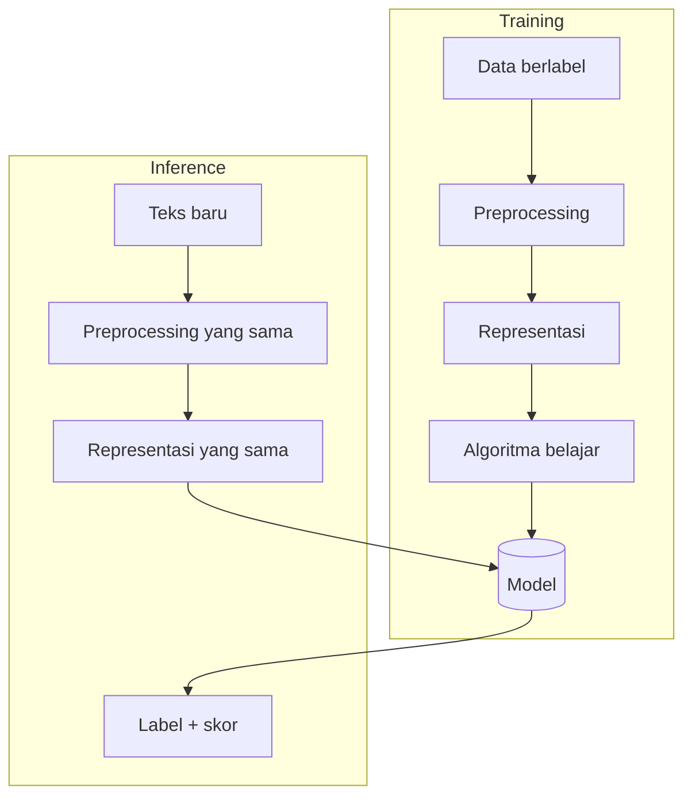

# Cara Kerja Sistem Klasifikasi Teks

!!! abstract "Info materi"
    **Tingkat kesulitan:** Pemula. **Estimasi waktu:** 75–100 menit.
    **Jenis kode:** ilustratif (`examples/level-0-orientasi/klasifikasi_mini.py`). Data latih sangat kecil; bukan eksperimen dan tidak ada evaluasi.

## Tujuan pembelajaran

- [ ] Menjelaskan dua fase sistem klasifikasi: *training* dan *inference*.
- [ ] Menelusuri satu prediksi dari teks hingga label, termasuk nilai antaranya.
- [ ] Mengenali kegagalan khas pada klasifikator yang terlalu sederhana (seri dan kata di luar kosakata).
- [ ] Menjelaskan mengapa preprocessing saat training dan inference harus identik.

## Prasyarat

[Penerapan NLP di Kehidupan Nyata](penerapan-nlp.md). Kode memakai `for`, dictionary, dan function; semuanya dijelaskan singkat di bawah dan lengkap di [Level 1](../level-1-python/index.md).

## Pengantar dan motivasi

Klasifikasi teks adalah tugas memberi satu label dari himpunan tetap pada sebuah teks. Analoginya petugas pos yang memilah surat ke kotak
"darurat" dan "biasa". Petugas itu belajar dari contoh surat yang sudah dipilah sebelumnya (**training**), lalu memilah surat baru
(**inference**). Seluruh Level 4 membangun sistem seperti ini dengan alat yang lebih kuat; di sini kita membuat versi paling sederhana agar setiap
langkahnya dapat diikuti dengan tangan.

## Konsep dasar



Dua aturan penting dari diagram:

1. **Preprocessing dan representasi pada inference harus identik** dengan saat training. Perbedaan kecil membuat model menerima masukan yang tidak pernah dilihatnya.
2. **Training dan inference adalah fase terpisah.** Model tidak boleh melihat data uji saat training.

| Komponen | Peran |
|---|---|
| Data berlabel | Contoh (teks, label) sumber belajar |
| Fitur | Angka yang mewakili teks |
| Model | Parameter hasil belajar |
| Skor | Angka keyakinan model; tidak selalu probabilitas |

## Penjelasan mendalam

### "Model" pada contoh ini

Model kita adalah **tabel frekuensi**: untuk tiap kelas, berapa kali tiap kata muncul pada kalimat latih kelas itu. "Belajar" berarti menghitung tabel itu
dari data. Tidak ada rumus yang rumit; tujuannya memperlihatkan bahwa training = mengekstrak pola statistik dari contoh.

### Cara memprediksi

Untuk teks baru, skor tiap kelas adalah jumlah frekuensi kata-katanya pada kelas itu. Kelas dengan skor tertinggi menjadi prediksi. Ini versi sangat kasar
dari Naive Bayes ([Level 4](../level-4-machine-learning/naive-bayes.md)), yang memakai probabilitas, smoothing, dan prior.

### Dua kelemahan yang langsung terlihat

- **Seri (*tie*)**: bila skor sama, `max` memilih kelas pertama secara kebetulan.
- **Kata di luar kosakata (OOV)**: kata yang tidak ada di data latih tidak memberi informasi.
- Kelemahan lain: kata umum ikut dihitung sama berat; urutan kata tidak dipakai; model tidak bisa mengatakan "tidak yakin" kecuali kita menambahkannya.

## Cara kerja atau alur proses

Tiga langkah pada kode: **(1)** hitung kata per kelas, **(2)** untuk teks baru jumlahkan frekuensi per kelas, **(3)** pilih skor tertinggi.

## Contoh sederhana

Data latih: "air naik" (Emergency), "promo diskon" (Non-Emergency). Tabel: Emergency {air:1, naik:1}, Non-Emergency {promo:1, diskon:1}. Teks baru "air promo": skor
Emergency = 1, Non-Emergency = 1, seri; model tidak punya dasar memilih.

## Contoh dalam konteks Twitter/X kebencanaan

Enam kalimat latih sintetis (tiga Emergency, tiga Non-Emergency). Tiga teks baru dicoba: dua mirip data latih, satu ("halo apa kabar") tidak memuat kata yang dikenal.
Contoh ini **ilustratif**: data terlalu kecil untuk evaluasi apa pun.

## Praktik Python

Berkas: `examples/level-0-orientasi/klasifikasi_mini.py`. Jalankan dari akar repository: `python -X utf8 examples/level-0-orientasi/klasifikasi_mini.py`.

!!! info "Catatan sintaks untuk pemula"
    - `DATA_LATIH` adalah **list** berisi pasangan `(teks, label)` (tuple).
    - `Counter` (pustaka `collections`) menghitung kemunculan elemen; `Counter().update(daftar)` menambahkan hitungan.
    - `{label: ... for label, c in hitung.items()}` adalah *dictionary comprehension*: membuat dictionary dari perulangan.
    - `max(skor, key=skor.get)` memilih kunci dengan nilai terbesar.
    Penjelasan lengkap ada di Level 1.

### Bagian 1 — Data latih

```python title="Bagian 1"
--8<-- "level-0-orientasi/klasifikasi_mini.py:data"
```

Enam pasangan teks dan label. Belum ada keluaran.

### Bagian 2 — Fungsi `latih`

```python title="Bagian 2"
--8<-- "level-0-orientasi/klasifikasi_mini.py:latih"
```

Untuk tiap pasangan, `hitung.setdefault(label, Counter())` membuat `Counter` kosong untuk label baru (atau mengambil yang sudah ada), lalu `.update(teks.split())` menambahkan hitungan kata. Hasilnya dictionary label → `Counter` kata.

### Bagian 3 — Fungsi `prediksi`

```python title="Bagian 3"
--8<-- "level-0-orientasi/klasifikasi_mini.py:prediksi"
```

`skor` dihitung untuk tiap kelas dengan menjumlahkan `c[kata]` (frekuensi kata pada kelas itu; 0 bila tidak ada). `terbaik` adalah kelas bernilai terbesar. Fungsi mengembalikan label dan seluruh skor.

### Bagian 4 — Memeriksa model hasil training

```python title="Bagian 4"
--8<-- "level-0-orientasi/klasifikasi_mini.py:model"
```

```text title="Output nyata"
['Emergency', 'Non-Emergency']
1 1 0
15 18
```

Interpretasi: model berisi dua kelas. Kata `banjir` muncul 1 kali di Emergency dan 1 kali di Non-Emergency (tidak membedakan kelas); `pelatihan` tidak pernah muncul di Emergency (0). Total kata: 15 di Emergency dan 18 di Non-Emergency. **Cara memeriksa:** hitung manual jumlah kata kalimat Emergency (5 + 5 + 5 = 15).

### Bagian 5 — Menelusuri satu prediksi

```python title="Bagian 5"
--8<-- "level-0-orientasi/klasifikasi_mini.py:langkah"
```

```text title="Output nyata"
tolong {'Emergency': 1, 'Non-Emergency': 0}
evakuasi {'Emergency': 1, 'Non-Emergency': 0}
banjir {'Emergency': 1, 'Non-Emergency': 1}
```

Interpretasi: untuk "tolong evakuasi banjir", tiap kata menyumbang skor per kelas. Jumlah Emergency = 1 + 1 + 1 = 3; Non-Emergency = 0 + 0 + 1 = 1. Inilah nilai antara di balik prediksi.

### Bagian 6 — Prediksi pada tiga teks

```python title="Bagian 6"
--8<-- "level-0-orientasi/klasifikasi_mini.py:uji"
```

```text title="Output nyata"
'tolong evakuasi banjir' -> Emergency {'Emergency': 3, 'Non-Emergency': 1}
'pelatihan mitigasi besok' -> Non-Emergency {'Emergency': 0, 'Non-Emergency': 3}
'halo apa kabar' -> Emergency {'Emergency': 0, 'Non-Emergency': 0}
```

Interpretasi:

- Baris 1: skor 3 lawan 1, prediksi Emergency, sesuai hitungan di Bagian 5.
- Baris 2: kata-kata pelatihan condong ke Non-Emergency (3 lawan 0).
- Baris 3: **tidak ada satu pun kata yang dikenal**, skor sama-sama 0, dan `max` memilih kelas pertama secara kebetulan. Prediksi `Emergency` di sini **tidak bermakna**.

!!! danger "Pelajaran penting"
    Model harus mampu mengatakan "tidak yakin". Prediksi yang dipaksakan pada masukan di luar kosakata dapat menyesatkan, apalagi pada konteks darurat.

### Bagian 7 — Perbaikan sederhana: mengakui ketidakpastian

```python title="Bagian 7"
--8<-- "level-0-orientasi/klasifikasi_mini.py:perbaikan"
```

```text title="Output nyata"
Tidak yakin Emergency
```

Interpretasi: bila semua skor sama, fungsi baru mengembalikan `"Tidak yakin"` alih-alih menebak. Teks yang dikenal tetap diprediksi biasa (`Emergency`). Sistem nyata menerapkan gagasan ini dengan ambang keyakinan dan peninjauan manusia.

### Skrip terpadu

Ketujuh bagian adalah satu skrip, `klasifikasi_mini.py`.

## Kesalahan umum dan debugging

| Kesalahan | Penjelasan | Perbaikan |
|---|---|---|
| Preprocessing berbeda saat training dan inference | Kata `Banjir` vs `banjir` dianggap berbeda | Pakai fungsi preprocessing yang sama |
| Menafsirkan skor mentah sebagai probabilitas | Skor di sini hanyalah hitungan | Hati-hati; model lain memberi probabilitas |
| Tidak menangani seri dan kata asing | `max` memilih kelas pertama diam-diam | Tangani seri (Bagian 7) |
| Melatih dan mengevaluasi pada data yang sama | Skor tampak bagus tanpa bukti | Pisahkan data latih dan uji (Level 4) |
| `KeyError` saat membaca tabel | Mengakses kata yang belum ada dengan `dict` biasa | `Counter` mengembalikan 0 untuk kata baru |

## Kelebihan dan keterbatasan

**Kelebihan:** sangat transparan; setiap angka dapat dihitung dengan tangan; tanpa pustaka tambahan.
**Keterbatasan:** semua kata berbobot sama; urutan dan konteks diabaikan; tidak ada probabilitas; data latih kecil membuat banyak kata asing; tidak ada evaluasi.

## Latihan bertahap

1. **Konseptual.** Apa dua fase utama sistem klasifikasi dan apa yang terjadi di masing-masing?
2. **Membaca kode.** Mengapa `model["Emergency"]["pelatihan"]` bernilai 0 dan bukan galat?
3. **Menghitung.** Tentukan skor kedua kelas untuk teks `"gempa besok"`, lalu prediksinya.
4. **Debugging.** Teks `"halo apa kabar"` diprediksi `Emergency`. Jelaskan penyebabnya dan perbaikannya.
5. **Mini-proyek.** Tambahkan dua kalimat latih per kelas pada `DATA_LATIH`. Bagaimana skor tiga teks uji berubah? Apakah ada teks yang prediksinya berubah?

## Kunci jawaban dan pembahasan

??? success "Jawaban 1"
    Training: model belajar dari data berlabel (di sini menghitung frekuensi kata per kelas). Inference: model dipakai memprediksi teks baru dengan preprocessing dan representasi yang sama.

??? success "Jawaban 2"
    `Counter` mengembalikan 0 untuk kunci yang tidak ada, sehingga aman. Pada `dict` biasa akses seperti itu menimbulkan `KeyError`.

??? success "Jawaban 3"
    Di `DATA_LATIH`, `gempa` muncul 0 kali pada kalimat Emergency dan 2 kali pada kalimat Non-Emergency ("pelatihan mitigasi gempa akan digelar besok" dan "berita bmkg gempa kemarin sudah dilaporkan"). `besok` muncul 0 kali di Emergency dan 1 kali di Non-Emergency. Jadi skor Emergency = 0 + 0 = 0 dan skor Non-Emergency = 2 + 1 = 3. Prediksi: Non-Emergency. Anda dapat memeriksanya dengan `prediksi("gempa besok", model)`.

??? success "Jawaban 4"
    Tidak ada kata yang dikenal sehingga kedua skor 0 (seri), dan `max` memilih kelas yang pertama dalam dictionary. Perbaikan: tangani seri, mis. kembalikan "Tidak yakin" (Bagian 7).

??? success "Jawaban 5"
    Tidak ada jawaban tunggal; jalankan sendiri. Harapan: kata baru menambah hitungan sehingga skor tertentu naik; teks yang tadinya seri mungkin tidak lagi seri bila kata-katanya muncul pada data baru. Catat apakah perubahan masuk akal.

## Kuis singkat

**1.** Mengapa preprocessing saat inference harus sama dengan saat training?

??? success "Jawaban"
    Model hanya mengenal bentuk fitur yang dilihat saat training; perbedaan membuat fitur tidak cocok.

**2.** Apa yang salah dengan prediksi pada `'halo apa kabar'`?

??? success "Jawaban"
    Tidak ada bukti dari data; kelas dipilih karena urutan seri, bukan karena sinyal dari teks.

**3.** Apa itu "model" pada contoh ini?

??? success "Jawaban"
    Tabel frekuensi kata per kelas yang dihitung dari data latih.

## Ringkasan

- Klasifikasi = belajar dari contoh berlabel (training) lalu memprediksi teks baru (inference) dengan pipeline yang identik.
- Pada contoh: model = tabel frekuensi kata; skor = jumlah frekuensi; prediksi = skor tertinggi.
- Klasifikator sederhana gagal pada seri dan kata asing; model yang baik perlu menangani ketidakpastian.

## Glosarium istilah baru

Training (pelatihan)
:   Fase model belajar parameter dari data berlabel.

Inference (inferensi)
:   Fase memakai model terlatih untuk memprediksi data baru.

Skor
:   Angka keyakinan atau kecocokan yang dihasilkan model.

Seri (*tie*)
:   Dua kelas memiliki skor yang sama.

Kata di luar kosakata (OOV)
:   Kata baru yang tidak ada di data latih.

## Referensi

- McCallum, A., & Nigam, K. (1998). A comparison of event models for Naive Bayes text classification. *AAAI-98 Workshop on Learning for Text Categorization*, 41–48 (makalah akademik; detail diperiksa daring).
- Dokumentasi scikit-learn, *Working With Text Data*: <https://scikit-learn.org/stable/tutorial/text_analytics/working_with_text_data.html> (dokumentasi resmi).

## Materi selanjutnya

[Memahami Masalah Emergency vs Non-Emergency](masalah-emergency.md)
