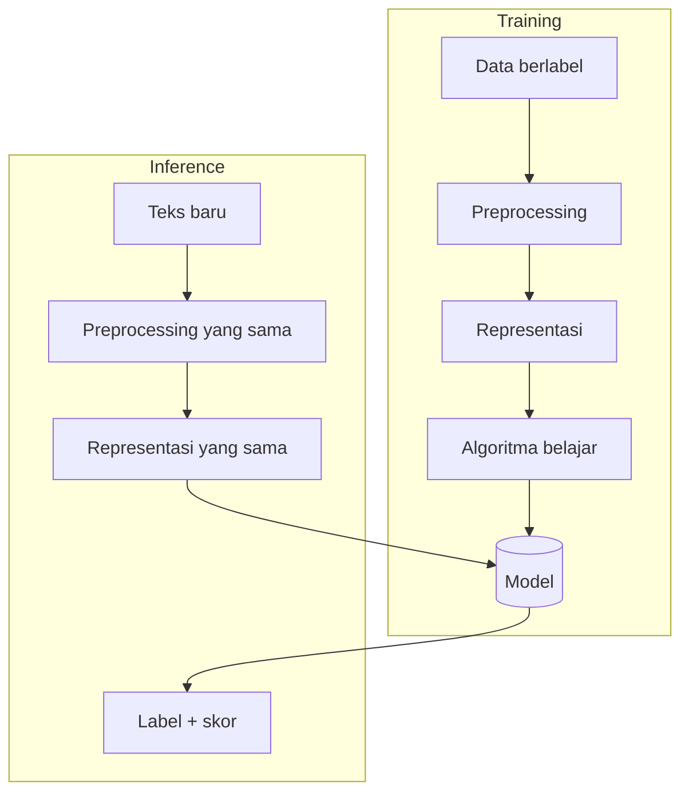

# Cara Kerja Sistem Klasifikasi Teks

## Tujuan pembelajaran

- [ ] Menjelaskan dua fase sistem klasifikasi: *training* dan *inference*.
- [ ] Menelusuri satu prediksi dari teks hingga label.
- [ ] Mengenali kegagalan khas pada klasifikator yang terlalu sederhana.

## Prasyarat

[Penerapan NLP di Kehidupan Nyata](penerapan-nlp.md), dasar Python (cukup `for`, `dict`, dan `function`; dipelajari lebih dalam di Level 1).

## Pengantar dan intuisi

Klasifikasi teks adalah tugas memberi satu label dari himpunan tetap pada
sebuah teks. Analoginya petugas pos yang memilah surat ke kotak "darurat" dan
"biasa". Petugas itu belajar dari contoh surat yang sudah dipilah sebelumnya
(training), lalu memilah surat baru (inference).

## Konsep



Dua aturan penting dari diagram:

1. **Langkah preprocessing dan representasi pada inference harus identik** dengan saat training. Perbedaan kecil membuat model menerima masukan yang tidak pernah dilihatnya.
2. **Training dan inference adalah fase terpisah.** Model tidak boleh melihat data uji saat training.

### Komponen

| Komponen | Peran |
|---|---|
| Data berlabel | Contoh (teks, label) sumber belajar |
| Fitur | Angka yang mewakili teks |
| Model | Parameter hasil belajar |
| Skor | Angka keyakinan model; tidak selalu probabilitas |

## Contoh kontekstual kebencanaan

Kita bangun klasifikator mini yang menghitung kata per kelas pada enam
kalimat latih. Ini **contoh ilustratif**: data terlalu kecil untuk evaluasi
apa pun.

## Contoh kode

```python title="klasifikasi_mini.py" linenums="1"
--8<-- "level-0-orientasi/klasifikasi_mini.py"
```

### Penjelasan kode

1. `DATA_LATIH` adalah list pasangan `(teks, label)`.
2. `latih` membuat `Counter` kata untuk tiap label. Inilah "model" kita: tabel frekuensi.
3. `prediksi` menjumlahkan frekuensi tiap kata pada teks baru di tiap kelas, lalu memilih kelas dengan skor tertinggi.
4. Blok `__main__` mencoba tiga teks baru.

Cara menjalankan dari akar repository:

```bash
python examples/level-0-orientasi/klasifikasi_mini.py
```

### Output dan interpretasi

Output berikut berasal dari eksekusi nyata:

```text
'tolong evakuasi banjir' -> Emergency {'Emergency': 3, 'Non-Emergency': 1}
'pelatihan mitigasi besok' -> Non-Emergency {'Emergency': 0, 'Non-Emergency': 3}
'halo apa kabar' -> Emergency {'Emergency': 0, 'Non-Emergency': 0}
```

- Baris 1: kata `tolong`, `evakuasi`, dan `banjir` muncul total 3 kali di kelas Emergency dan 1 kali (`banjir`) di Non-Emergency.
- Baris 2: kata-kata pelatihan condong ke Non-Emergency.
- Baris 3: **tidak ada satu pun kata yang dikenal**, skor sama-sama 0, dan `max` memilih kelas pertama secara kebetulan. Prediksi `Emergency` di sini tidak bermakna.

!!! danger "Pelajaran penting"
    Model harus mampu mengatakan "tidak yakin". Prediksi yang dipaksakan pada
    masukan di luar kosakata dapat menyesatkan, apalagi pada konteks darurat.

## Kesalahan umum

- Memakai preprocessing berbeda saat training dan inference.
- Menafsirkan skor mentah sebagai probabilitas.
- Tidak menangani seri (*tie*) dan kata di luar kosakata.
- Melatih dan mengevaluasi pada data yang sama.

## Latihan mandiri

1. Tambahkan dua kalimat latih per kelas. Bagaimana skor tiga teks uji berubah?
2. Ubah `prediksi` agar mengembalikan `"Tidak yakin"` ketika semua skor sama.
3. Buat satu teks yang diprediksi Emergency padahal bukan. Mengapa model keliru?
4. Mengapa skor kata umum seperti `yang` seharusnya diberi bobot kecil? (Petunjuk: lihat TF-IDF di Level 3.)

## Kuis singkat

**1.** Mengapa preprocessing saat inference harus sama dengan saat training?

??? success "Jawaban"
    Model hanya mengenal bentuk fitur yang dilihatnya saat training; perbedaan membuat fitur tidak cocok.

**2.** Apa yang salah dengan prediksi pada `'halo apa kabar'`?

??? success "Jawaban"
    Tidak ada bukti dari data; kelas dipilih karena urutan seri, bukan karena sinyal dari teks.

**3.** Apa dua fase utama sistem klasifikasi?

??? success "Jawaban"
    Training (belajar dari data berlabel) dan inference (memprediksi teks baru).

## Ringkasan

Klasifikasi = belajar dari contoh berlabel lalu memprediksi teks baru dengan
pipeline yang identik. Klasifikator sederhana gagal pada seri dan kata asing,
dan model yang baik perlu menangani ketidakpastian.

## Referensi

- McCallum, A., & Nigam, K. (1998). A comparison of event models for Naive Bayes text classification.
- Dokumentasi scikit-learn: *Working with text data* (<https://scikit-learn.org/stable/tutorial/text_analytics/working_with_text_data.html>).

## Materi selanjutnya

[Memahami Masalah Emergency vs Non-Emergency](masalah-emergency.md)
