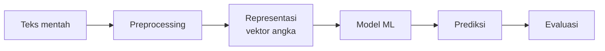

# Hubungan NLP dengan Machine Learning

## Tujuan pembelajaran

- [ ] Menjelaskan mengapa teks harus diubah menjadi angka sebelum dipelajari model ML.
- [ ] Menggambarkan alur umum NLP berbasis ML dari teks mentah hingga prediksi.
- [ ] Menyebutkan tantangan khas bahasa yang tidak dimiliki data tabel biasa.

## Prasyarat

[AI, ML, Deep Learning, NLP, dan Text Mining](ai-ml-dl-nlp.md).

## Pengantar dan intuisi

Algoritma ML pada dasarnya adalah fungsi matematika: menerima angka,
mengeluarkan angka. Teks bukan angka. Maka hampir seluruh pekerjaan NLP
berbasis ML adalah menjawab dua pertanyaan:

1. **Bagaimana mengubah teks menjadi angka tanpa membuang informasi penting?** (representasi)
2. **Bagaimana memakai angka itu untuk membuat keputusan?** (model)

Bagian pertama itulah kontribusi khas NLP. Bagian kedua memakai ML umum.

## Konsep

### Alur umum



| Tahap | Pertanyaan utama | Dibahas di |
|---|---|---|
| Preprocessing | Apa yang dibersihkan atau dipertahankan? | Level 2 |
| Representasi | Bagaimana teks menjadi vektor? | Level 3 |
| Model | Algoritma apa yang memetakan vektor ke label? | Level 4 |
| Evaluasi | Apakah model benar-benar baik? | Level 5 |

### Mengapa teks lebih sulit daripada data tabel

- **Dimensi tinggi dan jarang (sparse)**: kosakata puluhan ribu kata, tetapi satu postingan hanya memakai belasan.
- **Urutan dan konteks**: "korban tidak selamat" dan "selamat, tidak ada korban" memakai kata mirip dengan arti berlawanan.
- **Ambiguitas**: "api" bisa berarti kebakaran atau sekadar nama.
- **Variasi tulisan**: `tolong`, `tlong`, `tolooong`, `TOLONG!!`.
- **Bahasa informal dan campuran**: singkatan, bahasa daerah, dan istilah Inggris.

### Tiga generasi pendekatan

| Generasi | Representasi | Contoh | Kelemahan utama |
|---|---|---|---|
| Aturan | Pola tulisan tangan | Regex, kamus kata kunci | Tidak skalabel |
| ML klasik | Fitur hasil rekayasa (BoW, TF-IDF) | Naive Bayes, SVM | Mengabaikan urutan dan makna kata |
| Deep learning | Representasi dipelajari (embedding, Transformer) | LSTM, BERT | Butuh data dan komputasi |

Kurikulum ini mengikuti urutan tersebut karena setiap generasi memperbaiki
kelemahan sebelumnya, dan karena baseline klasik sering sangat sulit dikalahkan
pada data kecil.

## Contoh kontekstual kebencanaan

Dua kalimat dengan kata hampir sama:

- "Korban **tidak** selamat, mohon bantuan"
- "**Selamat**, **tidak** ada korban"

Representasi *bag of words* hanya menghitung kata, sehingga kedua kalimat
tampak serupa. Inilah contoh keterbatasan representasi yang akan kita
selidiki di Level 3, dan alasan n-gram serta model kontekstual diperkenalkan.

## Contoh kode

Ilustrasi paling sederhana "teks menjadi angka": menghitung kemunculan kata
dengan pustaka standar.

```python
from collections import Counter

kalimat = ["korban tidak selamat", "selamat tidak ada korban"]

for k in kalimat:
    print(sorted(Counter(k.split()).items()))
```

### Penjelasan kode

1. `Counter` menghitung berapa kali tiap elemen muncul.
2. `k.split()` memecah kalimat menjadi kata berdasarkan spasi.
3. `sorted(...)` mengurutkan pasangan (kata, jumlah) agar mudah dibandingkan.

### Output dan interpretasi

```text
[('korban', 1), ('selamat', 1), ('tidak', 1)]
[('ada', 1), ('korban', 1), ('selamat', 1), ('tidak', 1)]
```

Kedua kalimat berbagi tiga kata yang sama. Hanya kata `ada` yang membedakan.
Urutan kata, yang membawa makna "tidak selamat" versus "selamat, tidak ada",
hilang dalam representasi ini.

## Kesalahan umum

- Mengira model "memahami" teks. Model mempelajari pola statistik dari representasi yang kita berikan.
- Memilih algoritma canggih sebelum memeriksa kualitas label dan representasi.
- Memperlakukan teks seperti kolom angka biasa tanpa memikirkan kebocoran data (dibahas di Level 2).

## Latihan mandiri

1. Ubah dua kalimat berbeda arti dengan kata sama menjadi `Counter`. Apakah hasilnya identik?
2. Tulis tiga contoh ambiguitas kata dalam konteks kebencanaan.
3. Gambar alur pada diagram di atas untuk kasus "mendeteksi permintaan bantuan".

## Kuis singkat

**1.** Mengapa teks harus direpresentasikan sebagai angka?

??? success "Jawaban"
    Algoritma ML bekerja dengan operasi numerik; representasi mengubah teks menjadi vektor sehingga operasi itu dapat dilakukan.

**2.** Apa kelemahan utama *bag of words*?

??? success "Jawaban"
    Urutan kata dan konteks hilang, sehingga kalimat dengan makna berlawanan dapat tampak serupa.

**3.** Mengapa baseline ML klasik tetap penting walau ada deep learning?

??? success "Jawaban"
    Ia cepat, murah, mudah diinterpretasi, dan sering kompetitif pada data kecil; sebagai pembanding ia juga menunjukkan apakah model rumit memang bermanfaat.

## Ringkasan

NLP berbasis ML = preprocessing → representasi → model → evaluasi. Tantangan
khas bahasa adalah dimensi tinggi, konteks, ambiguitas, dan variasi tulisan.

## Referensi

- Jurafsky & Martin, *Speech and Language Processing*, bab klasifikasi teks.
- Manning, Raghavan, & Schütze (2008), *Introduction to Information Retrieval*, bab *vector space model*.

## Materi selanjutnya

[Penerapan NLP di Kehidupan Nyata](penerapan-nlp.md)
