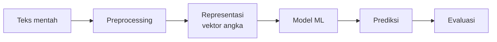
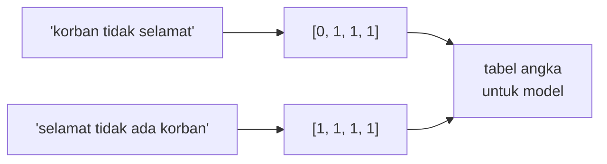

# Hubungan NLP dengan Machine Learning

!!! abstract "Info materi"
    **Tingkat kesulitan:** Pemula. **Estimasi waktu:** 60–75 menit.
    **Jenis kode:** ilustratif (`examples/level-0-orientasi/teks_ke_angka.py`); kode boleh dibaca saja.

## Tujuan pembelajaran

- [ ] Menjelaskan mengapa teks harus diubah menjadi angka sebelum dipelajari model ML.
- [ ] Menggambarkan alur umum NLP berbasis ML dari teks mentah hingga evaluasi.
- [ ] Menyebutkan tantangan khas bahasa yang tidak dimiliki data tabel biasa.
- [ ] Menjelaskan keterbatasan representasi "kantong kata" dengan contoh.

## Prasyarat

[AI, ML, Deep Learning, NLP, dan Text Mining](ai-ml-dl-nlp.md).

## Pengantar dan motivasi

Algoritma ML pada dasarnya adalah fungsi matematika: menerima angka, mengeluarkan angka. Teks bukan angka. Maka hampir seluruh
pekerjaan NLP berbasis ML adalah menjawab dua pertanyaan:

1. **Bagaimana mengubah teks menjadi angka tanpa membuang informasi penting?** (representasi)
2. **Bagaimana memakai angka itu untuk membuat keputusan?** (model)

Bagian pertama adalah kontribusi khas NLP; bagian kedua memakai ML umum.

## Konsep dasar

### Alur umum



| Tahap | Pertanyaan utama | Dibahas di |
|---|---|---|
| Preprocessing | Apa yang dibersihkan atau dipertahankan? | [Level 2](../level-2-fondasi-teks/index.md) |
| Representasi | Bagaimana teks menjadi vektor? | [Level 3](../level-3-representasi-teks/index.md) |
| Model | Algoritma apa yang memetakan vektor ke label? | [Level 4](../level-4-machine-learning/index.md) |
| Evaluasi | Apakah model benar-benar baik? | [Level 5](../level-5-evaluasi/index.md) |

**Vektor** adalah daftar angka dengan urutan tetap, misalnya `[1, 0, 1]`. Satu teks menjadi satu vektor; kumpulan teks menjadi
tabel angka (baris = teks, kolom = fitur).

## Penjelasan mendalam

### Mengapa teks lebih sulit daripada data tabel

- **Dimensi tinggi dan jarang (*sparse*)**: kosakata puluhan ribu kata, tetapi satu postingan hanya memakai belasan.
- **Urutan dan konteks**: "korban tidak selamat" dan "selamat, tidak ada korban" memakai kata mirip dengan arti berlawanan.
- **Ambiguitas**: "api" bisa berarti kebakaran atau sekadar nama.
- **Variasi tulisan**: `tolong`, `tlong`, `tolooong`, `TOLONG!!`.
- **Bahasa informal dan campuran**: singkatan, bahasa daerah, istilah Inggris.

### Tiga generasi pendekatan

| Generasi | Representasi | Contoh | Kelemahan utama |
|---|---|---|---|
| Aturan | Pola tulisan tangan | Regex, kamus kata kunci | Tidak skalabel |
| ML klasik | Fitur hasil rekayasa (BoW, TF-IDF) | Naive Bayes, SVM | Mengabaikan urutan dan makna kata |
| Deep learning | Representasi dipelajari (embedding, Transformer) | LSTM, BERT | Butuh data dan komputasi |

Kurikulum ini mengikuti urutan tersebut karena setiap generasi memperbaiki kelemahan sebelumnya, dan karena baseline klasik sering
sangat sulit dikalahkan pada data kecil. **Kita tidak mengasumsikan model yang lebih rumit pasti lebih baik**; itu selalu diuji.

### Kantong kata (*bag of words*): ide dasarnya

Hitung berapa kali tiap kata muncul, abaikan urutannya. Setiap teks menjadi satu baris angka. Cara ini sederhana, dan di Level 3 kita
pelajari secara penuh bersama kelemahannya.

## Cara kerja atau alur proses

Dari dua kalimat menjadi tabel angka:



(Kolom berurutan: `ada`, `korban`, `selamat`, `tidak`; dihitung pada Bagian 2.)

## Contoh sederhana

Dua kalimat: "air naik" dan "air surut". Kosakata: `air`, `naik`, `surut`. Vektor: `[1, 1, 0]` dan `[1, 0, 1]`. Kata `air`
muncul di keduanya sehingga tidak membedakan; `naik` dan `surut` yang membedakan.

## Contoh dalam konteks Twitter/X kebencanaan

Dua kalimat dengan kata hampir sama:

- "Korban **tidak** selamat, mohon bantuan"
- "**Selamat**, **tidak** ada korban"

Representasi kantong kata hanya menghitung kata, sehingga kedua kalimat tampak serupa. Inilah keterbatasan representasi yang akan kita
selidiki di Level 3, dan alasan n-gram serta model kontekstual diperkenalkan.

## Praktik Python

Anda cukup **membaca** kode ini. Berkas: `examples/level-0-orientasi/teks_ke_angka.py`.

!!! info "Catatan sintaks untuk pemula"
    - `Counter(...)` (dari pustaka standar `collections`) menghitung berapa kali tiap elemen muncul.
    - `k.split()` memecah kalimat menjadi daftar kata berdasarkan spasi.
    - `sorted(...)` mengurutkan; `{... for ...}` membuat **set** (himpunan elemen unik) dan `[... for ...]` membuat **list**.
    - `zip(a, b)` memasangkan dua daftar elemen demi elemen.
    Penjelasan lengkap ada di [Level 1](../level-1-python/index.md).

### Bagian 1 — Menghitung kata

```python title="Bagian 1"
--8<-- "level-0-orientasi/teks_ke_angka.py:counter"
```

`for k in kalimat` mengulang dua kalimat. `Counter(k.split()).items()` memberi pasangan (kata, jumlah); `sorted` mengurutkannya agar mudah dibandingkan.

```text title="Output nyata"
[('korban', 1), ('selamat', 1), ('tidak', 1)]
[('ada', 1), ('korban', 1), ('selamat', 1), ('tidak', 1)]
```

Interpretasi: kedua kalimat berbagi tiga kata yang sama; hanya kata `ada` yang membedakan. Urutan kata, yang membawa makna "tidak selamat" versus "selamat, tidak ada", hilang.

### Bagian 2 — Menjadi vektor berukuran sama

```python title="Bagian 2"
--8<-- "level-0-orientasi/teks_ke_angka.py:kosakata"
```

`kosakata` adalah daftar kata unik dari semua kalimat, diurutkan. `vektor` memuat, untuk tiap kalimat, jumlah kemunculan tiap kata kosakata (selalu dengan urutan kolom yang sama).

```text title="Output nyata"
['ada', 'korban', 'selamat', 'tidak']
[0, 1, 1, 1] <- korban tidak selamat
[1, 1, 1, 1] <- selamat tidak ada korban
```

Interpretasi: setiap kalimat sekarang adalah daftar empat angka dengan arti kolom yang sama (`ada`, `korban`, `selamat`, `tidak`). Inilah yang dapat diterima model ML. **Cara memeriksa:** panjang vektor sama dengan jumlah kata kosakata (4).

### Bagian 3 — Urutan hilang

```python title="Bagian 3"
--8<-- "level-0-orientasi/teks_ke_angka.py:urutan"
```

```text title="Output nyata"
True
```

Interpretasi: kalimat dengan urutan terbalik menghasilkan hitungan kata yang **identik** (`True`). Representasi ini tidak membedakannya.

### Bagian 4 — Variasi tulisan

```python title="Bagian 4"
--8<-- "level-0-orientasi/teks_ke_angka.py:variasi"
```

```text title="Output nyata"
4 4 3
```

Interpretasi: tiga angka berurutan menunjukkan banyaknya "kata" berbeda pada tiga tahap. Mentah: 4 (`tolong`, `tlong`, `tolooong`, `TOLONG!!`). Setelah huruf kecil: tetap 4, karena `tolong!!` masih berbeda dari `tolong` akibat tanda seru. Setelah huruf kecil dan tanda seru dibuang: 3, karena `tolong` dan `TOLONG!!` menyatu. `tlong` dan `tolooong` tetap terpisah; menyatukannya membutuhkan langkah lain (normalisasi). Satu langkah sederhana tidak cukup; preprocessing adalah rangkaian langkah (Level 2).

### Skrip terpadu

Keempat bagian adalah satu skrip: `teks_ke_angka.py`.

## Kesalahan umum dan debugging

| Kesalahan | Penjelasan |
|---|---|
| Mengira model "memahami" teks | Model mempelajari pola statistik dari representasi yang kita berikan |
| Memilih algoritma canggih sebelum memeriksa label dan representasi | Kualitas data dan representasi sering lebih menentukan |
| Memperlakukan teks seperti kolom angka biasa | Ada isu khusus: urutan, ambiguitas, kebocoran data (Level 2) |
| Mengubah urutan kolom antara latih dan uji | Arti kolom bergeser; vektor tidak sebanding |

## Kelebihan dan keterbatasan

**Kantong kata:** sederhana, cepat, mudah ditafsirkan. Keterbatasan: urutan dan konteks hilang; kata baru tidak dikenal; variasi tulisan
memecah hitungan. Pendekatan lanjutan (n-gram, embedding, Transformer) memperbaiki sebagian, dengan biaya data dan komputasi.

## Latihan bertahap

1. **Konseptual.** Mengapa ML membutuhkan angka, bukan teks?
2. **Membaca kode.** Pada Bagian 2, mengapa vektor kalimat pertama berawalan 0?
3. **Mengisi kode.** Untuk kosakata `['air', 'naik', 'surut']`, tulis vektor "air surut".
4. **Menganalisis.** Tulis dua pasang kalimat darurat yang kata-katanya sama tetapi artinya berlawanan.
5. **Mini-proyek.** Gambar alur untuk mendeteksi permintaan bantuan, dari teks mentah sampai evaluasi, dan tulis satu keputusan pada tiap tahap.

## Kunci jawaban dan pembahasan

??? success "Jawaban 1"
    Algoritma ML dibangun dari operasi numerik (penjumlahan, perkalian, jarak). Representasi mengubah teks menjadi vektor agar operasi itu dapat dilakukan.

??? success "Jawaban 2"
    Kolom pertama adalah kata `ada`, yang tidak muncul pada "korban tidak selamat", sehingga nilainya 0.

??? success "Jawaban 3"
    `[1, 0, 1]`: `air` 1, `naik` 0, `surut` 1.

??? success "Jawaban 4"
    Contoh: "ada korban jiwa" vs "tidak ada korban jiwa" (negasi); "air masuk ke rumah" vs "rumah masuk ke air"? (urutan mengubah makna). Kunci: kata sama, makna berbeda karena urutan atau negasi.

??? success "Jawaban 5"
    Contoh: teks mentah → (preprocessing: huruf kecil, buang URL) → (representasi: kantong kata) → (model: pengklasifikasi) → (prediksi: permintaan bantuan atau bukan) → (evaluasi: recall untuk permintaan bantuan). Keputusan boleh berbeda; yang penting tahapnya berurutan dan masing-masing punya alasan.

## Kuis singkat

**1.** Mengapa teks harus direpresentasikan sebagai angka?

??? success "Jawaban"
    Algoritma ML bekerja dengan operasi numerik; representasi mengubah teks menjadi vektor.

**2.** Apa kelemahan utama kantong kata?

??? success "Jawaban"
    Urutan dan konteks hilang sehingga kalimat bermakna berlawanan dapat tampak serupa.

**3.** Mengapa baseline ML klasik tetap penting?

??? success "Jawaban"
    Cepat, murah, mudah ditafsirkan, sering kompetitif pada data kecil, dan menunjukkan apakah model rumit memang bermanfaat.

## Ringkasan

- NLP berbasis ML: preprocessing → representasi → model → evaluasi.
- Teks diubah menjadi vektor angka dengan urutan kolom tetap.
- Kantong kata kehilangan urutan; variasi tulisan memecah hitungan.
- Model yang lebih rumit tidak otomatis lebih baik; selalu diuji.

## Glosarium istilah baru

Vektor
:   Daftar angka dengan urutan tetap.

Representasi
:   Cara mengubah teks menjadi angka yang dapat diproses model.

Kantong kata (*bag of words*)
:   Representasi berupa hitungan kata tanpa urutan.

Kosakata (*vocabulary*)
:   Himpunan kata unik yang menjadi kolom vektor.

Sparse
:   Sebagian besar elemennya nol.

## Referensi

- Jurafsky, D., & Martin, J. H. *Speech and Language Processing* (edisi ke-3, draf daring): <https://web.stanford.edu/~jurafsky/slp3/> (buku teks).
- Manning, C. D., Raghavan, P., & Schütze, H. (2008). *Introduction to Information Retrieval*. Cambridge University Press (buku; model ruang vektor).

## Materi selanjutnya

[Penerapan NLP di Kehidupan Nyata](penerapan-nlp.md)
