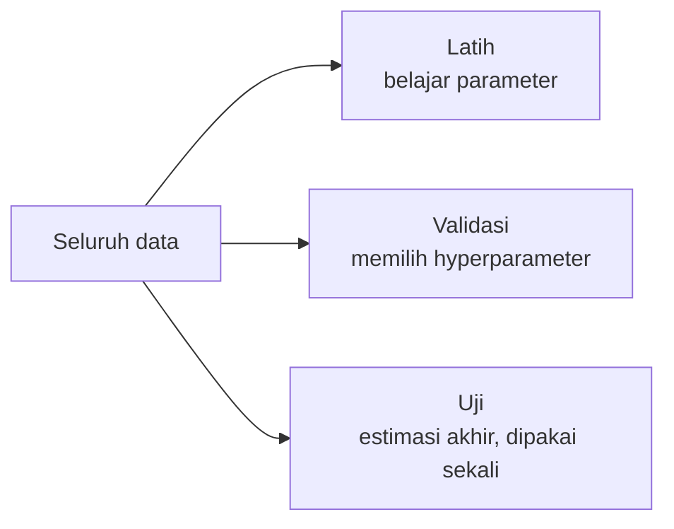

# Dataset, Fitur, Label, Model, Training, dan Inference

## Tujuan pembelajaran

- [ ] Mendefinisikan dataset, fitur, label, model, training, dan inference dengan tepat.
- [ ] Menunjuk istilah-istilah itu pada contoh kode.
- [ ] Menjelaskan mengapa data latih dan data uji harus dipisahkan.

## Prasyarat

[Cara Kerja Sistem Klasifikasi Teks](cara-kerja-klasifikasi-teks.md).

## Pengantar dan intuisi

Enam istilah ini muncul di hampir setiap halaman berikutnya. Analogi: siswa
belajar dari **soal latihan beserta kunci jawaban** (dataset berlabel),
kemudian mengerjakan **ujian dengan soal yang belum pernah dilihat** (inference
pada data uji). Nilai ujian menunjukkan kemampuan sebenarnya, bukan hafalan.

## Konsep

| Istilah | Definisi | Contoh di proyek |
|---|---|---|
| **Dataset** | Kumpulan contoh | Tabel postingan dan label |
| **Contoh (sample)** | Satu baris dataset | Satu postingan |
| **Fitur (feature), X** | Angka yang mewakili contoh | Vektor TF-IDF postingan |
| **Label / target, y** | Jawaban benar | `Emergency` atau `Non-Emergency` |
| **Model** | Fungsi/parameter yang dipelajari: fitur → prediksi | Regresi logistik terlatih |
| **Training** | Mencari parameter model dari data berlabel | `model.fit(X_latih, y_latih)` |
| **Inference** | Memakai model terlatih untuk data baru | `model.predict(teks_baru)` |
| **Parameter** | Nilai yang dipelajari model | Bobot tiap kata |
| **Hyperparameter** | Pengaturan yang kita pilih sebelum training | Kekuatan regularisasi `C` |

### Pembagian data



Data uji tidak boleh dipakai dalam keputusan apa pun selama pengembangan;
jika dipakai, skornya menjadi terlalu optimistis (kebocoran data).

## Contoh kontekstual kebencanaan

Tabel dataset sintetis (ilustratif):

| text | label |
|---|---|
| banjir setinggi dada mohon evakuasi | Emergency |
| rumah terbakar tolong kirim bantuan | Emergency |
| jalan sudah bersih setelah banjir kemarin | Non-Emergency |
| pelatihan mitigasi gempa besok | Non-Emergency |

## Contoh kode

```python title="istilah_dasar.py" linenums="1"
--8<-- "level-0-orientasi/istilah_dasar.py"
```

### Penjelasan kode

1. `dataset` adalah list pasangan `(teks, label)`.
2. `ekstrak_fitur` mengubah teks menjadi kamus fitur: jumlah kata dan penanda permintaan.
3. `X` berisi fitur, `y` berisi label. Pemisahan X/y adalah konvensi di seluruh ML.
4. "Training" di sini adalah aturan paling sederhana: label yang paling sering bersama `ada_permintaan == 1`. Model nyata (Level 4) jauh lebih kaya.
5. `prediksi` adalah inference pada teks baru.

### Output dan interpretasi

Output nyata:

```text
X[0] = {'jumlah_kata': 5, 'ada_permintaan': 1}
y    = ['Emergency', 'Emergency', 'Non-Emergency', 'Non-Emergency']
model = Emergency
'tolong ada kebakaran di pasar' -> Emergency
'berita gempa hari ini' -> Non-Emergency
```

Kedua prediksi sesuai harapan, tetapi **hanya empat contoh latih** dan dua
teks uji yang kebetulan mudah. Ini tidak membuktikan model baik. Ia hanya
menunjukkan alur data → fitur → model → prediksi.

## Kesalahan umum

- Menyamakan fitur dan label, atau memasukkan label sebagai fitur (kebocoran paling kasar).
- Mengevaluasi model pada data yang dipakai untuk melatihnya.
- Mengira hyperparameter dipelajari model; ia dipilih oleh kita.
- Memakai data uji berulang kali untuk memilih model.

## Latihan mandiri

1. Tambahkan fitur `ada_url` pada `ekstrak_fitur`. Apa dampaknya pada `X`?
2. Tentukan mana yang parameter dan mana yang hyperparameter: bobot kata, jumlah pohon, laju belajar, intercept.
3. Jelaskan dengan kalimat Anda sendiri mengapa evaluasi pada data latih menyesatkan.

## Kuis singkat

**1.** Apa perbedaan training dan inference?

??? success "Jawaban"
    Training menyesuaikan parameter dari data berlabel; inference memakai parameter tetap untuk memprediksi data baru.

**2.** Untuk apa data validasi?

??? success "Jawaban"
    Memilih hyperparameter dan model tanpa menyentuh data uji.

**3.** `X` dan `y` pada tugas kita masing-masing berisi apa?

??? success "Jawaban"
    `X` berisi representasi numerik teks, `y` berisi label Emergency/Non-Emergency.

## Ringkasan

Dataset berisi contoh; tiap contoh punya fitur (X) dan label (y); training
mempelajari model dari data latih; inference memakainya pada data baru; data
uji harus tetap terpisah.

## Referensi

- Dokumentasi scikit-learn: *Cross-validation: evaluating estimator performance* (<https://scikit-learn.org/stable/modules/cross_validation.html>).

## Materi selanjutnya

[Persiapan Python, Virtual Environment, pip, Jupyter, dan Git](persiapan-python.md)
