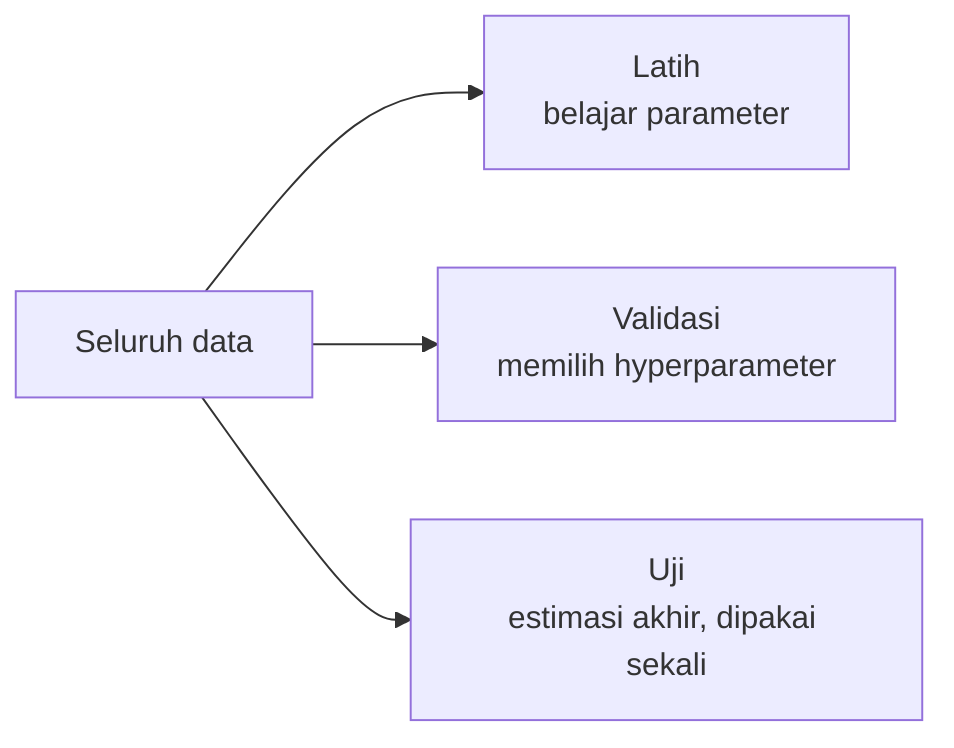
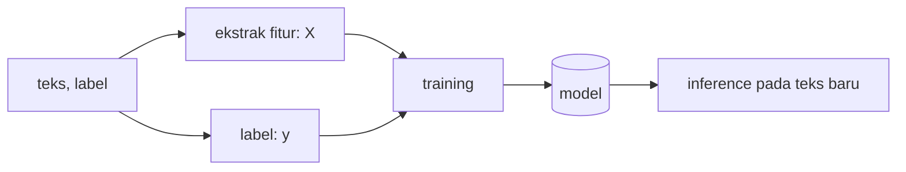

# Dataset, Fitur, Label, Model, Training, dan Inference

!!! abstract "Info materi"
    **Tingkat kesulitan:** Pemula. **Estimasi waktu:** 75–100 menit.
    **Jenis kode:** ilustratif (`examples/level-0-orientasi/istilah_dasar.py`). Data sangat kecil dan sintetis; angka akurasi di halaman ini bukan hasil eksperimen yang bermakna.

## Tujuan pembelajaran

- [ ] Mendefinisikan dataset, fitur, label, model, training, dan inference dengan tepat.
- [ ] Menunjuk tiap istilah pada baris kode contoh.
- [ ] Menjelaskan mengapa data latih dan data uji harus dipisahkan, dengan bukti dari contoh.
- [ ] Membedakan parameter dan hyperparameter.

## Prasyarat

[Cara Kerja Sistem Klasifikasi Teks](cara-kerja-klasifikasi-teks.md).

## Pengantar dan motivasi

Enam istilah ini muncul di hampir setiap halaman berikutnya. Analogi: siswa belajar dari **soal latihan beserta kunci jawaban** (dataset berlabel), lalu mengerjakan **ujian dengan soal yang belum pernah dilihat** (inference pada data uji). Nilai ujian menunjukkan kemampuan sebenarnya; nilai pada soal latihan yang sudah dihafal tidak.

## Konsep dasar

| Istilah | Definisi | Contoh di proyek |
|---|---|---|
| **Dataset** | Kumpulan contoh | Tabel postingan dan label |
| **Contoh (*sample*)** | Satu baris dataset | Satu postingan |
| **Fitur (*feature*), `X`** | Angka yang mewakili contoh | Vektor TF-IDF postingan |
| **Label / target, `y`** | Jawaban benar | `Emergency` atau `Non-Emergency` |
| **Model** | Fungsi dengan parameter yang dipelajari: fitur → prediksi | Regresi logistik terlatih |
| **Training** | Mencari parameter model dari data berlabel | `model.fit(X_latih, y_latih)` |
| **Inference** | Memakai model terlatih untuk data baru | `model.predict(teks_baru)` |
| **Parameter** | Nilai yang dipelajari model | Bobot tiap kata |
| **Hyperparameter** | Pengaturan yang kita pilih sebelum training | Kekuatan regularisasi `C` |

## Penjelasan mendalam

### Fitur versus label

Fitur adalah **masukan** model; label adalah **jawaban** yang ingin ditebak. Jika label ikut menjadi fitur, model bisa "mengintip jawaban" dan skornya palsu. Itu bentuk paling kasar dari **kebocoran data** (*data leakage*).

### Pembagian data



Data uji tidak boleh dipakai dalam keputusan apa pun selama pengembangan; jika dipakai, skornya menjadi terlalu optimistis. Alasannya sama dengan siswa yang melihat soal ujian sebelum ujian.

### Parameter versus hyperparameter

Parameter **dipelajari** model dari data (bobot kata). Hyperparameter **dipilih oleh kita** sebelum training (misalnya `C`, jumlah pohon, laju belajar). Hyperparameter dipilih dengan data validasi, bukan data uji.

## Cara kerja atau alur proses



## Contoh sederhana

Tiga siswa: Ani, Budi, Citra mengerjakan 4 soal latihan dan semuanya benar karena soalnya dihafal. Pada ujian baru, nilai mereka 2 dari 4. Nilai latihan (100%) tidak mewakili kemampuan; nilai ujian (50%) lebih jujur. Gagasan yang sama berlaku pada model.

## Contoh dalam konteks Twitter/X kebencanaan

Tabel dataset sintetis (ilustratif):

| text | label |
|---|---|
| banjir setinggi dada mohon evakuasi | Emergency |
| rumah terbakar tolong kirim bantuan | Emergency |
| jalan sudah bersih setelah banjir kemarin | Non-Emergency |
| pelatihan mitigasi gempa besok | Non-Emergency |

## Praktik Python

Berkas: `examples/level-0-orientasi/istilah_dasar.py`. Jalankan dari akar repository: `python -X utf8 examples/level-0-orientasi/istilah_dasar.py`.

!!! info "Catatan sintaks untuk pemula"
    - `def ekstrak_fitur(teks):` mendefinisikan **function**; `return` mengembalikan nilainya.
    - `[ ... for ... in ...]` adalah *list comprehension*: membuat list dari perulangan.
    - `for teks, _ in dataset` membongkar pasangan; `_` berarti "nilai ini tidak dipakai".
    - `int(True)` bernilai `1` dan `int(False)` bernilai `0`.
    - `zip(X, y)` memasangkan elemen dua list.

### Bagian 1 — Dataset

```python title="Bagian 1"
--8<-- "level-0-orientasi/istilah_dasar.py:data"
```

`dataset` adalah list berisi empat pasangan `(teks, label)`.

```text title="Output nyata"
4 ('banjir setinggi dada mohon evakuasi', 'Emergency')
```

Interpretasi: ada 4 contoh, dan contoh pertama adalah pasangan teks dan labelnya.

### Bagian 2 — Mengekstrak fitur

```python title="Bagian 2"
--8<-- "level-0-orientasi/istilah_dasar.py:fitur"
```

Fungsi menerima teks dan mengembalikan dictionary dua fitur: `jumlah_kata` dan `ada_permintaan` (1 bila ada kata "tolong" atau "mohon").

```text title="Output nyata"
{'jumlah_kata': 3, 'ada_permintaan': 1}
```

Interpretasi: "tolong kirim bantuan" punya 3 kata dan mengandung kata permintaan.

### Bagian 3 — Memisahkan X dan y

```python title="Bagian 3"
--8<-- "level-0-orientasi/istilah_dasar.py:xy"
```

```text title="Output nyata"
X[0] = {'jumlah_kata': 5, 'ada_permintaan': 1}
y    = ['Emergency', 'Emergency', 'Non-Emergency', 'Non-Emergency']
```

Interpretasi: `X` adalah daftar fitur tiap contoh dan `y` daftar labelnya, dengan urutan yang sama. Konvensi `X` dan `y` dipakai di seluruh machine learning. **Cara memeriksa:** `len(X) == len(y)` harus benar.

### Bagian 4 — Training

```python title="Bagian 4"
--8<-- "level-0-orientasi/istilah_dasar.py:latih"
```

"Training" di sini adalah aturan paling sederhana: ambil label yang paling sering menyertai `ada_permintaan == 1`. `max(set(...), key=....count)` memilih label dengan hitungan terbanyak.

```text title="Output nyata"
dari_permintaan = ['Emergency', 'Emergency']
model = Emergency
```

Interpretasi: dua contoh latih punya kata permintaan, dua-duanya Emergency, sehingga `model = Emergency`. Model nyata (Level 4) mempelajari ribuan parameter, bukan satu label.

### Bagian 5 — Inference

```python title="Bagian 5"
--8<-- "level-0-orientasi/istilah_dasar.py:prediksi"
```

```text title="Output nyata"
'tolong ada kebakaran di pasar' -> Emergency
'berita gempa hari ini' -> Non-Emergency
```

Interpretasi: kedua prediksi sesuai harapan, tetapi hanya dua teks yang kebetulan mudah. Ini belum membuktikan model baik.

### Bagian 6 — Mengapa data uji harus terpisah

```python title="Bagian 6"
--8<-- "level-0-orientasi/istilah_dasar.py:uji"
```

`data_uji` berisi empat contoh yang tidak dipakai saat training. `akurasi` menghitung proporsi prediksi yang benar (`True` dihitung sebagai 1 oleh `sum`).

```text title="Output nyata"
akurasi data latih: 1.0
akurasi data uji  : 0.5
'mohon bantuan air naik cepat': asli=Emergency, prediksi=Emergency
'tolong follow akun saya': asli=Non-Emergency, prediksi=Emergency
'gempa terasa kuat warga menjauhi bangunan rusak': asli=Emergency, prediksi=Non-Emergency
'saya membaca berita gempa tahun lalu': asli=Non-Emergency, prediksi=Non-Emergency
```

Interpretasi:

- Pada data latih akurasi 1,0 (sempurna), pada data uji 0,5. Selisih ini menunjukkan mengapa evaluasi pada data latih menyesatkan.
- "tolong follow akun saya" salah karena model hanya melihat kata "tolong": persis jebakan kata kunci dari [halaman sebelumnya](masalah-emergency.md).
- Laporan gempa nyata terlewat karena tidak mengandung kata "tolong"/"mohon". Ini **false negative**, jenis kesalahan yang paling mahal.
- Angka 0,5 dari empat contoh **bukan estimasi andal**; dengan data sekecil ini satu contoh mengubah akurasi 25 poin persentase.

### Skrip terpadu

Keenam bagian adalah satu skrip `istilah_dasar.py`.

## Kesalahan umum dan debugging

| Kesalahan | Gejala | Perbaikan |
|---|---|---|
| Menyamakan fitur dan label | Akurasi aneh mendekati 100% | Pastikan `y` tidak masuk `X` |
| Mengevaluasi pada data latih | Skor tinggi, performa nyata buruk | Pisahkan data uji |
| Mengira hyperparameter dipelajari model | Bingung saat tuning | Hyperparameter dipilih dengan validasi |
| Memakai data uji berulang untuk memilih model | Estimasi terlalu optimistis | Gunakan validasi, dan uji sekali |
| `len(X) != len(y)` | `ValueError` pada scikit-learn | Periksa pembuatan `X` dan `y` dari data yang sama |

## Kelebihan dan keterbatasan

**Kelebihan kerangka X/y + latih/uji:** sederhana, berlaku untuk hampir semua model.
**Keterbatasan:** satu pembagian data bisa kebetulan mudah atau sulit; data yang berkorelasi (mis. satu peristiwa banyak postingan) tetap membocorkan informasi jika dipisah acak. Level 5 membahas pembagian berbasis kelompok.

## Latihan bertahap

1. **Konseptual.** Apa perbedaan training dan inference?
2. **Klasifikasi istilah.** Mana yang parameter dan mana hyperparameter: bobot kata, jumlah pohon, laju belajar, intercept?
3. **Membaca kode.** Mengapa `y` bernilai `['Emergency', 'Emergency', 'Non-Emergency', 'Non-Emergency']`?
4. **Mengisi kode.** Tambahkan fitur `ada_url` (1 bila ada kata yang diawali `http`) pada `ekstrak_fitur`. Apa dampaknya pada `X[0]`?
5. **Debugging.** Mengapa akurasi data latih 1,0 padahal akurasi data uji 0,5? Apakah model "salah"?
6. **Mini-proyek.** Tambahkan tiga contoh baru pada `data_uji` yang sulit bagi aturan ini, dan hitung akurasi barunya.

## Kunci jawaban dan pembahasan

??? success "Jawaban 1"
    Training menyesuaikan parameter dari data berlabel; inference memakai parameter tetap untuk memprediksi data baru.

??? success "Jawaban 2"
    Parameter: bobot kata dan intercept (dipelajari dari data). Hyperparameter: jumlah pohon dan laju belajar (dipilih sebelum training).

??? success "Jawaban 3"
    `y` dibuat dengan mengambil elemen kedua (label) tiap pasangan di `dataset` berurutan. Dua contoh pertama Emergency dan dua berikutnya Non-Emergency.

??? success "Jawaban 4"
    Contoh: `"ada_url": int(any(k.startswith("http") for k in kata))`. `X[0]` mendapat kunci ketiga `ada_url` bernilai `0` karena contoh pertama tidak memuat URL. Jalankan untuk memastikan.

??? success "Jawaban 5"
    Model dilatih pada empat contoh itu sehingga aturannya cocok dengan mereka; akurasi data latih tidak menunjukkan kemampuan menggeneralisasi. Pada data baru aturan "ada tolong/mohon" terlalu kasar. Model tidak "salah"; evaluasinya yang harus pada data uji.

??? success "Jawaban 6"
    Tidak ada kunci tunggal. Contoh sulit: laporan darurat tanpa kata "tolong"/"mohon" (false negative) dan postingan biasa yang memakai "tolong" (false positive). Akurasi baru bergantung pada contoh Anda.

## Kuis singkat

**1.** Untuk apa data validasi?

??? success "Jawaban"
    Memilih hyperparameter dan model tanpa menyentuh data uji.

**2.** `X` dan `y` pada tugas kita masing-masing berisi apa?

??? success "Jawaban"
    `X` berisi representasi numerik teks, `y` berisi label Emergency/Non-Emergency.

**3.** Mengapa akurasi pada data latih tidak cukup?

??? success "Jawaban"
    Model sudah melihat data itu; skor tinggi bisa hanya hafalan.

## Ringkasan

- Dataset berisi contoh; tiap contoh punya fitur (`X`) dan label (`y`).
- Training mempelajari parameter dari data latih; inference memakainya pada data baru.
- Data uji harus tetap terpisah; evaluasi pada data latih menyesatkan.
- Hyperparameter dipilih manusia dengan data validasi.

## Glosarium istilah baru

Dataset
:   Kumpulan contoh yang dipakai untuk belajar dan mengevaluasi.

Fitur (*feature*)
:   Angka atau atribut yang mewakili sebuah contoh sebagai masukan model.

Label
:   Jawaban benar yang ingin diprediksi.

Parameter
:   Nilai yang dipelajari model dari data.

Hyperparameter
:   Pengaturan yang dipilih sebelum training.

Data validasi
:   Data untuk memilih hyperparameter atau model.

Data uji
:   Data untuk estimasi akhir performa, dipakai sekali.

Kebocoran data (*data leakage*)
:   Informasi dari luar data latih yang ikut memengaruhi training atau evaluasi.

## Referensi

- Dokumentasi scikit-learn: *Cross-validation: evaluating estimator performance* (<https://scikit-learn.org/stable/modules/cross_validation.html>) (dokumentasi resmi).

## Materi selanjutnya

[Persiapan Python, Virtual Environment, pip, Jupyter, dan Git](persiapan-python.md)
