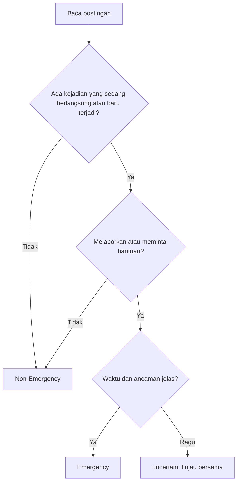

# Memahami Masalah Emergency vs Non-Emergency

!!! abstract "Info materi"
    **Tingkat kesulitan:** Pemula. **Estimasi waktu:** 60–80 menit.
    **Jenis materi:** konseptual. Halaman ini tidak memakai kode Python; keputusan label adalah keputusan manusia yang harus disepakati sebelum model apa pun dibuat.

## Tujuan pembelajaran

- [ ] Menyatakan definisi operasional label `Emergency` dan `Non-Emergency`.
- [ ] Membedakan laporan kejadian, permintaan bantuan, berita, opini, informasi lama, dan peringatan umum.
- [ ] Menerapkan aturan anotasi pada contoh yang ambigu dan menuliskan alasannya.
- [ ] Menjelaskan mengapa kesalahan klasifikasi punya konsekuensi yang tidak sama.

## Prasyarat

[Cara Kerja Sistem Klasifikasi Teks](cara-kerja-klasifikasi-teks.md). Anda perlu tahu bahwa model belajar dari contoh berlabel.

## Pengantar dan motivasi

Bayangkan dua relawan diminta memilah seratus cuitan menjadi "darurat" dan "bukan darurat". Relawan pertama menandai semua cuitan yang menyebut kata "banjir". Relawan kedua hanya menandai cuitan yang melaporkan banjir yang
sedang terjadi atau meminta pertolongan. Hasil pilahan mereka akan sangat berbeda, padahal keduanya merasa bekerja dengan benar.

Model tidak bisa menyelesaikan perbedaan semacam ini. Jika label dibuat tidak konsisten, model akan belajar ketidakkonsistenan itu. Karena itu definisi label harus tegas **sebelum** data dikumpulkan dan model dilatih; ini lebih penting daripada memilih algoritma yang canggih.

!!! warning "Kata kunci bukan definisi"
    Postingan berisi "gempa", "banjir", atau "tolong" **tidak otomatis** Emergency. "Tolong doakan korban gempa kemarin" tidak meminta pertolongan darurat.

## Konsep dasar

**Anotasi** adalah proses manusia memberi label pada data. **Definisi operasional** adalah definisi yang cukup jelas sehingga dua orang berbeda dapat menerapkannya dan sampai pada label yang sama. Kata "operasional" berarti definisi itu dapat dikerjakan, bukan sekadar slogan seperti "darurat itu yang mendesak".

**Unit analisis** adalah apa yang dianggap satu contoh. Pada proyek ini satu **postingan** (satu teks) adalah satu contoh. Konteks utas, gambar, dan profil penulis tidak digunakan pada versi dasar.

## Penjelasan mendalam

### Definisi operasional

Sebuah postingan diberi label **Emergency** bila memenuhi **kedua** syarat berikut:

1. **Kejadian yang sedang berlangsung atau baru terjadi** (kira-kira dalam jam terakhir menurut isi teks) yang mengancam keselamatan jiwa, kesehatan, atau harta; **dan**
2. Postingan itu **melaporkan kejadian tersebut** atau **meminta bantuan/penyelamatan** terkait kejadian tersebut.

Selain itu diberi **Non-Emergency**, termasuk berita, opini, informasi lama, peringatan umum, edukasi, candaan, dan topik yang tidak terkait.

Perhatikan kata "dan". Syarat satu saja tidak cukup: postingan yang membahas banjir besar bulan lalu memenuhi tema bencana tetapi tidak memenuhi syarat waktu.

### Jenis postingan dan labelnya

| Jenis | Ciri | Label | Contoh |
|---|---|---|---|
| Laporan kejadian | Menyatakan kejadian berlangsung di lokasi tertentu | Emergency | "Rumah warga di RT 05 terbakar, api menjalar" |
| Permintaan bantuan | Meminta pertolongan terkait kejadian yang sedang terjadi | Emergency | "Tolong, ibu saya terjebak di lantai 2, air naik" |
| Berita | Pelaporan oleh media, sering ada rujukan sumber | Non-Emergency\* | "BMKG: gempa M4,1 terjadi pukul 08.12" |
| Opini | Pendapat atau emosi tanpa laporan baru | Non-Emergency | "Pemerintah lambat tangani banjir" |
| Informasi lama | Kejadian sudah berlalu atau pulih | Non-Emergency | "Banjir kemarin sudah surut" |
| Peringatan umum | Imbauan tanpa kejadian spesifik | Non-Emergency | "Musim hujan, waspada banjir" |

\* Berita tentang kejadian yang sedang berlangsung bisa ambigu; lihat aturan di bawah.

### Aturan anotasi untuk kasus ambigu

1. Jika waktu kejadian tidak jelas dan tidak ada permintaan bantuan, beri **Non-Emergency**.
2. Berita dari akun media tentang kejadian yang sedang berlangsung dengan korban atau ancaman nyata diberi **Emergency** hanya jika teks menyiratkan kejadian masih berlangsung. Catat sebagai kasus ambigu.
3. Sarkasme atau candaan: **Non-Emergency**, kecuali ada permintaan bantuan eksplisit.
4. Jika anotator tetap ragu, tandai `uncertain` untuk ditinjau bersama. **Jangan dipaksakan** sebagai data latih.
5. Jangan menilai berdasarkan siapa penulisnya; nilai isi teksnya.

### Mengapa kesalahan tidak sama bobotnya

Ada dua jenis kesalahan:

- **False negative:** laporan darurat sungguhan diprediksi Non-Emergency. Akibatnya laporan itu bisa terlewat oleh petugas.
- **False positive:** postingan biasa diprediksi Emergency. Akibatnya petugas membuang waktu memeriksa laporan yang tidak perlu.

Dalam respons bencana, kehilangan laporan sungguhan umumnya lebih mahal daripada memeriksa laporan palsu, tetapi terlalu banyak alarm palsu juga membuat petugas kelelahan dan mulai mengabaikan sistem. Karena itu pilihan metrik dan ambang keputusan dibahas khusus di [Level 5](../level-5-evaluasi/index.md), dan sistem operasional tetap membutuhkan **peninjauan manusia**.

### Kasus label yang sangat tidak seimbang

Di dunia nyata, postingan Emergency biasanya jauh lebih sedikit daripada Non-Emergency. Ini disebut **ketidakseimbangan kelas** (*class imbalance*). Model yang selalu menjawab Non-Emergency akan tampak akurat tetapi tidak berguna. Topik ini juga dibahas di Level 5.

!!! info "Konsistensi antaranotator"
    Dalam penelitian nyata, dua anotator melabeli sampel yang sama, lalu kesepakatan diukur (misalnya dengan Cohen's kappa). Hasil di bawah ambang yang disepakati menandakan definisi label perlu diperbaiki. Anda akan merasakan versi kecilnya di [Mini Proyek](mini-proyek-manual.md).

## Cara kerja atau alur proses

Urutan berpikir anotator untuk satu postingan:

## Contoh sederhana

Dua kalimat dengan kata yang sama, label berbeda:

- "Banjir setinggi dada, mohon evakuasi!" → ada kejadian berlangsung dan permintaan bantuan → **Emergency**.
- "Banjir tahun lalu merusak banyak rumah." → kejadian lama, tidak ada permintaan → **Non-Emergency**.

## Contoh dalam konteks Twitter/X kebencanaan

Contoh berikut **sintetis** (dibuat untuk pengajaran, bukan dataset teranotasi yang sudah divalidasi). Labelnya mengikuti definisi di atas.

| # | Postingan (sintetis) | Label | Alasan |
|---|---|---|---|
| 1 | "Banjir setinggi dada di Jl. Melati, mohon evakuasi!" | Emergency | Kejadian berlangsung + permintaan bantuan |
| 2 | "Ada yang tahu cara bikin tas siaga bencana?" | Non-Emergency | Pertanyaan edukasi |
| 3 | "Gempa tadi bikin lemari roboh, ada tetangga terluka, butuh ambulans" | Emergency | Kejadian baru + korban + bantuan |
| 4 | "Gempa tadi cuma terasa sebentar, semua aman" | Non-Emergency | Kejadian ada, tidak ada ancaman |
| 5 | "Doakan korban longsor minggu lalu ya" | Non-Emergency | Informasi lama |
| 6 | "Tolong follow akun saya, giveaway!" | Non-Emergency | Kata "tolong" tanpa kejadian |
| 7 | "Asap tebal dari gudang dekat pasar, terdengar ledakan" | Emergency | Laporan kejadian berlangsung |
| 8 | "Jembatan dekat rumah kayaknya mau ambruk" | `uncertain` | Tidak jelas urgensi dan waktu |

Cara membaca tabel: contoh 4 menyebut gempa dan baru terjadi, tetapi tidak ada ancaman, sehingga syarat 1 tidak terpenuhi. Contoh 6 memuat "tolong", tetapi tidak ada kejadian. Contoh 8 sengaja dibiarkan `uncertain` karena aturan 1 dan 4 saling bertemu: waktunya tidak jelas, tetapi ancamannya mungkin nyata.

## Praktik Python

Tidak ada kode pada halaman ini. Menulis kode sebelum label disepakati hanya akan mengotomatiskan ketidakjelasan. Pada [Level 2](../level-2-fondasi-teks/index.md) dan seterusnya, dataset sintetis proyek ini memakai definisi label yang sama; lihat dokumentasi dataset di sana.

## Penjelasan kode per bagian

Tidak berlaku (tidak ada kode). Sebagai gantinya, gunakan diagram alur di atas sebagai "algoritma manual" saat melabeli.

## Contoh output dan interpretasinya

Hasil anotasi adalah tabel (teks, label, catatan). Interpretasi yang baik mencatat alasan pada kasus ambigu supaya anotator lain dapat menirunya.

## Kesalahan umum dan debugging

| Kesalahan | Gejala | Perbaikan |
|---|---|---|
| Memakai kata kunci sebagai definisi | "tolong follow akun saya" dilabeli Emergency | Periksa dua syarat definisi, bukan kata |
| Mencampur berita bencana dengan kejadian berlangsung | Semua berita gempa dilabeli Emergency | Terapkan aturan 2 dan periksa waktu kejadian |
| Memaksa label pada kasus ragu | Data latih berisik, kesepakatan rendah | Tandai `uncertain` dan bahas bersama |
| Mengubah aturan di tengah pelabelan tanpa catatan | Label awal dan akhir tidak sebanding | Catat setiap perubahan aturan dan tinjau ulang label lama |
| Menilai berdasarkan siapa penulisnya | Akun media selalu Emergency | Aturan 5: nilai isi teks |

## Kelebihan dan keterbatasan

**Kelebihan definisi ini:** eksplisit, dapat diuji dengan dua anotator, dan memisahkan topik dari kondisi darurat.
**Keterbatasan:**

- Batas "kira-kira jam terakhir" tidak selalu bisa dipastikan dari teks.
- Hanya teks yang dipakai; gambar, lokasi, dan utas diabaikan.
- Dua label biner menyembunyikan tingkat keparahan. Sistem nyata sering memerlukan tingkat prioritas.
- Definisi ini adalah keputusan proyek ini; lembaga penanggulangan bencana dapat memakai definisi lain.

## Latihan bertahap

1. **Konseptual.** Sebutkan dua syarat Emergency dan jelaskan mengapa keduanya harus terpenuhi sekaligus.
2. **Menerapkan definisi.** Beri label untuk "Banjir kemarin sudah surut, terima kasih relawan." dan jelaskan alasannya.
3. **Mengenali jebakan kata kunci.** Tulis satu postingan yang memuat kata "tolong" tetapi Non-Emergency, dan satu yang tidak memuat kata "tolong" tetapi Emergency.
4. **Mengubah label dengan sedikit kata.** Ubah "Musim hujan, waspada banjir" menjadi Emergency dengan hanya mengubah beberapa kata.
5. **Kasus ambigu.** Postingan akun media: "Banjir melanda kawasan X, warga mengungsi." Tidak ada jam. Pakai aturan anotasi dan putuskan label, lalu jelaskan.
6. **Mini-proyek.** Tulis lima postingan buatan Anda, termasuk satu `uncertain`, lengkap dengan alasan. Minta orang lain melabelinya tanpa melihat jawaban Anda, lalu bandingkan.

## Kunci jawaban dan pembahasan

??? success "Jawaban 1"
    Syarat 1: ada kejadian yang sedang berlangsung atau baru terjadi dan mengancam. Syarat 2: postingan melaporkan atau meminta bantuan terkait kejadian itu. Keduanya harus ada sebab syarat 1 saja menangkap berita lama dan edukasi, sedangkan syarat 2 saja menangkap permintaan "tolong" yang tidak terkait kejadian darurat.

??? success "Jawaban 2"
    Non-Emergency. Kejadian sudah berlalu (surut) dan tidak ada permintaan bantuan, sehingga syarat 1 dan 2 tidak terpenuhi.

??? success "Jawaban 3"
    Contoh: "Tolong follow akun saya, giveaway!" (Non-Emergency; ada "tolong" tapi tanpa kejadian) dan "Air sudah masuk rumah, anak saya terjebak di atap" (Emergency; tanpa kata "tolong" tetapi ada kejadian berlangsung dan permintaan implisit). Jawaban Anda boleh berbeda selama dua syarat definisi dipenuhi atau dilanggar dengan jelas.

??? success "Jawaban 4"
    Contoh: "Banjir sudah masuk rumah kami sekarang, mohon bantuan." Perubahan yang membuatnya Emergency: dari imbauan umum menjadi laporan kejadian yang berlangsung (kata "sudah masuk rumah", "sekarang") dan ada permintaan bantuan. Ini menunjukkan bahwa label ditentukan oleh waktu dan maksud, bukan oleh topik.

??? success "Jawaban 5"
    Menurut aturan 2, berita dari akun media diberi Emergency hanya jika teks menyiratkan kejadian masih berlangsung. "Warga mengungsi" menyiratkan kejadian masih berdampak, tetapi tidak ada waktu. Jawaban yang bisa dipertahankan adalah `uncertain` (aturan 4) atau Non-Emergency (aturan 1). Yang penting, alasan dicatat. Jawaban "Emergency" hanya karena ada kata "banjir" adalah jawaban yang keliru.

??? success "Jawaban 6"
    Tidak ada kunci tunggal. Yang dinilai adalah (a) apakah alasan merujuk pada dua syarat, dan (b) apakah pelabel kedua sepakat. Jika tidak sepakat, cari aturan mana yang kurang jelas dan perbaiki rumusannya.

## Kuis singkat

**1.** "Banjir kemarin sudah surut, terima kasih relawan." Label?

??? success "Jawaban"
    Non-Emergency: kejadian sudah berlalu dan tidak ada permintaan bantuan.

**2.** Mengapa label `uncertain` tidak langsung dipakai sebagai data latih?

??? success "Jawaban"
    Label yang ragu menambah noise; sebaiknya ditinjau bersama atau dikecualikan.

**3.** Apa dua syarat Emergency pada definisi operasional?

??? success "Jawaban"
    Kejadian berlangsung atau baru terjadi yang mengancam, dan postingan melaporkannya atau meminta bantuan terkait kejadian itu.

**4.** Mana yang umumnya lebih berbahaya dalam respons bencana: false negative atau false positive?

??? success "Jawaban"
    False negative (laporan sungguhan terlewat) umumnya lebih berbahaya, tetapi false positive yang terlalu banyak juga merusak kepercayaan dan beban kerja petugas.

## Ringkasan

- Definisi label yang eksplisit dan aturan anotasi untuk kasus ambigu adalah fondasi proyek.
- Kata kunci bukan definisi; waktu, ancaman, dan maksud postingan yang menentukan.
- Kasus ragu ditandai `uncertain`, bukan dipaksakan.
- Kesalahan klasifikasi tidak sama bobotnya; peninjauan manusia tetap diperlukan.

## Glosarium istilah baru

Anotasi
:   Proses manusia memberi label pada data.

Definisi operasional
:   Definisi yang cukup jelas sehingga dua orang dapat menerapkannya dan sampai pada label yang sama.

False negative
:   Kasus positif sungguhan yang diprediksi negatif (laporan Emergency terlewat).

False positive
:   Kasus negatif sungguhan yang diprediksi positif (alarm palsu).

Ketidakseimbangan kelas
:   Jumlah contoh antarkelas sangat berbeda.

Cohen's kappa
:   Ukuran kesepakatan dua anotator yang memperhitungkan kesepakatan karena kebetulan.

## Referensi

- Imran, M., Castillo, C., Diaz, F., & Vieweg, S. (2015). Processing social media messages in mass emergency: A survey. *ACM Computing Surveys*, 47(4) (survei akademik).

## Materi selanjutnya

[Mengenal Teks Media Sosial](teks-media-sosial.md)
