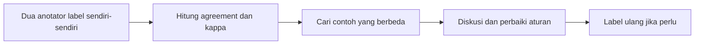

# Mini Proyek: Mengelompokkan Teks Secara Manual

!!! abstract "Info materi"
    **Tingkat kesulitan:** Pemula. **Estimasi waktu:** 90–120 menit.
    **Jenis kode:** ilustratif (`examples/level-0-orientasi/kesepakatan.py`). Semua data di halaman ini **sintetis dan fiktif**; angka kesepakatan bukan estimasi kualitas dataset mana pun.

## Tujuan pembelajaran

- [ ] Menerapkan definisi dan aturan anotasi pada postingan sintetis.
- [ ] Merasakan sendiri kasus ambigu dan ketidaksepakatan label.
- [ ] Menghitung persentase kesepakatan dan Cohen's kappa antara dua anotator, dengan tangan dan dengan kode.
- [ ] Menjelaskan mengapa persentase kesepakatan bisa menyesatkan pada kelas yang timpang.

## Prasyarat

[Memahami Masalah Emergency vs Non-Emergency](masalah-emergency.md) dan [Teks Media Sosial](teks-media-sosial.md).

## Pengantar dan motivasi

Sebelum menyerahkan pekerjaan ke model, kerjakan dulu secara manual. Anotasi manual mengungkap kelemahan definisi label dan menghasilkan data kecil berlabel yang nantinya dapat menjadi pembanding. Jika dua orang yang membaca aturan yang sama tidak sepakat, model hampir pasti juga akan kesulitan.

## Konsep dasar

**Kesepakatan (*agreement*)** antara dua anotator pada sampel yang sama menunjukkan seberapa jelas definisi label. Ukuran paling sederhana adalah **persentase kesepakatan**:

$$
\text{agreement} = \frac{\text{jumlah label yang sama}}{\text{jumlah contoh}}
$$

Contoh angka: dari 10 contoh, 8 berlabel sama, maka agreement = 8/10 = 0,8 = 80%.

## Penjelasan mendalam

### Mengapa persentase saja tidak cukup

Dua orang bisa sepakat hanya karena kebetulan, terutama bila satu kelas sangat dominan. Jika 90% contoh adalah Non-Emergency, anotator yang selalu menjawab Non-Emergency akan sepakat dengan hampir siapa pun, padahal ia tidak membedakan apa-apa.

### Cohen's kappa

**Cohen's kappa** mengoreksi kesepakatan karena kebetulan:

$$
\kappa = \frac{p_o - p_e}{1 - p_e}
$$

Arti simbol:

- $p_o$: kesepakatan yang **teramati** (persentase di atas, dalam bentuk pecahan).
- $p_e$: kesepakatan yang **diharapkan karena kebetulan**, dihitung dari seberapa sering tiap anotator memakai tiap label: $p_e = \sum_k p_A(k)\,p_B(k)$ dengan $p_A(k)$ proporsi anotator A memberi label $k$.
- $\kappa = 1$ berarti sepakat sempurna; $\kappa = 0$ berarti tidak lebih baik dari kebetulan.

**Contoh hitung dengan tangan** pada data fiktif di bawah (A memberi E: 3, N: 5, U: 2; B memberi E: 4, N: 6, U: 0):

- $p_o = 0{,}8$.
- $p_e = 0{,}3 \times 0{,}4 + 0{,}5 \times 0{,}6 + 0{,}2 \times 0 = 0{,}12 + 0{,}30 + 0 = 0{,}42$.
- $\kappa = (0{,}8 - 0{,}42) / (1 - 0{,}42) = 0{,}38 / 0{,}58 \approx 0{,}66$.

Tidak ada ambang universal untuk "cukup baik"; ambang ditentukan oleh tujuan proyek dan sebaiknya dinyatakan sebelum anotasi.

## Cara kerja atau alur proses



## Contoh sederhana

Dua anotator melabeli 4 postingan: A = E, N, N, E; B = E, N, E, E. Sama pada 3 dari 4, jadi agreement 75%. Satu perbedaan (nomor 3) menjadi bahan diskusi.

## Contoh dalam konteks Twitter/X kebencanaan

### Tugas

Berikut 10 postingan **sintetis**. Beri label `E` (Emergency), `N` (Non-Emergency), atau `U` (uncertain) menggunakan aturan di halaman sebelumnya. Kerjakan sendiri **sebelum** melihat kunci.

| # | Postingan |
|---|---|
| 1 | "Banjir masuk rumah, air sudah selutut, tolong kirim perahu karet ke Gg. Mawar 3" |
| 2 | "Besok ada simulasi gempa di sekolah anak saya" |
| 3 | "Pohon tumbang menimpa mobil di depan kantor, pengemudi terjepit!!" |
| 4 | "Musim hujan begini selalu bikin deg-degan, semoga aman" |
| 5 | "BMKG: gempa M5,0 pukul 06.30, tidak berpotensi tsunami" |
| 6 | "Banjir tahun lalu parah banget, sekarang drainase sudah diperbaiki" |
| 7 | "Ada suara ledakan dan asap hitam dari arah pabrik, warga berhamburan" |
| 8 | "Tolong RT kami belum dapat bantuan sembako" |
| 9 | "Lagi asik nonton, tiba-tiba lampu mati. Pasti PLN lagi..." |
| 10 | "Jalan Merdeka tergenang, motor mogok, tapi masih bisa dilewati mobil" |

### Kunci pembahasan

??? success "Lihat kunci setelah melabeli sendiri"
    | # | Label | Catatan |
    |---|---|---|
    | 1 | E | Kejadian berlangsung + permintaan bantuan |
    | 2 | N | Kegiatan terjadwal |
    | 3 | E | Korban terjepit, kejadian baru |
    | 4 | N | Opini/kecemasan umum |
    | 5 | N | Berita resmi tanpa ancaman nyata |
    | 6 | N | Informasi lama |
    | 7 | E | Laporan kejadian berlangsung dengan ancaman |
    | 8 | U | Permintaan bantuan nyata, tetapi kebutuhan logistik, bukan keselamatan segera; **diskusikan** |
    | 9 | N | Keluhan tanpa ancaman jelas |
    | 10 | U | Banjir ada, tetapi tidak jelas ancaman; **diskusikan** |

    Ini kunci penulis, bukan kebenaran mutlak. Perbedaan label pada #8 dan #10 adalah hal wajar dan justru bagian pembelajarannya: aturan perlu diperjelas, misalnya apakah kebutuhan logistik pascabencana termasuk Emergency.

## Praktik Python

Berkas: `examples/level-0-orientasi/kesepakatan.py`. Dua "anotator" di sini adalah daftar label **fiktif** yang dibuat untuk mendemonstrasikan rumus; keduanya bukan hasil anotasi pada tabel di atas. Jalankan dari akar repository: `python examples/level-0-orientasi/kesepakatan.py`.

!!! info "Catatan sintaks untuk pemula"
    - `zip(a, b)` memasangkan elemen dua list pada posisi yang sama.
    - `sum(x == y for ...)` menjumlahkan nilai `True` (=1) dan `False` (=0).
    - `enumerate(...)` memberi nomor urut; `i + 1` membuat nomor mulai dari 1.
    - `Counter(list)` menghitung kemunculan tiap elemen.
    - `f"{nilai:.0%}"` memformat pecahan sebagai persen tanpa desimal; `:.2f` memberi dua desimal.

### Bagian 1 — Data dua anotator

```python title="Bagian 1"
--8<-- "level-0-orientasi/kesepakatan.py:data"
```

```text title="Output nyata"
10 10
```

Interpretasi: kedua list berpanjang sama (10). **Cara memeriksa:** panjang harus sama, kalau tidak `zip` memotong diam-diam pada list yang lebih pendek.

### Bagian 2 — Persentase kesepakatan

```python title="Bagian 2"
--8<-- "level-0-orientasi/kesepakatan.py:agreement"
```

`sama` menghitung pasangan label yang sama; `agreement` adalah `sama` dibagi jumlah contoh; `beda` mengumpulkan nomor contoh yang berbeda.

```text title="Output nyata"
Kesepakatan: 8/10 = 80%
Contoh yang berbeda (nomor): [8, 10]
```

Interpretasi: 8 dari 10 sama (80%). Nilai yang berguna ada pada daftar `beda`: contoh 8 dan 10, tempat definisi label perlu diperjelas.

### Bagian 3 — Cohen's kappa

```python title="Bagian 3"
--8<-- "level-0-orientasi/kesepakatan.py:kappa"
```

`po` adalah kesepakatan teramati. `ca` dan `cb` menghitung label tiap anotator; `pe` menjumlahkan hasil kali proporsi tiap label. `set(a) | set(b)` adalah gabungan label yang dipakai salah satu anotator.

```text title="Output nyata"
kappa contoh: 0.66
```

Interpretasi: $\kappa \approx 0{,}66$, sama dengan hitungan tangan di atas. Penulis juga membandingkannya dengan `sklearn.metrics.cohen_kappa_score` pada data yang sama dan mendapat 0,6552, yaitu nilai yang sama setelah pembulatan. (Pemeriksaan itu dijalankan sekali oleh penulis dan tidak menjadi bagian skrip.)

### Bagian 4 — Ketika kelas timpang

```python title="Bagian 4"
--8<-- "level-0-orientasi/kesepakatan.py:timpang"
```

```text title="Output nyata"
kesepakatan: 90%, kappa: 0.00
```

Interpretasi: anotator B selalu menjawab `N`, anotator A menjawab `E` pada satu dari sepuluh contoh. Persentase kesepakatan tampak tinggi (90%) padahal B tidak membedakan apa-apa; kappa 0,00 menunjukkan tidak ada kesepakatan di atas kebetulan. Inilah alasan Latihan 3 dan alasan metrik pada data timpang perlu dipilih hati-hati di [Level 5](../level-5-evaluasi/index.md).

### Skrip terpadu

Keempat bagian adalah satu skrip `kesepakatan.py`.

## Kesalahan umum dan debugging

| Kesalahan | Gejala | Perbaikan |
|---|---|---|
| Berdiskusi sebelum selesai melabeli | Kesepakatan tampak terlalu tinggi | Labeli secara independen, baru bandingkan |
| Menyimpulkan kualitas dataset dari sampel sangat kecil | Kesimpulan terlalu pasti | Nyatakan ukuran sampel dan ketidakpastian |
| Memaksa konsensus tanpa catatan | Aturan tidak terdokumentasi | Catat alasan dan revisi aturan |
| `len(a) != len(b)` | `zip` memotong tanpa peringatan | Periksa panjang list lebih dulu |
| Membagi dengan nol pada kappa | `ZeroDivisionError` jika $p_e = 1$ (semua label sama pada kedua anotator) | Tangani kasus ini secara khusus |

## Kelebihan dan keterbatasan

**Kelebihan:** persentase kesepakatan mudah dihitung dan dipahami; kappa mengoreksi kebetulan.
**Keterbatasan:** kappa sensitif pada distribusi label dan tidak punya ambang universal; dua anotator pada 10 contoh terlalu sedikit untuk kesimpulan statistik; kesepakatan tinggi tidak menjamin label benar, hanya konsisten.

## Latihan bertahap

1. **Konseptual.** Apa perbedaan kesepakatan dan kebenaran label?
2. **Menghitung.** A = [E, N, N, E], B = [E, N, E, E]. Hitung agreement.
3. **Menafsirkan.** Mengapa persentase kesepakatan 90% bisa menyesatkan bila 90% contoh adalah kelas yang sama?
4. **Membaca kode.** Pada `cohen_kappa`, apa yang dihitung oleh `sum((ca[k] / n) * (cb[k] / n) for k in ...)`?
5. **Debugging.** Jalankan `cohen_kappa(["N"]*5, ["N"]*5)` dan jelaskan galatnya. Bagaimana memperbaikinya?
6. **Mini-proyek.** Labeli 10 postingan sintetis buatan Anda, minta teman melabeli juga, hitung agreement dan kappa. Untuk setiap ketidaksepakatan, tulis revisi aturan yang menyelesaikannya.

## Kunci jawaban dan pembahasan

??? success "Jawaban 1"
    Kesepakatan mengukur konsistensi antaranotator; kebenaran mengukur kesesuaian dengan realitas atau standar. Dua anotator bisa konsisten tetapi sama-sama keliru, terutama bila aturan salah.

??? success "Jawaban 2"
    Sama pada posisi 1, 2, dan 4 (3 dari 4): agreement = 3/4 = 75%.

??? success "Jawaban 3"
    Anotator yang selalu menjawab kelas dominan sudah sepakat dengan 90% contoh tanpa membedakan apa pun. Persentase tidak memperhitungkan kesepakatan karena kebetulan; kappa memperhitungkannya (lihat Bagian 4).

??? success "Jawaban 4"
    Menghitung $p_e$: untuk tiap label $k$, proporsi A memberi $k$ dikali proporsi B memberi $k$, lalu dijumlahkan. Ini peluang sepakat bila kedua anotator memilih label sesuai kebiasaannya secara acak.

??? success "Jawaban 5"
    Kedua anotator hanya memakai `N`, sehingga $p_e = 1$ dan penyebut $1 - p_e = 0$, menimbulkan `ZeroDivisionError`. Perbaikan: jika $p_e = 1$, kembalikan nilai khusus (mis. 1.0 bila $p_o = 1$) atau laporkan bahwa kappa tidak terdefinisi. (Silakan jalankan untuk melihat galatnya sendiri.)

??? success "Jawaban 6"
    Tidak ada kunci tunggal. Yang dinilai adalah apakah setiap ketidaksepakatan diubah menjadi aturan yang lebih jelas dan apakah Anda menyatakan keterbatasan sampel sekecil 10 contoh.

## Kuis singkat

**1.** Apa kelemahan persentase kesepakatan sederhana?

??? success "Jawaban"
    Tidak memperhitungkan kesepakatan karena kebetulan, terutama saat kelas tidak seimbang.

**2.** Apa yang sebaiknya dilakukan dengan contoh berlabel `U`?

??? success "Jawaban"
    Ditinjau bersama untuk memperbaiki aturan; jangan dimasukkan sebagai data latih tanpa keputusan.

**3.** Apa arti $\kappa = 0$?

??? success "Jawaban"
    Kesepakatan tidak lebih baik daripada yang diharapkan karena kebetulan.

## Ringkasan

- Anotasi manual mengungkap kelemahan definisi label.
- Persentase kesepakatan mudah tetapi bisa menyesatkan; Cohen's kappa mengoreksi kebetulan.
- Kesepakatan adalah umpan balik untuk memperbaiki aturan, bukan sekadar angka.

## Glosarium istilah baru

Kesepakatan (*agreement*)
:   Proporsi contoh yang diberi label sama oleh dua anotator.

Cohen's kappa
:   Ukuran kesepakatan yang dikoreksi untuk kesepakatan karena kebetulan.

Anotator
:   Orang yang memberi label pada data.

`uncertain` (`U`)
:   Label sementara untuk kasus yang ragu dan perlu ditinjau bersama.

## Referensi

- Imran, M., Castillo, C., Diaz, F., & Vieweg, S. (2015). Processing social media messages in mass emergency: A survey. *ACM Computing Surveys*, 47(4) (survei akademik).
- Dokumentasi scikit-learn: `cohen_kappa_score` (<https://scikit-learn.org/stable/modules/generated/sklearn.metrics.cohen_kappa_score.html>) (dokumentasi resmi).

## Materi selanjutnya

[Level 1: Fondasi Python untuk NLP](../level-1-python/index.md)
