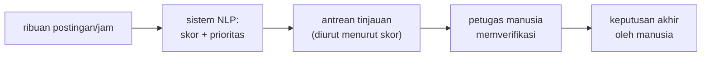

# Penerapan NLP di Kehidupan Nyata

!!! abstract "Info materi"
    **Tingkat kesulitan:** Pemula. **Estimasi waktu:** 60–75 menit.
    **Jenis kode:** ilustratif dengan **angka asumsi** (`examples/level-0-orientasi/beban_peninjauan.py`). Angka di halaman ini bukan hasil pengukuran.

## Tujuan pembelajaran

- [ ] Mengidentifikasi tugas-tugas NLP umum beserta masukan dan keluarannya.
- [ ] Memetakan tiap tugas ke contoh nyata, termasuk di bidang kebencanaan.
- [ ] Menilai risiko false positive dan false negative pada sebuah aplikasi.
- [ ] Menghitung beban peninjauan manusia dari asumsi sederhana.

## Prasyarat

[Hubungan NLP dengan Machine Learning](hubungan-nlp-ml.md).

## Pengantar dan motivasi

NLP sudah hadir di keseharian: filter spam, saran ketikan, mesin pencari, penerjemah. Cara terbaik memahami bidang ini adalah mengenali
**jenis tugas** di balik tiap aplikasi, karena satu jenis tugas dapat memakai teknik yang sama di banyak domain. Memahami jenis tugas
juga menentukan bagaimana kita **mengukur keberhasilan**, dan itu bergantung pada akibat kesalahan.

## Konsep dasar

| Tugas | Masukan → keluaran | Contoh umum | Contoh kebencanaan |
|---|---|---|---|
| Klasifikasi teks | Teks → satu kelas | Deteksi spam | **Emergency vs Non-Emergency** |
| Analisis sentimen | Teks → polaritas | Ulasan produk | Mengukur kecemasan publik |
| Named Entity Recognition | Teks → entitas bertipe | Mengenali nama orang | Mengekstrak lokasi kejadian |
| Ekstraksi informasi | Teks → data terstruktur | Menarik tanggal dari kontrak | Jumlah korban dan jenis kebutuhan |
| Topic modeling | Korpus → topik | Mengelompokkan berita | Tema keluhan pascabencana |
| Mesin penerjemah | Teks A → teks B | Penerjemah daring | Menerjemahkan peringatan lintas bahasa |
| Question answering | Pertanyaan → jawaban | Asisten virtual | "Di mana posko terdekat?" |
| Peringkasan | Teks panjang → ringkas | Ringkasan berita | Ringkasan laporan situasi |

Proyek utama kita adalah **klasifikasi teks biner**: satu teks → satu dari dua label.

## Penjelasan mendalam

### Dimensi risiko

Tidak semua kesalahan setara. Sebelum membangun sistem, tanyakan:

- Apa akibat ***false positive*** (sistem menandai padahal bukan)?
- Apa akibat ***false negative*** (sistem melewatkan padahal ya)?
- Siapa yang meninjau keluaran sistem, manusia atau mesin lain?

| Aplikasi | Akibat false positive | Akibat false negative |
|---|---|---|
| Filter spam | Surat penting masuk spam | Sedikit spam lolos |
| Penyaring pesan darurat | Petugas memeriksa pesan yang tidak mendesak | Permintaan tolong terlewat |

### Manusia dalam lingkaran (*human in the loop*)

Pada aplikasi berisiko tinggi, sistem sebaiknya **membantu memprioritaskan** pekerjaan manusia, bukan menggantikan keputusannya. Sistem menaikkan
peringkat pesan yang diduga mendesak; manusia memverifikasi dan memutuskan. Pendekatan ini mengubah pertanyaan dari "apakah model benar?" menjadi
"berapa banyak yang perlu ditinjau, dan berapa yang terlewat?" (Bagian 2).

### Metrik mengikuti biaya

Jika false negative paling mahal, kita ingin **recall** tinggi (menemukan sebanyak mungkin pesan darurat). Namun recall tinggi biasanya
berarti lebih banyak false positive, sehingga beban peninjauan naik. Menyeimbangkannya adalah keputusan tentang sumber daya, dan akan dibahas dengan data di Level 5.

## Cara kerja atau alur proses



## Contoh sederhana

Filter email: jika salah menandai surat lamaran kerja sebagai spam (false positive), seseorang kehilangan kesempatan. Jika membiarkan satu iklan lolos
(false negative), akibatnya kecil. Akibat kedua kesalahan berbeda; filter dirancang untuk meminimalkan yang lebih mahal.

## Contoh dalam konteks Twitter/X kebencanaan

Pusat koordinasi menerima ribuan postingan setelah gempa. Operator manusia tidak mungkin membaca semuanya. Sistem NLP memprioritaskan antrean tinjauan:
postingan yang diduga laporan kejadian dinaikkan peringkatnya. Keputusan akhir tetap pada manusia.

!!! warning "Batas tanggung jawab"
    Dalam materi ini model hanya membantu *memprioritaskan* tinjauan. Ia tidak menentukan keadaan darurat secara otomatis, dan tidak boleh
    dipakai begitu saja pada pesan nyata tanpa validasi yang sesuai.

## Praktik Python

Halaman ini konseptual; satu skrip kecil mengubah pertanyaan "mana kesalahan yang lebih mahal?" menjadi hitungan. Berkas: `examples/level-0-orientasi/beban_peninjauan.py`. Semua angka adalah **asumsi**, bukan data.

!!! info "Catatan sintaks untuk pemula"
    - `NAMA = 1000` membuat variabel (huruf besar menandakan "konstanta" menurut kebiasaan). `{...}` dengan pasangan `kunci: nilai` membuat **dictionary**.
    - `for nama, (recall, fpr) in SKENARIO.items():` mengulang tiap pasangan; tanda kurung memecah pasangan nilai (*tuple*) menjadi dua variabel.
    - `f"... {x:.0f} ..."` menyisipkan nilai `x` ke dalam teks dengan nol desimal.
    Penjelasan lengkap ada di [Level 1](../level-1-python/index.md).

### Bagian 1 — Asumsi

```python title="Bagian 1"
--8<-- "level-0-orientasi/beban_peninjauan.py:asumsi"
```

Kita mengandaikan 1.000 pesan per jam, 2% benar-benar darurat, dan 5 petugas yang masing-masing meninjau 60 pesan per jam (kapasitas 300). `recall` adalah bagian pesan darurat yang ditemukan; `fpr` (*false positive rate*) adalah bagian pesan **bukan** darurat yang salah ditandai. Tiga sistem fiktif dengan karakter berbeda.

### Bagian 2 — Menghitung beban

```python title="Bagian 2"
--8<-- "level-0-orientasi/beban_peninjauan.py:hitung"
```

Pesan darurat per jam = 1000 × 0,02 = 20; bukan darurat = 980. Untuk tiap sistem: ditemukan (TP) = 20 × recall; terlewat (FN) = 20 − TP; alarm palsu (FP) = 980 × fpr; yang perlu ditinjau = TP + FP.

```text title="Output nyata"
pesan darurat/jam = 20, bukan darurat = 980, kapasitas peninjau = 300/jam
A (recall tinggi, alarm palsu sedang)
   ditemukan=18  terlewat=2  alarm palsu=49  perlu ditinjau=67  muat kapasitas=True
B (alarm palsu sangat sedikit, banyak terlewat)
   ditemukan=14  terlewat=6  alarm palsu=10  perlu ditinjau=24  muat kapasitas=True
C (hampir tak ada yang terlewat, banyak alarm palsu)
   ditemukan=19  terlewat=1  alarm palsu=196  perlu ditinjau=215  muat kapasitas=True
```

Interpretasi (hanya berlaku pada asumsi di atas):

- **A:** menemukan 18 dari 20 pesan darurat, 2 terlewat; petugas meninjau 67 pesan, 49 di antaranya alarm palsu.
- **B:** hanya 24 pesan perlu ditinjau (ringan bagi petugas), tetapi **6 dari 20 pesan darurat terlewat**. Terlihat "efisien" tetapi paling berbahaya.
- **C:** hanya 1 terlewat, tetapi 215 pesan harus ditinjau (196 alarm palsu).
- Pada kapasitas 300 per jam, semuanya muat. Bila hanya dua petugas (kapasitas 120) skenario C tidak muat (215 > 120). Jadi pilihan terbaik bergantung pada kapasitas peninjau, bukan hanya pada seberapa akurat sistemnya.
- Perhatikan bahwa pada prevalensi 2%, sistem dengan alarm palsu "hanya" 5% tetap menghasilkan 49 alarm palsu untuk 18 temuan benar. Persentase kecil dari kelompok besar menghasilkan angka besar.

### Skrip terpadu

Kedua bagian adalah satu skrip: `beban_peninjauan.py`.

## Kesalahan umum dan debugging

| Kesalahan | Penjelasan |
|---|---|
| Menganggap satu model cocok untuk semua tugas | Tugas berbeda butuh keluaran dan metrik berbeda |
| Mengabaikan perbedaan biaya kesalahan antar-aplikasi | Pilih metrik sesuai akibat kesalahan |
| Menilai sistem hanya dari akurasi | Pada kelas langka, akurasi tinggi bisa menyembunyikan banyak pesan terlewat |
| Membangun sistem otomatis penuh untuk keputusan berisiko tinggi | Perlu peninjauan manusia dan validasi |
| Menganggap angka asumsi sebagai hasil | Angka di halaman ini fiktif untuk latihan berhitung |

## Kelebihan dan keterbatasan

**Pendekatan prioritas dengan manusia:** menggabungkan kecepatan mesin dan penilaian manusia; kapasitas peninjau menjadi parameter yang jelas.
**Keterbatasan:** tetap bergantung pada kualitas model dan kapasitas manusia; angka asumsi tidak mewakili kondisi nyata; model dapat bias terhadap
gaya bahasa tertentu.

## Latihan bertahap

1. **Konseptual.** Sebutkan tugas NLP di balik tiga aplikasi di ponsel Anda.
2. **Membaca tabel.** Pada tabel Bagian 2, skenario mana yang terlewat paling banyak? Dan yang paling banyak menghasilkan alarm palsu?
3. **Menghitung.** Jika 2.000 pesan per jam dan prevalensi 1%, berapa pesan darurat dan bukan darurat per jam?
4. **Analisis kasus.** Penyaring pesan darurat dengan 1.000 pesan per jam dan 5 petugas. Mana yang lebih mahal: false positive atau false negative? Sebutkan asumsi Anda.
5. **Mini-proyek.** Ubah `KAPASITAS_PER_JAM` menjadi `2 * 60` dan jalankan; skenario mana yang tidak muat, dan apa artinya bagi pilihan sistem?

## Kunci jawaban dan pembahasan

??? success "Jawaban 1"
    Contoh: pencarian = pencarian dokumen/relevansi; keyboard prediktif = pemodelan bahasa; penerjemah = mesin penerjemah; filter spam = klasifikasi teks. Jawaban Anda boleh berbeda selama tugasnya tepat.

??? success "Jawaban 2"
    Terlewat paling banyak: B (6). Alarm palsu paling banyak: C (196).

??? success "Jawaban 3"
    Pesan darurat = 2.000 × 0,01 = 20; bukan darurat = 1.980.

??? success "Jawaban 4"
    Pada pesan darurat, false negative umumnya lebih mahal (permintaan tolong terlewat), selama kapasitas peninjau mencukupi. Namun bila alarm palsu sangat banyak sehingga petugas kewalahan, pesan yang benar justru dapat terlewat dalam antrean. Asumsi yang perlu disebut: prevalensi pesan darurat, kapasitas petugas, dan seberapa cepat respons bergantung pada deteksi.

??? success "Jawaban 5"
    Dengan kapasitas 120 per jam: A (67) dan B (24) muat; C (215) tidak muat. Artinya sistem C tidak layak untuk 2 petugas walau paling sedikit melewatkan pesan; pilihan sistem harus mempertimbangkan kapasitas.

## Kuis singkat

**1.** Tugas apa yang dikerjakan sistem yang memberi label Emergency/Non-Emergency?

??? success "Jawaban"
    Klasifikasi teks (biner).

**2.** Mengapa penting menentukan biaya false negative sebelum membangun sistem?

??? success "Jawaban"
    Ia menentukan metrik dan ambang yang dioptimalkan; pada pesan darurat, yang terlewat bisa berdampak serius.

**3.** Mengapa persentase alarm palsu yang kecil tetap dapat menghasilkan banyak alarm palsu?

??? success "Jawaban"
    Karena dikalikan jumlah pesan bukan darurat yang sangat besar (980 dari 1.000 pada contoh).

## Ringkasan

- NLP terdiri dari banyak jenis tugas; proyek kita adalah klasifikasi teks biner.
- Biaya false positive dan false negative berbeda; metrik dan ambang mengikuti biaya.
- Sistem membantu memprioritaskan tinjauan manusia, bukan menggantikannya.
- Pada kelas langka, persentase alarm palsu kecil tetap menghasilkan banyak alarm; kapasitas peninjau menentukan pilihan.

## Glosarium istilah baru

Klasifikasi teks
:   Tugas memberi satu label dari himpunan tetap pada sebuah teks.

Named Entity Recognition (NER)
:   Mengenali entitas bertipe (orang, lokasi) dalam teks.

Prevalensi
:   Proporsi kelas positif dalam data.

Human in the loop
:   Manusia memverifikasi atau memutuskan hasil sistem.

*False positive rate*
:   Bagian contoh negatif yang salah ditandai positif.

## Referensi

- Imran, M., Castillo, C., Diaz, F., & Vieweg, S. (2015). Processing social media messages in mass emergency: A survey. *ACM Computing Surveys*, 47(4), artikel 67. DOI: 10.1145/2771588 (survei akademik).

## Materi selanjutnya

[Cara Kerja Sistem Klasifikasi Teks](cara-kerja-klasifikasi-teks.md)
