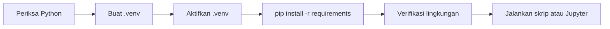

# Persiapan Python, Virtual Environment, pip, Jupyter Notebook, dan Git

!!! abstract "Info materi"
    **Tingkat kesulitan:** Pemula. **Estimasi waktu:** 60–90 menit (termasuk instalasi).
    **Jenis materi:** panduan instalasi dan referensi. Perintah terminal di sini adalah langkah yang Anda jalankan sendiri; hasil di komputer Anda akan berbeda dari contoh (jalur, versi).

## Tujuan pembelajaran

- [ ] Menjelaskan fungsi Python, virtual environment, pip, Jupyter Notebook, dan Git.
- [ ] Membuat lingkungan terisolasi untuk kurikulum ini dan memastikan lingkungan itu aktif.
- [ ] Memasang dependensi dari berkas `requirements*.txt`.
- [ ] Menjalankan skrip dan notebook dari repository tanpa menyimpan data sensitif ke Git.

## Prasyarat

Python 3.10 atau lebih baru terpasang, dan terminal (PowerShell di Windows; Terminal di macOS/Linux). Anda tidak perlu pengalaman pemrograman. Contoh di repository ini hanya dijalankan pada Python 3.14 (lihat halaman berikutnya); versi lain belum diuji oleh penulis. Versi yang terlalu baru kadang belum memiliki paket siap pakai (*wheel*), sehingga jika instalasi gagal, mencoba versi stabil yang sedikit lebih lama adalah langkah yang masuk akal.

## Pengantar dan motivasi

Proyek Python berbeda membutuhkan versi pustaka berbeda. Jika semuanya dipasang global, suatu saat satu proyek merusak proyek lain. **Virtual environment** adalah folder berisi salinan Python dan pustaka khusus untuk satu proyek. Anggap seperti kotak peralatan terpisah untuk tiap proyek: peralatan di kotak A tidak mengganggu kotak B.

## Konsep dasar

| Alat | Fungsi |
|---|---|
| Python | Bahasa dan interpreter |
| `venv` | Membuat lingkungan terisolasi (bawaan Python) |
| `pip` | Memasang pustaka dari PyPI (gudang paket Python) |
| `requirements.txt` | Daftar pustaka yang dibutuhkan proyek |
| Jupyter Notebook | Dokumen interaktif: kode, hasil, dan teks bersama |
| Git | Pelacak riwayat perubahan berkas |

### Tiga berkas dependensi di repository ini

| Berkas | Isi | Kapan dipakai |
|---|---|---|
| `requirements.txt` | MkDocs dan theme | Menjalankan situs dokumentasi |
| `requirements-ml.txt` | NumPy, pandas, scikit-learn, Sastrawi, pytest, Jupyter, FastAPI | Level 1–5 dan 7 |
| `requirements-dl.txt` | PyTorch, Transformers (berat, opsional) | Level 6 |

!!! note "Jangan pasang semuanya sekaligus"
    Pasang `requirements-dl.txt` hanya saat mencapai Level 6. Unduhannya besar.

## Penjelasan mendalam

### Mengapa isolasi itu penting

Setiap pustaka punya versi, dan versi baru kadang mengubah perilaku. Pada [Level 1](../level-1-python/pandas-dasar.md) dan seterusnya Anda akan melihat bahwa hasil dan galat dapat bergantung pada versi pandas atau scikit-learn. Dengan satu `.venv` per proyek, versi yang dipakai konsisten dan dapat dicatat.

### Apa yang terjadi saat lingkungan "diaktifkan"

Mengaktifkan `.venv` pada dasarnya menaruh folder `.venv/Scripts` (Windows) atau `.venv/bin` (macOS/Linux) di depan daftar lokasi yang dicari terminal saat Anda mengetik `python` atau `pip`. Itu sebabnya perintah yang sama memakai Python yang berbeda tergantung lingkungan aktif.

### Git: yang disimpan dan yang tidak

Git menyimpan riwayat perubahan. Jangan menyimpan `.venv/`, berkas data pribadi, kredensial (kata sandi, token), atau model berukuran besar. `.gitignore` di repository ini sudah menutup `.venv/`, tetapi Anda tetap bertanggung jawab memeriksa sebelum `git add`.

## Cara kerja atau alur proses



## Contoh sederhana

Dua proyek di satu laptop: Proyek A memakai pandas 2.x dan Proyek B memakai pandas 1.x. Dengan dua `.venv` terpisah, keduanya tetap berjalan; tanpa itu, memasang pandas 2.x untuk A akan merusak B.

## Contoh dalam konteks Twitter/X kebencanaan

Seorang relawan data memakai laptop yang sama untuk dua pekerjaan: analisis laporan banjir (butuh pandas 2.x) dan skrip lama pemantau cuitan gempa yang bergantung pada pandas 1.x. Setiap pekerjaan punya `.venv` sendiri sehingga memperbarui satu tidak mematahkan yang lain.

## Praktik Python

### Langkah 1 — Periksa Python

```bash
python --version
```

Jika perintah tidak dikenali, coba `python3 --version` (macOS/Linux) atau `py --version` (Windows). Versi harus 3.10 atau lebih baru.

### Langkah 2 — Buat dan aktifkan virtual environment

=== "Windows (PowerShell)"

    ```powershell
    python -m venv .venv
    .venv\Scripts\Activate.ps1
    ```

=== "macOS / Linux"

    ```bash
    python3 -m venv .venv
    source .venv/bin/activate
    ```

`python -m venv .venv` menjalankan modul `venv` dan membuat folder `.venv`. Prompt biasanya berubah menjadi `(.venv)`. Folder `.venv/` sudah tercantum di `.gitignore`.

!!! warning "PowerShell menolak menjalankan skrip?"
    Jalankan sekali: `Set-ExecutionPolicy -Scope CurrentUser RemoteSigned`, lalu coba lagi. Perintah ini hanya berlaku untuk akun Anda.

### Langkah 3 — Pasang dependensi

```bash
python -m pip install --upgrade pip
pip install -r requirements.txt -r requirements-ml.txt
```

`-r` berarti "baca daftar paket dari berkas ini". Dua berkas boleh diberikan sekaligus.

### Langkah 4 — Jalankan Jupyter

```bash
jupyter lab
```

Browser akan terbuka. Buka berkas `.ipynb` di folder `examples/`.

### Langkah 5 — Git dasar

```bash
git status            # lihat berkas yang berubah
git add examples/     # siapkan perubahan untuk disimpan
git commit -m "Menambah contoh Level 0"
git log --oneline     # riwayat commit
```

### Langkah 6 — Pastikan Python yang dipakai berasal dari `.venv`

Jalankan di terminal:

```bash
python -c "import sys; print(sys.executable)"
```

Penjelasan: `python -c "..."` menjalankan kode pendek langsung dari terminal. `sys.executable` adalah lokasi berkas Python yang sedang berjalan.

```text title="Output nyata, jalur berbeda di tiap komputer"
D:\ucup\Workspace\blog\materi-nlp\.venv\Scripts\python.exe
```

Interpretasi: jalur berisi `.venv` berarti lingkungan benar. Jika yang tampil Python global (mis. `C:\Python314\python.exe`), lingkungan belum aktif dan paket akan terpasang di tempat yang salah.

## Penjelasan kode per bagian

Halaman ini hanya berisi perintah terminal, bukan program. Perintah-perintah itu dijelaskan satu per satu pada tiap langkah di atas. Program Python pertama yang diperiksa terminal ada di halaman [Instalasi dan Verifikasi Lingkungan](verifikasi-lingkungan.md).

## Kesalahan umum dan debugging

| Kesalahan | Gejala | Perbaikan |
|---|---|---|
| Lupa mengaktifkan `.venv` sebelum `pip install` | Paket terpasang global; skrip tidak menemukan paket | Aktifkan `.venv`, ulangi `pip install` |
| `jupyter` dari lingkungan lain | Notebook tidak menemukan pustaka | Jalankan `jupyter lab` setelah `.venv` aktif |
| `git add .` ikut menyimpan `.venv/`, data pribadi, atau kredensial | Berkas besar atau rahasia masuk riwayat | Periksa `git status` sebelum `add`; gunakan `.gitignore` |
| Menulis jalur absolut (`C:\Users\...`) di notebook | Tidak jalan di komputer lain | Pakai jalur relatif dari akar repository |
| `python` tidak dikenali | Python belum ada di PATH | Pasang ulang dan centang "Add to PATH", atau pakai `py` |

## Kelebihan dan keterbatasan

**Kelebihan `venv` + `pip`:** bawaan Python, ringan, dan cukup untuk kurikulum ini.
**Keterbatasan:** `venv` hanya mengisolasi pustaka Python, bukan versi Python itu sendiri atau pustaka sistem; alat lain (mis. conda, uv) menawarkan fitur tambahan, tetapi tidak diperlukan di sini.

## Latihan bertahap

1. **Konseptual.** Mengapa satu `.venv` per proyek lebih aman daripada satu lingkungan global?
2. **Membaca kode.** Apa arti `pip install -r requirements.txt -r requirements-ml.txt`?
3. **Praktik.** Buat `.venv` baru di folder percobaan, aktifkan, dan tampilkan `sys.executable`.
4. **Praktik.** Pasang satu pustaka kecil (mis. `pip install tqdm`) dan buktikan bahwa ia hanya ada di `.venv` itu (impor dari Python global akan gagal).
5. **Debugging.** `pip install` berhasil tetapi `import pandas` di notebook gagal. Sebutkan dua kemungkinan penyebab dan cara memeriksanya.
6. **Mini-proyek.** Buat repository Git baru, tambahkan satu berkas, dan commit. Lalu tambahkan `.venv/` ke `.gitignore` dan pastikan `git status` tidak menampilkannya.

## Kunci jawaban dan pembahasan

??? success "Jawaban 1"
    Versi pustaka berbeda antarproyek bisa bertabrakan. Isolasi memastikan memperbarui satu proyek tidak merusak yang lain dan membuat versi dapat dicatat.

??? success "Jawaban 2"
    `-r` membaca daftar paket dari berkas; dua berkas diberikan sehingga paket dokumentasi dan paket ML terpasang bersama.

??? success "Jawaban 3"
    `python -m venv .venv`, aktifkan, lalu `python -c "import sys; print(sys.executable)"`. Jalur harus memuat nama folder `.venv`.

??? success "Jawaban 4"
    Setelah `pip install tqdm` di `.venv` aktif, `python -c "import tqdm"` berhasil. Setelah `deactivate` dan memakai Python global, perintah yang sama memberi `ModuleNotFoundError`, yang membuktikan paket hanya ada di `.venv`.

??? success "Jawaban 5"
    (a) Kernel Jupyter bukan dari `.venv` sehingga memakai Python lain; periksa dengan `import sys; print(sys.executable)` di sel notebook. (b) `pip` yang dipakai milik Python lain; periksa dengan `python -m pip --version`. Perbaikan: pasang dengan `python -m pip install ...` dari `.venv` dan daftarkan kernel (lihat halaman verifikasi).

??? success "Jawaban 6"
    Setelah `git init`, buat berkas, `git add`, `git commit -m "..."`. Dengan `.venv/` tercantum di `.gitignore`, `git status` tidak lagi menampilkannya sebagai berkas baru.

## Kuis singkat

**1.** Mengapa memakai virtual environment?

??? success "Jawaban"
    Mengisolasi dependensi tiap proyek agar versi tidak bertabrakan.

**2.** Apa yang tidak boleh di-commit ke Git?

??? success "Jawaban"
    `.venv/`, berkas data pribadi, model besar, dan kredensial.

**3.** Apa arti prompt berawalan `(.venv)`?

??? success "Jawaban"
    Lingkungan virtual sedang aktif pada terminal itu.

## Ringkasan

- Gunakan satu virtual environment per proyek.
- Pasang dependensi dari `requirements*.txt` saat `.venv` aktif.
- Jalankan Jupyter dari lingkungan yang sama.
- Lacak perubahan dengan Git tanpa menyertakan data sensitif.

## Glosarium istilah baru

Virtual environment
:   Folder berisi Python dan pustaka terisolasi untuk satu proyek.

pip
:   Alat pemasang pustaka Python dari PyPI.

PyPI
:   Gudang paket Python publik.

Jupyter Notebook
:   Dokumen interaktif yang memuat kode, hasil, dan teks.

Git
:   Sistem pelacak riwayat perubahan berkas.

Commit
:   Satu titik simpan riwayat perubahan di Git.

## Referensi

- Dokumentasi Python: *venv* (<https://docs.python.org/3/library/venv.html>).
- Dokumentasi pip: <https://pip.pypa.io/>.
- Dokumentasi Jupyter: <https://docs.jupyter.org/>.
- Pro Git: <https://git-scm.com/book>.

(Semuanya dokumentasi atau buku resmi, bukan makalah penelitian.)

## Materi selanjutnya

[Instalasi dan Verifikasi Lingkungan](verifikasi-lingkungan.md)
