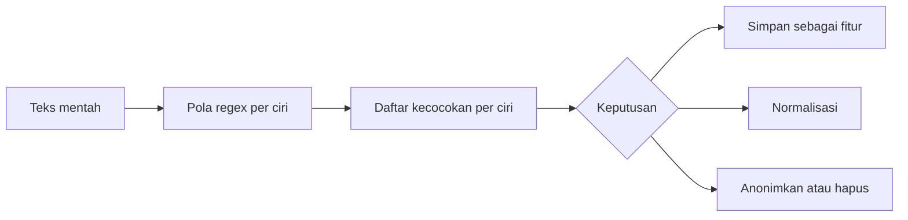

# Mengenal Teks Media Sosial

!!! abstract "Info materi"
    **Tingkat kesulitan:** Pemula. **Estimasi waktu:** 75–100 menit.
    **Jenis kode:** ilustratif (`examples/level-0-orientasi/ciri_media_sosial.py`). Anda boleh membaca tanpa menjalankannya; regex dipelajari rinci di [Level 1](../level-1-python/regex-dasar.md).

## Tujuan pembelajaran

- [ ] Mengenali ciri khas teks media sosial: bahasa informal, singkatan, huruf berulang, emoji, hashtag, URL, dan mention.
- [ ] Menjelaskan mengapa tiap ciri menyulitkan NLP dan kapan justru informatif.
- [ ] Mengekstrak ciri tersebut dengan regex sederhana dan membaca keluarannya, termasuk batas-batasnya.
- [ ] Menjelaskan alasan privasi untuk menganonimkan mention.

## Prasyarat

[Memahami Masalah Emergency vs Non-Emergency](masalah-emergency.md).

## Pengantar dan motivasi

Teks buku dan berita ditulis rapi. Postingan saat bencana ditulis terburu-buru, dari ponsel, sering dalam keadaan panik. Akibatnya teks penuh singkatan, salah ketik, huruf diulang, dan simbol. Model NLP yang dilatih pada teks rapi sering gagal di sini.

Namun ciri yang tampak "berantakan" itu kadang justru membawa informasi. Huruf yang diulang ("TOLOOONG") dapat menandakan kepanikan. Karena itu langkah pertama bukan membersihkan, melainkan **mengenali** apa yang ada.

## Konsep dasar

| Ciri | Contoh | Tantangan | Bisa informatif? |
|---|---|---|---|
| Bahasa informal | "cepet bgt", "gak", "udh" | Banyak variasi ejaan | Ya, penanda gaya darurat |
| Singkatan | "tlg", "yg", "dgn" | Ambigu, tidak baku | Ya |
| Huruf berulang | "TOLOOONG" | Memecah kosakata | Ya, intensitas emosi |
| Huruf kapital | "BANJIR!!" | Case folding menghilangkannya | Mungkin |
| Emoji | 🙏 🆘 😭 | Bukan kata, makna kontekstual | Mungkin |
| Hashtag | #banjir #gempaMalang | Gabungan kata, bisa menandai peristiwa | Ya |
| Mention | @bpbd_kota | Nama akun, mengandung identitas | Kadang; pertimbangkan privasi |
| URL | https://t.co/xyz | Tidak bermakna sebagai kata | Sering hanya penanda berita |
| Bahasa campuran | "stuck di jalan, tolong help" | Kosakata multibahasa | Ya |

**Regex** (*regular expression*) adalah bahasa kecil untuk menulis pola teks, misalnya "huruf `@` diikuti huruf/angka". Di sini regex dipakai sebagai alat bantu menemukan ciri, bukan untuk memahami makna.

## Penjelasan mendalam

### Mengapa variasi ejaan menyulitkan

Komputer menganggap `TOLOOONG`, `tolong`, dan `tlg` sebagai tiga string berbeda. Jika model menghitung kata, ketiganya menjadi tiga fitur terpisah yang masing-masing jarang muncul. Sinyal yang sama terpecah menjadi serpihan; ini disebut **sparsity**.

### Jangan buang secara otomatis

Banyak tutorial menghapus semua tanda baca, emoji, dan hashtag. Keputusan itu harus berdasarkan tujuan dan eksperimen. URL berita bisa menjadi sinyal Non-Emergency, sedangkan "!!!" bisa menjadi sinyal urgensi. Pembahasan lengkap ada di [Level 2](../level-2-fondasi-teks/index.md).

### Privasi

Mention dan nama pengguna dapat mengidentifikasi orang. Untuk materi belajar dan dataset, **anonimkan** mention (mis. ganti menjadi `@USER`) dan jangan menyimpan identitas yang tidak dibutuhkan. Jangan menaruh data pengguna nyata pada contoh.

## Cara kerja atau alur proses



Keputusan di ujung (simpan, normalisasi, atau hapus) bergantung pada tujuan; kode di halaman ini berhenti pada tahap "daftar kecocokan" dan sedikit normalisasi.

## Contoh sederhana

Dari kalimat `"Tolong!!! cek https://contoh.id"`, regex `https?://\S+` menemukan `https://contoh.id`. Artinya: `http`, huruf `s` yang boleh ada atau tidak (`s?`), lalu `://`, lalu satu atau lebih karakter bukan spasi (`\S+`).

## Contoh dalam konteks Twitter/X kebencanaan

Satu postingan **sintetis**:

```text
@bpbd_kota TOLOOONG banjir naik cepet bgt di Jl. Melati 🙏 #banjir https://t.co/xyz123
```

Ia memuat mention, huruf berulang, singkatan (`bgt`), emoji, hashtag, dan URL sekaligus. Satu kalimat pendek, enam tantangan.

## Praktik Python

Berkas: `examples/level-0-orientasi/ciri_media_sosial.py`. Jalankan dari akar repository:

```bash
python -X utf8 examples/level-0-orientasi/ciri_media_sosial.py
```

!!! info "Catatan sintaks untuk pemula"
    - `import re` memuat modul regex bawaan Python; `import sys` memuat modul sistem.
    - `re.compile(pola)` menyiapkan pola agar bisa dipakai berulang.
    - Awalan `r` pada string (`r"..."`) berarti *raw string*: garis miring terbalik `\` tidak ditafsirkan Python sehingga aman untuk regex.
    - `{k: v for ... in ...}` adalah *dictionary comprehension*.
    - `f"{nama:15}"` adalah f-string; `:15` memberi lebar 15 karakter agar rapi.

### Bagian 0 — Mengapa ada `sys.stdout.reconfigure`

Di bagian atas skrip ada `sys.stdout.reconfigure(encoding="utf-8")`. Konsol Windows lama memakai encoding `cp1252` yang tidak dapat mencetak emoji; tanpa baris ini Anda bisa mendapat `UnicodeEncodeError: 'charmap' codec can't encode character` saat mencetak 🙏. Baris itu memaksa keluaran memakai UTF-8. Alternatifnya adalah menjalankan Python dengan `python -X utf8`. Keduanya aman dipakai di sistem lain.

### Bagian 1 — Mendefinisikan pola

```python title="Bagian 1"
--8<-- "level-0-orientasi/ciri_media_sosial.py:pola"
```

`POLA` adalah dictionary: kunci adalah nama ciri, nilai adalah pola yang sudah dikompilasi. Arti pola:

| Pola | Arti |
|---|---|
| `https?://\S+` | `http`/`https`, `://`, lalu karakter bukan spasi |
| `@\w+` | `@` diikuti huruf, angka, atau garis bawah |
| `#\w+` | `#` diikuti huruf, angka, atau garis bawah |
| `(\w)\1{2,}` | satu karakter, diulang oleh dirinya sendiri minimal dua kali lagi (jadi total tiga atau lebih) |
| rentang emoji | karakter pada rentang kode tertentu Unicode |

Rentang emoji disusun dengan `chr(...)` (mengubah nomor kode Unicode menjadi karakter). Ini hanya satu pendekatan sederhana dan **tidak mencakup semua emoji**.

### Bagian 2 — Contoh dan ekstraksi ciri

```python title="Bagian 2a"
--8<-- "level-0-orientasi/ciri_media_sosial.py:contoh"
```

```text title="Output nyata"
@bpbd_kota TOLOOONG banjir naik cepet bgt di Jl. Melati 🙏 #banjir https://t.co/xyz123
```

```python title="Bagian 2b"
--8<-- "level-0-orientasi/ciri_media_sosial.py:ekstrak"
```

`ekstrak_ciri` menerima satu string dan mengembalikan dictionary: nama ciri → daftar kecocokan. `pola.finditer(teks)` menghasilkan setiap kecocokan, dan `m.group(0)` mengambil teks yang cocok.

```text title="Output nyata"
url            : ['https://t.co/xyz123']
mention        : ['@bpbd_kota']
hashtag        : ['#banjir']
emoji          : ['🙏']
huruf_berulang : ['OOO']
```

Interpretasi: setiap ciri ditemukan satu kali. Perhatikan bahwa `huruf_berulang` hanya menangkap `OOO` dari `TOLOOONG`, bukan kata utuhnya, karena pola menangkap rangkaian yang diulang. Singkatan `bgt` dan `cepet` tidak tertangkap sama sekali; itu memerlukan kamus normalisasi. **Cara memeriksa:** hitung manual ciri pada kalimat contoh dan bandingkan dengan keluaran.

### Bagian 3 — Anonimisasi dan normalisasi huruf berulang

```python title="Bagian 3"
--8<-- "level-0-orientasi/ciri_media_sosial.py:normalisasi"
```

`pola.sub(pengganti, teks)` mengganti semua kecocokan. `re.sub(r"(\w)\1{2,}", r"\1", ...)` mengganti rangkaian huruf berulang dengan satu huruf pertama (`\1` merujuk pada karakter yang ditangkap).

```text title="Output nyata"
@USER TOLOOONG banjir naik cepet bgt di Jl. Melati 🙏 #banjir https://t.co/xyz123
TOLONG tolong
```

Interpretasi: mention diganti `@USER` sehingga identitas hilang. `TOLOOONG` menjadi `TOLONG` lalu `tolong` setelah huruf kecil. Hati-hati: aturan ini juga merusak kata yang memang memiliki huruf kembar tiga (hampir tidak ada dalam bahasa Indonesia, tetapi ada pada bahasa lain).

### Bagian 4 — Batas-batas regex

```python title="Bagian 4"
--8<-- "level-0-orientasi/ciri_media_sosial.py:batas"
```

```text title="Output nyata"
['http://contoh.id/berita.']
['#gempaMalang']
['aaa', 'ooooo']
```

Interpretasi:

- URL yang ditangkap menyertakan titik di akhir kalimat (`berita.`), padahal titik itu bukan bagian alamat. Pola `\S+` rakus: ia mengambil semua karakter bukan spasi.
- Hashtag `#gempaMalang` tertangkap utuh, tetapi tidak dipecah menjadi "gempa Malang"; pemecahan memerlukan langkah lanjutan.
- `Baaanjir` menghasilkan `aaa`, dan `sooooorry` menghasilkan `ooooo`; pola menangkap rangkaian yang diulang, bukan kata utuhnya.
- "Tolong!!!" tidak termasuk ciri sama sekali karena kita tidak membuat polanya (Latihan 1).

### Skrip terpadu

Keempat bagian (ditambah baris `sys.stdout.reconfigure`) adalah satu skrip `ciri_media_sosial.py`. Ini skrip edukasi, bukan implementasi produksi.

## Kesalahan umum dan debugging

| Kesalahan | Gejala | Perbaikan |
|---|---|---|
| Mencetak emoji di konsol Windows lama | `UnicodeEncodeError: 'charmap' codec can't encode ...` | `python -X utf8` atau `sys.stdout.reconfigure(encoding="utf-8")` |
| Menghapus semua simbol tanpa evaluasi | Sinyal urgensi ("!!!") hilang | Uji dampaknya dengan eksperimen (Level 2) |
| Menyimpan nama pengguna asli | Pelanggaran privasi | Ganti dengan `@USER` |
| Mengira regex menangani semua variasi informal | `bgt`, `tlg` lolos | Tambahkan kamus normalisasi |
| Lupa raw string pada pola | `\b` dibaca sebagai backspace | Tulis `r"..."` |
| URL menyertakan tanda baca penutup | `berita.` ikut tertangkap | Pangkas tanda baca di ujung URL |

## Kelebihan dan keterbatasan

**Kelebihan:** regex cepat, tanpa pustaka tambahan, dan mudah diperiksa mata.
**Keterbatasan:** regex menangkap pola, bukan makna; rentang emoji tidak lengkap; singkatan dan salah ketik butuh kamus atau model; pola yang rakus menimbulkan kecocokan berlebih.

## Latihan bertahap

1. **Konseptual.** Mengapa `TOLOOONG` dan `tolong` menjadi masalah bagi model hitung kata?
2. **Membaca kode.** Apa arti `r"(\w)\1{2,}"` dengan kata-kata sendiri?
3. **Mengisi kode.** Tambahkan pola `"tanda_seru": re.compile(r"!{2,}")` pada `POLA`. Apa hasilnya untuk `"Tolong!!! cepat!!"`?
4. **Debugging.** Mengapa URL pada `"cek http://contoh.id/berita."` ikut menangkap titik, dan bagaimana mencegahnya?
5. **Argumen.** Berikan alasan kapan URL dapat membantu klasifikasi dan kapan merugikan.
6. **Mini-proyek.** Tulis tiga postingan sintetis campuran bahasa Indonesia dan Inggris, jalankan `ekstrak_ciri`, dan daftarkan ciri yang gagal ditangkap.

## Kunci jawaban dan pembahasan

??? success "Jawaban 1"
    Keduanya dianggap string berbeda sehingga kosakata membengkak dan sinyal terpecah (sparsity), kecuali dinormalisasi.

??? success "Jawaban 2"
    `(\w)` menangkap satu huruf/angka sebagai grup 1; `\1` berarti "karakter yang sama dengan grup 1"; `{2,}` berarti minimal dua kali lagi. Jadi pola cocok dengan satu karakter yang muncul total tiga kali atau lebih berturut-turut.

??? success "Jawaban 3"
    `!{2,}` cocok dengan dua tanda seru atau lebih berturut-turut. Untuk `"Tolong!!! cepat!!"` hasilnya `['!!!', '!!']`. Jawaban ini mengikuti perilaku `finditer` yang dijelaskan pada Bagian 2; jalankan sendiri untuk memastikan.

??? success "Jawaban 4"
    `\S+` mengambil semua karakter bukan spasi sampai bertemu spasi, dan titik pada ujung kalimat tidak dipisahkan oleh spasi. Pencegahan: pangkas tanda baca di akhir hasil (mis. `.rstrip(".,!?")`) atau gunakan pola yang tidak mengakhiri URL dengan tanda baca.

??? success "Jawaban 5"
    Membantu: URL ke situs berita sering menandai Non-Emergency (berita, bukan laporan langsung). Merugikan: tautan ke foto kejadian dapat menyertai laporan Emergency, sehingga membuang semua URL menghilangkan sinyal itu. Jawaban terbaik: ujilah dengan eksperimen.

??? success "Jawaban 6"
    Tidak ada kunci tunggal. Biasanya yang lolos: singkatan (`tlg`, `bgt`), kata asing yang ditulis fonetis, dan huruf berulang di tengah kata.

## Kuis singkat

**1.** Mengapa mention perlu dianonimkan pada dataset belajar?

??? success "Jawaban"
    Mention dapat mengidentifikasi individu; identitas tidak diperlukan untuk klasifikasi.

**2.** Mengapa menghapus semua tanda baca bisa merugikan?

??? success "Jawaban"
    Tanda seru berulang dapat menjadi sinyal urgensi.

**3.** Apa fungsi awalan `r` pada `r"\S+"`?

??? success "Jawaban"
    Membuat string mentah sehingga garis miring terbalik tidak ditafsirkan oleh Python.

## Ringkasan

- Teks media sosial penuh variasi informal.
- Ciri-cirinya bisa menjadi masalah sekaligus sinyal; putuskan berdasarkan tujuan dan eksperimen.
- Regex membantu menemukan ciri, tetapi punya batas (URL rakus, singkatan lolos, emoji tak lengkap).
- Anonimkan mention untuk menjaga privasi.

## Glosarium istilah baru

Regex (*regular expression*)
:   Bahasa untuk menulis pola pencarian pada teks.

Hashtag
:   Kata berawalan `#` yang menandai topik.

Mention
:   Penyebutan akun dengan awalan `@`.

Raw string
:   String berawalan `r` yang tidak menafsirkan garis miring terbalik.

Sparsity
:   Sinyal terpecah menjadi banyak fitur yang jarang muncul.

Anonimisasi
:   Menghilangkan atau mengganti identitas pengguna.

## Referensi

- Dokumentasi Python: modul `re` (<https://docs.python.org/3/library/re.html>) (dokumentasi resmi).
- Dokumentasi Python: `sys.stdout.reconfigure` (<https://docs.python.org/3/library/io.html#io.TextIOWrapper.reconfigure>) (dokumentasi resmi).

## Materi selanjutnya

[Dataset, Fitur, Label, Model, Training, dan Inference](istilah-dasar-ml.md)
