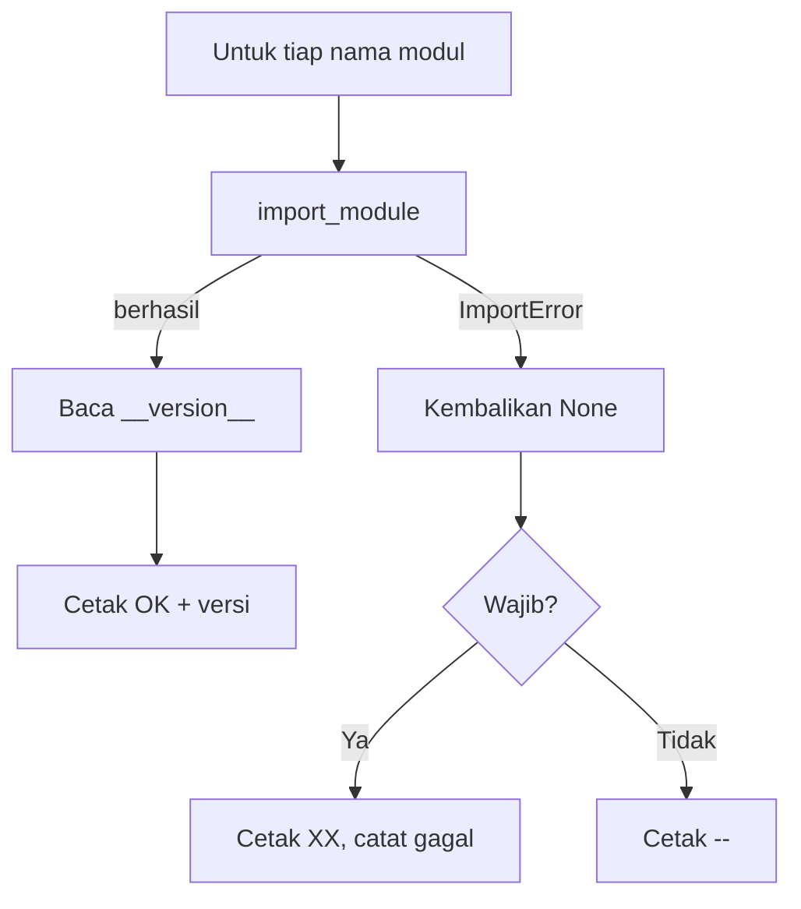

# Instalasi dan Verifikasi Lingkungan Pengembangan

!!! abstract "Info materi"
    **Tingkat kesulitan:** Pemula. **Estimasi waktu:** 45–60 menit.
    **Jenis kode:** utilitas (`examples/level-0-orientasi/verifikasi_lingkungan.py`). Output versi dan jalur pada komputer Anda akan berbeda dari contoh.

## Tujuan pembelajaran

- [ ] Memasang dependensi dasar kurikulum.
- [ ] Menjalankan skrip verifikasi dan membaca hasilnya.
- [ ] Mendiagnosis masalah instalasi yang paling umum.
- [ ] Mencatat versi paket untuk dilampirkan pada laporan eksperimen.

## Prasyarat

[Persiapan Python, Virtual Environment, pip, Jupyter, dan Git](persiapan-python.md) dengan `.venv` aktif.

## Pengantar dan motivasi

"Di komputer saya jalan" bukan bukti. Verifikasi lingkungan membuat kita tahu **versi apa** yang dipakai, sehingga hasil eksperimen dapat diulang dan galat mudah ditelusuri. Lakukan sekali di awal dan ulangi setelah mengubah paket.

## Konsep dasar

Verifikasi menjawab tiga pertanyaan:

1. Python yang aktif berasal dari `.venv`?
2. Semua paket wajib dapat di-*import*?
3. Versi paket apa yang terpasang (untuk dicatat pada laporan eksperimen)?

Satu istilah baru: **kode keluar** (*exit code*) adalah angka yang dikembalikan program ke terminal saat selesai. `0` berarti sukses; angka lain (biasanya `1`) berarti ada masalah.

## Penjelasan mendalam

### Nama paket pip berbeda dari nama modul

Yang Anda ketik pada `pip install` adalah nama paket di PyPI; yang Anda ketik pada `import` adalah nama modul. Keduanya tidak harus sama. Contoh paling terkenal: `pip install scikit-learn` tetapi `import sklearn`. Pada skrip, `PAKET_WAJIB` memakai **nama modul**.

### Paket wajib versus opsional

Paket wajib (NumPy, pandas, scikit-learn, matplotlib, Sastrawi, joblib) dibutuhkan Level 1–5. Paket opsional (FastAPI, pytest, PyTorch, Transformers) dibutuhkan hanya pada level tertentu. Kegagalan paket wajib menghentikan kurikulum; ketiadaan paket opsional tidak.

## Cara kerja atau alur proses



## Contoh sederhana

`import numpy` berhasil dan `numpy.__version__` berisi nomor versi, misalnya `"2.5.4"`. `import paket_yang_tidak_ada` melempar `ModuleNotFoundError` (turunan `ImportError`). Skrip memanfaatkan perbedaan ini.

## Contoh dalam konteks Twitter/X kebencanaan

Tim relawan menjalankan notebook klasifikasi pesan darurat di beberapa laptop. Satu laptop memberi hasil sedikit berbeda karena versi scikit-learn berbeda. Mencatat versi dari skrip verifikasi mempercepat penelusurannya. (Skenario ilustratif.)

## Praktik Python

Jalankan dari akar repository dengan `.venv` aktif:

```bash
python examples/level-0-orientasi/verifikasi_lingkungan.py
```

!!! info "Catatan sintaks untuk pemula"
    - `try: ... except ImportError: ...` mencoba sebuah operasi dan menangkap galat tertentu tanpa menghentikan program (dibahas di [Exception handling](../level-1-python/exception-handling.md)).
    - `getattr(obj, "nama", bawaan)` mengambil atribut `nama`, atau nilai `bawaan` jika tidak ada.
    - `f"{nama:12}"` menaruh `nama` dalam kolom selebar 12 karakter agar rapi.
    - `sys.exit(kode)` mengakhiri program dengan kode keluar tertentu.

### Bagian 1 — Daftar paket

```python title="Bagian 1"
--8<-- "level-0-orientasi/verifikasi_lingkungan.py:daftar"
```

`importlib` menyediakan `import_module` untuk meng-*import* dengan nama berupa string. `PAKET_WAJIB` dan `PAKET_OPSIONAL` adalah list nama modul.

### Bagian 2 — Fungsi `versi`

```python title="Bagian 2"
--8<-- "level-0-orientasi/verifikasi_lingkungan.py:versi"
```

Alur: coba meng-*import*; bila `ImportError`, kembalikan `None`; bila berhasil, kembalikan `__version__` atau teks `"terpasang"` jika modul tidak memiliki atribut itu (contoh: Sastrawi). Mengembalikan `None` untuk "tidak ada" memudahkan pemeriksaan `if v`.

Contoh pemakaian (dijalankan di mesin penulis, versi akan berbeda di komputer Anda):

```text title="Output nyata, versi berbeda tiap komputer"
2.5.4 None
```

Penjelasan: `versi("numpy")` mengembalikan `"2.5.4"` dan `versi("paket_tidak_ada")` mengembalikan `None`.

### Bagian 3 — Fungsi `main`

```python title="Bagian 3"
--8<-- "level-0-orientasi/verifikasi_lingkungan.py:main"
```

Urutannya: cetak versi dan lokasi Python, periksa tiap paket wajib (`OK` atau `XX`), lalu paket opsional (`OK` atau `--`). Jika ada yang gagal, cetak petunjuk dan kembalikan `1`; jika tidak, kembalikan `0`.

### Bagian 4 — Titik masuk

```python title="Bagian 4"
--8<-- "level-0-orientasi/verifikasi_lingkungan.py:masuk"
```

`if __name__ == "__main__":` hanya berjalan bila berkas dieksekusi langsung, bukan saat di-*import*. `sys.exit(main())` meneruskan angka yang dikembalikan `main` sebagai kode keluar program. Cara memeriksa kode keluar: `echo $?` (bash) atau `echo $LASTEXITCODE` (PowerShell).

### Output dan interpretasi

Output berikut berasal dari eksekusi pada mesin penulis (Windows, Python 3.14). Versi dan jalur pada komputer Anda akan berbeda; yang penting semua baris wajib berstatus `OK`.

```text title="Output nyata, jalur dan versi berbeda tiap komputer"
Python  : 3.14.7
Lokasi  : D:\ucup\Workspace\blog\materi-nlp\.venv\Scripts\python.exe
[OK] numpy        2.5.4
[OK] pandas       3.1.0
[OK] sklearn      1.9.1
[OK] matplotlib   3.11.2
[OK] Sastrawi     terpasang
[OK] joblib       1.6.0
[OK] fastapi      0.159.1
[OK] pytest       9.1.1
[--] torch        tidak terpasang (opsional)
[--] transformers tidak terpasang (opsional)

Lingkungan siap untuk Level 1-5.
```

Interpretasi: baris `Lokasi` harus memuat `.venv`. Baris `[--]` untuk paket opsional (`torch`, `transformers`) wajar sebelum Level 6. Kode keluar program ini `0`.

## Kesalahan umum dan debugging

| Gejala | Penyebab umum | Perbaikan |
|---|---|---|
| `ModuleNotFoundError` | `.venv` tidak aktif atau paket belum dipasang | Aktifkan `.venv`, lalu `pip install -r requirements-ml.txt` |
| `pip` memasang ke Python global | Memakai `pip` global | Gunakan `python -m pip install ...` dari `.venv` |
| Gagal membangun paket di Python terbaru | Belum ada *wheel* untuk versi Python Anda | Pakai Python versi stabil yang lebih rendah (mis. 3.12) |
| Emoji jadi `????` atau `UnicodeEncodeError` di Windows | Encoding konsol | `python -X utf8 skrip.py` atau `set PYTHONUTF8=1` |
| Notebook tidak melihat paket | Kernel Jupyter bukan dari `.venv` | `python -m ipykernel install --user --name nlp-hub` lalu pilih kernel itu |
| `Sastrawi` terdaftar `XX` | Nama pip `Sastrawi` sudah benar, mungkin belum dipasang | `pip install Sastrawi` |

## Kelebihan dan keterbatasan

**Kelebihan:** cepat, tanpa dependensi tambahan, dan hasilnya dapat disimpan.
**Keterbatasan:** hanya memeriksa bahwa paket dapat di-*import* dan versinya, bukan bahwa semua fitur bekerja; versi paket tidak dibandingkan dengan versi minimum di `requirements-ml.txt`.

## Latihan bertahap

1. **Konseptual.** Mengapa nama modul `sklearn` berbeda dari nama paket pip?
2. **Membaca kode.** Apa yang dikembalikan `versi("Sastrawi")` dan mengapa bukan nomor versi?
3. **Praktik.** Jalankan skrip dan simpan hasilnya ke `lingkungan.txt`. Jelaskan mengapa berkas itu berguna di laporan eksperimen.
4. **Mengisi kode.** Tambahkan `scipy` ke `PAKET_WAJIB`. Apa yang terjadi jika SciPy belum terpasang?
5. **Debugging.** Sebuah skrip mencetak `[XX] pandas TIDAK TERPASANG`, padahal Anda yakin sudah menjalankan `pip install pandas`. Apa penyebab paling mungkin dan cara memeriksanya?
6. **Mini-proyek.** Ubah `main` agar juga mencetak peringatan bila lokasi Python tidak memuat teks `.venv`.

## Kunci jawaban dan pembahasan

??? success "Jawaban 1"
    Nama paket di PyPI adalah `scikit-learn`, tetapi modul yang di-*import* bernama `sklearn`; keduanya tidak harus sama.

??? success "Jawaban 2"
    Modul `Sastrawi` tidak mendefinisikan `__version__`, sehingga `getattr` jatuh ke nilai bawaan `"terpasang"`. Itu sebabnya baris Sastrawi menampilkan "terpasang" alih-alih angka.

??? success "Jawaban 3"
    Di terminal: `python examples/level-0-orientasi/verifikasi_lingkungan.py > lingkungan.txt`. Berkas itu mendokumentasikan versi sehingga hasil dapat dibandingkan atau diulang orang lain.

??? success "Jawaban 4"
    Jika SciPy terpasang, ia tampil `[OK]`. Jika belum, tampil `[XX] scipy TIDAK TERPASANG`, program mengakhiri dengan kode keluar `1`, dan mencetak petunjuk pemasangan. (Scikit-learn sendiri membutuhkan SciPy, jadi biasanya sudah ada.)

??? success "Jawaban 5"
    Kemungkinan terbesar: `pip` yang dipakai milik Python lain atau `.venv` tidak aktif. Periksa dengan `python -m pip --version` dan `python -c "import sys; print(sys.executable)"`, lalu pasang dengan `python -m pip install pandas`.

??? success "Jawaban 6"
    Contoh: setelah mencetak `Lokasi`, tambahkan `if ".venv" not in sys.executable: print("Peringatan: .venv tampaknya tidak aktif")`. Catatan: ini heuristik, karena `.venv` dapat memakai nama lain.

## Kuis singkat

**1.** Apa gunanya kode keluar non-nol?

??? success "Jawaban"
    Memberi tahu skrip lain atau CI bahwa pemeriksaan gagal.

**2.** Mengapa `versi` mengembalikan `None` untuk paket yang tidak ada?

??? success "Jawaban"
    Agar pemanggil bisa memeriksa dengan `if v`; `None` bernilai salah.

**3.** Baris `Lokasi` memuat `C:\Python314\python.exe`. Apa artinya?

??? success "Jawaban"
    Python global yang dipakai; `.venv` belum aktif.

## Ringkasan

- Verifikasi lingkungan memastikan Python yang benar, paket lengkap, dan versi tercatat.
- Kebanyakan masalah berasal dari `.venv` yang tidak aktif atau `pip` dari Python lain.
- Nama paket pip bisa berbeda dari nama modul (`scikit-learn` vs `sklearn`).

## Glosarium istilah baru

Kode keluar (*exit code*)
:   Angka yang dikembalikan program ke terminal; `0` berarti sukses.

Modul
:   Berkas Python yang dapat di-*import*.

`ImportError`
:   Galat ketika modul tidak dapat di-*import*.

Wheel
:   Format paket Python yang sudah dikompilasi untuk versi Python tertentu.

Kernel Jupyter
:   Proses Python yang menjalankan sel notebook.

## Referensi

- Dokumentasi Python: `importlib` (<https://docs.python.org/3/library/importlib.html>) (dokumentasi resmi).
- Dokumentasi IPython: *Installing the IPython kernel* (<https://ipython.readthedocs.io/en/stable/install/kernel_install.html>) (dokumentasi resmi).

## Materi selanjutnya

[Mini Proyek: Mengelompokkan Teks Secara Manual](mini-proyek-manual.md)
