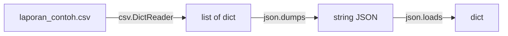

# CSV dan JSON

!!! abstract "Info materi"
    **Tingkat kesulitan:** Pemula–menengah. **Estimasi waktu:** 75–100 menit.
    **Jenis kode:** snippet edukatif (`examples/level-1-python/11_csv_json.py`) dengan data sintetis `examples/level-1-python/data/laporan_contoh.csv` (10 baris).

## Tujuan pembelajaran

- [ ] Membaca dan menulis CSV dengan `csv.DictReader` dan `csv.DictWriter`.
- [ ] Menjelaskan mengapa nilai CSV selalu berupa string.
- [ ] Mengubah dictionary menjadi JSON dan sebaliknya, dan menjelaskan opsi `ensure_ascii`.
- [ ] Menjelaskan mengapa teks dengan koma tidak boleh dipecah dengan `split(",")`.

## Prasyarat

[Membaca dan Menulis File Teks](file-teks.md) dan [Dictionary](list-tuple-set-dict.md).

## Pengantar dan motivasi

Dataset teks hampir selalu berformat CSV (tabel dengan kolom dipisah koma) atau JSON (data bersarang berbentuk
dictionary). Keduanya adalah format teks biasa, tetapi memiliki aturan sendiri tentang tanda kutip, koma, dan karakter khusus.
Salah menanganinya merusak data sebelum analisis dimulai.

## Konsep dasar

- **CSV** (*comma-separated values*): satu baris = satu rekaman; kolom dipisah koma; baris pertama biasanya **header** (nama kolom).
- **JSON** (*JavaScript Object Notation*): struktur bersarang berisi objek `{}` (setara dictionary), larik `[]` (setara list), string, angka, `true`/`false`/`null`.

| JSON | Python |
|---|---|
| objek `{}` | `dict` |
| larik `[]` | `list` |
| string, angka | `str`, `int`/`float` |
| `true`/`false`/`null` | `True`/`False`/`None` |

## Penjelasan mendalam

### Semua isi CSV adalah string

CSV tidak menyimpan tipe. Nilai `1` di kolom `id` terbaca `'1'` (Bagian 1). Untuk analisis numerik, konversi sendiri
(`int(...)`) atau gunakan pandas yang menebak tipe (halaman pandas).

### Mengapa tidak `split(",")`

Teks yang berisi koma ("banjir, air naik") ditulis CSV dalam tanda kutip: `1,"banjir, air naik"`.
`str.split(",")` tidak mengenal tanda kutip dan memecah teks menjadi tiga kolom (Bagian 3). Pustaka `csv` menangani kutipan
dan baris baru di dalam sel.

### `newline=""` dan encoding

Saat membuka CSV, pakai `newline=""` (agar `csv` mengatur baris baru sendiri) dan `encoding="utf-8"` (halaman sebelumnya).

### `ensure_ascii` pada JSON

Secara bawaan `json.dumps` menulis karakter non-ASCII sebagai urutan escape `\uXXXX`. Emoji 🙏 (di luar BMP)
ditulis sebagai **pasangan surrogate** `\ud83d\ude4f`. Ini JSON yang sah dan dapat dibaca kembali menjadi karakter yang sama, tetapi sulit
dibaca manusia. `ensure_ascii=False` menulis karakter apa adanya (pastikan berkas disimpan sebagai UTF-8).

### Kapan CSV, kapan JSON

CSV cocok untuk tabel datar (satu postingan per baris). JSON cocok untuk data bersarang (satu postingan dengan daftar
hashtag dan metadata). Pada proyek ini dataset berformat CSV (`text`, `label`).

## Cara kerja atau alur proses



## Contoh sederhana

```python
import json
json.dumps({"label": "Emergency"})   # '{"label": "Emergency"}'
```

## Contoh dalam konteks Twitter/X kebencanaan

Sebuah CSV berisi 10 laporan sintetis (id, teks, label, lokasi). Kita membaca semuanya, menyaring yang `Emergency`,
dan menyimpan satu laporan sebagai JSON untuk dikirim ke sebuah layanan (mis. API di Level 7).

## Praktik Python

Berkas: `examples/level-1-python/11_csv_json.py`. Data: `data/laporan_contoh.csv`, jalur dibuat dengan `Path(__file__).parent / "data" / ...` agar benar dari folder mana pun skrip dijalankan.

### Bagian 1 — Membaca CSV

```python title="Bagian 1"
--8<-- "level-1-python/11_csv_json.py:csv_baca"
```

`csv.DictReader(f)` membaca tiap baris sebagai dictionary dengan nama kolom sebagai kunci; `list(...)` memuat semuanya. `baris[0]["id"]` adalah nilai kolom `id` baris pertama.

```text title="Output nyata"
10 {'id': '1', 'teks': 'Banjir setinggi dada di Jl. Melati mohon evakuasi', 'label': 'Emergency', 'lokasi': 'Jakarta'}
str
```

Interpretasi: 10 rekaman. Perhatikan `'id': '1'`: nilainya **string**, bukan angka. Baris kedua mengonfirmasi tipenya `str`. Konversi dengan `int()` bila perlu menghitung.

### Bagian 2 — Menyaring

```python title="Bagian 2"
--8<-- "level-1-python/11_csv_json.py:saring"
```

```text title="Output nyata"
['Emergency', 'Non-Emergency']
5
```

Interpretasi: set comprehension mengumpulkan label unik; list comprehension memilih rekaman `Emergency`: 5 dari 10.

### Bagian 3 — Menulis CSV dan jebakan `split(",")`

```python title="Bagian 3"
--8<-- "level-1-python/11_csv_json.py:csv_tulis"
```

`io.StringIO()` adalah "berkas di memori" agar tidak perlu membuat berkas sungguhan. `DictWriter` menulis header dan baris.

```text title="Output nyata"
['id,teks', '1,"banjir, air naik"']
split salah: ['1', 'banjir', ' air naik']
```

Interpretasi: `DictWriter` otomatis menaruh teks yang berkoma dalam tanda kutip. `split(",")` pada baris yang sama menghasilkan **tiga** potongan: kolom teks terbelah menjadi dua. Selalu pakai modul `csv`.

### Bagian 4 — JSON

```python title="Bagian 4"
--8<-- "level-1-python/11_csv_json.py:json"
```

`json.dumps` mengubah dictionary menjadi string JSON; `json.loads` mengubah string JSON menjadi dictionary.

```text title="Output nyata"
{"id": "1", "teks": "Banjir setinggi dada di Jl. Melati mohon evakuasi", "label": "Emergency", "lokasi": "Jakarta"}
Jakarta dict
```

Interpretasi: string JSON mirip dictionary Python tetapi berupa teks. Setelah `loads`, `kembali` kembali berupa `dict` dan `kembali["lokasi"]` = `Jakarta`.

### Bagian 5 — Emoji dan `ensure_ascii`

```python title="Bagian 5"
--8<-- "level-1-python/11_csv_json.py:ascii"
```

```text title="Output nyata"
{"teks": "tolong \ud83d\ude4f"}
True
True
```

Interpretasi:

- Baris pertama (bawaan `ensure_ascii=True`): emoji ditulis sebagai dua escape `\ud83d\ude4f` (pasangan surrogate). Yang tercetak adalah **teks** `\ud83d\ude4f`, bukan gambar.
- Baris kedua: dengan `ensure_ascii=False` emoji ditulis apa adanya; perbandingan dengan string yang diharapkan `True`.
- Baris ketiga: JSON versi escape tetap dapat dibaca kembali menjadi karakter 🙏 yang sama (`True`). Jadi keduanya sah; yang berbeda hanya keterbacaan manusia.

### Skrip terpadu

Kelima bagian adalah satu skrip: `11_csv_json.py`.

## Kesalahan umum dan debugging

| Gejala | Penyebab | Perbaikan |
|---|---|---|
| Teks dengan koma terpecah | Memakai `split(",")` | Gunakan `csv.reader`/`DictReader` |
| Angka tidak bisa dijumlah (`TypeError`) | Nilai CSV adalah string | Konversi dengan `int()`/`float()` |
| Baris kosong ekstra di Windows | Tidak memakai `newline=""` | `open(..., newline="")` |
| Karakter rusak | Encoding tidak disebut | `encoding="utf-8"` |
| JSON tampak penuh `\uXXXX` | `ensure_ascii=True` (bawaan) | `ensure_ascii=False` bila ingin terbaca (simpan sebagai UTF-8) |
| `json.decoder.JSONDecodeError` | String bukan JSON valid (mis. kutip tunggal) | Pakai tanda kutip ganda; validasi sumber |
| Menyimpan data pribadi di contoh | Tidak menyaring | Pakai data sintetis; hapus identitas |

## Kelebihan dan keterbatasan

**CSV:** sederhana, kompak, didukung semua alat; tanpa tipe dan tanpa data bersarang. **JSON:** mendukung struktur bersarang
dan tipe dasar; lebih besar dan kurang cocok untuk tabel besar. Keduanya tidak menyimpan metadata seperti encoding.

## Latihan bertahap

1. **Konseptual.** Mengapa nilai pada `DictReader` selalu string?
2. **Membaca kode.** Perkirakan `json.loads('{"a": [1, 2]}')["a"][1]`.
3. **Mengisi kode.** Lengkapi agar mengambil id rekaman pertama sebagai bilangan bulat: `int(baris[0][___])`.
4. **Debugging.** CSV Anda berisi `3,"Rumah terbakar, tolong"` dan `split(",")` menghasilkan tiga potongan. Mengapa, dan apa perbaikannya?
5. **Program kecil.** Baca `laporan_contoh.csv`, hitung jumlah laporan per label dengan dictionary, dan cetak hasilnya sebagai JSON.

## Kunci jawaban dan pembahasan

??? success "Jawaban 1"
    CSV hanya teks; tidak ada informasi tipe. `csv` tidak menebak, jadi semua nilai berupa `str`. Konversi dilakukan oleh pembaca data.

??? success "Jawaban 2"
    `2`. `loads` mengubah objek menjadi dict; `["a"]` adalah list `[1, 2]`; `[1]` mengambil elemen kedua.

??? success "Jawaban 3"
    `"id"`: `int(baris[0]["id"])` menghasilkan 1.

??? success "Jawaban 4"
    `split(",")` tidak mengenal tanda kutip sehingga koma di dalam teks ikut memecah. Perbaikan: `csv.reader` atau `DictReader`, yang memahami kutipan.

??? success "Jawaban 5"
    ```python
    hitung = {}
    for b in baris:
        hitung[b["label"]] = hitung.get(b["label"], 0) + 1
    print(json.dumps(hitung, ensure_ascii=False))
    ```
    Untuk data pada berkas ini hasilnya `{"Emergency": 5, "Non-Emergency": 5}`.

## Kuis singkat

**1.** Apa tipe nilai `baris[0]["id"]`?

??? success "Jawaban"
    `str`.

**2.** Mengapa `ensure_ascii=False` kadang dipakai?

??? success "Jawaban"
    Agar karakter non-ASCII tertulis apa adanya dan terbaca manusia, bukan urutan `\uXXXX`.

**3.** Mengapa `csv` lebih baik daripada `split(",")`?

??? success "Jawaban"
    Ia memahami tanda kutip, koma di dalam teks, dan baris baru di dalam sel.

## Ringkasan

- CSV: tabel datar, semua nilai `str`; pakai modul `csv`, bukan `split(",")`.
- JSON: data bersarang; `dumps`/`loads` mengubah dict ↔ string.
- `ensure_ascii` menentukan emoji ditulis sebagai `\ud83d\ude4f` atau apa adanya; keduanya sah.

## Glosarium istilah baru

CSV
:   Format tabel teks dengan kolom dipisah koma.

JSON
:   Format data bersarang berbasis teks (objek, larik, string, angka).

Header
:   Baris pertama CSV berisi nama kolom.

Serialisasi / deserialisasi
:   Mengubah objek ke teks (`dumps`) / teks ke objek (`loads`).

Pasangan surrogate
:   Dua kode `\uXXXX` yang mewakili satu karakter di luar BMP, seperti emoji.

## Referensi

- Dokumentasi Python, modul `csv`: <https://docs.python.org/3/library/csv.html> (dokumentasi resmi).
- Dokumentasi Python, modul `json`: <https://docs.python.org/3/library/json.html> (dokumentasi resmi; menjelaskan `ensure_ascii`).

## Materi selanjutnya

[Dasar NumPy](numpy-dasar.md)
