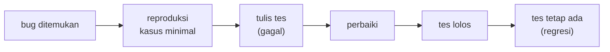

# Debugging dan Pengujian Kode Sederhana

!!! abstract "Info materi"
    **Tingkat kesulitan:** Menengah. **Estimasi waktu:** 90–120 menit.
    **Jenis kode:** snippet edukatif (`examples/level-1-python/16_debugging_pengujian.py`). Bagian pytest memerlukan `pytest` (`pip install -r requirements-ml.txt`) dan memakai berkas uji sementara.

## Tujuan pembelajaran

- [ ] Menjalankan langkah debugging yang sistematis: reproduksi, baca traceback, hipotesis, periksa nilai, perbaiki, uji.
- [ ] Menulis uji dengan `assert` untuk kasus normal, kasus tepi, dan galat.
- [ ] Menjalankan `pytest` dan membaca keluarannya saat sebuah tes gagal.
- [ ] Menjelaskan mengapa tes ditulis untuk bug yang sudah ditemukan (tes regresi).

## Prasyarat

[Function dan Parameter](function-parameter.md) dan [Exception Handling](exception-handling.md).

## Pengantar dan motivasi

Kode yang berjalan belum tentu benar. Pada NLP, bug sering sunyi: preprocessing yang salah tidak membuat program berhenti, hanya
membuat model belajar dari data rusak. Dua kebiasaan melindungi kita: **debugging yang terstruktur** (mencari penyebab, bukan menebak)
dan **pengujian otomatis** (memeriksa perilaku setiap kali kode berubah).

## Konsep dasar

**Debugging** adalah menemukan dan memperbaiki penyebab perilaku yang salah. **Pengujian** adalah menulis kode kecil yang
memeriksa perilaku kode lain. **Unit test** menguji satu function kecil.

Langkah debugging:

1. **Reproduksi**: temukan masukan terkecil yang memicu masalah.
2. **Baca pesan galat** (baris terakhir traceback).
3. **Hipotesis**: tebak penyebab yang spesifik.
4. **Periksa nilai**: cetak variabel (`print`, `repr`, `type`, `shape`) di titik yang dicurigai.
5. **Perbaiki** satu hal.
6. **Tulis tes** yang gagal sebelum perbaikan dan lolos sesudahnya.

## Penjelasan mendalam

### `assert` sebagai tes paling sederhana

`assert kondisi, "pesan"` tidak melakukan apa-apa jika kondisi benar, dan menimbulkan `AssertionError` jika salah. Kumpulan
`assert` dalam sebuah function `tes_...` sudah merupakan tes. Kelemahannya: tes pertama yang gagal menghentikan semuanya,
dan tidak ada ringkasan.

### Apa yang diuji

| Jenis | Pertanyaan | Contoh |
|---|---|---|
| Kasus normal | Benar untuk masukan biasa? | `"banjir naik"` → 2 |
| Kasus tepi | Benar di batas? | `""` → 0; spasi berlebih |
| Galat | Masukan salah ditolak jelas? | `[]` → `ValueError` |
| Regresi | Bug lama tidak kembali? | Kasus yang pernah gagal |

### `pytest`

`pytest` menemukan function berawalan `test_` di berkas `test_*.py`, menjalankannya, dan melaporkan hasil serta
**nilai yang dibandingkan** saat gagal (Bagian 5). Ini yang dipakai pada paket `nlp_hub` di
[Level 2](../level-2-fondasi-teks/pipeline-teruji.md).

### Mencari bug dengan `print` dan `repr`

`print` terbaik untuk melihat nilai antara; `repr` memperlihatkan spasi dan karakter tak terlihat (Bagian 4). Pelacak interaktif
(`breakpoint()`, debugger di editor) berguna untuk alur yang rumit, tetapi `print` yang terarah sering cukup.

### Bug sunyi: hasil salah tanpa galat

Galat yang menghentikan program mudah dilacak. Yang sulit adalah hasil salah tanpa pesan. Karena itu tes harus memeriksa **nilai
yang diharapkan** untuk kasus tepi, bukan sekadar "tidak galat".

## Cara kerja atau alur proses



## Contoh sederhana

```python
assert 2 + 2 == 4        # lolos, tidak ada keluaran
assert 2 + 2 == 5        # AssertionError
```

## Contoh dalam konteks Twitter/X kebencanaan

Function `hitung_kata` menghitung jumlah kata sebuah laporan. Kita menguji pada kasus normal, teks kosong, dan spasi berlebih. Lalu kita
menemukan function `rata_kata_salah` yang membagi dengan nol bila daftar laporan kosong.

## Praktik Python

Berkas: `examples/level-1-python/16_debugging_pengujian.py`. Bagian 1 sampai 5 berada di bawah `if __name__ == "__main__":`, sehingga hanya berjalan saat berkas dijalankan langsung (halaman [Import](import-modul.md)).

### Bagian 1 — Function dan tesnya

```python title="Bagian 1: function dan tes"
--8<-- "level-1-python/16_debugging_pengujian.py:fungsi"
```

`tes_hitung_kata` memuat tiga `assert`: kasus normal, teks kosong, dan spasi berlebih. `split()` tanpa argumen mengabaikan spasi berlebih dan menghasilkan daftar kosong untuk teks kosong.

### Bagian 2 — Menjalankan tes dan satu tes yang gagal

```python title="Bagian 2"
--8<-- "level-1-python/16_debugging_pengujian.py:jalan"
```

```text title="Output nyata"
semua tes lolos
AssertionError: seharusnya 2 kata
```

Interpretasi: ketiga `assert` pada `tes_hitung_kata` lolos (tidak ada keluaran sampai `print`). Pada bagian kedua, kami sengaja memasang harapan salah (`== 3`); `AssertionError` membawa pesan "seharusnya 2 kata" yang kita tulis. Pesan yang baik menyebut apa yang diharapkan.

### Bagian 3 — Mencari penyebab bug

```python title="Bagian 3: kode"
--8<-- "level-1-python/16_debugging_pengujian.py:bug"
```

```python title="Bagian 3: menjalankan"
--8<-- "level-1-python/16_debugging_pengujian.py:hunting"
```

```text title="Output nyata"
1.5
ZeroDivisionError: division by zero
ValueError: daftar tidak boleh kosong
```

Interpretasi: untuk `["banjir naik", "gempa"]` rata-rata kata (2+1)/2 = 1,5 (benar). Pada daftar kosong, `rata_kata_salah` menimbulkan `ZeroDivisionError` (pembagian dengan `len(daftar)` = 0), pesan yang tidak menjelaskan masalah sebenarnya. `rata_kata` memeriksa lebih dulu dan menolak masukan kosong dengan pesan jelas, dan itulah perbaikan. Tes regresi yang sesuai: `rata_kata([])` harus menimbulkan `ValueError`.

### Bagian 4 — `print` dan `repr` untuk melihat nilai

```python title="Bagian 4"
--8<-- "level-1-python/16_debugging_pengujian.py:print_debug"
```

```text title="Output nyata"
'tolong,  air naik' ['tolong,', 'air', 'naik'] ['tolong,', '', 'air', 'naik']
```

Interpretasi: `repr` menunjukkan dua spasi di tengah. `split()` tanpa argumen mengabaikan spasi berlebih (3 kata), sedangkan `split(" ")` menghasilkan elemen kosong `''` (4 elemen). Dari sini kita mengetahui mengapa menghitung kata dengan `split(" ")` memberi hasil berlebih.

### Bagian 5 — `pytest`

```python title="Bagian 5"
--8<-- "level-1-python/16_debugging_pengujian.py:pytest"
```

Skrip menulis berkas `test_contoh.py` ke folder sementara berisi dua tes (satu sengaja salah), menjalankan `python -m pytest -q`, lalu mengambil ringkasan dan dua baris galat dari keluarannya.

```text title="Output nyata"
ringkasan pytest: 1 failed, 1 passed
['E       AssertionError: assert 0 == 1', "E        +  where 0 = hitung_kata('')"]
```

Interpretasi: satu tes lolos dan satu gagal. Baris `E` memperlihatkan **nilai sebenarnya**: `assert 0 == 1` dan bahwa `hitung_kata('')` menghasilkan 0. Berbeda dengan `assert` biasa, `pytest` menampilkan nilai yang dibandingkan sehingga kita langsung tahu mana yang salah (di sini harapannya yang keliru, bukan function-nya).

### Skrip terpadu

Seluruh bagian adalah satu berkas: `16_debugging_pengujian.py`.

## Kesalahan umum dan debugging

| Gejala | Penyebab | Perbaikan |
|---|---|---|
| Tes lolos tetapi program salah | Tes hanya memeriksa kasus mudah | Tambahkan kasus tepi dan kasus dari bug nyata |
| Menebak perbaikan acak | Tidak mereproduksi masalah | Buat contoh minimal; periksa nilai dengan `print`/`repr` |
| Perbaikan merusak hal lain | Tidak ada tes | Jalankan seluruh tes setelah mengubah kode |
| `AssertionError` tanpa pesan | `assert` tanpa penjelasan | `assert kondisi, "yang diharapkan"` atau gunakan pytest |
| Tes bergantung urutan atau data acak | Tes tidak deterministik | Tetapkan seed; hindari ketergantungan antar tes |
| `assert` dimatikan dengan `python -O` | `assert` bukan untuk validasi masukan | Gunakan `raise ValueError` untuk validasi masukan, `assert` untuk tes |

## Kelebihan dan keterbatasan

**Kelebihan:** tes menangkap regresi cepat, mendokumentasikan perilaku, dan membuat perubahan aman. **Keterbatasan:** tes hanya menjamin yang diuji;
menulis tes butuh waktu; tes yang lolos bukan bukti kode benar pada data nyata.

## Latihan bertahap

1. **Konseptual.** Mengapa tes sebaiknya mencakup kasus tepi seperti teks kosong?
2. **Membaca kode.** Apa hasil `"a  b".split()` dan `"a  b".split(" ")`?
3. **Mengisi kode.** Tambahkan `assert` pada `tes_hitung_kata` untuk `"banjir"` agar bernilai 1.
4. **Debugging.** Seseorang memanggil `rata_kata_salah([])` dan mendapat `ZeroDivisionError`. Tulis perubahan minimal yang membuatnya menolak masukan dengan pesan jelas.
5. **Program kecil.** Tulis function `huruf_kapital_awal(teks)` yang mengembalikan `True` bila huruf pertama kapital, dengan tes untuk `"Banjir"`, `"banjir"`, dan `""`.

## Kunci jawaban dan pembahasan

??? success "Jawaban 1"
    Kasus tepi sering memicu bug yang tidak muncul pada masukan biasa (pembagian nol, indeks di luar batas); memeriksanya mencegah galat di data nyata.

??? success "Jawaban 2"
    `['a', 'b']` dan `['a', '', 'b']`. `split()` tanpa argumen mengabaikan spasi berlebih; `split(" ")` menghasilkan elemen kosong.

??? success "Jawaban 3"
    `assert hitung_kata("banjir") == 1`.

??? success "Jawaban 4"
    Tambahkan di awal function: `if not daftar: raise ValueError("daftar tidak boleh kosong")`. Itulah yang dilakukan `rata_kata` pada Bagian 3.

??? success "Jawaban 5"
    ```python
    def huruf_kapital_awal(teks):
        return bool(teks) and teks[0].isupper()

    assert huruf_kapital_awal("Banjir") is True
    assert huruf_kapital_awal("banjir") is False
    assert huruf_kapital_awal("") is False
    ```
    `bool(teks) and ...` mencegah `IndexError` pada teks kosong (kasus tepi).

## Kuis singkat

**1.** Apa yang terjadi bila `assert` kondisinya salah?

??? success "Jawaban"
    Python menimbulkan `AssertionError`.

**2.** Apa langkah pertama debugging?

??? success "Jawaban"
    Mereproduksi masalah dengan masukan sekecil mungkin.

**3.** Mengapa `pytest` lebih informatif daripada `assert` biasa?

??? success "Jawaban"
    Ia menampilkan nilai-nilai yang dibandingkan dan merangkum banyak tes.

## Ringkasan

- Debugging: reproduksi, baca galat, hipotesis, periksa nilai, perbaiki, tulis tes.
- Uji kasus normal, tepi, galat, dan regresi; `assert` untuk tes sederhana, `pytest` untuk proyek.
- Bug sunyi lebih berbahaya daripada galat yang menghentikan program.

## Glosarium istilah baru

Debugging
:   Menemukan dan memperbaiki penyebab perilaku salah.

Unit test
:   Pemeriksaan otomatis atas satu perilaku kecil.

Kasus tepi
:   Masukan di batas atau tak lazim (kosong, nol, spasi berlebih).

Tes regresi
:   Tes yang menjaga agar bug yang sudah diperbaiki tidak kembali.

`pytest`
:   Kerangka pengujian untuk Python.

## Referensi

- Dokumentasi pytest, *Get Started*: <https://docs.pytest.org/en/stable/getting-started.html> (dokumentasi resmi).
- Dokumentasi Python, pernyataan `assert`: <https://docs.python.org/3/reference/simple_stmts.html#the-assert-statement> (dokumentasi resmi).

## Materi selanjutnya

Level 1 selesai. Lanjut ke [Level 2: Fondasi Teks dan Preprocessing](../level-2-fondasi-teks/index.md).
