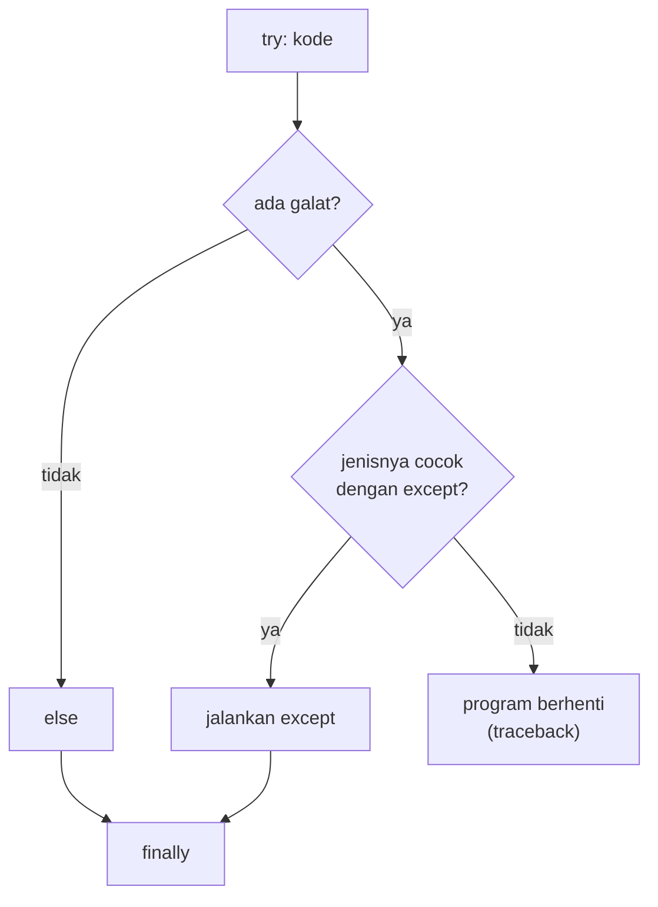

# Exception Handling

!!! abstract "Info materi"
    **Tingkat kesulitan:** Pemula–menengah. **Estimasi waktu:** 75–100 menit.
    **Jenis kode:** snippet edukatif (`examples/level-1-python/09_exception_handling.py`).

## Tujuan pembelajaran

- [ ] Menjelaskan apa itu *exception* dan bagaimana program berhenti saat terjadi.
- [ ] Menulis `try`/`except`/`else`/`finally` dan memilih jenis galat yang tepat.
- [ ] Membangkitkan galat sendiri dengan `raise` untuk masukan yang tidak valid.
- [ ] Menjelaskan mengapa `except Exception` yang terlalu lebar berbahaya.
- [ ] Membaca *traceback* dari baris terakhir.

## Prasyarat

[Function dan Parameter](function-parameter.md).

## Pengantar dan motivasi

Data nyata berantakan: sel kosong, angka bertuliskan "dua belas", berkas yang hilang. Tanpa
penanganan, satu baris bermasalah menghentikan seluruh pemrosesan jutaan baris. *Exception handling*
memungkinkan program mengenali masalah tertentu dan memilih tindakan: melewatinya, mencatatnya, atau berhenti
dengan pesan yang jelas.

## Konsep dasar

Saat sesuatu yang tidak mungkin terjadi, Python **membangkitkan (raise) exception**. Jika tidak ada
yang menangkapnya, program berhenti dan mencetak *traceback*.

```python
try:
    ...            # kode yang mungkin gagal
except JenisGalat:
    ...            # tindakan bila JenisGalat terjadi
else:
    ...            # berjalan bila TIDAK ada galat
finally:
    ...            # selalu berjalan (pembersihan)
```

| Galat | Kapan terjadi |
|---|---|
| `ValueError` | Nilai tidak cocok: `int("dua belas")` |
| `TypeError` | Tipe salah: `"5" + 5` |
| `KeyError` | Kunci dictionary tidak ada |
| `IndexError` | Indeks di luar batas |
| `ZeroDivisionError` | Pembagian dengan nol |
| `FileNotFoundError` | Berkas tidak ada |

## Penjelasan mendalam

### Tangkap yang spesifik

Tangkap **jenis galat yang Anda harapkan** dan tahu cara menanganinya. `except ValueError` untuk konversi angka
masuk akal. `except Exception` menangkap hampir semuanya, termasuk galat yang disebabkan bug di kode Anda;
hasilnya program tampak berjalan tetapi salah (Bagian 5).

### `else` dan `finally`

`else` menaruh kode yang bergantung pada keberhasilan `try` di luar blok yang dijaga, sehingga galat
dari kode itu tidak tertangkap keliru. `finally` selalu berjalan; dipakai untuk pembersihan seperti menutup
berkas (walau `with` biasanya lebih rapi; halaman File Teks).

### Kapan membangkitkan galat sendiri

Function yang menerima masukan tidak valid sebaiknya **gagal keras dengan pesan jelas** (`raise ValueError(...)`)
daripada mengembalikan hasil sembarangan. Pesan yang baik menyebut apa yang salah dan apa yang diharapkan.

### Membaca traceback

Traceback ditulis dari panggilan paling awal ke yang terakhir. **Baca baris terakhir dahulu**: jenis dan pesan galat.
Lalu cari baris dari berkas Anda sendiri; itulah tempat mencari penyebabnya (Bagian 6).

### Alternatif: periksa dulu atau minta maaf kemudian

"Look before you leap" (periksa `if teks.isdigit()` sebelum `int`) versus "easier to ask forgiveness"
(`try`/`except`). Gaya kedua umum di Python dan lebih andal untuk kasus yang sulit diperiksa di muka.

## Cara kerja atau alur proses



## Contoh sederhana

```python
try:
    int("abc")
except ValueError:
    print("bukan angka")
```

## Contoh dalam konteks Twitter/X kebencanaan

Kolom "jumlah korban" pada CSV kadang berisi teks seperti "dua orang" atau kosong. Function konversi yang aman
mengembalikan `None` untuk nilai tidak valid, lalu nilai itu ditangani terpisah (halaman Missing Values).

## Praktik Python

Berkas: `examples/level-1-python/09_exception_handling.py`.

### Bagian 1 — `try`/`except` dasar

```python title="Bagian 1"
--8<-- "level-1-python/09_exception_handling.py:dasar"
```

```text title="Output nyata"
12 None
```

Interpretasi: `"12"` dikonversi menjadi 12; `"dua belas"` memicu `ValueError`, ditangkap, dan function mengembalikan `None`.

### Bagian 2 — Beberapa jenis galat

```python title="Bagian 2"
--8<-- "level-1-python/09_exception_handling.py:jenis"
```

`except JenisGalat as e` menyimpan objek galat di `e`; mencetaknya menampilkan pesan.

```text title="Output nyata"
KeyError: 'b'
IndexError: list index out of range
ZeroDivisionError: division by zero
selesai
```

Interpretasi: tiga galat berbeda, masing-masing ditangkap dengan jenis yang sesuai. `finally` mencetak `selesai` terlepas dari galat.

### Bagian 3 — `else` dan `finally`

```python title="Bagian 3"
--8<-- "level-1-python/09_exception_handling.py:else"
```

```text title="Output nyata"
angka valid: 7
diperiksa: '7'
bukan angka: 'x'
diperiksa: 'x'
```

Interpretasi: untuk `"7"`, `else` berjalan; untuk `"x"`, `except` berjalan. `finally` berjalan pada **keduanya**.

### Bagian 4 — Membangkitkan galat sendiri

```python title="Bagian 4"
--8<-- "level-1-python/09_exception_handling.py:raise"
```

```text title="Output nyata"
ValueError: daftar teks tidak boleh kosong
3.0
```

Interpretasi: `rata_panjang([])` akan membagi dengan 0; alih-alih `ZeroDivisionError` yang membingungkan, function menolak masukan kosong dengan pesan jelas. Untuk `["aa", "bbbb"]`, rata-rata (2+4)/2 = 3,0.

### Bagian 5 — Galat yang tersembunyi

```python title="Bagian 5"
--8<-- "level-1-python/09_exception_handling.py:terlalu_lebar"
```

```text title="Output nyata"
2.0 0 0
```

Interpretasi: `hitung(6, 0)` mengembalikan 0 (mungkin diinginkan), tetapi `hitung("6", 3)` juga 0 padahal itu **bug tipe** (`"6" / 3` menimbulkan `TypeError`). `except Exception` menutupi keduanya. Tangkap `ZeroDivisionError` saja.

### Bagian 6 — Membaca traceback

```python title="Bagian 6"
--8<-- "level-1-python/09_exception_handling.py:traceback"
```

`traceback.format_exc()` mengembalikan teks traceback; kita ambil baris terakhir dan hitung baris berawalan `File`.

```text title="Output nyata"
ValueError: invalid literal for int() with base 10: 'abc'
3 frame pemanggilan
```

Interpretasi: baris terakhir langsung menyebut jenis galat (`ValueError`) dan penyebabnya (`'abc'` bukan bilangan bulat). Tiga *frame* menunjukkan rantai pemanggilan: kode utama → `level_2` → `level_3`.

### Skrip terpadu

Keenam bagian adalah satu skrip: `09_exception_handling.py`.

## Kesalahan umum dan debugging

| Gejala | Penyebab | Perbaikan |
|---|---|---|
| Program tampak jalan tetapi hasil salah | `except Exception` menelan bug | Tangkap galat spesifik; catat galat tak terduga |
| `except:` tanpa jenis | Menangkap bahkan Ctrl+C | Selalu sebut jenis galat |
| Kode yang bergantung pada keberhasilan di dalam `try` | Galat lain tertangkap keliru | Pindahkan ke `else` |
| Pesan galat tidak membantu | `raise ValueError()` tanpa pesan | Tulis pesan: apa yang salah, apa yang diharapkan |
| Galat diabaikan diam-diam | `except ...: pass` | Catat atau tangani; jangan diam |

## Kelebihan dan keterbatasan

**Kelebihan:** program tahan terhadap data kotor; pesan galat jelas mempercepat debugging. **Keterbatasan:** terlalu banyak
`try` membuat alur kabur; menangkap terlalu lebar menyembunyikan bug; galat bukan pengganti validasi data yang baik.

## Latihan bertahap

1. **Konseptual.** Kapan blok `finally` berjalan?
2. **Membaca kode.** Perkirakan `ke_angka("3.5")` bila function `ke_angka` seperti Bagian 1 (`int(teks)`).
3. **Mengisi kode.** Tangkap `FileNotFoundError` saat membuka `"tidak_ada.txt"` dan cetak `berkas hilang`.
4. **Debugging.** Mengapa `except Exception` pada `hitung("6", 3)` (Bagian 5) berbahaya?
5. **Program kecil.** Tulis `muat_angka(daftar)` yang mengonversi tiap string ke `int`, melewati nilai tidak valid, dan mengembalikan daftar angka valid beserta jumlah yang dilewati.

## Kunci jawaban dan pembahasan

??? success "Jawaban 1"
    Selalu: baik ada galat maupun tidak (dan walaupun ada `return`), sehingga cocok untuk pembersihan.

??? success "Jawaban 2"
    `None`. `int("3.5")` menimbulkan `ValueError` (string desimal tidak dapat dikonversi langsung oleh `int`), yang ditangkap. Gunakan `float("3.5")` bila memang ingin desimal.

??? success "Jawaban 3"
    ```python
    try:
        open("tidak_ada.txt", encoding="utf-8")
    except FileNotFoundError:
        print("berkas hilang")
    ```

??? success "Jawaban 4"
    `"6" / 3` adalah `TypeError`, kesalahan tipe yang seharusnya diperbaiki. `except Exception` mengubahnya menjadi `0` diam-diam, sehingga bug tidak terlihat dan hasil salah.

??? success "Jawaban 5"
    ```python
    def muat_angka(daftar):
        angka, lewat = [], 0
        for s in daftar:
            try:
                angka.append(int(s))
            except ValueError:
                lewat += 1
        return angka, lewat

    print(muat_angka(["3", "dua", "5"]))   # ([3, 5], 1)
    ```
    Melaporkan jumlah yang dilewati membuat data yang hilang terlihat, bukan diam-diam.

## Kuis singkat

**1.** Galat apa yang muncul dari `int("abc")`?

??? success "Jawaban"
    `ValueError`.

**2.** Mengapa `except Exception` sering dihindari?

??? success "Jawaban"
    Ia menangkap juga bug kode sendiri sehingga masalah tersembunyi.

**3.** Baris traceback mana yang dibaca lebih dulu?

??? success "Jawaban"
    Baris terakhir: jenis dan pesan galat.

## Ringkasan

- `try`/`except` menangkap galat tertentu; `else` untuk sukses, `finally` untuk pembersihan.
- `raise` memberi pesan jelas untuk masukan tidak valid.
- Tangkap yang spesifik; baca traceback dari baris terakhir.

## Glosarium istilah baru

Exception
:   Objek galat yang dibangkitkan saat sesuatu tidak mungkin dilakukan.

Traceback
:   Jejak pemanggilan function yang ditampilkan saat galat tidak tertangkap.

`raise`
:   Perintah membangkitkan exception secara sengaja.

`finally`
:   Blok yang selalu berjalan setelah `try`.

## Referensi

- Dokumentasi Python, *Errors and Exceptions* (tutorial): <https://docs.python.org/3/tutorial/errors.html> (dokumentasi resmi).
- Dokumentasi Python, *Built-in Exceptions*: <https://docs.python.org/3/library/exceptions.html> (dokumentasi resmi).

## Materi selanjutnya

[Membaca dan Menulis File Teks](file-teks.md)
