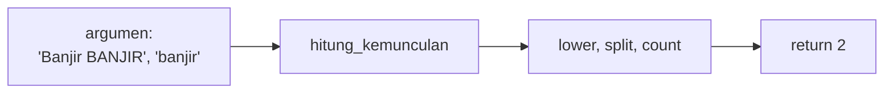

# Function dan Parameter

!!! abstract "Info materi"
    **Tingkat kesulitan:** Pemula–menengah. **Estimasi waktu:** 90–120 menit.
    **Jenis kode:** snippet edukatif (`examples/level-1-python/07_function_parameter.py`).

## Tujuan pembelajaran

- [ ] Mendefinisikan function dengan parameter posisi, bawaan, dan *keyword-only*.
- [ ] Membedakan `return` dari `print` dan memahami nilai `None` bila tidak ada `return`.
- [ ] Mengembalikan beberapa nilai dan memecahnya (*unpacking*).
- [ ] Menghindari jebakan argumen bawaan yang dapat diubah dan memahami lingkup variabel.
- [ ] Menulis docstring dan anotasi tipe sederhana.

## Prasyarat

[Perulangan](perulangan.md) dan [Kondisional](kondisional.md).

## Pengantar dan motivasi

Bila langkah yang sama dipakai di banyak tempat (membersihkan teks, menghitung kata), menyalinnya
berulang membuat kode panjang dan rawan salah. *Function* membungkus langkah itu dengan nama,
sehingga cukup ditulis sekali, diuji sekali, dan dipanggil di mana pun. Seluruh preprocessing
di [Level 2](../level-2-fondasi-teks/pipeline-teruji.md) adalah kumpulan function kecil.

## Konsep dasar

```python
def nama_fungsi(parameter1, parameter2=nilai_bawaan):
    """Penjelasan singkat (docstring)."""
    ...
    return hasil
```

- **Parameter**: nama di definisi (`teks`, `kata`). **Argumen**: nilai yang diberikan saat memanggil.
- **Parameter bawaan** (`huruf_kecil=True`): dipakai bila argumen tidak diberikan.
- **Keyword-only** (setelah `*`): harus diberikan dengan nama (`maks=10`).
- **`return`** mengembalikan nilai dan mengakhiri function; tanpa `return`, hasilnya `None`.

## Penjelasan mendalam

### `return` bukan `print`

`print` menampilkan sesuatu di layar tetapi tidak memberi nilai ke program. `return` memberi
nilai yang dapat disimpan atau dipakai function lain. Function yang hanya `print` mengembalikan `None`
(Bagian 6), sehingga hasilnya tidak dapat dipakai lebih lanjut.

### Parameter keyword-only mencegah salah urutan

Pada `ringkas(teks, *, maks=20)`, panggilan `ringkas(teks, 10)` ditolak. Memaksa `maks=10` membuat pemanggilan
jelas dan mengurangi kesalahan saat parameter bertambah.

### Mengembalikan beberapa nilai

Python sebenarnya mengembalikan **satu tuple**: `return a, b, c`. Pemanggil dapat memecahnya:
`kecil, besar, rata = statistik(...)`.

### Jebakan argumen bawaan yang dapat diubah

Nilai bawaan dibuat **sekali**, saat function didefinisikan. Bila itu list (`daftar=[]`),
semua panggilan berbagi list yang sama (Bagian 4). Pola aman: bawaan `None`, lalu buat list baru di dalam function.

### Lingkup (*scope*)

Variabel yang dibuat di dalam function bersifat **lokal**; ia tidak mengubah variabel dengan nama sama di luar
(Bagian 5). Untuk memakai nilai luar, kirim sebagai argumen dan kembalikan hasilnya.

### Docstring dan anotasi tipe

Docstring (string pertama dalam function) menjelaskan tujuan. Anotasi tipe (`teks: str -> float`) adalah
petunjuk bagi pembaca dan alat bantu; Python tidak memaksakannya saat berjalan.

## Cara kerja atau alur proses



## Contoh sederhana

```python
def kuadrat(x):
    return x * x

kuadrat(4)   # 16
```

## Contoh dalam konteks Twitter/X kebencanaan

Function untuk menghitung berapa kali kata `banjir` muncul, memotong teks agar muat tampilan,
menghitung statistik panjang teks, dan menghitung rasio huruf kapital (petunjuk urgensi).

## Praktik Python

Berkas: `examples/level-1-python/07_function_parameter.py`.

### Bagian 1 — Function dasar dengan parameter bawaan

```python title="Bagian 1"
--8<-- "level-1-python/07_function_parameter.py:dasar"
```

Baris `"""..."""` adalah docstring. Parameter `huruf_kecil=True` adalah bawaan; pemanggilan kedua menimpanya dengan `huruf_kecil=False`.

```text title="Output nyata"
3
1
```

Interpretasi: dengan huruf kecil, `Banjir`, `banjir`, `BANJIR` dianggap sama (3 kali). Tanpa itu, hanya `banjir` huruf kecil yang cocok (1 kali).

### Bagian 2 — Parameter keyword-only

```python title="Bagian 2"
--8<-- "level-1-python/07_function_parameter.py:keyword_only"
```

Tanda `*` menandai bahwa parameter sesudahnya harus ditulis dengan nama.

```text title="Output nyata"
Banjir setinggi dada...
Banjir set...
TypeError: ringkas() takes 1 positional argument but 2 were given
```

Interpretasi: batas bawaan 20 karakter memotong teks; `maks=10` memotongnya lebih pendek. Memberi `10` tanpa nama menimbulkan `TypeError`.

### Bagian 3 — Mengembalikan beberapa nilai

```python title="Bagian 3"
--8<-- "level-1-python/07_function_parameter.py:banyak"
```

```text title="Output nyata"
(3, 5, 4.0) tuple
3 5 4.0
```

Interpretasi: hasilnya sebuah tuple berisi minimum, maksimum, dan rata-rata. Baris `kecil, besar, rata = hasil` memecahnya menjadi tiga variabel.

### Bagian 4 — Jebakan argumen bawaan

```python title="Bagian 4"
--8<-- "level-1-python/07_function_parameter.py:default"
```

```text title="Output nyata"
[1, 2] [1, 2]
[1] [2]
```

Interpretasi: pada `tambah_salah`, kedua panggilan berbagi list bawaan yang sama; kedua hasil menunjuk list itu, yang akhirnya berisi `[1, 2]`. Versi `tambah` memakai `None` dan membuat list baru tiap panggilan, sehingga `[1]` dan `[2]`.

### Bagian 5 — Lingkup variabel

```python title="Bagian 5"
--8<-- "level-1-python/07_function_parameter.py:lingkup"
```

```text title="Output nyata"
99 10
```

Interpretasi: `jumlah_global = 99` di dalam function membuat variabel **lokal** baru; variabel luar tetap 10.

### Bagian 6 — Function tanpa `return`

```python title="Bagian 6"
--8<-- "level-1-python/07_function_parameter.py:tanpa_return"
```

```text title="Output nyata"
nilai: 5
None
```

Interpretasi: function mencetak `nilai: 5` tetapi mengembalikan `None`; menyimpan hasilnya tidak berguna.

### Bagian 7 — Docstring dan anotasi tipe

```python title="Bagian 7"
--8<-- "level-1-python/07_function_parameter.py:anotasi"
```

`teks: str` dan `-> float` adalah anotasi tipe. `c.isalpha()` benar untuk huruf; `c.isupper()` untuk huruf kapital. Penjumlahan `sum(c.isupper() for c in huruf)` menghitung nilai `True` sebagai 1.

```text title="Output nyata"
0.5 0.0
```

Interpretasi: pada `"TOLONG banjir"` ada 12 huruf dengan 6 kapital, sehingga 0,5. Pada `"123"` tidak ada huruf; function menangani kasus tepi itu dengan `return 0.0`, mencegah pembagian dengan nol.

### Skrip terpadu

Ketujuh bagian adalah satu skrip: `07_function_parameter.py`. Contoh function siap pakai yang diuji ada di paket `nlp_hub` (Level 2).

## Kesalahan umum dan debugging

| Gejala | Penyebab | Perbaikan |
|---|---|---|
| Hasil `None` tak terduga | Lupa `return` | Tambahkan `return` |
| `TypeError: ... takes 1 positional argument but 2 were given` | Argumen posisi untuk parameter keyword-only | Beri nama argumen |
| List bawaan "mengingat" panggilan sebelumnya | Argumen bawaan yang dapat diubah | Bawaan `None` |
| Perubahan variabel di dalam function tidak terlihat di luar | Variabel lokal | Kembalikan nilai dengan `return` |
| `UnboundLocalError` | Memakai variabel lokal sebelum diberi nilai | Beri nilai dulu, atau kirim sebagai argumen |
| `ZeroDivisionError` | Penyebut 0 | Tangani kasus tepi lebih dulu |

## Kelebihan dan keterbatasan

**Kelebihan:** menghindari duplikasi, memudahkan pengujian, dan menamai langkah. **Keterbatasan:** terlalu banyak function kecil
dapat menyulitkan penelusuran alur; anotasi tipe tidak diperiksa saat berjalan; function dengan efek samping (mengubah
data di luar) sulit diuji.

## Latihan bertahap

1. **Konseptual.** Apa beda parameter dan argumen?
2. **Membaca kode.** Perkirakan hasil `ringkas("abcdef", maks=3)` (versi Bagian 2).
3. **Mengisi kode.** Lengkapi function `kuadrat(x)` agar mengembalikan `x * x`.
4. **Debugging.** `def f(x): x + 1` lalu `print(f(2))` mencetak `None`. Mengapa?
5. **Program kecil.** Tulis `jumlah_kata(teks)` yang mengembalikan jumlah kata, tangani teks kosong, dan tulis tiga `assert` untuk mengujinya.

## Kunci jawaban dan pembahasan

??? success "Jawaban 1"
    Parameter adalah nama di definisi function; argumen adalah nilai yang diberikan saat memanggil.

??? success "Jawaban 2"
    `'abc...'`: tiga karakter pertama ditambah `...` karena panjang `"abcdef"` (6) lebih dari 3.

??? success "Jawaban 3"
    ```python
    def kuadrat(x):
        return x * x
    ```

??? success "Jawaban 4"
    Function menghitung `x + 1` tetapi tidak memakai `return`, sehingga mengembalikan `None`. Perbaikan: `return x + 1`.

??? success "Jawaban 5"
    ```python
    def jumlah_kata(teks):
        return len(teks.split())

    assert jumlah_kata("banjir naik") == 2
    assert jumlah_kata("") == 0
    assert jumlah_kata("  banjir   naik  ") == 2
    ```
    `split()` tanpa argumen mengabaikan spasi berlebih, sehingga teks kosong menghasilkan 0 kata.

## Kuis singkat

**1.** Apa yang dikembalikan function tanpa `return`?

??? success "Jawaban"
    `None`.

**2.** Mengapa `def f(x, daftar=[])` berbahaya?

??? success "Jawaban"
    List bawaan dibuat sekali dan dipakai bersama oleh semua panggilan; isinya menumpuk.

**3.** Apa fungsi tanda `*` dalam daftar parameter?

??? success "Jawaban"
    Menandai bahwa parameter sesudahnya harus diberikan dengan nama (keyword-only).

## Ringkasan

- Function membungkus langkah dengan nama; parameter bawaan dan keyword-only mempermudah pemanggilan.
- `return` memberi nilai; tanpa `return` hasilnya `None`; beberapa nilai dikembalikan sebagai tuple.
- Hindari argumen bawaan yang dapat diubah; variabel di dalam function bersifat lokal.

## Glosarium istilah baru

Function
:   Blok kode bernama yang dapat dipanggil berulang.

Parameter / argumen
:   Nama di definisi / nilai yang diberikan saat memanggil.

Docstring
:   String penjelas pertama di dalam function.

Scope (lingkup)
:   Wilayah program tempat sebuah nama berlaku.

Anotasi tipe
:   Petunjuk tipe (`x: int`, `-> str`) yang tidak dipaksakan saat berjalan.

## Referensi

- Dokumentasi Python, *Defining Functions*: <https://docs.python.org/3/tutorial/controlflow.html#defining-functions> (dokumentasi resmi).
- Dokumentasi Python, *Default Argument Values*: <https://docs.python.org/3/tutorial/controlflow.html#default-argument-values> (menjelaskan nilai bawaan dievaluasi sekali).

## Materi selanjutnya

[Import dan Modul](import-modul.md)
