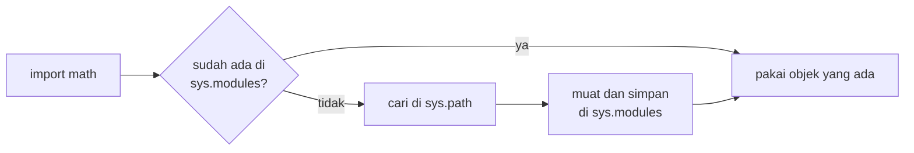

# Import dan Modul

!!! abstract "Info materi"
    **Tingkat kesulitan:** Pemula. **Estimasi waktu:** 60–75 menit.
    **Jenis kode:** snippet edukatif (`examples/level-1-python/08_import_modul.py`).

## Tujuan pembelajaran

- [ ] Menjelaskan apa itu modul dan paket, dan mengapa kita mengimpor.
- [ ] Memakai `import x`, `import x as y`, dan `from x import y`.
- [ ] Mengenali pesan `ModuleNotFoundError` dan `ImportError` serta penyebabnya.
- [ ] Menjelaskan arti `if __name__ == "__main__":`.

## Prasyarat

[Function dan Parameter](function-parameter.md).

## Pengantar dan motivasi

Python datang dengan "perpustakaan standar" berisi ribuan function siap pakai
(matematika, jalur berkas, penghitung, regex). Kita memakainya dengan **mengimpor**. Hal yang sama
berlaku untuk pustaka pihak ketiga seperti pandas dan scikit-learn, yang harus dipasang dulu dengan `pip`.
Hampir setiap skrip NLP dimulai dengan beberapa baris `import`.

## Konsep dasar

- **Modul**: satu berkas Python (`.py`) yang berisi function, kelas, dan variabel.
- **Paket**: folder berisi modul (mis. `nlp_hub`, `sklearn`).
- **Pustaka standar**: bawaan Python (`math`, `re`, `pathlib`, `collections`).
- **Pustaka pihak ketiga**: dipasang terpisah (`pip install pandas`).

| Bentuk | Pakai nama | Contoh |
|---|---|---|
| `import math` | `math.sqrt(16)` | Ruang nama modul terjaga |
| `import re as regex` | `regex.findall(...)` | Alias pendek atau menghindari bentrok |
| `from collections import Counter` | `Counter(...)` | Nama langsung tersedia |

## Penjelasan mendalam

### Mengapa `import x` lebih disukai pada awalnya

`import math` menjaga asal nama terlihat (`math.sqrt`), sehingga mudah melihat dari mana function berasal dan
tidak bentrok dengan nama Anda sendiri. `from x import y` lebih ringkas bila `y` sering dipakai. Hindari
`from x import *`, karena mengimpor banyak nama sekaligus dan menimpa nama yang sudah ada.

### Modul adalah objek

Hasil `import math` adalah objek bertipe `module` yang disimpan di `sys.modules`. Impor kedua kali tidak memuat ulang;
Python memakai objek yang sama (Bagian 3).

### Dari mana Python mencari modul

Python mencari modul di folder skrip yang sedang dijalankan, lalu di lokasi yang terdaftar
(`sys.path`), termasuk tempat pustaka terpasang. **Akibatnya:** jika Anda menamai berkas sendiri `random.py` atau `re.py`,
berkas itu dapat menimpa modul standar dengan nama sama dan menimbulkan galat aneh. Beri nama berkas yang tidak sama
dengan modul yang ada.

### `if __name__ == "__main__":`

Setiap modul memiliki variabel `__name__`. Bila berkas dijalankan langsung, nilainya `"__main__"`; bila diimpor
dari berkas lain, nilainya nama modulnya. Blok `if __name__ == "__main__":` hanya berjalan saat dijalankan langsung,
sehingga berkas yang sama dapat dipakai sebagai skrip sekaligus diimpor tanpa menjalankan kodenya (Bagian 5).

### Lingkungan virtual

Pustaka pihak ketiga dipasang per lingkungan virtual (`.venv`). `ModuleNotFoundError` sering berarti paket belum
dipasang **di lingkungan yang sedang aktif**, bukan di komputer secara umum
(lihat [Persiapan Python](../level-0-orientasi/persiapan-python.md)).

## Cara kerja atau alur proses



## Contoh sederhana

```python
import math
print(math.sqrt(25))   # 5.0
```

## Contoh dalam konteks Twitter/X kebencanaan

Menghitung kata paling sering di sebuah postingan (`collections.Counter`), mencari angka RT/RW
(`re`), dan menyusun jalur berkas data (`pathlib.Path`) tanpa menebak pemisah folder per sistem operasi.

## Praktik Python

Berkas: `examples/level-1-python/08_import_modul.py`.

### Bagian 1 — Gaya impor

```python title="Bagian 1"
--8<-- "level-1-python/08_import_modul.py:gaya"
```

`import re as regex` memberi alias `regex` untuk modul `re`. `math.sqrt` adalah akar kuadrat; `math.log(1)` logaritma natural 1.

```text title="Output nyata"
4.0 0.0
['05', '12']
```

Interpretasi: `sqrt(16)` = 4,0 (selalu `float`), `log(1)` = 0,0. `findall(r"\d+", ...)` mengambil semua urutan angka: `05` dan `12`.

### Bagian 2 — `from ... import`

```python title="Bagian 2"
--8<-- "level-1-python/08_import_modul.py:from"
```

`Counter(...).most_common(1)` mengembalikan daftar satu pasangan (kata, jumlah) yang paling sering. `Path("examples") / "level-1-python"` menyambung jalur dengan operator `/`; `.as_posix()` menampilkannya dengan garis miring biasa agar sama di semua sistem operasi.

```text title="Output nyata"
[('tolong', 2)]
examples/level-1-python
```

Interpretasi: `tolong` muncul dua kali. `Counter` melakukan penghitungan frekuensi yang sebelumnya kita tulis dengan dictionary.

### Bagian 3 — Modul adalah objek

```python title="Bagian 3"
--8<-- "level-1-python/08_import_modul.py:objek"
```

`sys.modules` adalah kamus modul yang sudah dimuat; `dir(math)` mendaftar nama di dalam modul.

```text title="Output nyata"
module module True
float True
```

Interpretasi: `math` bertipe `module` dan identik dengan entri `sys.modules["math"]` (`is` → `True`). `math.pi` adalah `float`, dan `"pi"` ada dalam daftar nama modul.

### Bagian 4 — Galat impor

```python title="Bagian 4"
--8<-- "level-1-python/08_import_modul.py:galat"
```

```text title="Output nyata"
ModuleNotFoundError: No module named 'paket_yang_tidak_ada'
ImportError: cannot import name 'fungsi_tidak_ada' from 'math' (unknown location)
```

Interpretasi: paket yang tidak ada → `ModuleNotFoundError`. Modul ada tetapi nama yang diminta tidak ada → `ImportError`. Cara mengatasinya berbeda: yang pertama biasanya `pip install ...`; yang kedua periksa ejaan atau versi pustaka.

### Bagian 5 — `__name__`

```python title="Bagian 5"
--8<-- "level-1-python/08_import_modul.py:nama"
```

```text title="Output nyata"
__main__
```

Interpretasi: karena berkas dijalankan langsung, `__name__` bernilai `"__main__"`. Bila berkas ini diimpor dari berkas lain, nilainya `"08_import_modul"`.

### Skrip terpadu

Kelima bagian adalah satu skrip: `08_import_modul.py`.

## Kesalahan umum dan debugging

| Gejala | Penyebab | Perbaikan |
|---|---|---|
| `ModuleNotFoundError: No module named 'pandas'` | Paket belum dipasang di lingkungan aktif | Aktifkan `.venv`, lalu `pip install -r requirements-ml.txt` |
| `ImportError: cannot import name ...` | Nama tidak ada di modul (salah eja atau versi lain) | Periksa dokumentasi versi yang terpasang |
| Galat aneh setelah menamai berkas `random.py` | Berkas Anda menimpa modul standar | Ganti nama berkas |
| `NameError: name 'Counter' is not defined` | Lupa mengimpor | Tambah `from collections import Counter` |
| Kode di berkas impor ikut berjalan | Tidak memakai `if __name__ == "__main__":` | Bungkus kode skrip dalam blok itu |

## Kelebihan dan keterbatasan

**Kelebihan:** memakai kode orang lain secara aman dan terstruktur; pustaka standar mencakup banyak kebutuhan.
**Keterbatasan:** ketergantungan versi (kode yang jalan di satu versi bisa gagal di versi lain); impor sirkular;
lingkungan berbeda menghasilkan perilaku berbeda, sehingga versi perlu dicatat.

## Latihan bertahap

1. **Konseptual.** Apa beda modul dan paket?
2. **Membaca kode.** Apa hasil `from math import sqrt; sqrt(9)`?
3. **Mengisi kode.** Lengkapi agar `Counter` tersedia: `from collections ___ Counter`.
4. **Debugging.** `import panda` menimbulkan `ModuleNotFoundError`, padahal Anda sudah memasang pandas. Apa kemungkinan penyebabnya?
5. **Program kecil.** Tulis skrip yang menghitung kata paling sering di `"air naik air surut air"` dengan `Counter` dan mencetaknya hanya bila dijalankan langsung.

## Kunci jawaban dan pembahasan

??? success "Jawaban 1"
    Modul adalah satu berkas Python; paket adalah folder yang berisi beberapa modul.

??? success "Jawaban 2"
    `3.0`. `sqrt` selalu mengembalikan `float`.

??? success "Jawaban 3"
    `import`: `from collections import Counter`.

??? success "Jawaban 4"
    Nama paketnya `pandas` (dengan `s`); `panda` salah eja. Penyebab lain bila ejaan benar: paket dipasang di lingkungan berbeda dari yang aktif.

??? success "Jawaban 5"
    ```python
    from collections import Counter

    if __name__ == "__main__":
        print(Counter("air naik air surut air".split()).most_common(1))
    ```
    Hasilnya `[('air', 3)]`. Blok `if __name__ == "__main__":` menjaga agar pencetakan tidak berjalan saat berkas diimpor.

## Kuis singkat

**1.** Apa perbedaan `ModuleNotFoundError` dan `ImportError`?

??? success "Jawaban"
    `ModuleNotFoundError`: modul tidak ditemukan. `ImportError`: modul ditemukan tetapi nama yang diminta tidak ada.

**2.** Apa nilai `__name__` saat berkas dijalankan langsung?

??? success "Jawaban"
    `"__main__"`.

**3.** Mengapa tidak menamai berkas sendiri `re.py`?

??? success "Jawaban"
    Berkas itu dapat menimpa modul standar `re` dan merusak impor.

## Ringkasan

- `import x`, `import x as y`, `from x import y` memuat modul; modul adalah objek yang dicache di `sys.modules`.
- `ModuleNotFoundError` = paket belum terpasang di lingkungan aktif; `ImportError` = nama tidak ada.
- Beri nama berkas yang tidak bentrok; gunakan `if __name__ == "__main__":` untuk kode skrip.

## Glosarium istilah baru

Modul
:   Satu berkas Python yang dapat diimpor.

Paket
:   Folder berisi modul.

Pustaka standar
:   Kumpulan modul bawaan Python.

`pip`
:   Alat untuk memasang pustaka pihak ketiga.

`sys.path`
:   Daftar lokasi tempat Python mencari modul.

## Referensi

- Dokumentasi Python, *Modules* (tutorial): <https://docs.python.org/3/tutorial/modules.html> (dokumentasi resmi).
- Dokumentasi Python, `__main__`: <https://docs.python.org/3/library/__main__.html> (dokumentasi resmi).

## Materi selanjutnya

[Exception Handling](exception-handling.md)
