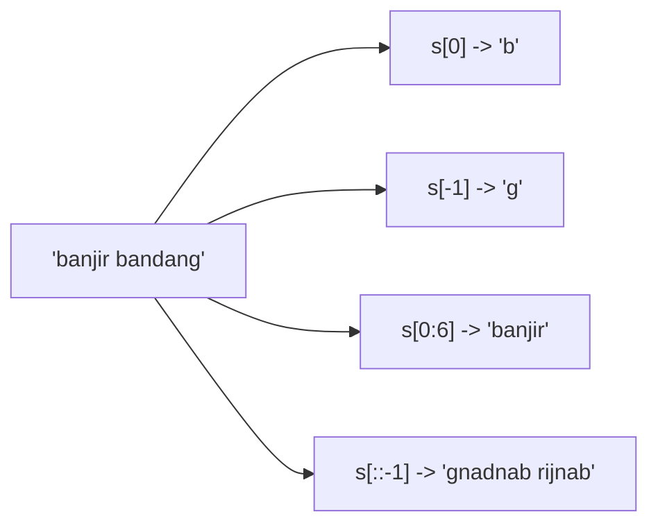

# Indexing dan Slicing

!!! abstract "Info materi"
    **Tingkat kesulitan:** Pemula. **Estimasi waktu:** 60–75 menit.
    **Jenis kode:** snippet edukatif (`examples/level-1-python/03_indexing_slicing.py`).

## Tujuan pembelajaran

- [ ] Mengambil satu elemen dengan indeks positif dan negatif.
- [ ] Memotong urutan dengan `[awal:akhir:langkah]` dan menjelaskan batasnya.
- [ ] Menjelaskan perbedaan galat `IndexError` pada indeks dan hasil kosong pada slice.
- [ ] Membalik urutan dengan `[::-1]`.

## Prasyarat

[String dan Operasi Teks](string-operasi-teks.md).

## Pengantar dan motivasi

Mengambil bagian dari teks atau daftar adalah pekerjaan rutin: tiga kata pertama
sebuah postingan, karakter terakhir, atau potongan di antara dua posisi. *Indexing* mengambil satu
elemen; *slicing* mengambil sepotong. Keduanya berlaku sama untuk string, list, dan tuple.

## Konsep dasar

Posisi dihitung mulai dari **0**. Indeks negatif menghitung dari belakang (`-1` = elemen terakhir).

```text
 b  a  n  j  i  r  _  b  a  n  d  a  n  g      (_ = spasi)
 0  1  2  3  4  5  6  7  8  9 10 11 12 13      indeks positif
-14 ... -7 ...                          -2 -1   indeks negatif
```

Slice `s[a:b]` mengambil elemen mulai indeks `a` sampai **sebelum** `b`
(batas bawah termasuk, batas atas tidak). `s[a:b:c]` menambah langkah `c`.

| Bentuk | Arti |
|---|---|
| `s[i]` | Elemen ke-`i` |
| `s[-1]` | Elemen terakhir |
| `s[a:b]` | Dari `a` sampai sebelum `b` |
| `s[:b]` / `s[a:]` | Dari awal / sampai akhir |
| `s[::-1]` | Seluruhnya, terbalik |
| `s[::k]` | Setiap `k` elemen |

## Penjelasan mendalam

### Mengapa batas atas tidak termasuk

Konvensi "setengah terbuka" membuat panjang slice `s[a:b]` selalu `b - a`, dan membuat dua slice
berurutan `s[:k]` dan `s[k:]` tepat menyambung tanpa tumpang tindih. Ini mengurangi kesalahan
"selisih satu" (*off-by-one*) yang sangat umum.

### Indeks versus slice di luar batas

Indeks tunggal di luar batas menimbulkan `IndexError` (Bagian 4), karena elemen itu tidak
ada. Slice di luar batas **tidak** galat: Python memotong sampai batas yang ada, dan menghasilkan
urutan kosong bila tidak ada yang tersisa. Perilaku ini memudahkan, tetapi dapat menyembunyikan bug.

### Slicing membuat salinan

Slice menghasilkan objek baru; mengubahnya tidak mengubah yang asli (untuk string, memang tidak bisa
diubah sama sekali). Pada NLP, `teks[:280]` mengambil 280 karakter pertama untuk memotong teks yang terlalu panjang.

## Cara kerja atau alur proses



## Contoh sederhana

```python
kata = "gempa"
kata[0]     # 'g'
kata[1:4]   # 'emp'
kata[-2:]   # 'pa'
```

## Contoh dalam konteks Twitter/X kebencanaan

Memotong awal postingan untuk pratinjau (`teks[:30] + "..."`), mengambil kata terakhir,
atau memeriksa apakah awalan kata `"ban"`. Slicing juga dipakai untuk memotong teks yang
melebihi batas panjang masukan model.

## Praktik Python

Berkas: `examples/level-1-python/03_indexing_slicing.py`.

### Bagian 1 — Indeks tunggal

```python title="Bagian 1"
--8<-- "level-1-python/03_indexing_slicing.py:indeks"
```

```text title="Output nyata"
14
b g ' '
```

Interpretasi: panjang 14. `teks[0]` = `b`, `teks[-1]` = `g`, dan `teks[6]` adalah spasi (diperlihatkan oleh `repr` sebagai `' '`), yaitu pemisah antara "banjir" dan "bandang".

### Bagian 2 — Slice

```python title="Bagian 2"
--8<-- "level-1-python/03_indexing_slicing.py:slice"
```

```text title="Output nyata"
banjir
bandang
ban...
gnadnab rijnab
```

Interpretasi: `teks[0:6]` mengambil indeks 0–5 ("banjir"; indeks 6 tidak ikut). `teks[7:]` mengambil dari indeks 7 sampai akhir ("bandang"). `teks[:3] + "..."` menggabungkan tiga huruf pertama dengan titik tiga. `[::-1]` membalik seluruh string.

### Bagian 3 — Pada list

```python title="Bagian 3"
--8<-- "level-1-python/03_indexing_slicing.py:daftar"
```

```text title="Output nyata"
banjir bandang ['bandang', 'banjir']
```

Interpretasi: `kata = teks.split()` adalah list `['banjir', 'bandang']`; indeks dan slice bekerja sama seperti pada string. `kata[::-1]` membalik urutan kata.

### Bagian 4 — Di luar batas

```python title="Bagian 4"
--8<-- "level-1-python/03_indexing_slicing.py:batas"
```

```text title="Output nyata"
IndexError: string index out of range
'' True
```

Interpretasi: `teks[100]` menimbulkan `IndexError` (tidak ada karakter ke-100). `teks[100:105]` tidak galat; hasilnya string kosong `''`. Perbedaan ini sering menjadi sumber bug diam-diam.

### Bagian 5 — Langkah

```python title="Bagian 5"
--8<-- "level-1-python/03_indexing_slicing.py:langkah"
```

```text title="Output nyata"
[0, 3, 6, 9]
bni
```

Interpretasi: `[::3]` mengambil setiap tiga elemen dari `0` sampai `9`. `teks[0:6:2]` mengambil huruf pada indeks 0, 2, 4 dari "banjir": `b`, `n`, `i`.

### Skrip terpadu

Lima bagian adalah satu skrip: `03_indexing_slicing.py`.

## Kesalahan umum dan debugging

| Gejala | Penyebab | Perbaikan |
|---|---|---|
| `IndexError: string index out of range` | Indeks melebihi panjang | Periksa `len()` dulu; ingat indeks maksimum = `len - 1` |
| Hasil slice kurang satu elemen | Lupa bahwa batas atas tidak ikut | Naikkan batas atas satu |
| Slice kosong tanpa galat | Indeks di luar batas | Periksa panjang dan nilai indeks |
| `TypeError: string indices must be integers` | Indeks berupa `float` atau string | Gunakan `int` |
| Mencoba mengubah `teks[0] = "B"` | String tidak dapat diubah | Buat string baru |

## Kelebihan dan keterbatasan

**Kelebihan:** sintaks seragam untuk string, list, dan tuple; ringkas dan cepat.
**Keterbatasan:** indeks karakter tidak sama dengan indeks "huruf yang terlihat" pada teks berkarakter
majemuk (emoji beberapa code point, lihat [Karakter dan Unicode](../level-2-fondasi-teks/karakter-unicode-encoding.md));
slice di luar batas tidak memberi peringatan.

## Latihan bertahap

1. **Konseptual.** Mengapa `s[0:3]` mengambil tiga elemen, bukan empat?
2. **Membaca kode.** Perkirakan `"gempa kuat"[-4:]` dan `"gempa kuat"[:5]`.
3. **Mengisi kode.** Lengkapi agar mengambil kata kedua dan terakhir: `kata = "air naik cepat".split(); kata[___]`, `kata[___]`.
4. **Debugging.** Mengapa `"banjir"[6]` galat tetapi `"banjir"[6:]` tidak?
5. **Program kecil.** Tulis kode yang memotong teks menjadi maksimal 20 karakter dan menambahkan `...` hanya bila teks lebih panjang.

## Kunci jawaban dan pembahasan

??? success "Jawaban 1"
    Slice mengambil dari indeks awal sampai **sebelum** indeks akhir; `0, 1, 2` adalah tiga elemen. Panjang slice selalu `akhir - awal`.

??? success "Jawaban 2"
    `'kuat'` dan `'gempa'`. `[-4:]` mengambil empat karakter terakhir; `[:5]` lima karakter pertama.

??? success "Jawaban 3"
    `kata[1]` (kata kedua, "naik") dan `kata[-1]` (terakhir, "cepat"). Indeks dimulai dari 0.

??? success "Jawaban 4"
    Panjang "banjir" 6, sehingga indeks valid 0–5; indeks 6 tidak ada (`IndexError`). Slice `[6:]` berarti "dari posisi 6 sampai akhir", yang kosong tetapi sah (`''`).

??? success "Jawaban 5"
    ```python
    teks = "Banjir setinggi dada di Jl. Melati"
    hasil = teks if len(teks) <= 20 else teks[:20] + "..."
    ```
    Kondisi `len(teks) <= 20` mencegah titik tiga muncul pada teks pendek.

## Kuis singkat

**1.** Apa hasil `"banjir"[-1]`?

??? success "Jawaban"
    `'r'`, karakter terakhir.

**2.** Apa fungsi `[::-1]`?

??? success "Jawaban"
    Membalik urutan elemen.

**3.** Apa beda indeks dan slice di luar batas?

??? success "Jawaban"
    Indeks menimbulkan `IndexError`; slice menghasilkan urutan kosong atau terpotong tanpa galat.

## Ringkasan

- Indeks dimulai dari 0; indeks negatif menghitung dari belakang.
- Slice `[a:b]` mengambil sampai sebelum `b`; `[::-1]` membalik; `[a:b:c]` memakai langkah.
- Indeks di luar batas galat; slice di luar batas tidak.

## Glosarium istilah baru

Indeks (*index*)
:   Nomor posisi elemen dalam urutan, dimulai dari 0.

Slice
:   Potongan urutan, ditulis `s[awal:akhir:langkah]`.

Off-by-one
:   Kesalahan selisih satu pada batas indeks.

Urutan (*sequence*)
:   Kumpulan elemen berurutan: string, list, tuple.

## Referensi

- Dokumentasi Python, *Common Sequence Operations*: <https://docs.python.org/3/library/stdtypes.html#common-sequence-operations> (dokumentasi resmi).

## Materi selanjutnya

[List, Tuple, Set, dan Dictionary](list-tuple-set-dict.md)
