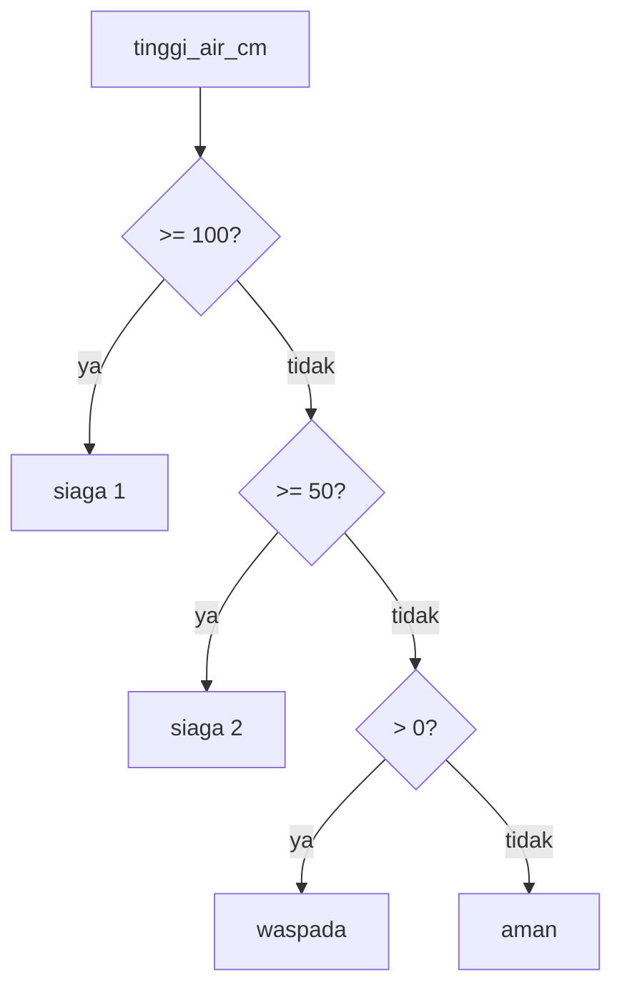

# Kondisional: if, elif, else

!!! abstract "Info materi"
    **Tingkat kesulitan:** Pemula. **Estimasi waktu:** 60–75 menit.
    **Jenis kode:** snippet edukatif (`examples/level-1-python/05_kondisional.py`).

## Tujuan pembelajaran

- [ ] Menulis percabangan `if`/`elif`/`else` dengan indentasi yang benar.
- [ ] Menggabungkan syarat dengan `and`, `or`, `not`.
- [ ] Memakai ekspresi kondisional satu baris dan memahami nilai "benar/salah" (*truthy/falsy*).
- [ ] Menjelaskan mengapa urutan cabang penting.

## Prasyarat

[Variabel dan Tipe Data](variabel-tipe-data.md) dan [String](string-operasi-teks.md).

## Pengantar dan motivasi

Program yang hanya berjalan lurus dari atas ke bawah terbatas. Kita sering perlu memutuskan:
*jika tinggi air di atas 100 cm, status siaga 1; jika tidak...* Percabangan memungkinkan program
memilih jalur berdasarkan syarat. Pada NLP, ia dipakai untuk aturan sederhana
(mis. memeriksa kata kunci) dan untuk menangani kasus tepi.

## Konsep dasar

```python
if syarat_1:
    ...
elif syarat_2:
    ...
else:
    ...
```

- Python memeriksa dari atas dan **menjalankan cabang pertama** yang syaratnya benar, lalu melewati sisanya.
- Isi cabang ditandai **indentasi** (empat spasi). Tanda `:` mengakhiri baris syarat.
- Perbandingan: `==`, `!=`, `<`, `<=`, `>`, `>=`. Keanggotaan: `in`, `not in`.
- Gabungan: `and` (keduanya benar), `or` (salah satu benar), `not` (membalik).

## Penjelasan mendalam

### Urutan cabang menentukan hasil

Karena hanya cabang benar pertama yang dijalankan, cabang yang lebih khusus harus ditulis lebih dahulu.
Bagian 5 memperlihatkan fungsi yang menaruh syarat paling longgar (`> 0`) di atas, sehingga
cabang `siaga 2` tidak pernah tercapai.

### *Truthy* dan *falsy*

Python menganggap beberapa nilai "salah" dalam syarat: `0`, `""`, `[]`, `{}`, `None`, dan `False`.
Hampir semua lainnya dianggap "benar". Ini ringkas (`if teks:` berarti "teks tidak kosong")
tetapi dapat mengejutkan; `if jumlah:` bernilai salah ketika `jumlah` = 0, yang mungkin angka sah.

### Ekspresi kondisional (ternary)

`x if syarat else y` memilih satu dari dua nilai dalam satu baris. Cocok untuk penugasan sederhana;
jangan dipakai untuk logika bertingkat karena sulit dibaca.

### Alternatif

Untuk banyak kasus berbasis nilai, dictionary pencarian (`{"E": "Emergency"}[kode]`) atau
`match`/`case` (Python 3.10+) dapat lebih rapi daripada rantai `elif` yang panjang.

## Cara kerja atau alur proses



## Contoh sederhana

```python
suhu = 35
if suhu > 30:
    print("panas")
else:
    print("sejuk")
```

## Contoh dalam konteks Twitter/X kebencanaan

Menentukan status banjir dari tinggi air, dan memeriksa apakah teks mengandung kata kunci
permintaan bantuan. **Peringatan:** aturan kata kunci seperti ini hanya ilustrasi; kata kunci
bukan definisi Emergency (lihat [Masalah Emergency](../level-0-orientasi/masalah-emergency.md)).

## Praktik Python

Berkas: `examples/level-1-python/05_kondisional.py`.

### Bagian 1 — Rantai if/elif/else

```python title="Bagian 1"
--8<-- "level-1-python/05_kondisional.py:tingkat"
```

Fungsi `tingkat` menerima tinggi air dan mengembalikan status (fungsi dibahas lebih lanjut di halaman Function). `return` mengakhiri fungsi saat cabang benar ditemukan.

```text title="Output nyata"
0 -> aman
20 -> waspada
50 -> siaga 2
120 -> siaga 1
```

Interpretasi: 120 memenuhi `>= 100` (siaga 1). 50 tidak memenuhi `>= 100` tetapi memenuhi `>= 50` (siaga 2); karena batas `>=`, 50 sudah termasuk siaga 2. 20 hanya memenuhi `> 0` (waspada); 0 jatuh ke `else` (aman).

### Bagian 2 — and, or, not

```python title="Bagian 2"
--8<-- "level-1-python/05_kondisional.py:logika"
```

```text title="Output nyata"
True True False
mengandung permintaan bantuan banjir
terkait bencana
True
```

Interpretasi: tiga hasil `in` pertama menjadi bahan syarat. `and` membutuhkan keduanya benar (terpenuhi). `or` cukup satu (`banjir` ada). `not` membalik `False` menjadi `True`.

### Bagian 3 — Ekspresi kondisional

```python title="Bagian 3"
--8<-- "level-1-python/05_kondisional.py:ternary"
```

```text title="Output nyata"
Emergency
```

Interpretasi: `"tolong" in teks` benar, sehingga `label` = `"Emergency"`. Ini hanya **aturan ilustratif**, bukan pelabelan yang benar.

### Bagian 4 — Truthy dan falsy

```python title="Bagian 4"
--8<-- "level-1-python/05_kondisional.py:truthy"
```

```text title="Output nyata"
False True False False False
```

Interpretasi: string kosong, list kosong, `0`, dan `None` dianggap salah; string berisi `"a"` dianggap benar.

### Bagian 5 — Urutan cabang yang keliru

```python title="Bagian 5"
--8<-- "level-1-python/05_kondisional.py:urutan"
```

```text title="Output nyata"
waspada siaga 1
```

Interpretasi: untuk 120 cm, fungsi yang cabangnya terbalik mengembalikan `waspada` (cabang `> 0` benar lebih dulu), sedangkan fungsi yang benar mengembalikan `siaga 1`. Tidak ada galat; hasilnya diam-diam salah. Cara menemukannya: uji nilai batas (0, 49, 50, 99, 100).

### Skrip terpadu

Kelima bagian adalah satu skrip: `05_kondisional.py`.

## Kesalahan umum dan debugging

| Gejala | Penyebab | Perbaikan |
|---|---|---|
| `IndentationError: expected an indented block` | Isi cabang tidak diindentasi | Indentasi empat spasi |
| `SyntaxError: invalid syntax` pada `if x = 5:` | `=` dipakai alih-alih `==` | Gunakan `==` untuk perbandingan |
| Cabang tidak pernah tercapai | Urutan cabang salah | Taruh syarat paling khusus di atas |
| `if jumlah:` salah ketika jumlah = 0 | `0` itu *falsy* | Tulis `if jumlah is not None:` bila 0 sah |
| `"a" or "b" in teks` selalu benar | `"a"` dianggap benar | `"a" in teks or "b" in teks` |

## Kelebihan dan keterbatasan

**Kelebihan:** sederhana dan eksplisit; mudah diuji. **Keterbatasan:** aturan `if` untuk bahasa alami cepat menjadi
rapuh (tak pernah mencakup semua variasi); inilah alasan kita memakai model yang belajar dari data.

## Latihan bertahap

1. **Konseptual.** Mengapa urutan cabang `elif` penting?
2. **Membaca kode.** Perkirakan `tingkat(49)` dan `tingkat(100)`.
3. **Mengisi kode.** Lengkapi: `status = "darurat" if ___ else "biasa"` agar bernilai `"darurat"` bila `jumlah_korban > 0`.
4. **Debugging.** `if teks == "tolong" or "banjir":` selalu benar. Mengapa, dan apa perbaikannya?
5. **Program kecil.** Tulis fungsi `kategori_panjang(teks)` yang mengembalikan `"pendek"` (<= 5 kata), `"sedang"` (6–15), atau `"panjang"` (> 15). Uji pada nilai batas.

## Kunci jawaban dan pembahasan

??? success "Jawaban 1"
    Hanya cabang benar pertama yang dijalankan. Bila cabang longgar ditaruh di atas cabang khusus, cabang khusus tidak pernah tercapai.

??? success "Jawaban 2"
    `waspada` dan `siaga 1`. 49 tidak `>= 50`, tetapi `> 0` (waspada); 100 memenuhi `>= 100` (siaga 1).

??? success "Jawaban 3"
    `jumlah_korban > 0`: `status = "darurat" if jumlah_korban > 0 else "biasa"`.

??? success "Jawaban 4"
    `or "banjir"` mengevaluasi string `"banjir"` sendiri, yang selalu *truthy*. Perbaikan: `if teks == "tolong" or teks == "banjir":` atau `if teks in ("tolong", "banjir"):`.

??? success "Jawaban 5"
    ```python
    def kategori_panjang(teks):
        n = len(teks.split())
        if n <= 5:
            return "pendek"
        elif n <= 15:
            return "sedang"
        return "panjang"
    ```
    Uji batas: 5 kata → pendek, 6 → sedang, 15 → sedang, 16 → panjang.

## Kuis singkat

**1.** Apa yang dilakukan `elif`?

??? success "Jawaban"
    Memeriksa syarat tambahan hanya bila syarat sebelumnya salah.

**2.** Apakah `bool([])` benar atau salah?

??? success "Jawaban"
    Salah (`False`): list kosong dianggap *falsy*.

**3.** Apa beda `=` dan `==`?

??? success "Jawaban"
    `=` penugasan; `==` perbandingan kesamaan.

## Ringkasan

- `if`/`elif`/`else` menjalankan cabang benar pertama; indentasi menandai isinya.
- `and`, `or`, `not` menggabungkan syarat; `in` memeriksa keanggotaan.
- Nilai kosong dan 0 *falsy*; urutan cabang menentukan hasil.

## Glosarium istilah baru

Percabangan
:   Pemilihan jalur program berdasarkan syarat.

Indentasi
:   Spasi di awal baris yang menandai blok kode.

Truthy / falsy
:   Nilai yang dianggap benar atau salah dalam syarat.

Ekspresi kondisional (ternary)
:   `x if syarat else y`: memilih satu dari dua nilai.

## Referensi

- Dokumentasi Python, *More Control Flow Tools — if Statements*: <https://docs.python.org/3/tutorial/controlflow.html#if-statements> (dokumentasi resmi).

## Materi selanjutnya

[Perulangan](perulangan.md)
