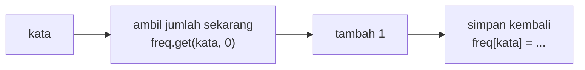

# List, Tuple, Set, dan Dictionary

!!! abstract "Info materi"
    **Tingkat kesulitan:** Pemula–menengah. **Estimasi waktu:** 90–120 menit.
    **Jenis kode:** snippet edukatif (`examples/level-1-python/04_koleksi.py`).

## Tujuan pembelajaran

- [ ] Memilih antara list, tuple, set, dan dictionary sesuai kebutuhan.
- [ ] Menambah, mengubah, dan mengakses elemen pada tiap koleksi.
- [ ] Menghitung frekuensi kata dengan dictionary.
- [ ] Menjelaskan galat `KeyError`, `TypeError` pada tuple, dan jebakan *aliasing* pada list.

## Prasyarat

[Indexing dan Slicing](indexing-slicing.md).

## Pengantar dan motivasi

Satu postingan berisi banyak kata; satu dataset berisi banyak postingan. Kita memerlukan
wadah untuk menyimpan banyak nilai sekaligus. Python punya empat wadah utama, dengan sifat berbeda:
apakah berurutan, apakah boleh berulang, dan apakah dapat diubah. Memilih wadah yang tepat membuat kode lebih
sederhana dan cepat. Dictionary, misalnya, adalah dasar untuk menghitung frekuensi kata dan menyimpan satu
laporan beserta atributnya.

## Konsep dasar

| Wadah | Contoh | Berurutan | Boleh duplikat | Dapat diubah |
|---|---|---|---|---|
| **list** | `["a", "b", "a"]` | ya | ya | ya |
| **tuple** | `(-6.2, 106.8)` | ya | ya | **tidak** |
| **set** | `{"a", "b"}` | tidak | **tidak** | ya |
| **dictionary** | `{"label": "Emergency"}` | ya (urutan penyisipan) | kunci unik | ya |

Dictionary menyimpan pasangan **kunci → nilai**. Akses lewat kunci, bukan posisi.

## Penjelasan mendalam

### Kapan memakai yang mana

- **list:** kumpulan berurutan yang akan bertambah atau berubah (daftar kata sebuah teks).
- **tuple:** kumpulan kecil yang tetap dan bermakna sebagai satu kesatuan (koordinat `(lat, lon)`); dapat dipakai sebagai kunci dictionary.
- **set:** keanggotaan dan keunikan; "apakah kata ini ada?" jauh lebih cepat pada set daripada pada list.
- **dictionary:** pencarian berdasarkan nama atau kunci, serta penghitungan (kata → jumlah).

### Himpunan: operasi matematis

`&` irisan, `|` gabungan, `-` selisih. Dengan set, "kata yang ada di kedua teks" cukup `set(a) & set(b)`.
Set tidak berurutan; urutan elemennya tidak boleh diandalkan (gunakan `sorted()` untuk keluaran yang stabil).

### Akses dictionary: `[]` versus `.get()`

`laporan["lokasi"]` menimbulkan `KeyError` jika kunci tidak ada. `laporan.get("lokasi", "tidak diketahui")`
mengembalikan nilai bawaan sebagai gantinya. Pilih `[]` bila kunci seharusnya selalu ada (galat adalah sinyal bug),
dan `.get()` bila kunci boleh tidak ada.

### Aliasing: dua nama, satu list

`b = a` **tidak** menyalin list; keduanya menunjuk ke objek yang sama. Perubahan lewat `b` terlihat pada `a`.
Salinan dibuat dengan `a.copy()` atau `list(a)` (salinan dangkal; untuk list bersarang, pakai `copy.deepcopy`).

## Cara kerja atau alur proses

Menghitung frekuensi dengan dictionary:



## Contoh sederhana

```python
buah = ["apel", "jeruk", "apel"]
len(buah), set(buah)     # (3, {'apel', 'jeruk'})
```

## Contoh dalam konteks Twitter/X kebencanaan

Sebuah laporan disimpan sebagai dictionary (teks, label, korban, lokasi); kumpulan kata
sebuah postingan sebagai list; kata unik sebagai set; frekuensi kata sebagai dictionary kata → jumlah.
Kombinasi ini adalah fondasi *bag of words* (Level 3).

## Praktik Python

Berkas: `examples/level-1-python/04_koleksi.py`.

### Bagian 1 — List

```python title="Bagian 1"
--8<-- "level-1-python/04_koleksi.py:list"
```

`append` menambah di akhir; `kata[1] = "mohon"` mengganti elemen indeks 1; `count` menghitung kemunculan.

```text title="Output nyata"
['banjir', 'tolong', 'banjir', 'evakuasi'] 4
['banjir', 'tolong', 'banjir', 'evakuasi', 'air']
['banjir', 'mohon', 'banjir', 'evakuasi', 'air'] 2
```

Interpretasi: list berubah di tempat (berbeda dari string). `banjir` muncul dua kali. Baris ketiga menunjukkan elemen `tolong` sudah diganti `mohon`; bagian-bagian berikutnya memakai list yang sudah berubah ini.

### Bagian 2 — Tuple

```python title="Bagian 2"
--8<-- "level-1-python/04_koleksi.py:tuple"
```

`lat, lon = koordinat` adalah *unpacking*: memecah tuple menjadi dua variabel.

```text title="Output nyata"
-6.2 106.8
TypeError: 'tuple' object does not support item assignment
```

Interpretasi: membaca elemen tuple mudah, mengubahnya terlarang. Tuple cocok untuk data yang tidak boleh berubah.

### Bagian 3 — Set

```python title="Bagian 3"
--8<-- "level-1-python/04_koleksi.py:set"
```

```text title="Output nyata"
['air', 'banjir', 'evakuasi', 'mohon'] 4
{'banjir'}
True
```

Interpretasi: `set(kata)` membuang duplikat: 5 elemen menjadi 4 kata unik (`sorted` menghasilkan urutan stabil). `&` menghasilkan irisan dua set: hanya `banjir` yang ada di keduanya. `"air" in unik` adalah pemeriksaan keanggotaan.

### Bagian 4 — Dictionary

```python title="Bagian 4"
--8<-- "level-1-python/04_koleksi.py:dict"
```

```text title="Output nyata"
Emergency tidak diketahui
['teks', 'label', 'korban', 'lokasi']
KeyError: 'waktu'
```

Interpretasi: `laporan["label"]` = `Emergency`; kunci `lokasi` belum ada sehingga `.get` memberi nilai bawaan. Setelah `laporan["lokasi"] = "Jakarta"`, kunci ditambahkan di akhir. Mengakses `laporan["waktu"]` yang tidak ada menimbulkan `KeyError: 'waktu'`.

### Bagian 5 — Menghitung frekuensi

```python title="Bagian 5"
--8<-- "level-1-python/04_koleksi.py:frekuensi"
```

```text title="Output nyata"
{'banjir': 2, 'mohon': 1, 'evakuasi': 1, 'air': 1}
```

Interpretasi: tiap putaran: ambil jumlah saat ini (`get(k, 0)` memberi 0 bila baru), tambah 1, simpan. Hasilnya frekuensi kata. Pustaka `collections.Counter` melakukan hal yang sama (halaman Import dan Modul).

### Bagian 6 — Aliasing

```python title="Bagian 6"
--8<-- "level-1-python/04_koleksi.py:alias"
```

```text title="Output nyata"
['x', 'y'] True
['x', 'y'] ['x', 'y', 'z']
```

Interpretasi: `b = a` membuat dua nama untuk satu list (`a is b` → `True`), jadi `b.append("y")` mengubah `a`. `a.copy()` membuat list terpisah: menambah `"z"` ke `c` tidak memengaruhi `a`.

### Skrip terpadu

Keenam bagian adalah satu skrip, `04_koleksi.py`.

## Kesalahan umum dan debugging

| Gejala | Penyebab | Perbaikan |
|---|---|---|
| `KeyError: 'waktu'` | Kunci tidak ada | `.get(kunci, bawaan)` atau periksa `kunci in dict` |
| `TypeError: 'tuple' object does not support item assignment` | Mengubah tuple | Gunakan list, atau buat tuple baru |
| `unhashable type: 'list'` | List dipakai sebagai kunci dict/anggota set | Pakai tuple |
| Perubahan pada satu list muncul di list lain | Aliasing (`b = a`) | `a.copy()` |
| Urutan set berbeda tiap dijalankan | Set tidak berurutan | `sorted(set)` |
| Mengubah list saat mengulanginya | Indeks bergeser | Iterasi pada salinan atau buat list baru |

## Kelebihan dan keterbatasan

**list:** fleksibel, tetapi pencarian "ada atau tidak" lambat pada list besar. **tuple:** aman dari perubahan, tidak fleksibel.
**set:** keanggotaan sangat cepat, tanpa urutan dan duplikat. **dictionary:** pencarian cepat berdasarkan kunci;
kunci harus *hashable* (tidak dapat diubah).

## Latihan bertahap

1. **Konseptual.** Kapan memilih set, bukan list?
2. **Membaca kode.** Perkirakan `len(set(["a", "b", "a"]))` dan `{"a": 1}.get("b", 0)`.
3. **Mengisi kode.** Lengkapi penghitungan frekuensi: `freq[k] = freq.___(k, 0) + 1`.
4. **Debugging.** `a = [1, 2]; b = a; b.append(3); print(a)` mencetak `[1, 2, 3]`. Jelaskan dan perbaiki bila Anda ingin `a` tetap.
5. **Program kecil.** Dari `"tolong tolong banjir air banjir banjir".split()`, buat dictionary frekuensi dan cetak kata yang paling sering.

## Kunci jawaban dan pembahasan

??? success "Jawaban 1"
    Ketika yang penting adalah keanggotaan atau keunikan (apakah kata ini ada, kata apa saja yang unik) dan urutan tidak penting; set mencarinya jauh lebih cepat.

??? success "Jawaban 2"
    `2` dan `0`. Dua elemen unik (`a`, `b`); `.get("b", 0)` mengembalikan nilai bawaan 0 karena kunci `b` tidak ada.

??? success "Jawaban 3"
    `get`. `freq.get(k, 0)` memberi jumlah saat ini atau 0 bila `k` baru.

??? success "Jawaban 4"
    `b = a` membuat dua nama untuk satu list (aliasing), jadi `b.append(3)` mengubah objek yang sama. Perbaikan: `b = a.copy()` (atau `list(a)`).

??? success "Jawaban 5"
    ```python
    freq = {}
    for k in "tolong tolong banjir air banjir banjir".split():
        freq[k] = freq.get(k, 0) + 1
    print(freq, max(freq, key=freq.get))
    ```
    Frekuensi: `{'tolong': 2, 'banjir': 3, 'air': 1}`; kata paling sering `banjir`. `max(freq, key=freq.get)` memilih kunci dengan nilai terbesar.

## Kuis singkat

**1.** Wadah mana yang tidak dapat diubah?

??? success "Jawaban"
    Tuple (dan string).

**2.** Apa beda `d["x"]` dan `d.get("x")` bila kunci `x` tidak ada?

??? success "Jawaban"
    `d["x"]` menimbulkan `KeyError`; `d.get("x")` mengembalikan `None` (atau nilai bawaan yang diberikan).

**3.** Apa akibat `b = a` pada list?

??? success "Jawaban"
    Keduanya menunjuk list yang sama; perubahan lewat satu nama terlihat pada nama lain.

## Ringkasan

- list (berurutan, dapat diubah), tuple (tetap), set (unik, tanpa urutan), dict (kunci → nilai).
- Frekuensi kata: `d[k] = d.get(k, 0) + 1`.
- Waspadai `KeyError`, tuple yang tidak dapat diubah, dan aliasing.

## Glosarium istilah baru

List
:   Wadah berurutan yang dapat diubah.

Tuple
:   Wadah berurutan yang tidak dapat diubah.

Set (himpunan)
:   Wadah elemen unik tanpa urutan.

Dictionary
:   Wadah pasangan kunci → nilai.

Hashable
:   Dapat dijadikan kunci dictionary atau anggota set; objek yang tidak dapat diubah.

Aliasing
:   Dua nama yang menunjuk ke objek yang sama.

## Referensi

- Dokumentasi Python, *Data Structures* (tutorial): <https://docs.python.org/3/tutorial/datastructures.html> (dokumentasi resmi).

## Materi selanjutnya

[Kondisional](kondisional.md)
