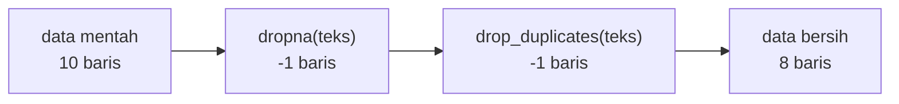

# Missing Values dan Duplikasi Data

!!! abstract "Info materi"
    **Tingkat kesulitan:** Menengah. **Estimasi waktu:** 75–100 menit.
    **Jenis kode:** snippet edukatif (`examples/level-1-python/14_missing_duplikasi.py`) dengan data sintetis `data/laporan_contoh.csv`.

## Tujuan pembelajaran

- [ ] Mendeteksi nilai kosong (*missing values*) dengan `isna` dan menghitungnya per kolom.
- [ ] Memilih antara membuang atau mengisi nilai kosong dan menjelaskan konsekuensinya.
- [ ] Mendeteksi dan membuang duplikat dengan `duplicated` dan `drop_duplicates`.
- [ ] Menjelaskan mengapa duplikat dapat menyebabkan kebocoran data dan mengapa variasi huruf kapital/spasi dapat menyembunyikan duplikat.

## Prasyarat

[Dasar pandas](pandas-dasar.md).

## Pengantar dan motivasi

Data nyata jarang bersih. Ada sel yang kosong (teks tidak tersimpan, lokasi tidak diisi) dan baris yang
sama muncul dua kali (retweet, kesalahan impor). Keduanya memengaruhi hasil: baris kosong dapat membuat program
galat; duplikat membuat model menghafal dan membuat skor evaluasi terlalu bagus bila salinan jatuh di data latih dan data uji
([Data Leakage](../level-2-fondasi-teks/leakage-preprocessing.md)).

## Konsep dasar

- **Missing value**: nilai yang tidak ada. Di pandas ditulis `NaN` (angka) atau `NaN`/`None` (teks). Sel kosong di CSV terbaca `NaN`.
- **Duplikat**: baris yang isinya sama. Bisa duplikat seluruh baris atau hanya pada kolom tertentu (misal `teks`).

| Operasi | Fungsi |
|---|---|
| `df.isna()` | Tabel `True/False` untuk nilai kosong |
| `df.isna().sum()` | Jumlah kosong per kolom |
| `df.dropna(subset=[...])` | Membuang baris kosong pada kolom tertentu |
| `df.fillna(nilai)` | Mengisi nilai kosong |
| `df.duplicated(subset=..., keep=...)` | Menandai duplikat |
| `df.drop_duplicates(subset=..., keep="first")` | Membuang duplikat |

## Penjelasan mendalam

### Membuang atau mengisi?

- **Buang** baris bila nilai kosong menghilangkan makna baris itu. Teks kosong pada tugas klasifikasi teks tidak berguna: **buang** (id 9 pada data ini).
- **Isi** bila kolom pendukung kosong dan baris masih berguna. Lokasi kosong dapat diisi `"tidak diketahui"`.
- **Jangan mengisi tanpa berpikir**: mengisi angka kosong dengan 0 atau rata-rata mengubah sebaran data. Catat keputusan Anda.

### `keep` pada duplikat

`duplicated(keep="first")` menandai kemunculan **kedua dan seterusnya**. `keep=False` menandai **semua** salinan, berguna untuk
*melihat* kelompok duplikat (Bagian 2). Untuk membuang, `drop_duplicates(keep="first")` menyisakan kemunculan pertama.

### Duplikat tersembunyi

`"Banjir naik"`, `"banjir naik "`, dan `"BANJIR NAIK"` adalah tiga string berbeda bagi komputer. Bandingkan setelah preprocessing dasar
(`lower()`, `strip()`) untuk menemukan duplikat yang sesungguhnya (Bagian 5). Pada data nyata, teks yang hampir sama (*near-duplicate*) juga perlu
dikenali (Level 3).

### Urutan: bersihkan, **lalu** bagi data

Duplikat harus dibuang **sebelum** membagi data latih dan uji; bila tidak, salinan yang sama dapat berada di kedua sisi.

### `NaN` tidak sama dengan dirinya sendiri

`float("nan") == float("nan")` bernilai `False` (Bagian 6). Karena itu periksa dengan `isna`/`pd.isna`, bukan `== nan`.

## Cara kerja atau alur proses



## Contoh sederhana

```python
import pandas as pd
s = pd.Series(["a", None, "a"])
s.isna().sum(), s.duplicated().sum()   # (1, 0): None bukan duplikat dari "a"
```

## Contoh dalam konteks Twitter/X kebencanaan

Di data sintetis ini: id 9 memiliki teks kosong; id 6 memiliki lokasi kosong; id 2 dan 8 berisi teks identik
("Pelatihan mitigasi gempa digelar besok pagi"), meniru *retweet*.

## Praktik Python

Berkas: `examples/level-1-python/14_missing_duplikasi.py`.

### Bagian 1 — Mencari nilai kosong

```python title="Bagian 1"
--8<-- "level-1-python/14_missing_duplikasi.py:missing"
```

`df["teks"].isna()` menghasilkan topeng boolean; `df[topeng][[kolom]]` memilih baris yang kosong dan dua kolom saja.

```text title="Output nyata"
id        0
teks      1
label     0
lokasi    1
dtype: int64
   id          label
8   9  Non-Emergency
```

Interpretasi: satu teks kosong dan satu lokasi kosong. Baris dengan teks kosong adalah id 9 (label `Non-Emergency`). Indeks barisnya 8 (indeks dimulai dari 0; id dimulai dari 1).

### Bagian 2 — Mencari duplikat

```python title="Bagian 2"
--8<-- "level-1-python/14_missing_duplikasi.py:duplikat"
```

```text title="Output nyata"
duplikat teks: 1
   id                                         teks
1   2  Pelatihan mitigasi gempa digelar besok pagi
7   8  Pelatihan mitigasi gempa digelar besok pagi
```

Interpretasi: satu baris ditandai duplikat (kemunculan kedua). Dengan `keep=False`, kedua salinan (id 2 dan 8) tampil bersama sehingga kita dapat membandingkannya.

### Bagian 3 — Membersihkan

```python title="Bagian 3"
--8<-- "level-1-python/14_missing_duplikasi.py:bersih"
```

`dropna(subset=["teks"])` membuang baris yang teksnya kosong; `drop_duplicates(subset="teks", keep="first")` membuang duplikat teks (menyisakan yang pertama).

```text title="Output nyata"
(10, 4) -> (8, 4)
[1, 2, 3, 4, 5, 6, 7, 10]
```

Interpretasi: dari 10 baris menjadi 8; yang terbuang adalah id 9 (kosong) dan id 8 (duplikat id 2). Data asli `df` tidak berubah; hasilnya DataFrame baru `bersih`.

### Bagian 4 — Mengisi

```python title="Bagian 4"
--8<-- "level-1-python/14_missing_duplikasi.py:isi"
```

```text title="Output nyata"
['Jakarta', 'Bandung', 'Surabaya', 'Jakarta', 'Padang', 'tidak diketahui']
1 0
```

Interpretasi: lokasi kosong id 6 diganti `"tidak diketahui"`. Jumlah kosong pada `df` asli masih 1 (tidak berubah), sedangkan setelah `fillna` menjadi 0. `fillna` mengembalikan salinan, bukan mengubah yang asli.

### Bagian 5 — Duplikat tersembunyi

```python title="Bagian 5"
--8<-- "level-1-python/14_missing_duplikasi.py:kapital"
```

```text title="Output nyata"
0
2
```

Interpretasi: tiga string yang bermakna sama dianggap tidak ada duplikat (0) sebelum dinormalkan, tetapi setelah `lower()` dan `strip()` terdeteksi 2 duplikat. Duplikat sebenarnya lebih banyak daripada yang terlihat pada perbandingan mentah.

### Bagian 6 — `NaN` dan kesamaan

```python title="Bagian 6"
--8<-- "level-1-python/14_missing_duplikasi.py:nan_bukan_sama"
```

```text title="Output nyata"
False True
```

Interpretasi: `nan == nan` adalah `False`; `pd.isna(nan)` adalah `True`. Gunakan fungsi pemeriksa, bukan `==`.

### Skrip terpadu

Keenam bagian adalah satu skrip: `14_missing_duplikasi.py`.

## Kesalahan umum dan debugging

| Gejala | Penyebab | Perbaikan |
|---|---|---|
| `AttributeError: 'float' object has no attribute 'lower'` | Teks kosong (`NaN`, bertipe float) masuk fungsi string | `dropna` atau `fillna("")` sebelum memproses |
| Duplikat tidak terdeteksi | Variasi huruf kapital/spasi | Normalkan dulu sebelum `duplicated` |
| `df.dropna()` membuang terlalu banyak baris | Tanpa `subset`, membuang baris yang kolom mana pun kosong | `dropna(subset=[kolom_penting])` |
| Hasil `fillna` hilang | Tidak menyimpan hasil | `df = df.fillna(...)` |
| Skor uji terlalu bagus | Duplikat di latih dan uji | Buang duplikat sebelum membagi data |
| `== np.nan` tidak pernah benar | `NaN` tidak sama dengan dirinya | `isna` |

## Kelebihan dan keterbatasan

**Kelebihan:** operasi vektor yang jelas dan cepat. **Keterbatasan:** keputusan membuang atau mengisi bersifat subjektif dan memengaruhi hasil;
`duplicated` hanya mengenali kesamaan persis (bukan near-duplicate); mengisi nilai dapat menyembunyikan bahwa data itu hilang.

## Latihan bertahap

1. **Konseptual.** Mengapa duplikat berbahaya saat membagi data latih dan uji?
2. **Membaca kode.** Apa beda `duplicated()` dan `duplicated(keep=False)`?
3. **Mengisi kode.** Lengkapi: `df.dropna(___=["teks"])` agar hanya baris dengan teks kosong yang dibuang.
4. **Debugging.** `df["teks"].str.lower()` menghasilkan `NaN` untuk satu baris. Mengapa?
5. **Program kecil.** Hitung jumlah duplikat pada kolom `teks` setelah `lower()` dan `strip()`, lalu buang dan cetak ukuran sebelum/sesudah.

## Kunci jawaban dan pembahasan

??? success "Jawaban 1"
    Salinan yang sama dapat jatuh di data latih dan uji; model "mengenali" teks yang sudah dilihatnya sehingga skor uji terlalu optimistis (kebocoran data).

??? success "Jawaban 2"
    `duplicated()` hanya menandai kemunculan kedua dan seterusnya; `duplicated(keep=False)` menandai **semua** salinan, termasuk yang pertama.

??? success "Jawaban 3"
    `subset`: `df.dropna(subset=["teks"])`.

??? success "Jawaban 4"
    Baris itu memiliki teks kosong (`NaN`); metode `.str` mempertahankan `NaN` alih-alih memprosesnya. Buang atau isi baris itu terlebih dahulu bila perlu.

??? success "Jawaban 5"
    ```python
    s = df["teks"].dropna().str.lower().str.strip()
    print(s.duplicated().sum(), len(s), "->", len(s.drop_duplicates()))
    ```
    Setelah menghilangkan teks kosong, ada 9 teks dan 1 duplikat (id 8 salinan id 2), sehingga 9 → 8.

## Kuis singkat

**1.** Bagaimana menghitung nilai kosong per kolom?

??? success "Jawaban"
    `df.isna().sum()`.

**2.** Mengapa `nan == nan` salah?

??? success "Jawaban"
    Menurut standar bilangan desimal, `NaN` tidak sama dengan apa pun, termasuk dirinya; gunakan `isna`.

**3.** Kapan sebaiknya membuang duplikat?

??? success "Jawaban"
    Sebelum membagi data latih dan uji.

## Ringkasan

- `isna().sum()` menghitung kosong; `dropna(subset=...)` membuang; `fillna` mengisi.
- `duplicated`/`drop_duplicates` menangani duplikat; normalkan huruf dan spasi untuk menemukan duplikat tersembunyi.
- Bersihkan sebelum membagi data; catat keputusan membuang atau mengisi.
- Pada data ini: 10 baris → 8 setelah membuang 1 teks kosong dan 1 duplikat.

## Glosarium istilah baru

Missing value
:   Nilai yang tidak ada pada data.

Duplikat
:   Baris yang isinya sama dengan baris lain.

Near-duplicate
:   Baris yang hampir sama tetapi tidak persis sama.

`fillna` / `dropna`
:   Mengisi / membuang nilai kosong.

Kebocoran data
:   Informasi dari data uji ikut memengaruhi pelatihan.

## Referensi

- Dokumentasi pandas, *Working with missing data*: <https://pandas.pydata.org/docs/user_guide/missing_data.html> (dokumentasi resmi).
- Dokumentasi pandas, `DataFrame.duplicated`: <https://pandas.pydata.org/docs/reference/api/pandas.DataFrame.duplicated.html> (dokumentasi resmi).

## Materi selanjutnya

[Dasar Regex dengan `re`](regex-dasar.md)
