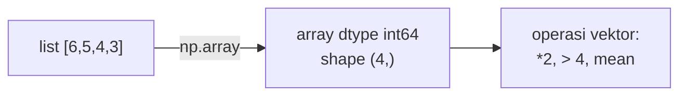

# Dasar NumPy

!!! abstract "Info materi"
    **Tingkat kesulitan:** Menengah. **Estimasi waktu:** 90–120 menit.
    **Jenis kode:** snippet edukatif (`examples/level-1-python/12_numpy_dasar.py`). Memerlukan `numpy` (`pip install -r requirements-ml.txt`).

## Tujuan pembelajaran

- [ ] Membuat array NumPy dan membaca `shape` serta `dtype`.
- [ ] Melakukan operasi per elemen (vektorisasi) dan penyaringan dengan topeng boolean.
- [ ] Menghitung ringkasan (rata-rata, simpangan baku, jumlah per sumbu).
- [ ] Menghitung perkalian titik dan norma vektor, dan menjelaskan kaitannya dengan TF-IDF.
- [ ] Mengenali galat ketidakcocokan bentuk.

## Prasyarat

[Perulangan](perulangan.md) dan [List, Tuple, Set, Dict](list-tuple-set-dict.md). Pengetahuan matematika sekolah menengah (rata-rata, akar kuadrat).

## Pengantar dan motivasi

Teks yang sudah diubah menjadi angka disimpan sebagai **array**: tabel angka berukuran tetap. Menghitung dengan
`for` biasa pada jutaan angka lambat. NumPy memproses seluruh array sekaligus dengan kode tingkat rendah yang
cepat. Seluruh pustaka ML yang kita pakai (pandas, scikit-learn) dibangun di atas NumPy.

## Konsep dasar

- **Array (`ndarray`)**: kumpulan nilai **bertipe sama** dalam satu atau lebih dimensi.
- **`shape`**: ukuran tiap dimensi. Vektor 4 elemen berbentuk `(4,)`; matriks 2 baris × 3 kolom berbentuk `(2, 3)`.
- **`dtype`**: tipe elemen (`int64`, `float64`).
- **Vektorisasi**: operasi diterapkan ke seluruh elemen tanpa perulangan eksplisit.
- **`axis`**: arah operasi. `axis=0` menyusuri baris (hasil per kolom); `axis=1` menyusuri kolom (hasil per baris).

Rumus yang dipakai (simbol: $x_i$ elemen ke-$i$, $n$ jumlah elemen):

$$
\text{rata-rata} = \frac{1}{n}\sum_{i=1}^{n} x_i
\qquad
\text{simpangan baku} = \sqrt{\frac{1}{n}\sum_{i=1}^{n}(x_i-\text{rata-rata})^2}
$$

Perkalian titik (*dot product*) dua vektor $a$ dan $b$ dan norma L2 vektor $a$:

$$
a \cdot b = \sum_i a_i b_i
\qquad
\lVert a \rVert_2 = \sqrt{\sum_i a_i^2}
$$

## Penjelasan mendalam

### Contoh numerik

Panjang kata empat laporan: $[6, 5, 4, 3]$. Rata-rata $=(6+5+4+3)/4=4{,}5$. Selisih terhadap rata-rata: $1{,}5;\ 0{,}5;\ -0{,}5;\ -1{,}5$;
kuadratnya $2{,}25;\ 0{,}25;\ 0{,}25;\ 2{,}25$ dengan rata-rata $1{,}25$; akarnya $1{,}118$ adalah simpangan baku.
(NumPy `std()` memakai pembagi $n$, bukan $n-1$, secara bawaan.)

Vektor $a=[1,0,1]$ dan $b=[1,1,0]$: $a\cdot b = 1\cdot1 + 0\cdot1 + 1\cdot0 = 1$. Norma $\lVert a\rVert_2=\sqrt{1+0+1}=\sqrt2\approx1{,}414$.

### Mengapa NumPy cepat dan apa harganya

Elemen disimpan berurutan dalam memori dengan tipe seragam, sehingga operasi dijalankan dalam kode C. Harganya:
semua elemen harus bertipe sama, dan bentuk operan harus cocok (Bagian 6).

### Array bukan list

`list * 2` mengulang list (`[6,5,4,3,6,5,4,3]`); `array * 2` mengalikan **setiap elemen** (`[12,10,8,6]`) (Bagian 5).
Ini sumber kebingungan paling umum bagi pemula.

### Kaitan dengan NLP

Satu dokumen menjadi vektor, kumpulan dokumen menjadi matriks (baris = dokumen, kolom = kata). Norma L2 dipakai
pada normalisasi TF-IDF dan perkalian titik pada kemiripan teks ([TF-IDF](../level-3-representasi-teks/tfidf.md)).

### Catatan platform

`dtype` bilangan bulat bawaan bergantung versi dan sistem (NumPy 2 pada Windows memakai `int64`; versi lama di Windows
memakai `int32`). Jangan menggantungkan logika pada ukuran bawaan.

## Cara kerja atau alur proses



## Contoh sederhana

```python
import numpy as np
x = np.array([1, 2, 3])
x * 2        # array([2, 4, 6])
```

## Contoh dalam konteks Twitter/X kebencanaan

`panjang` berisi jumlah kata empat postingan; matriks `m` adalah mini matriks dokumen-kata (2 dokumen × 3 kata):
nilai di baris 0 kolom 2 adalah berapa kali kata ketiga muncul pada dokumen pertama.

## Praktik Python

Berkas: `examples/level-1-python/12_numpy_dasar.py`.

### Bagian 1 — Membuat array

```python title="Bagian 1"
--8<-- "level-1-python/12_numpy_dasar.py:array"
```

```text title="Output nyata"
[6 5 4 3] int64 (4,)
ndarray 4
```

Interpretasi: array bertipe `ndarray`, `dtype` `int64`, bentuk `(4,)` (satu dimensi, empat elemen). Perhatikan array dicetak tanpa koma.

### Bagian 2 — Operasi vektor dan penyaringan

```python title="Bagian 2"
--8<-- "level-1-python/12_numpy_dasar.py:vektor"
```

`panjang > 4` menghasilkan array boolean (topeng); `panjang[panjang > 4]` memakai topeng untuk memilih elemen yang bernilai `True`. `.round(3)` membulatkan.

```text title="Output nyata"
4.5 6 1.118
[12 10  8  6] [6 5]
[ True  True False False]
```

Interpretasi: rata-rata 4,5; maksimum 6; simpangan baku 1,118 (cocok dengan perhitungan tangan). `panjang * 2` mengalikan setiap elemen. Topeng `[True True False False]` memilih elemen 6 dan 5.

### Bagian 3 — Matriks dan sumbu

```python title="Bagian 3"
--8<-- "level-1-python/12_numpy_dasar.py:matriks"
```

`m.sum(axis=0)` menjumlahkan **sepanjang baris** sehingga menghasilkan satu nilai per kolom. `m.T` adalah transpose (menukar baris dan kolom). `(m == 0).mean()` adalah proporsi elemen nol.

```text title="Output nyata"
(2, 3) [1 3 2] [3 3]
(3, 2) 0.5
```

Interpretasi: `m` berbentuk (2, 3). Jumlah per kolom `[1 3 2]` (1+0, 0+3, 2+0); jumlah per baris `[3 3]` (1+0+2, 0+3+0). Transpose berbentuk (3, 2). Tiga dari enam elemen bernilai 0, sehingga proporsinya 0,5. Proporsi nol yang tinggi adalah ciri matriks teks (halaman Sparse Matrix, Level 3).

### Bagian 4 — Perkalian titik dan norma

```python title="Bagian 4"
--8<-- "level-1-python/12_numpy_dasar.py:vektor_kata"
```

`a @ b` adalah perkalian titik. `np.arange(0, 1, 0.25)` membuat deret dari 0 sampai sebelum 1 dengan langkah 0,25. `np.zeros((2, 2), dtype=int)` membuat matriks nol.

```text title="Output nyata"
1 1.414
[0.   0.25 0.5  0.75] [[0 0]
 [0 0]]
```

Interpretasi: hasilnya sama dengan hitungan tangan: perkalian titik 1 dan norma $\sqrt2 = 1{,}414$.

### Bagian 5 — Array berbeda dari list

```python title="Bagian 5"
--8<-- "level-1-python/12_numpy_dasar.py:perbandingan"
```

```text title="Output nyata"
[6, 5, 4, 3, 6, 5, 4, 3]
[12 10  8  6]
```

Interpretasi: `list * 2` mengulang list; `array * 2` mengalikan tiap elemen.

### Bagian 6 — Bentuk tidak cocok

```python title="Bagian 6"
--8<-- "level-1-python/12_numpy_dasar.py:galat"
```

```text title="Output nyata"
ValueError: operands could not be broadcast together with shapes (3,) (2,)
```

Interpretasi: menjumlah array berpanjang 3 dan 2 tidak mungkin; NumPy menolak dengan menyebut kedua bentuk. Di scikit-learn, pesan serupa muncul bila jumlah fitur latih dan uji berbeda.

### Skrip terpadu

Keenam bagian adalah satu skrip: `12_numpy_dasar.py`.

## Kesalahan umum dan debugging

| Gejala | Penyebab | Perbaikan |
|---|---|---|
| `ValueError: operands could not be broadcast together` | Bentuk tidak cocok | Cetak `.shape` kedua operan |
| `array * 2` dikira mengulang | Mengira array = list | Ingat: operasi per elemen |
| Hasil `axis` terbalik | Salah memahami arah | `axis=0` per kolom, `axis=1` per baris; uji pada contoh kecil |
| Elemen berubah tipe diam-diam | Array bertipe tunggal | Periksa `dtype` |
| Hasil bilangan bulat terpotong | Menugaskan desimal ke array `int` | Buat array `float` |
| `std()` berbeda dari kalkulator | Pembagi $n$ vs $n-1$ | `ddof=1` untuk sampel |

## Kelebihan dan keterbatasan

**Kelebihan:** cepat, ringkas, dasar semua pustaka numerik. **Keterbatasan:** tipe seragam; tidak menyimpan nama kolom (pandas melakukannya);
array padat memakan memori untuk data sangat jarang (matriks teks memakai format *sparse*).

## Latihan bertahap

1. **Konseptual.** Mengapa operasi NumPy lebih cepat daripada perulangan `for` Python?
2. **Membaca kode.** Perkirakan `np.array([1, 2, 3]).sum()` dan `np.array([1, 2, 3])[np.array([1, 2, 3]) > 1]`.
3. **Mengisi kode.** Lengkapi agar menghitung rata-rata per kolom matriks `m`: `m.mean(axis=___)`.
4. **Debugging.** `np.array([1, 2, 3]) + np.array([1, 2])` galat. Apa pesannya dan bagaimana memperbaikinya?
5. **Program kecil.** Hitung norma L2 dan buat vektor ternormalisasi dari `v = np.array([3, 4])`; pastikan panjang hasilnya 1.

## Kunci jawaban dan pembahasan

??? success "Jawaban 1"
    Array disimpan berurutan dengan tipe seragam dan dihitung dalam kode C yang dioptimalkan untuk seluruh array sekaligus, bukan satu per satu oleh interpreter Python.

??? success "Jawaban 2"
    `6` dan `[2 3]`. Topeng `[False True True]` memilih elemen 2 dan 3.

??? success "Jawaban 3"
    `0`: `m.mean(axis=0)` merata-ratakan sepanjang baris sehingga menghasilkan satu nilai per kolom (hasil `[0.5 1.5 1.]`).

??? success "Jawaban 4"
    `ValueError: operands could not be broadcast together with shapes (3,) (2,)`. Samakan panjang (mis. `[1, 2, 0]`), atau pastikan memang ingin menjumlahkan array yang bentuknya sesuai.

??? success "Jawaban 5"
    ```python
    v = np.array([3, 4])
    n = np.linalg.norm(v)      # 5.0
    u = v / n                  # [0.6 0.8]
    print(np.linalg.norm(u))   # 1.0
    ```
    Norma $\sqrt{3^2+4^2}=5$; setelah dibagi 5 panjangnya 1. Inilah normalisasi L2 pada TF-IDF.

## Kuis singkat

**1.** Apa arti `shape` `(2, 3)`?

??? success "Jawaban"
    Dua baris dan tiga kolom.

**2.** Apa beda `list * 2` dan `array * 2`?

??? success "Jawaban"
    `list * 2` mengulang list; `array * 2` mengalikan setiap elemen.

**3.** Apa itu topeng boolean?

??? success "Jawaban"
    Array `True/False` hasil perbandingan yang dipakai untuk memilih elemen.

## Ringkasan

- Array NumPy: bertipe seragam, punya `shape` dan `dtype`; operasi per elemen (vektorisasi).
- Topeng boolean menyaring; `axis` menentukan arah penjumlahan; `a @ b` perkalian titik; `np.linalg.norm` norma L2.
- Ketidakcocokan bentuk adalah galat umum.

## Glosarium istilah baru

Array (`ndarray`)
:   Tabel angka bertipe seragam berukuran tetap.

`shape` / `dtype`
:   Ukuran tiap dimensi / tipe elemen array.

Vektorisasi
:   Menerapkan operasi pada seluruh array tanpa perulangan eksplisit.

Topeng boolean
:   Array `True/False` untuk memilih elemen.

Norma L2
:   Panjang vektor: akar jumlah kuadrat elemen.

Perkalian titik (*dot product*)
:   Jumlah hasil kali elemen yang bersesuaian dua vektor.

## Referensi

- Dokumentasi NumPy, *NumPy: the absolute basics for beginners*: <https://numpy.org/doc/stable/user/absolute_beginners.html> (dokumentasi resmi).

## Materi selanjutnya

[Dasar pandas](pandas-dasar.md)
