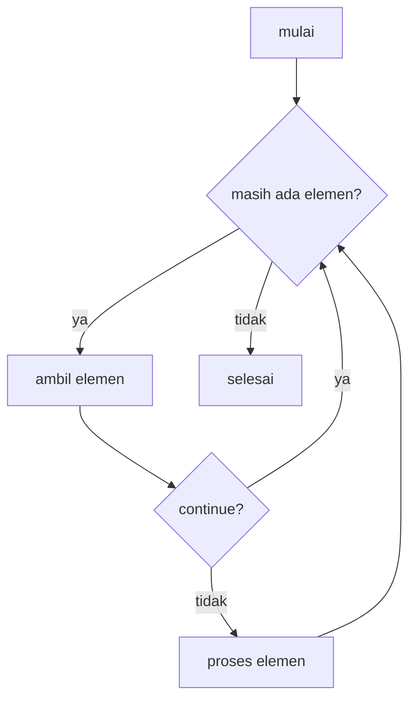

# Perulangan: for, while, dan Comprehension

!!! abstract "Info materi"
    **Tingkat kesulitan:** Pemula–menengah. **Estimasi waktu:** 75–100 menit.
    **Jenis kode:** snippet edukatif (`examples/level-1-python/06_perulangan.py`).

## Tujuan pembelajaran

- [ ] Memakai `for`, `range`, `enumerate`, `zip`, dan `while`.
- [ ] Mengontrol perulangan dengan `break` dan `continue`.
- [ ] Menulis list dan set comprehension yang mudah dibaca.
- [ ] Menjelaskan mengapa mengubah list yang sedang diiterasi berbahaya.

## Prasyarat

[Kondisional](kondisional.md) dan [List, Tuple, Set, Dict](list-tuple-set-dict.md).

## Pengantar dan motivasi

Hampir setiap pekerjaan NLP adalah "lakukan hal yang sama untuk setiap
dokumen/kata". Menulis ulang baris yang sama seribu kali tidak mungkin; perulangan
mengerjakannya. `for` mengiterasi koleksi yang sudah ada; `while` mengulang selama
syaratnya benar dan **harus punya akhir**.

## Konsep dasar

| Konstruksi | Fungsi |
|---|---|
| `for x in koleksi:` | Iterasi tiap elemen |
| `range(n)` | Bilangan 0 sampai `n-1` |
| `enumerate(koleksi, start=1)` | Elemen beserta nomor urutnya |
| `zip(a, b)` | Memasangkan dua koleksi |
| `break` / `continue` | Berhenti total / lompat ke putaran berikutnya |
| `[ekspresi for x in k if syarat]` | List comprehension |
| `{ekspresi for x in k}` | Set comprehension |
| `while syarat:` | Ulangi selama syarat benar |

## Penjelasan mendalam

### `for` versus `while`

Pakai `for` bila jumlah putaran diketahui atau mengikuti sebuah koleksi (hampir selalu pada NLP).
Pakai `while` bila berhenti bergantung pada kondisi yang berubah (mis. membaca sampai data habis).
`while` yang kondisinya tidak pernah menjadi salah menghasilkan **perulangan tak berujung**.

### `break` dan `else` pada perulangan

`break` menghentikan perulangan seketika. Klausa `else` pada `for` (jarang dipakai) berjalan
**hanya bila perulangan selesai tanpa `break`**; berguna untuk pola "cari sesuatu, jika tidak ada, lakukan
lain" (Bagian 4).

### Comprehension: ringkas, tetapi jangan berlebihan

`[len(t.split()) for t in teks_list]` setara dengan membuat list kosong lalu `append` dalam `for`.
Comprehension bagus untuk transformasi/penyaringan sederhana. Bila perlu banyak syarat bertingkat
atau efek samping (mencetak, menulis file), pakai `for` biasa agar terbaca.

### Jangan mengubah list yang sedang diiterasi

Ketika elemen dihapus saat iterasi, indeks internal bergeser dan sebagian elemen **terlewat**
(Bagian 8). Buat list baru (comprehension), atau iterasi pada salinan.

## Cara kerja atau alur proses



## Contoh sederhana

```python
for kata in ["air", "naik"]:
    print(kata.upper())   # AIR, NAIK
```

## Contoh dalam konteks Twitter/X kebencanaan

Tiga laporan pendek: menghitung jumlah kata tiap laporan, melewati laporan yang
mengandung "besok" (bukan kejadian berlangsung), dan mencari laporan pertama yang menyebut "gempa".

## Praktik Python

Berkas: `examples/level-1-python/06_perulangan.py`. Variabel `teks_list` berisi tiga laporan.

### Bagian 1 — `for` dan `range`

```python title="Bagian 1"
--8<-- "level-1-python/06_perulangan.py:for"
```

`end=" "` pada `print` mengganti baris baru dengan spasi.

```text title="Output nyata"
banjir naik
gempa terasa
pelatihan besok
0 1 2
```

Interpretasi: `for teks in teks_list` mengambil tiap elemen secara berurutan. `range(3)` menghasilkan 0, 1, 2 (tidak termasuk 3).

### Bagian 2 — `enumerate`

```python title="Bagian 2"
--8<-- "level-1-python/06_perulangan.py:enumerate"
```

```text title="Output nyata"
1 banjir naik 2
2 gempa terasa 2
3 pelatihan besok 2
```

Interpretasi: `enumerate(..., start=1)` memberi nomor mulai 1. `len(teks.split())` menghitung kata; ketiganya 2 kata. Alternatif `range(len(teks_list))` lebih bertele-tele.

### Bagian 3 — `continue`

```python title="Bagian 3"
--8<-- "level-1-python/06_perulangan.py:continue"
```

```text title="Output nyata"
tanpa 'besok': 2
```

Interpretasi: laporan yang memuat "besok" dilewati (`continue` melompat ke putaran berikutnya), sehingga hanya 2 laporan dihitung. `jumlah += 1` adalah singkatan `jumlah = jumlah + 1`.

### Bagian 4 — `break` dan `else`

```python title="Bagian 4"
--8<-- "level-1-python/06_perulangan.py:break"
```

```text title="Output nyata"
ditemukan: gempa terasa
```

Interpretasi: perulangan berhenti saat menemukan "gempa" sehingga `else` tidak dijalankan. Bila tidak ada "gempa", `else` mencetak `tidak ada gempa`.

### Bagian 5 — Comprehension

```python title="Bagian 5"
--8<-- "level-1-python/06_perulangan.py:comprehension"
```

```text title="Output nyata"
[2, 2, 2]
['gempa terasa', 'pelatihan besok']
```

Interpretasi: list comprehension mengumpulkan jumlah kata; semuanya 2 sehingga hasil `[2, 2, 2]` tidak informatif pada contoh sekecil ini (pada data nyata nilainya bervariasi). Set comprehension memilih laporan yang lebih panjang dari 11 karakter; `sorted` membuat keluaran stabil.

### Bagian 6 — `while`

```python title="Bagian 6"
--8<-- "level-1-python/06_perulangan.py:while"
```

```text title="Output nyata"
n akhir: -1
```

Interpretasi: `n` berubah 5 → 3 → 1 → −1. Perulangan berhenti ketika `n > 0` salah, dan `n` berakhir di −1, bukan 0, karena langkah 2 melompati 0. Memikirkan kondisi berhenti penting.

### Bagian 7 — `zip`

```python title="Bagian 7"
--8<-- "level-1-python/06_perulangan.py:zip"
```

```text title="Output nyata"
a 1
b 2
[(1, 'a')]
```

Interpretasi: `zip` memasangkan elemen yang bersesuaian. Baris terakhir menunjukkan jebakan: `zip` berhenti pada koleksi **terpendek** tanpa peringatan, sehingga dua elemen dari `[1, 2, 3]` hilang.

### Bagian 8 — Mengubah list saat iterasi

```python title="Bagian 8"
--8<-- "level-1-python/06_perulangan.py:ubah"
```

```text title="Output nyata"
[4, 8]
[]
```

Interpretasi: tujuan menghapus semua angka genap dari `[2, 4, 6, 8]`. Menghapus saat iterasi menghasilkan `[4, 8]` (sebagian terlewat karena indeks bergeser), sedangkan comprehension menghasilkan `[]` yang benar.

### Skrip terpadu

Kedelapan bagian adalah satu skrip: `06_perulangan.py`.

## Kesalahan umum dan debugging

| Gejala | Penyebab | Perbaikan |
|---|---|---|
| Program tidak pernah berhenti | `while` tanpa perubahan pada kondisinya | Pastikan variabel kondisi berubah; tekan Ctrl+C untuk menghentikan |
| Elemen terlewat saat menghapus | Mengubah list yang sedang diiterasi | Pakai comprehension atau iterasi pada salinan |
| `zip` memotong data diam-diam | Panjang berbeda | Periksa panjang, atau `zip(..., strict=True)` (Python 3.10+) |
| `range(len(x))` bertele-tele | Gaya lama | `for item in x` atau `enumerate` |
| Comprehension sulit dibaca | Terlalu banyak syarat | Pakai `for` biasa |

## Kelebihan dan keterbatasan

**Kelebihan:** mengotomatiskan pekerjaan berulang; comprehension ringkas dan cepat. **Keterbatasan:** perulangan
Python murni lambat untuk jutaan elemen (NumPy/pandas lebih cepat); kondisi `while` yang salah menghasilkan
perulangan tak berujung.

## Latihan bertahap

1. **Konseptual.** Apa beda `break` dan `continue`?
2. **Membaca kode.** Perkirakan `list(range(1, 6))` dan `[x * 2 for x in range(3)]`.
3. **Mengisi kode.** Lengkapi agar mencetak nomor dan kata: `for no, kata in ___(["air", "naik"], start=1):`.
4. **Debugging.** Mengapa `for x in lst: if x == 0: lst.remove(x)` bisa melewatkan nol yang berurutan?
5. **Program kecil.** Cetak hanya teks yang panjangnya lebih dari rata-rata panjang seluruh teks pada `teks_list` (gunakan `sum` dan comprehension).

## Kunci jawaban dan pembahasan

??? success "Jawaban 1"
    `break` keluar dari perulangan sepenuhnya; `continue` hanya melewati sisa putaran ini dan lanjut ke berikutnya.

??? success "Jawaban 2"
    `[1, 2, 3, 4, 5]` dan `[0, 2, 4]`. `range(1, 6)` berhenti sebelum 6; `range(3)` menghasilkan 0, 1, 2.

??? success "Jawaban 3"
    `enumerate`: `for no, kata in enumerate(["air", "naik"], start=1):`.

??? success "Jawaban 4"
    Setelah elemen dihapus, elemen sesudahnya bergeser ke indeks yang baru saja dilewati, sehingga iterasi melompatinya. Contoh pada Bagian 8. Perbaikan: `lst = [x for x in lst if x != 0]`.

??? success "Jawaban 5"
    ```python
    rata = sum(len(t) for t in teks_list) / len(teks_list)
    print([t for t in teks_list if len(t) > rata])
    ```
    Panjang karakter ketiga teks 11, 12, 15; rata-rata ≈ 12,67; hanya `"pelatihan besok"` (15) yang lebih panjang.

## Kuis singkat

**1.** Berapa panjang hasil `zip([1, 2, 3], ["a"])`?

??? success "Jawaban"
    1, karena `zip` berhenti pada koleksi terpendek.

**2.** Mengapa `while` dapat berbahaya?

??? success "Jawaban"
    Bila kondisinya tidak pernah menjadi salah, perulangan tak pernah berhenti.

**3.** Apa kelebihan comprehension?

??? success "Jawaban"
    Ringkas dan jelas untuk transformasi atau penyaringan sederhana, tanpa membuat list kosong dan `append` manual.

## Ringkasan

- `for` untuk koleksi, `while` dengan kondisi berhenti yang jelas; `enumerate` dan `zip` menambah kenyamanan.
- `break` menghentikan, `continue` melompati; `else` pada `for` berjalan bila tidak ada `break`.
- Comprehension untuk transformasi sederhana; jangan mengubah list saat mengiterasinya.

## Glosarium istilah baru

Iterasi
:   Mengunjungi elemen koleksi satu per satu.

Comprehension
:   Sintaks ringkas membuat list/set dari perulangan.

Perulangan tak berujung
:   `while` yang kondisinya tidak pernah salah.

Unpacking
:   Memecah pasangan atau tuple menjadi beberapa variabel.

## Referensi

- Dokumentasi Python, *for Statements* dan *List Comprehensions* (tutorial): <https://docs.python.org/3/tutorial/controlflow.html#for-statements> dan <https://docs.python.org/3/tutorial/datastructures.html#list-comprehensions> (dokumentasi resmi).

## Materi selanjutnya

[Function dan Parameter](function-parameter.md)
