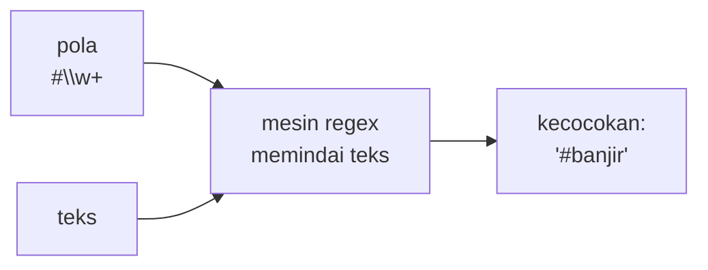

# Dasar Regex dengan `re`

!!! abstract "Info materi"
    **Tingkat kesulitan:** Menengah. **Estimasi waktu:** 120 menit.
    **Jenis kode:** snippet edukatif (`examples/level-1-python/15_regex_dasar.py`).

## Tujuan pembelajaran

- [ ] Menjelaskan apa itu *regular expression* (regex) dan kapan dipakai.
- [ ] Memakai `re.findall`, `re.search`, `re.match`, dan `re.sub`.
- [ ] Menulis pola dengan kelas karakter, kuantifier, kelompok, dan jangkar.
- [ ] Membedakan *greedy* dan *non-greedy*, dan menjelaskan tanda `raw string`.
- [ ] Mengenali jebakan `\w` (mencakup angka) dan hasil `None` dari `search`.

## Prasyarat

[String](string-operasi-teks.md) dan [Exception Handling](exception-handling.md).

## Pengantar dan motivasi

Bagaimana menemukan semua hashtag di sebuah postingan, atau mengganti semua tautan dengan satu penanda? Metode
string seperti `find` hanya mencari teks tetap. Regex adalah bahasa kecil untuk menjelaskan **pola** teks:
"satu `#` diikuti huruf atau angka", "dua digit, titik, dua digit". Preprocessing teks media sosial di
[Level 2](../level-2-fondasi-teks/case-folding-pembersihan.md) sangat bergantung pada regex.

## Konsep dasar

Pola yang sering dipakai:

| Pola | Arti |
|---|---|
| `\d` | Satu digit (0–9) |
| `\w` | Huruf, **angka**, atau garis bawah |
| `\s` | Spasi, tab, baris baru |
| `.` | Karakter apa pun (kecuali baris baru) |
| `[abc]` / `[^abc]` | Salah satu dari a, b, c / bukan salah satunya |
| `+` / `*` / `?` | Satu atau lebih / nol atau lebih / nol atau satu |
| `{2,}` | Dua kali atau lebih |
| `\b` | Batas kata |
| `( ... )` | Kelompok (dapat diambil) |
| `\1` | Rujukan ke kelompok pertama |

Fungsi utama modul `re`:

| Fungsi | Hasil |
|---|---|
| `re.findall(pola, teks)` | Daftar **semua** kecocokan |
| `re.search(pola, teks)` | Kecocokan **pertama** di mana pun (atau `None`) |
| `re.match(pola, teks)` | Cocok hanya di **awal** teks (atau `None`) |
| `re.sub(pola, ganti, teks)` | Mengganti semua kecocokan |
| `re.compile(pola)` | Menyiapkan pola untuk dipakai berulang |

## Penjelasan mendalam

### Raw string `r"..."`

Regex penuh garis miring terbalik (`\d`, `\b`). Pada string biasa, `\b` berarti karakter *backspace* (Bagian 8: `len("\b")` = 1),
bukan batas kata. Awalan `r` (*raw string*) membuat Python tidak menafsirkan garis miring, sehingga `r"\b"` berisi dua
karakter (`\` dan `b`) yang diteruskan ke regex. **Selalu tulis pola regex sebagai raw string.**

### `search` bukan `match`

`re.match` hanya mencocokkan di **awal** teks; `re.search` mencari di mana pun. Pemula sering memakai `match` dan heran
mengapa hasilnya `None`. Pada hampir semua kasus pembersihan teks, `search` atau `findall` yang diinginkan.

### Hasil `None` dan `AttributeError`

Bila tidak ada kecocokan, `search` mengembalikan `None`, bukan objek kecocokan. Memanggil `.group()` pada `None` menimbulkan
`AttributeError` (Bagian 4). Periksa dulu: `if m:`.

### Greedy versus non-greedy

Kuantifier bersifat *greedy* (serakah): `.*` mengambil sebanyak mungkin. Menambah `?` (`.*?`) membuatnya *non-greedy*: mengambil
sesedikit mungkin (Bagian 6). Pada HTML sederhana ini menentukan apakah satu atau semua tag tercakup.

### Jebakan `\w`

`\w` mencakup **angka**. `(\w)\1{2,}` ("karakter yang sama tiga kali atau lebih") memendekkan `TOLOOONG` menjadi
`TOLONG`, tetapi juga memendekkan `Rp1000000` menjadi `Rp10` (Bagian 7). Di Level 2 kita memakai pola khusus huruf.

### Regex bukan parser sempurna

Regex bagus untuk pola sederhana (tautan, hashtag, jam). Untuk struktur bersarang (HTML penuh) atau bahasa alami, regex cepat
menjadi rapuh dan sulit dibaca. Tulis pola sependek dan sejelas mungkin dan uji dengan banyak contoh.

## Cara kerja atau alur proses



## Contoh sederhana

```python
import re
re.findall(r"\d+", "RT 05 RW 12")   # ['05', '12']
```

`\d+` = satu atau lebih digit berurutan.

## Contoh dalam konteks Twitter/X kebencanaan

Postingan sintetis: `@bpbd Banjir di RT 05/RW 12 sejak 06.30, tinggi 120 cm https://t.co/abc #banjir`. Kita ingin
mengambil angka RT/RW, jam, hashtag, dan mention, serta mengganti tautan dengan `<URL>`.

## Praktik Python

Berkas: `examples/level-1-python/15_regex_dasar.py`. Variabel `teks` berisi postingan di atas.

### Bagian 1 — `findall`

```python title="Bagian 1"
--8<-- "level-1-python/15_regex_dasar.py:findall"
```

`\d+` mengambil urutan digit; `#\w+` mengambil `#` diikuti karakter kata; `@\w+` untuk mention.

```text title="Output nyata"
['05', '12', '06', '30', '120']
['#banjir'] ['@bpbd']
```

Interpretasi: lima kelompok digit diambil, termasuk `06` dan `30` dari jam `06.30` sebagai dua angka terpisah (titik bukan digit). Satu hashtag dan satu mention ditemukan.

### Bagian 2 — `sub`

```python title="Bagian 2"
--8<-- "level-1-python/15_regex_dasar.py:sub"
```

`https?://\S+`: `http` dengan `s` opsional, `://`, lalu karakter bukan spasi sebanyak mungkin. `\s+` menggantikan deretan spasi/baris baru dengan satu spasi.

```text title="Output nyata"
@bpbd Banjir di RT 05/RW 12 sejak 06.30, tinggi 120 cm <URL> #banjir
banjir naik cepat
```

Interpretasi: tautan diganti `<URL>`; spasi berlebih dan baris baru dirapikan.

### Bagian 3 — Kelompok

```python title="Bagian 3"
--8<-- "level-1-python/15_regex_dasar.py:grup"
```

Tanda kurung `( )` membuat kelompok yang dapat diambil. `m.groups()` mengembalikan semua kelompok; `m.group(0)` seluruh kecocokan; `m.start()` posisi awal. Pola `\b\d{1,2}\.\d{2}\b` mengenali jam: satu atau dua digit, titik, dua digit, dengan batas kata.

```text title="Output nyata"
('05', '12') RT 05/RW 12 16
['06.30']
```

Interpretasi: kelompok menghasilkan `('05', '12')`; seluruh kecocokan `RT 05/RW 12` dimulai di posisi 16. Pola jam hanya cocok dengan `06.30`; `120` dan `05` tidak, karena tidak berbentuk digit-titik-digit.

### Bagian 4 — `match`, `search`, dan hasil `None`

```python title="Bagian 4"
--8<-- "level-1-python/15_regex_dasar.py:match"
```

```text title="Output nyata"
None True
None
AttributeError: 'NoneType' object has no attribute 'group'
```

Interpretasi: `re.match(r"banjir", "ada banjir")` bernilai `None` karena kata itu bukan di awal teks, sedangkan `re.search` menemukannya (`True`). Pada baris berikutnya, `search(r"gempa", teks)` tidak menemukan apa-apa dan mengembalikan `None`; memanggil `.group(0)` pada `None` menimbulkan `AttributeError`. Periksa hasilnya dulu (`if hasil:`).

### Bagian 5 — Huruf besar/kecil

```python title="Bagian 5"
--8<-- "level-1-python/15_regex_dasar.py:flag"
```

```text title="Output nyata"
['banjir']
['Banjir', 'banjir', 'BANJIR']
```

Interpretasi: secara bawaan regex peka huruf besar/kecil sehingga hanya `banjir` kecil yang cocok. `flags=re.IGNORECASE` mengabaikan perbedaan itu dan mengembalikan ketiganya (teks asli tidak diubah).

### Bagian 6 — Greedy dan non-greedy

```python title="Bagian 6"
--8<-- "level-1-python/15_regex_dasar.py:serakah"
```

```text title="Output nyata"
['<b>satu</b> dan <b>dua</b>']
['<b>satu</b>', '<b>dua</b>']
```

Interpretasi: `.*` serakah dan melahap dari `<b>` pertama sampai `</b>` terakhir, menghasilkan satu kecocokan besar. `.*?` berhenti pada `</b>` terdekat, menghasilkan dua kecocokan yang dimaksud.

### Bagian 7 — `compile` dan jebakan `\w`

```python title="Bagian 7"
--8<-- "level-1-python/15_regex_dasar.py:compile"
```

`re.compile` menyiapkan pola sekali untuk dipakai berulang (lebih rapi dan sedikit lebih cepat). Pola `(\w)\1{2,}`: satu karakter kata (kelompok 1), lalu kelompok 1 muncul lagi dua kali atau lebih; `\1` pada penggantian menyisakan satu salinan.

```text title="Output nyata"
TOLONG
Rp10
```

Interpretasi: `TOLOOONG` menjadi `TOLONG` seperti diharapkan. Namun `Rp1000000` menjadi `Rp10`: `\w` mencakup angka sehingga deretan `0` ikut dipendekkan. Pola yang benar harus membatasi pada huruf (dibahas di Level 2).

### Bagian 8 — Galat pola dan raw string

```python title="Bagian 8"
--8<-- "level-1-python/15_regex_dasar.py:galat"
```

```text title="Output nyata"
re.error: missing ), unterminated subpattern at position 0
1 2
```

Interpretasi: tanda kurung yang tidak ditutup menimbulkan `re.error` dengan posisi masalahnya. Baris kedua menunjukkan perbedaan raw string: `"\b"` hanya 1 karakter (backspace), sedangkan `r"\b"` 2 karakter (`\` dan `b`) yang dipahami regex sebagai batas kata.

### Skrip terpadu

Kedelapan bagian adalah satu skrip: `15_regex_dasar.py`.

## Kesalahan umum dan debugging

| Gejala | Penyebab | Perbaikan |
|---|---|---|
| `AttributeError: 'NoneType' object has no attribute 'group'` | `search` tidak menemukan apa-apa | `if m:` sebelum `.group()` |
| `match` mengembalikan `None` padahal teks ada | `match` hanya di awal | Pakai `search` |
| `re.error: missing ), unterminated subpattern` | Kurung tidak seimbang | Periksa pasangan `( )`, `[ ]` |
| Pola `\b` tidak bekerja | Tidak memakai raw string | `r"\b..."` |
| Satu kecocokan terlalu besar | Kuantifier serakah | `.*?` |
| Angka ikut berubah | `\w` mencakup angka | Batasi dengan `[^\W\d_]` (huruf saja) atau `[A-Za-z]` |
| Pola terlalu rumit untuk dibaca | Regex berlebihan | Pecah menjadi beberapa langkah, beri komentar, tulis tes |

## Kelebihan dan keterbatasan

**Kelebihan:** ringkas untuk pola teks; tersedia di semua bahasa; cepat untuk pola sederhana. **Keterbatasan:** sulit dibaca dan dirawat;
tidak cocok untuk struktur bersarang atau bahasa alami; sangat mudah menghasilkan kecocokan yang terlalu longgar atau terlalu sempit.

## Latihan bertahap

1. **Konseptual.** Apa beda `re.match` dan `re.search`?
2. **Membaca kode.** Perkirakan `re.findall(r"\d+", "RT 05 RW 12")` dan `re.sub(r"\s+", " ", "a   b")`.
3. **Mengisi kode.** Lengkapi pola untuk mengambil semua hashtag: `re.findall(r"___\w+", teks)`.
4. **Debugging.** `re.search(r"gempa", "ada banjir").group(0)` menimbulkan `AttributeError`. Mengapa dan apa perbaikannya?
5. **Program kecil.** Tulis fungsi `ganti_url(teks)` yang mengganti tautan `http://` atau `https://` dengan `<URL>`, lalu uji dengan `assert`.

## Kunci jawaban dan pembahasan

??? success "Jawaban 1"
    `match` hanya mencocokkan di awal teks; `search` mencari di mana pun dan mengembalikan kecocokan pertama.

??? success "Jawaban 2"
    `['05', '12']` dan `'a b'`. `\d+` mengambil dua kelompok digit; `\s+` mengganti tiga spasi dengan satu.

??? success "Jawaban 3"
    `#`: `re.findall(r"#\w+", teks)`.

??? success "Jawaban 4"
    Tidak ada kata "gempa" pada teks, sehingga `search` mengembalikan `None`, dan `None.group(0)` galat. Perbaikan: `m = re.search(...)` lalu `if m: ...`.

??? success "Jawaban 5"
    ```python
    import re

    def ganti_url(teks):
        return re.sub(r"https?://\S+", "<URL>", teks)

    assert ganti_url("lihat https://t.co/abc ya") == "lihat <URL> ya"
    assert ganti_url("tanpa tautan") == "tanpa tautan"
    ```
    `https?` mencakup `http` dan `https`; `\S+` mengambil karakter bukan spasi sampai tautan berakhir.

## Kuis singkat

**1.** Mengapa pola regex ditulis sebagai raw string?

??? success "Jawaban"
    Agar garis miring terbalik (`\d`, `\b`) tidak ditafsirkan Python lebih dulu.

**2.** Apa beda `.*` dan `.*?`?

??? success "Jawaban"
    `.*` serakah (sebanyak mungkin); `.*?` non-greedy (sesedikit mungkin).

**3.** Apa yang dikembalikan `re.search` bila tidak ada kecocokan?

??? success "Jawaban"
    `None`.

## Ringkasan

- Regex menjelaskan pola teks; fungsi utama `findall`, `search`, `match`, `sub`, `compile`.
- Tulis pola sebagai raw string; `search` bukan `match`; periksa hasil `None`.
- Waspadai kuantifier serakah dan `\w` yang mencakup angka.

## Glosarium istilah baru

Regular expression (regex)
:   Bahasa pola untuk mencocokkan teks.

Raw string
:   String berawalan `r` yang tidak menafsirkan garis miring terbalik.

Kuantifier
:   Penanda jumlah pengulangan (`+`, `*`, `?`, `{n,m}`).

Greedy / non-greedy
:   Mengambil sebanyak / sesedikit mungkin.

Kelompok (*group*)
:   Bagian pola dalam kurung yang dapat diambil atau dirujuk.

## Referensi

- Dokumentasi Python, *Regular Expression HOWTO*: <https://docs.python.org/3/howto/regex.html> (dokumentasi resmi).
- Dokumentasi Python, modul `re`: <https://docs.python.org/3/library/re.html> (dokumentasi resmi).

## Materi selanjutnya

[Debugging dan Pengujian Kode Sederhana](debugging-pengujian.md)
