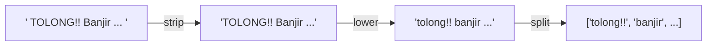

# String dan Operasi Teks

!!! abstract "Info materi"
    **Tingkat kesulitan:** Pemula. **Estimasi waktu:** 75–90 menit.
    **Jenis kode:** snippet edukatif (`examples/level-1-python/02_string_operasi_teks.py`).

## Tujuan pembelajaran

- [ ] Menjelaskan bahwa string adalah urutan karakter yang tidak dapat diubah.
- [ ] Memakai `strip`, `lower`, `split`, `join`, `replace`, `find`, `startswith`, `endswith`, dan operator `in`.
- [ ] Menyusun string dengan f-string.
- [ ] Menjelaskan mengapa metode string mengembalikan string baru.

## Prasyarat

[Variabel dan Tipe Data](variabel-tipe-data.md).

## Pengantar dan motivasi

Seluruh NLP dimulai dari string: satu postingan adalah satu string. Sebelum model
melihatnya, kita hampir selalu membersihkan spasi di ujung, menyeragamkan huruf besar/kecil, dan
memecahnya menjadi kata. Operasi dasar ini membentuk fondasi preprocessing di
[Level 2](../level-2-fondasi-teks/index.md).

## Konsep dasar

String adalah **urutan karakter** yang ditulis di antara tanda kutip (`'...'` atau `"..."`).
Ia **tidak dapat diubah** (*immutable*): metode string tidak mengubah string asal,
melainkan **mengembalikan string baru**.

| Operasi | Fungsi |
|---|---|
| `len(s)` | Jumlah karakter |
| `s.strip()` | Membuang spasi/baris baru di kedua ujung |
| `s.lower()` / `s.upper()` | Mengubah ke huruf kecil/besar |
| `s.split()` | Memecah pada spasi menjadi daftar kata |
| `" ".join(daftar)` | Menyambung daftar kata dengan pemisah |
| `s.replace(a, b)` | Mengganti semua `a` dengan `b` |
| `s.find(a)` | Posisi pertama `a`, atau `-1` bila tidak ada |
| `a in s` | Apakah `a` ada di dalam `s` |
| `s.startswith(a)` / `s.endswith(a)` | Awal/akhir sama dengan `a`? |

## Penjelasan mendalam

### Metode versus fungsi

`len(teks)` adalah **fungsi** yang menerima string sebagai argumen. `teks.strip()` adalah
**metode**: fungsi yang "melekat" pada objek string dan dipanggil dengan titik. Keduanya
melakukan pekerjaan yang sama dalam bentuk berbeda; hanya konvensi Python yang berbeda.

### Mengapa string tidak dapat diubah

Karena string dipakai bersama banyak bagian program (sebagai kunci kamus, misalnya),
Python melarang perubahan di tempat agar tidak ada kejutan. Jika perlu "mengubah",
buat string baru (Bagian 6). Konsekuensi praktis: `teks.lower()` saja **tidak mengubah** `teks`;
Anda harus menyimpan hasilnya: `teks = teks.lower()`.

### Alternatif: kapan `split()` tidak cukup

`split()` memecah pada spasi, tetapi tanda baca menempel pada kata (`'Melati,'`).
Untuk tokenisasi yang baik, regex dipakai (halaman [Regex](regex-dasar.md) dan
[Tokenisasi](../level-2-fondasi-teks/token-kalimat-tokenisasi.md)).

## Cara kerja atau alur proses



## Contoh sederhana

```python
" Halo Dunia ".strip().lower().split()   # ['halo', 'dunia']
```

Tiga metode dirantai (*method chaining*): hasil metode pertama menjadi bahan metode berikutnya.

## Contoh dalam konteks Twitter/X kebencanaan

Postingan sintetis: `  TOLONG!! Banjir di Jl. Melati, air naik cepat  `. Ia mengandung spasi
berlebih, huruf kapital, tanda seru, dan tanda baca. Kita bersihkan sedikit demi sedikit.

## Praktik Python

Berkas: `examples/level-1-python/02_string_operasi_teks.py`.

### Bagian 1 — Melihat string apa adanya

```python title="Bagian 1"
--8<-- "level-1-python/02_string_operasi_teks.py:dasar"
```

`repr(teks)` menampilkan string dengan tanda kutip sehingga spasi di ujung terlihat. `len(teks)` menghitung semua karakter, termasuk spasi.

```text title="Output nyata"
'  TOLONG!! Banjir di Jl. Melati, air naik cepat  '
49
```

Interpretasi: ada dua spasi di awal dan dua di akhir; panjang total 49.

### Bagian 2 — Membersihkan

```python title="Bagian 2"
--8<-- "level-1-python/02_string_operasi_teks.py:bersihkan"
```

`teks.strip()` membuang spasi ujung; `teks.lower().strip()` merantai dua metode.

```text title="Output nyata"
'TOLONG!! Banjir di Jl. Melati, air naik cepat'
tolong!! banjir di jl. melati, air naik cepat
45
```

Interpretasi: panjang turun dari 49 menjadi 45 (empat spasi terbuang). Huruf kecil menyeragamkan `TOLONG` menjadi `tolong`. Variabel `teks` sendiri **tidak berubah**.

### Bagian 3 — Memecah dan menyambung

```python title="Bagian 3"
--8<-- "level-1-python/02_string_operasi_teks.py:pecah"
```

`split()` tanpa argumen memecah pada spasi (dan membuang spasi berlebih). `" ".join(kata)` menyambung daftar menjadi satu string dengan spasi sebagai pemisah.

```text title="Output nyata"
['TOLONG!!', 'Banjir', 'di', 'Jl.', 'Melati,', 'air', 'naik', 'cepat']
banjir naik cepat
```

Interpretasi: delapan potongan; perhatikan `'TOLONG!!'` dan `'Melati,'` masih membawa tanda baca. `join` adalah kebalikan `split`.

### Bagian 4 — Mencari dan mengganti

```python title="Bagian 4"
--8<-- "level-1-python/02_string_operasi_teks.py:cari"
```

```text title="Output nyata"
True
True True 3 -1
TOLONG! Banjir di Jl. Melati, air naik cepat
```

Interpretasi: `"Jl. Melati" in teks` bernilai `True`. `"banjir".find("j")` = 3 (indeks mulai dari 0); `find("z")` = `-1` artinya tidak ditemukan. `replace("!!", "!")` mengganti dua tanda seru dengan satu.

### Bagian 5 — f-string

```python title="Bagian 5"
--8<-- "level-1-python/02_string_operasi_teks.py:fstring"
```

```text title="Output nyata"
Lokasi: 'Melati', panjang nama: 6
```

Interpretasi: ekspresi di dalam `{}` dihitung dan disisipkan; `!r` memberi tanda kutip.

### Bagian 6 — String tidak dapat diubah

```python title="Bagian 6"
--8<-- "level-1-python/02_string_operasi_teks.py:immutable"
```

```text title="Output nyata"
TypeError: 'str' object does not support item assignment
Banjir banjir
```

Interpretasi: mengubah huruf pertama langsung menimbulkan `TypeError`. Solusinya membuat string baru: `"B" + kata_tetap[1:]` menghasilkan `Banjir`, sementara `kata_tetap` tetap `banjir`.

### Skrip terpadu

Keenam bagian adalah satu skrip, `02_string_operasi_teks.py`, yang dijalankan dari atas ke bawah.

## Kesalahan umum dan debugging

| Gejala | Penyebab | Perbaikan |
|---|---|---|
| `teks.lower()` tidak mengubah apa pun | Hasil tidak disimpan | `teks = teks.lower()` |
| `TypeError: 'str' object does not support item assignment` | Mencoba mengubah string di tempat | Buat string baru |
| `AttributeError: 'NoneType' object has no attribute 'lower'` | Variabelnya `None`, bukan string | Periksa sumber data |
| Kata tidak ditemukan padahal tampak ada | Perbedaan huruf besar/kecil atau spasi tak terlihat | `lower()`, `strip()`, `repr()` |
| `find` dikira mengembalikan `True/False` | Mengembalikan indeks atau `-1` | Pakai `in` untuk keberadaan |

## Kelebihan dan keterbatasan

**Kelebihan:** operasi string bawaan Python lengkap dan cepat untuk pembersihan dasar.
**Keterbatasan:** `split()` tidak menangani tanda baca; `lower()` tidak cukup untuk variasi
informal (`tolooong`, `tlg`); tidak ada pemahaman bahasa. Itu sebabnya ada preprocessing di Level 2.

## Latihan bertahap

1. **Konseptual.** Mengapa `teks.strip()` tidak mengubah `teks` asli?
2. **Membaca kode.** Perkirakan `"Banjir Naik".lower().split()`.
3. **Mengisi kode.** Lengkapi agar mencetak `banjir-naik`: `"-".___(["banjir", "naik"])`.
4. **Debugging.** Mengapa `"Tolong" in "tolong banjir"` bernilai `False`, dan bagaimana membuatnya `True`?
5. **Program kecil.** Tulis kode yang menerima `"  GEMPA!! terasa kuat  "` dan menghasilkan daftar `['gempa!!', 'terasa', 'kuat']`.

## Kunci jawaban dan pembahasan

??? success "Jawaban 1"
    String tidak dapat diubah. `strip()` mengembalikan string **baru**; `teks` tetap sama kecuali hasilnya ditugaskan kembali.

??? success "Jawaban 2"
    `['banjir', 'naik']`. `lower()` mengubah ke huruf kecil, lalu `split()` memecah pada spasi.

??? success "Jawaban 3"
    `join`: `"-".join(["banjir", "naik"])` menghasilkan `banjir-naik`.

??? success "Jawaban 4"
    Operator `in` peka huruf besar/kecil: `"Tolong"` (T kapital) berbeda dari `"tolong"`. Perbaikan: `"tolong" in teks.lower()` atau bandingkan keduanya dalam huruf kecil.

??? success "Jawaban 5"
    `"  GEMPA!! terasa kuat  ".lower().strip().split()` menghasilkan `['gempa!!', 'terasa', 'kuat']`. (`split()` tanpa argumen sudah membuang spasi ujung, sehingga `strip()` opsional di sini.)

## Kuis singkat

**1.** Apa arti string *immutable*?

??? success "Jawaban"
    String tidak dapat diubah setelah dibuat; operasi menghasilkan string baru.

**2.** Apa hasil `"banjir".find("z")`?

??? success "Jawaban"
    `-1`, tanda tidak ditemukan.

**3.** Apa beda `split()` dan `join()`?

??? success "Jawaban"
    `split()` memecah string menjadi daftar; `join()` menyambung daftar menjadi string.

## Ringkasan

- String adalah urutan karakter yang tidak dapat diubah; metode mengembalikan string baru.
- `strip`, `lower`, `split`, `join`, `replace`, `find`, `in` adalah operasi dasar pembersihan teks.
- f-string menyisipkan nilai ke dalam teks.
- `split()` meninggalkan tanda baca; preprocessing lanjutan ada di Level 2.

## Glosarium istilah baru

String
:   Urutan karakter yang ditulis dengan tanda kutip.

Immutable
:   Tidak dapat diubah setelah dibuat.

Metode (*method*)
:   Fungsi yang melekat pada objek dan dipanggil dengan titik, mis. `teks.strip()`.

Method chaining
:   Merantai beberapa metode sehingga hasil satu menjadi masukan berikutnya.

Token
:   Satuan hasil pemecahan teks, mis. kata.

## Referensi

- Dokumentasi Python, *Text Sequence Type — str*: <https://docs.python.org/3/library/stdtypes.html#text-sequence-type-str> (dokumentasi resmi).

## Materi selanjutnya

[Indexing dan Slicing](indexing-slicing.md)
