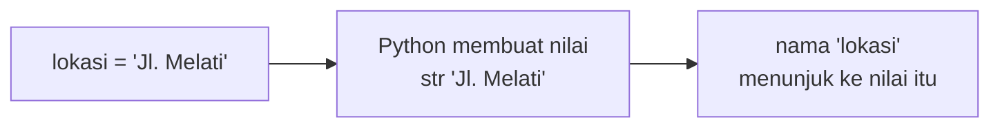

# Variabel dan Tipe Data

!!! abstract "Info materi"
    **Tingkat kesulitan:** Pemula. **Estimasi waktu:** 60–90 menit.
    **Jenis kode:** snippet edukatif (`examples/level-1-python/01_variabel_tipe_data.py`).

## Tujuan pembelajaran

- [ ] Membuat variabel dan memilih tipe data yang sesuai (`str`, `int`, `float`, `bool`, `None`).
- [ ] Mengonversi antartipe dengan aman dan mengenali galat `TypeError`.
- [ ] Menjelaskan jebakan ketelitian bilangan desimal dan cara membandingkannya.
- [ ] Membedakan `None` dari `0` dan string kosong.

## Prasyarat

[Persiapan Python](../level-0-orientasi/persiapan-python.md) selesai dan Python dapat dijalankan.

## Pengantar dan motivasi

Komputer menyimpan semuanya sebagai data. Agar program tahu **apa yang boleh
dilakukan** pada sebuah data, tiap nilai memiliki **tipe**. `"3" + "1"` menyambung
dua teks menjadi `"31"`, sedangkan `3 + 1` menjumlah dua angka menjadi `4`. Pada NLP,
kesalahan tipe adalah galat sehari-hari: kolom angka yang terbaca sebagai teks saat
membaca CSV, atau teks kosong yang ternyata `None`.

## Konsep dasar

**Variabel** adalah *nama* yang menunjuk ke sebuah nilai. Tanda `=` bukan
"sama dengan" matematika; ia berarti "buat nama di kiri menunjuk ke nilai di kanan".

| Tipe | Contoh | Catatan |
|---|---|---|
| `str` | `"Jl. Melati"` | Teks; tidak dapat diubah (*immutable*) |
| `int` | `3` | Bilangan bulat |
| `float` | `1.2` | Bilangan desimal; tidak selalu tepat |
| `bool` | `True` | Benar/salah; hasil perbandingan |
| `NoneType` | `None` | Menandai "tidak ada nilai" |

Nama variabel memakai `huruf_kecil_dengan_garis_bawah` dan sebaiknya
deskriptif (`jumlah_korban`, bukan `x`). Python peka huruf besar/kecil:
`Lokasi` dan `lokasi` adalah dua nama berbeda.

## Penjelasan mendalam

### Mengapa tipe penting

Tipe menentukan operasi yang sah. Menjumlah `str` dengan `int` tidak
bermakna sehingga Python menolak dengan `TypeError` (Bagian 6). Penolakan
ini membantu: lebih baik berhenti dengan pesan jelas daripada diam-diam menghasilkan
data yang salah.

### Konversi tipe

`int("12")` mengubah teks menjadi bilangan bulat; `str(12)` mengubah bilangan
menjadi teks. Konversi bisa gagal: `int("dua belas")` menimbulkan `ValueError`
(dibahas di halaman [Exception Handling](exception-handling.md)).

### Bilangan desimal disimpan dalam biner

Komputer menyimpan `float` dalam basis 2. Pecahan seperti 0,1 tidak dapat
direpresentasikan tepat dalam biner, seperti 1/3 tidak dapat ditulis tepat dalam
desimal. Hasilnya `0.1 + 0.2` bukan persis `0.3`. Solusi: bandingkan dengan
toleransi (`math.isclose`) atau dengan pembulatan, jangan dengan `==`.

### Tiga jenis "kosong"

`None`, `0`, dan `""` (string kosong) berbeda. `None` berarti tidak ada nilai
sama sekali. Membandingkannya dengan `is None` adalah cara yang disarankan
(`is` memeriksa identitas objek, sedangkan `==` memeriksa kesamaan nilai).

## Cara kerja atau alur proses



## Contoh sederhana

```python
umur = 20          # int
nama = "Sari"      # str
print(nama, umur)  # Sari 20
```

## Contoh dalam konteks Twitter/X kebencanaan

Satu laporan memiliki lokasi (teks), jumlah korban (bulat), tinggi air (desimal),
status darurat (boolean), dan catatan yang belum ada (`None`). Pada data
nyata, nilai "belum ada" ini sering muncul sebagai sel kosong pada CSV.

## Praktik Python

Berkas: `examples/level-1-python/01_variabel_tipe_data.py`. Jalankan dengan
`python -X utf8 examples/level-1-python/01_variabel_tipe_data.py`.

### Bagian 1 — Membuat variabel

```python title="Bagian 1"
--8<-- "level-1-python/01_variabel_tipe_data.py:variabel"
```

Lima baris, lima variabel dengan tipe berbeda. Tidak ada keluaran karena tidak ada
`print`. Python menentukan tipe dari nilainya; kita tidak menuliskannya.

### Bagian 2 — Memeriksa tipe

```python title="Bagian 2"
--8<-- "level-1-python/01_variabel_tipe_data.py:tipe"
```

- `for nama, nilai in [(...), (...)]` mengulang daftar pasangan; tiap putaran memecah satu pasangan menjadi `nama` dan `nilai` (*unpacking*).
- `f"{nama:14} {nilai!r:14} {type(nilai).__name__}"` adalah *f-string*: nilai di dalam `{}` dihitung dan disisipkan. `:14` memberi lebar 14 karakter; `!r` memakai `repr` (string diberi tanda kutip); `type(nilai).__name__` adalah nama tipe.

```text title="Output nyata"
lokasi         'Jl. Melati'   str
jumlah_korban  3              int
tinggi_air_m   1.2            float
darurat        True           bool
catatan        None           NoneType
```

Interpretasi: tipe tiap variabel sesuai dugaan. Perhatikan `'Jl. Melati'` diberi tanda kutip (karena `!r`), sedangkan `3` tidak.

### Bagian 3 — Konversi

```python title="Bagian 3"
--8<-- "level-1-python/01_variabel_tipe_data.py:konversi"
```

```text title="Output nyata"
13
121
int str
```

Interpretasi: `int("12") + 1` = 13 (penjumlahan angka). `str(12) + "1"` = `"121"` (penyambungan teks). Baris ketiga membuktikan bahwa hasil konversinya bertipe `int` dan `str`.

### Bagian 4 — Aritmetika dasar

```python title="Bagian 4"
--8<-- "level-1-python/01_variabel_tipe_data.py:aritmetika"
```

```text title="Output nyata"
3.5 3 1
```

Interpretasi: `/` selalu menghasilkan `float` (3,5), `//` pembagian bulat (3), `%` sisa bagi (1). Jumlah
kata tiap laporan atau pembagian tumpukan data sering memakai `//` dan `%`.

### Bagian 5 — Jebakan bilangan desimal

```python title="Bagian 5"
--8<-- "level-1-python/01_variabel_tipe_data.py:desimal"
```

```text title="Output nyata"
0.30000000000000004
False True True
```

Interpretasi: `0.1 + 0.2` sebenarnya `0.30000000000000004`, sehingga `== 0.3` bernilai `False`. Setelah dibulatkan ke dua desimal (`round(..., 2)`) atau diperiksa dengan `math.isclose`, hasilnya `True`.

### Bagian 6 — Galat tipe dan `None`

```python title="Bagian 6"
--8<-- "level-1-python/01_variabel_tipe_data.py:galat"
```

`try/except` menangkap galat agar skrip tidak berhenti (dibahas lengkap pada halaman Exception Handling).

```text title="Output nyata"
TypeError: can only concatenate str (not "int") to str
False False True
```

Interpretasi: Python menolak `"5" + 5` dan menyebutkan penyebabnya. `None == 0` dan `None == ""` bernilai `False`: tiga "kosong" ini berbeda; `None is None` bernilai `True`.

### Skrip terpadu

Keenam bagian di atas adalah satu skrip, `01_variabel_tipe_data.py`, dan semuanya berdiri sendiri; menjalankannya mencetak seluruh keluaran dari atas ke bawah.

## Kesalahan umum dan debugging

| Gejala | Penyebab | Cara memperbaiki |
|---|---|---|
| `TypeError: can only concatenate str (not "int") to str` | Menjumlah teks dan angka | Konversi salah satu: `str(5)` atau `int("5")` |
| `NameError: name 'lokasi' is not defined` | Salah ketik nama atau belum dibuat | Periksa ejaan dan urutan baris |
| `==` pada `float` memberi hasil mengejutkan | Representasi biner | `math.isclose` atau `round` |
| `None` dikira `0` atau `""` | Menganggap semua "kosong" sama | `is None` untuk memeriksa tidak adanya nilai |
| Variabel bernama `list` atau `str` | Menimpa fungsi bawaan | Pakai nama deskriptif lain |

## Kelebihan dan keterbatasan

**Kelebihan:** Python menentukan tipe otomatis (*dynamic typing*), sehingga kode ringkas.
**Keterbatasan:** tipe baru ketahuan saat program dijalankan, bukan saat menulis; kesalahan tipe baru
muncul setelah program berjalan. Anotasi tipe (dibahas di halaman function) dan tes membantu.

## Latihan bertahap

1. **Konseptual.** Apa perbedaan variabel dan nilai? Mengapa `x = 5` tidak berarti "x sama dengan 5" seperti di matematika?
2. **Membaca kode.** Perkirakan hasil `print(type(3.0).__name__)` dan `print(7 // 2)`.
3. **Mengisi kode.** Lengkapi: `tinggi = "120"` lalu `tinggi_int = ___(tinggi)` agar `tinggi_int + 1` menghasilkan `121`.
4. **Debugging.** Apa yang salah pada `print("Korban: " + 3)`, dan bagaimana dua cara memperbaikinya?
5. **Program kecil.** Buat variabel untuk satu laporan banjir karangan Anda (lokasi, jumlah korban, tinggi air, status darurat, catatan) lalu cetak tiap nama, nilai, dan tipenya.

## Kunci jawaban dan pembahasan

??? success "Jawaban 1"
    Variabel adalah nama; nilai adalah data yang ditunjuk nama itu. `=` adalah **penugasan** (assignment): menunjuk nama ke nilai. Nilai variabel dapat diubah kemudian (`x = 6`), sedangkan persamaan matematika tidak.

??? success "Jawaban 2"
    `float` dan `3`. `3.0` bertipe `float`; `7 // 2` adalah pembagian bulat (3).

??? success "Jawaban 3"
    `int`. `tinggi_int = int(tinggi)` mengubah `"120"` menjadi 120, sehingga `tinggi_int + 1` = 121.

??? success "Jawaban 4"
    Teks `"Korban: "` disambung dengan angka 3 (`TypeError`). Perbaikan: `print("Korban: " + str(3))` atau `print("Korban:", 3)` atau `print(f"Korban: {3}")`.

??? success "Jawaban 5"
    Contoh: `lokasi = "Jl. Kenanga"`, `jumlah_korban = 2`, `tinggi_air_m = 0.8`, `darurat = True`, `catatan = None`, lalu pakai perulangan seperti Bagian 2. Pastikan tipe sesuai: teks, bulat, desimal, boolean, `NoneType`.

## Kuis singkat

**1.** Apa tipe `None`, dan kapan dipakai?

??? success "Jawaban"
    `NoneType`; dipakai untuk menandai nilai yang belum ada atau tidak diketahui.

**2.** Mengapa `0.1 + 0.2 == 0.3` salah?

??? success "Jawaban"
    Representasi biner bilangan desimal tidak tepat; hasil penjumlahan hanya sangat dekat dengan 0.3 (sebenarnya 0.30000000000000004).

**3.** Apa perbedaan `/` dan `//`?

??? success "Jawaban"
    `/` menghasilkan `float` (7 / 2 = 3.5); `//` pembagian bulat (7 // 2 = 3).

## Ringkasan

- Variabel adalah nama yang menunjuk ke nilai bertipe.
- Tipe dasar: `str`, `int`, `float`, `bool`, `None`.
- Konversi dengan `int()` dan `str()`; waspadai `TypeError`.
- Jangan membandingkan `float` dengan `==`; `None` berbeda dari `0` dan `""`.

## Glosarium istilah baru

Variabel
:   Nama yang menunjuk ke sebuah nilai.

Tipe data
:   Jenis nilai yang menentukan operasi yang boleh dilakukan (`str`, `int`, `float`, `bool`).

Penugasan (*assignment*)
:   Pembuatan hubungan nama dan nilai dengan tanda `=`.

`None`
:   Nilai khusus yang berarti "tidak ada nilai".

f-string
:   String berawalan `f` yang menyisipkan hasil ekspresi di dalam `{}`.

## Referensi

- Dokumentasi Python, *Built-in Types*: <https://docs.python.org/3/library/stdtypes.html> (dokumentasi resmi).
- Dokumentasi Python, *Floating Point Arithmetic: Issues and Limitations*: <https://docs.python.org/3/tutorial/floatingpoint.html> (dokumentasi resmi; menjelaskan 0,1 + 0,2).

## Materi selanjutnya

[String dan Operasi Teks](string-operasi-teks.md)
