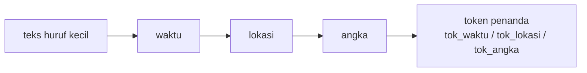

# Normalisasi Angka, Waktu, dan Lokasi

!!! abstract "Info materi"
    **Tingkat kesulitan:** Menengah. **Estimasi waktu:** 75–100 menit.
    **Jenis kode:** snippet edukatif (`examples/level-2-preprocessing/09_angka_waktu_lokasi.py`).

## Tujuan pembelajaran

- [ ] Menjelaskan mengapa angka, jam, dan alamat spesifik jarang membantu model apa adanya.
- [ ] Mengganti angka, waktu, dan alamat dengan token penanda dan menjelaskan informasi yang hilang.
- [ ] Mengenali kegagalan pola regex (positif palsu dan angka menempel pada huruf).
- [ ] Menafsirkan temuan bahwa alamat hampir selalu hadir pada satu kelas dataset sintetis ini.

## Prasyarat

- [Case Folding, Tanda Baca, dan Pembersihan](case-folding-pembersihan.md).
- [Normalisasi Bahasa Informal](normalisasi-informal.md).
- [Dasar Regex](../level-1-python/regex-dasar.md) (Level 1).

## Pengantar dan motivasi

`pukul 08.12`, `50 cm`, `RT 05`, dan `Jl. Melati` hanya muncul sekali atau dua
kali di seluruh data. Sebagai fitur kata, `08.12` tidak punya arti bagi model:
ia tidak akan pernah muncul lagi. Namun keberadaan "ada jam", "ada ukuran
ketinggian", atau "ada alamat" dapat berarti: laporan kejadian sering memuat
keterangan waktu, tinggi air, dan lokasi, sedangkan opini dan candaan jarang.

Normalisasi mengganti nilai spesifik dengan token penanda (`tok_waktu`,
`tok_angka`, `tok_lokasi`) yang **berulang** pada banyak postingan.

## Konsep dasar

| Jenis | Contoh | Token | Informasi yang hilang |
|---|---|---|---|
| Waktu | `pukul 08.12`, `22:15 wib` | `tok_waktu` | Jam tepatnya |
| Angka | `50 cm`, `2 lansia` | `tok_angka` | Besarnya angka |
| Lokasi | `Jl. Melati RT 08`, `kelurahan sukamaju` | `tok_lokasi` | Nama tempat |

## Penjelasan mendalam

### Pola yang dipakai

Pola-pola ini dapat dibaca di `examples/nlp_hub/preprocessing.py`.

- **Waktu:** `\b(?:(?:pukul|jam)\s*)?(?:[01]?\d|2[0-3])[.:][0-5]\d(?:\s*wib|\s*wita|\s*wit)?\b`. Jam 0–23, pemisah `.` atau `:`, menit 00–59, dengan awalan `pukul`/`jam` dan akhiran zona waktu yang opsional.
- **Angka:** `(?<![\w.,])\d+(?:[.,]\d+)*\b`. `(?<![\w.,])` adalah *lookbehind negatif*: angka tidak boleh didahului huruf, angka, titik, atau koma. Jadi `Rp50.000` dan `m4,1` (angka menempel pada huruf) tidak disentuh, sedangkan `50.000` dan `1,5` yang berdiri sendiri diganti utuh.
- **Alamat:** `jl|jln|jalan|gang` + satu kata (+ opsional `RT/RW`), `RT 05/RW 02`, awalan wilayah (`kelurahan`, `desa`, `kota`, ...) + satu kata, ditambah daftar nama tempat (*gazetteer*, `NAMA_TEMPAT_CONTOH`) untuk nama bertipe dua kata seperti `harapan jaya`.

### Mengapa urutannya waktu, lokasi, lalu angka

Waktu (`08.12`) harus diganti sebelum angka, atau `08` dan `12` menjadi dua
`tok_angka`. Lokasi (`rt 08`) diganti sebelum angka agar `08` tidak diambil
terpisah.

### Kegagalan yang sudah diketahui

- **Positif palsu waktu:** `1.50 m` (tinggi air 1,5 meter) terbaca sebagai waktu `1.50`. Pola waktu tidak dapat membedakan, karena keduanya angka-titik-dua-digit.
- **Angka menempel pada huruf:** `Rp50.000` dan `m4,1` dibiarkan oleh langkah angka (alamat `RT05` tetap ditangkap oleh langkah lokasi). Itu perilaku yang disengaja agar tidak terpotong.
- **Nama tempat tanpa awalan:** `sukajadi` tidak dikenali kecuali ada di gazetteer.
- **Awalan wilayah menelan kata berikutnya:** `kota ini` aman karena ada pengecualian, tetapi `kota besar` menjadi `tok_lokasi`.

## Cara kerja atau alur proses



Seluruh langkah ini aktif hanya bila `KonfigurasiPraproses(angka_waktu_lokasi=True)`.

## Contoh sederhana

`"banjir di jl. melati rt 08 pukul 08.12"` → `"banjir di tok_lokasi tok_waktu"`.

## Contoh dalam konteks Twitter/X kebencanaan

Postingan sintetis laporan: "Air banjir setinggi dada di Jl. Melati RT 08".
Dengan normalisasi alamat, kalimat itu memuat `tok_lokasi`, yang akan sama
pada ratusan laporan lain dari tempat berbeda. Ini membantu model mengenali pola
"menyebut lokasi" tanpa harus hafal nama jalannya.

## Praktik Python

Berkas: `examples/level-2-preprocessing/09_angka_waktu_lokasi.py`.

### Bagian 1 — Waktu

```python title="Bagian 1"
--8<-- "level-2-preprocessing/09_angka_waktu_lokasi.py:waktu"
```

`{teks!r:30}` memformat nilai dengan `repr` (tanda kutip) dan lebar 30 karakter.

```text title="Output nyata"
'gempa pukul 08.12 tadi'       -> 'gempa tok_waktu tadi'
'api terlihat jam 22:15 wib'   -> 'api terlihat tok_waktu'
'air setinggi 1.50 m'          -> 'air setinggi tok_waktu m'
'magnitudo 4,1'                -> 'magnitudo 4,1'
```

Interpretasi: dua teks pertama benar. Teks ketiga adalah **positif palsu**:
tinggi air 1,50 m dibaca sebagai jam 1.50. Teks keempat aman karena
pemisahnya koma dan hanya satu digit di belakangnya.

### Bagian 2 — Angka

```python title="Bagian 2"
--8<-- "level-2-preprocessing/09_angka_waktu_lokasi.py:angka"
```

```text title="Output nyata"
'setinggi 50 cm'               -> 'setinggi tok_angka cm'
'ada 2 lansia dan 3 balita'    -> 'ada tok_angka lansia dan tok_angka balita'
'dana Rp50.000'                -> 'dana Rp50.000'
'gempa m4,1'                   -> 'gempa m4,1'
```

Interpretasi: angka berdiri sendiri diganti; angka yang menempel pada huruf
dibiarkan. Versi awal pola (`\b\d+(?:[.,]\d+)?\b`) menghasilkan `dana Rp50. tok_angka`
karena `\b` (batas kata) tidak ada antara `p` dan `5`; bug ini ditemukan saat
menyusun pelajaran dan sekarang dijaga oleh tes `test_normalisasi_angka_kasus_tepi`.

### Bagian 3 — Lokasi

```python title="Bagian 3"
--8<-- "level-2-preprocessing/09_angka_waktu_lokasi.py:lokasi"
```

```text title="Output nyata"
'banjir di jl. melati rt 08'             -> 'banjir di tok_lokasi'
'warga kelurahan sukamaju mengungsi'     -> 'warga tok_lokasi mengungsi'
'di kota ini aman'                       -> 'di kota ini aman'
'desa cikaramas terendam'                -> 'tok_lokasi terendam'
'dekat sukajadi tadi'                    -> 'dekat sukajadi tadi'
```

Interpretasi: alamat jalan, kelurahan di gazetteer, dan awalan `desa` + nama
dikenali. `kota ini` aman, tetapi `sukajadi` (tanpa awalan, tidak ada di
gazetteer) lolos. Ada dua cara mengenali lokasi: aturan dan daftar nama.
Daftar nama harus bersumber dari data resmi (misalnya daftar kelurahan) agar
tidak mengira satu nama tempat sebagai kata biasa.

### Bagian 4 — Dampak pada dataset

```python title="Bagian 4"
--8<-- "level-2-preprocessing/09_angka_waktu_lokasi.py:korpus"
```

```text title="Output nyata"
tipe: 596 -> 554
               sum  count  mean
label                          
Emergency      191    191  1.00
Non-Emergency   97    373  0.26
```

Interpretasi:

- Kosakata turun dari 596 menjadi 554 tipe.
- Token `tok_lokasi` muncul di **seluruh** 191 teks Emergency (100%) tetapi hanya di 97 dari 373 teks Non-Emergency (26%).

!!! warning "Temuan ini adalah artefak dataset sintetis"
    Setiap templat laporan dan permintaan bantuan pada pembangkit data
    menyebut lokasi, sedangkan banyak templat Non-Emergency tidak. Pada data
    nyata, laporan kejadian memang sering menyebut lokasi, tetapi tidak
    pernah 100%, dan postingan lain (berita, imbauan) juga menyebutnya. Dengan
    pola seperti ini, model sederhana dapat mencapai skor tinggi hanya
    dari ada-tidaknya alamat. Karena itu skor pada dataset ini tidak boleh
    dianggap mewakili performa dunia nyata, dan set uji tulis-tangan (48
    teks) disediakan untuk menguji ketergantungan semacam ini.

### Skrip terpadu

Fungsi `normalisasi_waktu`, `normalisasi_angka`, dan `normalisasi_lokasi`
dipanggil dari `praproses_token` bila `angka_waktu_lokasi=True`. Tes:
`test_normalisasi_waktu`, `test_normalisasi_angka_kasus_tepi`,
`test_normalisasi_lokasi_jalan_rt_dan_gazetteer`,
`test_normalisasi_lokasi_tidak_menelan_kota_ini`, dan
`test_waktu_salah_baca_desimal_dua_digit_didokumentasikan` (yang mencatat
kelemahan `1.50 m`).

## Kesalahan umum dan debugging

| Gejala | Penyebab | Perbaikan |
|---|---|---|
| `Rp50.000` → `Rp50. tok_angka` | `\b` tidak ada antara huruf dan angka | Gunakan lookbehind `(?<![\w.,])` |
| `1.50 m` → `tok_waktu` | Pola waktu ambigu | Tambahkan syarat awalan `pukul`/`jam`, atau terima positif palsu dan catat |
| Angka diganti sebelum waktu | Urutan langkah | Waktu dahulu, lalu angka |
| Nama tempat nyata tidak dikenali | Tidak ada di gazetteer | Pakai daftar resmi; ukur cakupannya |
| Nama tempat dipakai kata biasa ikut terganti | Gazetteer terlalu luas | Periksa daftar terhadap kosakata umum |

## Kelebihan dan keterbatasan

**Kelebihan:** mengurangi kosakata; menjaga sinyal "ada alamat/waktu/angka".
**Keterbatasan:** informasi spesifik hilang (lokasi yang berbeda tidak lagi
dibedakan); regex tidak sempurna; sinyal sering menyatu dengan artefak
pembangkit data (di sini, alamat berkorelasi kuat dengan label).

## Latihan bertahap

1. **Konseptual.** Mengapa `08.12` tidak berguna sebagai fitur kata?
2. **Membaca kode.** Apa hasil `normalisasi_angka("2 lansia dan 3 balita")`?
3. **Debugging.** `normalisasi_waktu("tinggi air 1.50 m")` menghasilkan `tok_waktu`. Usulkan satu perubahan pola dan satu risikonya.
4. **Pemrograman kecil.** Tulis `ada_alamat(teks)` yang memanggil `normalisasi_lokasi` dan mengembalikan `True` bila hasilnya memuat `tok_lokasi`.
5. **Analisis.** Alamat muncul di 100% teks Emergency dataset ini. Jelaskan dua alasan mengapa angka itu tidak boleh dipakai sebagai klaim tentang data nyata.

## Kunci jawaban dan pembahasan

??? success "Jawaban 1"
    Nilai `08.12` hampir tidak pernah berulang, sehingga model tidak dapat menghubungkannya dengan label. Penggantian dengan `tok_waktu` mengumpulkan semua jam menjadi satu fitur yang berulang.

??? success "Jawaban 2"
    `tok_angka lansia dan tok_angka balita` (sesuai output Bagian 2 untuk kalimat serupa).

??? success "Jawaban 3"
    Wajibkan awalan `pukul` atau `jam` (hapus bagian `?` pada kelompok awalan). Risikonya, jam tanpa awalan seperti "gempa 08.12 tadi" tidak lagi dikenali. Pembahasan: setiap pola memilih antara positif palsu dan negatif palsu; pilih yang lebih murah untuk tugas Anda.

??? success "Jawaban 4"
    ```python
    from nlp_hub.preprocessing import normalisasi_lokasi

    def ada_alamat(teks):
        return "tok_lokasi" in normalisasi_lokasi(teks.lower()).split()
    ```
    `normalisasi_lokasi` mensyaratkan teks huruf kecil, karena itu `lower()` dipanggil lebih dulu. `.split()` memastikan yang dicocokkan adalah token utuh, bukan bagian dari kata lain.

??? success "Jawaban 5"
    Pertama, data sintetis dibuat dari templat yang menyebut lokasi pada setiap laporan; itu pilihan pembuat data, bukan fakta lapangan. Kedua, pada data nyata banyak laporan darurat tanpa alamat dan banyak postingan Non-Emergency (berita, imbauan) yang menyebut lokasi. Selain itu, pola regex tertentu hanya mengenali gaya penulisan yang dipakai penulis templat.

## Kuis singkat

**1.** Mengapa `Rp50.000` dibiarkan?

??? success "Jawaban"
    Angka menempel pada huruf; pola dibuat tidak menyentuhnya agar tidak terpotong menjadi `Rp50.` dan angka lain.

**2.** Apa risiko mengganti semua alamat dengan `tok_lokasi`?

??? success "Jawaban"
    Nama tempat spesifik hilang; model tidak dapat membedakan lokasi, dan kata biasa yang kebetulan menyerupai nama tempat dapat ikut terganti.

**3.** Mengapa urutan waktu → lokasi → angka penting?

??? success "Jawaban"
    Agar `08.12` dan `rt 08` tidak terpecah menjadi beberapa `tok_angka` sebelum pola yang lebih spesifik sempat bekerja.

## Ringkasan

- Angka, jam, dan alamat spesifik jarang berulang; token penanda menyatukannya.
- Pola regex punya positif palsu (`1.50 m`) dan angka menempel pada huruf perlu penanganan khusus.
- Normalisasi lokasi menurunkan kosakata 596 → 554 pada dataset ini.
- Alamat hadir di 100% teks Emergency sintetis: artefak pembangkit data, bukan temuan nyata.

## Glosarium istilah baru

Lookbehind negatif
:   Pola regex yang mensyaratkan teks di sebelah kiri **tidak** sesuai pola tertentu: `(?<!...)`.

Gazetteer
:   Daftar nama tempat yang dipakai untuk mengenali lokasi.

Positif palsu (*false positive*)
:   Pola cocok pada teks yang seharusnya tidak cocok.

Artefak data
:   Pola pada data yang berasal dari cara data dibuat, bukan dari fenomena sebenarnya.

## Referensi

- Dokumentasi Python, *Regular Expression HOWTO* (lookbehind dan lookahead): <https://docs.python.org/3/howto/regex.html> (dokumentasi resmi).

## Materi berikutnya

[Perbandingan Pipeline Preprocessing](perbandingan-pipeline.md)
