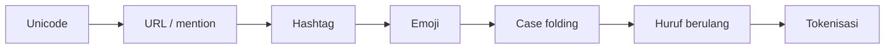

# Case Folding, Tanda Baca, dan Pembersihan URL, Mention, Hashtag

!!! abstract "Info materi"
    **Tingkat kesulitan:** Pemula. **Estimasi waktu:** 75–100 menit.
    **Jenis kode:** snippet edukatif (`examples/level-2-preprocessing/03_pembersihan.py`) dan fungsi di `nlp_hub.preprocessing`.

## Tujuan pembelajaran

- [ ] Menjelaskan tujuan dan risiko *case folding*.
- [ ] Mengganti URL dan mention dengan token penanda, dan menjelaskan alasannya.
- [ ] Memilih salah satu dari tiga cara menangani hashtag.
- [ ] Memutuskan kapan tanda baca perlu dipertahankan sebagai sinyal.
- [ ] Menjalankan urutan langkah pembersihan dan memeriksa hasil tiap langkah.

## Prasyarat

- [Token, Kalimat, dan Tokenisasi Kata](token-kalimat-tokenisasi.md).
- [Dasar Regex dengan `re`](../level-1-python/regex-dasar.md) (Level 1).

## Pengantar dan motivasi

Teks media sosial penuh unsur yang bukan "kata biasa": alamat tautan, nama akun,
tagar, dan tanda seru berderet. Jika tidak ditangani, setiap URL unik menjadi
satu fitur tersendiri yang hanya muncul sekali (tidak berguna untuk
generalisasi), dan `Tolong`, `TOLONG`, `tolong` dianggap tiga kata berbeda.

Namun membuang semuanya begitu saja juga berisiko. Kehadiran URL bisa menjadi
petunjuk ("berita"), dan tanda seru bisa menandakan urgensi. Keputusan
preprocessing bergantung pada tujuan klasifikasi dan harus dibuktikan secara
empiris (lihat [Perbandingan Pipeline](perbandingan-pipeline.md)).

## Konsep dasar

| Konsep | Arti | Keputusan yang perlu dibuat |
|---|---|---|
| **Case folding** | Menyeragamkan huruf besar/kecil | Hampir selalu huruf kecil; catat apa yang hilang |
| **Token penanda** (*placeholder*) | Mengganti URL/mention dengan satu kata tetap, mis. `tok_url` | Hapus, atau pertahankan keberadaannya sebagai sinyal |
| **Hashtag** | `#SiagaBencana` | Pertahankan, hapus, atau ambil kata di dalamnya |
| **Tanda baca** | `! ? . ,` | Hapus, atau ubah beberapa menjadi sinyal |

## Penjelasan mendalam

### Case folding

Python menyediakan `str.lower()` dan `str.casefold()`. Untuk teks Indonesia
berhuruf Latin keduanya setara, jadi paket ini memakai `lower()`. Kehilangan
yang perlu diketahui: singkatan seperti `BMKG` dan `SAR` menjadi `bmkg` dan
`sar`, sehingga tidak lagi dapat dibedakan dari kata biasa yang kebetulan
sama ejaannya. Pada kebanyakan tugas
klasifikasi, penyatuan ini lebih menguntungkan daripada merugikan.

Huruf kapital sebagai sinyal (misalnya seluruh pesan ditulis kapital sebagai
tanda panik) hanya dapat dimanfaatkan bila dihitung **sebelum** huruf diubah
menjadi kecil, misalnya fitur "rasio huruf kapital". Itu dibahas di
Level 3.

### URL dan mention

Setiap URL pendek unik (`https://t.co/xyz123`), sehingga tidak pernah
berulang di data latih dan tidak membantu model. Namun *adanya* URL sebagai
kategori bisa berulang di banyak teks. Penggantian dengan token tetap (`tok_url`) menjaga sinyal "ada
tautan" sambil membuang bagian unik. Hal yang sama berlaku untuk mention
(`@bpbd_contoh` → `tok_mention`).

!!! warning "Privasi"
    Nama akun adalah identitas pengguna. Mengganti mention dengan token juga
    mengurangi risiko data pribadi terbawa ke fitur, log, atau contoh yang
    dipublikasikan. Pada data nyata, hapus identitas lebih awal, bukan hanya
    saat modeling.

### Hashtag

Tiga pilihan:

| Mode | Hasil `#SiagaBencana` | Kapan dipakai |
|---|---|---|
| `pertahankan` | `#SiagaBencana` (menjadi token `siagabencana` setelah tokenisasi) | Tagar sering dipakai sebagai label topik |
| `hapus` | (hilang) | Tagar hanya dekorasi |
| `kata` | `Siaga Bencana` | Kata di dalam tagar punya makna |

Mode `kata` memisahkan huruf kecil ke huruf besar (*CamelCase*). Tagar seluruhnya
huruf kecil seperti `#banjirkelurahan` **tidak dapat dipisah** tanpa kamus,
sehingga tetap menjadi satu kata gabungan.

### Tanda baca

Menghapus tanda baca menyatukan `tolong!!!` dan `tolong`. Namun jika tanda
seru berkorelasi dengan urgensi, informasi itu hilang. Kompromi yang dipakai di
paket ini: hapus semua tanda baca, tetapi opsi `tanda_seru=True` menambahkan
satu token `tok_seru` bila teks asli memuat `!`.

## Cara kerja atau alur proses

Urutan langkah penting. Beberapa langkah **harus** sebelum langkah lain:

1. Normalisasi Unicode (supaya pola regex bekerja pada karakter yang benar).
2. Ganti URL dan mention (sebelum tanda baca dibuang, agar URL tidak rusak).
3. Proses hashtag (**sebelum** huruf menjadi kecil, karena CamelCase butuh huruf besar).
4. Proses emoji (sebelum tokenisasi, karena tokenizer membuang emoji).
5. Case folding.
6. Kurangi huruf berulang, lalu tokenisasi.



## Contoh sederhana

`"Tolong!!! Air naik"` dan `"tolong air naik"` seharusnya menghasilkan fitur
yang sama (bila tanda seru tidak dijadikan sinyal) karena maknanya sama.

## Contoh dalam konteks Twitter/X kebencanaan

Postingan sintetis: `@bpbd_contoh TOLOOONG banjir naik! #SiagaBencana
https://contoh.example/1 🙏`. Pada satu postingan terdapat mention, huruf
kapital, huruf berulang, tanda seru, hashtag CamelCase, URL, dan emoji.
Bagian *Praktik Python* menelusuri perubahannya langkah demi langkah.

## Praktik Python

Berkas: `examples/level-2-preprocessing/03_pembersihan.py`. Setiap fungsi
yang dipakai ada di `nlp_hub.preprocessing`.

### Bagian 1 — Case folding

```python title="Bagian 1"
--8<-- "level-2-preprocessing/03_pembersihan.py:case_folding"
```

```text title="Output nyata"
tolong, banjir di jl. melati
bmkg sar
```

Interpretasi: semua huruf menjadi kecil, termasuk singkatan `BMKG` dan `SAR`.
Kecuali ditulis pada pilihan, tanda baca belum disentuh.

### Bagian 2 — URL dan mention

```python title="Bagian 2"
--8<-- "level-2-preprocessing/03_pembersihan.py:url_mention"
```

`ganti_url` memakai regex `https?://\S+|www\.\S+`: `https?` berarti "http"
dengan "s" opsional, `://` adalah literal, `\S+` berarti satu atau lebih
karakter bukan spasi. `ganti_mention` memakai `@\w+`: tanda "@" diikuti huruf,
angka, atau garis bawah. Fungsi menyisipkan spasi di sekeliling token agar tidak
menempel pada kata lain.

```text title="Output nyata"
@bpbd_contoh banjir naik, info:  tok_url
 tok_mention  banjir naik, info:  tok_url
```

Interpretasi: spasi ganda tidak masalah karena tokenisasi nanti mengabaikannya.
Perhatikan bahwa mention dan URL kini menjadi kata tetap yang sama pada setiap postingan.

### Bagian 3 — Tiga cara menangani hashtag

```python title="Bagian 3"
--8<-- "level-2-preprocessing/03_pembersihan.py:hashtag"
```

- `for mode in [...]` mengulang tiga mode.
- `" ".join(teks.split())` merapikan spasi berlebih agar mudah dibandingkan.

```text title="Output nyata"
pertahankan -> 'Air naik #SiagaBencana #banjirkelurahan'
hapus -> 'Air naik'
kata -> 'Air naik Siaga Bencana banjirkelurahan'
```

Interpretasi: `#SiagaBencana` terpisah menjadi dua kata, sedangkan
`#banjirkelurahan` tidak dapat dipisah (tetap `banjirkelurahan`). Mode `hapus`
menghilangkan seluruh tagar, termasuk kata `banjir` di dalamnya.

### Bagian 4 — Tanda seru sebagai sinyal

```python title="Bagian 4"
--8<-- "level-2-preprocessing/03_pembersihan.py:tanda_baca"
```

`KonfigurasiPraproses(tanda_seru=True)` membuat salah satu langkah menambahkan token `tok_seru`.

```text title="Output nyata"
True
tolong air naik tok_seru
tolong air naik
```

Interpretasi: tanpa opsi, kedua teks identik (`True`). Dengan opsi, hanya yang
bertanda seru mendapat `tok_seru`. Apakah ini bermanfaat atau tidak harus
diukur; pada dataset sintetis ini hasilnya diuji di halaman
[Perbandingan Pipeline](perbandingan-pipeline.md).

### Bagian 5 — Menelusuri satu postingan langkah demi langkah

```python title="Bagian 5"
--8<-- "level-2-preprocessing/03_pembersihan.py:langkah"
```

Setiap langkah mengambil hasil langkah sebelumnya (variabel `langkah` ditimpa). `print("1", ...)` memberi nomor agar urutan terbaca.

```text title="Output nyata"
1 @bpbd_contoh TOLOOONG banjir naik! #SiagaBencana https://contoh.example/1 🙏
2 tok_mention TOLOOONG banjir naik! #SiagaBencana tok_url 🙏
3 tok_mention TOLOOONG banjir naik! Siaga Bencana tok_url 🙏
4 tok_mention TOLOOONG banjir naik! Siaga Bencana tok_url emo_doa
5 tok_mention tolooong banjir naik! siaga bencana tok_url emo_doa
6 tok_mention tolong banjir naik! siaga bencana tok_url emo_doa
7 ['tok_mention', 'tolong', 'banjir', 'naik', 'siaga', 'bencana', 'tok_url', 'emo_doa']
```

Interpretasi per langkah:

- Langkah 2: mention dan URL menjadi token tetap.
- Langkah 3: `#SiagaBencana` menjadi `Siaga Bencana`. Ini harus terjadi sebelum langkah 5, karena setelah huruf menjadi kecil batas kata tidak terlihat lagi.
- Langkah 4: emoji menjadi token `emo_doa`.
- Langkah 5–6: huruf kecil, lalu `TOLOOONG` menjadi `tolong`.
- Langkah 7: tokenisasi; tanda seru hilang.

**Cara memeriksa:** bandingkan jumlah token akhir (8) dengan hitungan manual dari langkah 6.

### Skrip terpadu

Versi gabungan langkah-langkah ini adalah fungsi `praproses_token` di
`examples/nlp_hub/preprocessing.py`. Ia memanggil fungsi yang sama, hanya
diatur lewat `KonfigurasiPraproses`. Perbedaannya dengan Bagian 5: urutan
langkah tetap, dan setiap langkah dapat dimatikan lewat konfigurasi.

## Kesalahan umum dan debugging

| Gejala | Penyebab | Perbaikan |
|---|---|---|
| `Siaga Bencana` menjadi `siagabencana` | Case folding dilakukan sebelum pemrosesan hashtag | Ubah urutan: hashtag dahulu |
| URL berubah menjadi `https`, `contoh`, `example` | Tanda baca dihapus sebelum URL diganti | Ganti URL lebih awal |
| Titik di akhir URL ikut terbawa | Pola `\S+` mengambil semua karakter bukan spasi | Terima dan periksa; untuk URL yang diikuti tanda baca, pangkas karakter akhir |
| Huruf kecil `bmkg` bentrok dengan kata lain | Case folding menghilangkan perbedaan | Periksa frekuensi; pertimbangkan kamus singkatan |
| Mention dihapus tetapi nama akun tersisa di kolom lain | Pembersihan hanya pada satu kolom | Hapus identitas pada seluruh kolom sebelum disimpan |

## Kelebihan dan keterbatasan

**Kelebihan:** langkah deterministik, tanpa data latih, sehingga bebas risiko kebocoran data.
**Keterbatasan:**

- Semua langkah menghapus sebagian informasi. Tidak ada yang "gratis".
- Aturan regex mudah gagal pada kasus tepi (URL tanpa `http`, mention dengan titik).
- Pilihan terbaik (hapus atau jadikan token) tidak bisa ditentukan dari intuisi; harus diukur.

## Latihan bertahap

1. **Konseptual.** Mengapa hashtag harus diproses sebelum case folding?
2. **Membaca kode.** Apa keluaran `proses_hashtag("#BanjirJakarta #gempa", "kata")` setelah spasi dirapikan?
3. **Debugging.** Seseorang menjalankan `case_folding` lebih dulu lalu `proses_hashtag(..., "kata")`, hasil `#SiagaBencana` menjadi `siagabencana`. Jelaskan penyebabnya dan perbaikannya.
4. **Pemrograman kecil.** Tulis fungsi `hitung_url(daftar_teks)` yang mengembalikan berapa teks yang mengandung URL, memakai `POLA_URL`.
5. **Tantangan (desain).** Anda menduga postingan berisi URL cenderung Non-Emergency (berita). Bagaimana membuktikannya pada dataset tanpa mengubah bagian lain dari pipeline?

## Kunci jawaban dan pembahasan

??? success "Jawaban 1"
    Karena pemisahan CamelCase membutuhkan huruf besar sebagai batas kata. Setelah semua huruf menjadi kecil, batas hilang dan `#SiagaBencana` menjadi `siagabencana`.

??? success "Jawaban 2"
    `Banjir Jakarta gempa`. `#BanjirJakarta` dipisah pada huruf besar kedua, sedangkan `#gempa` tinggal satu kata. (Perilaku ini juga dicakup oleh tes `test_proses_hashtag`.)

??? success "Jawaban 3"
    Penyebabnya urutan langkah: huruf besar yang menjadi penanda batas sudah diubah ke kecil sebelum pemisahan. Perbaikannya memanggil `proses_hashtag` sebelum `case_folding`, seperti pada `praproses_token`.

??? success "Jawaban 4"
    ```python
    from nlp_hub.preprocessing import POLA_URL

    def hitung_url(daftar_teks):
        return sum(1 for t in daftar_teks if POLA_URL.search(t))
    ```
    `POLA_URL.search(t)` mengembalikan objek bila ada URL, atau `None` bila tidak. `sum(1 for ...)` menghitung berapa teks yang cocok. Pembahasan: `search` cukup, karena kita hanya perlu tahu *ada* URL, bukan semua URL.

??? success "Jawaban 5"
    Hitung proporsi teks ber-URL di tiap kelas dengan `groupby` dan bandingkan. Lalu ukur dampaknya dengan membandingkan dua konfigurasi yang hanya berbeda pada penanganan URL (mis. `url=True` dan `url=False`) memakai pembagian data yang sama. Catatan: pada dataset sintetis ini, URL ditambahkan secara acak dengan peluang yang sama untuk kedua label, jadi tidak diharapkan ada hubungan; kesimpulan pada data nyata dapat berbeda.

## Kuis singkat

**1.** Mengapa URL diganti `tok_url` dan bukan dibiarkan?

??? success "Jawaban"
    Setiap URL unik sehingga tidak berguna sebagai fitur; token tetap menjaga informasi "ada tautan".

**2.** Apakah tanda baca selalu dibuang?

??? success "Jawaban"
    Tidak. Tanda baca yang membawa sinyal (misalnya `!`) dapat dipertahankan sebagai fitur. Keputusannya harus diuji.

**3.** Mengapa mengganti mention membantu privasi?

??? success "Jawaban"
    Nama akun adalah identitas; token tetap membuang identitas dari fitur, log, dan contoh.

## Ringkasan

- Case folding menyatukan variasi huruf tetapi menghilangkan sinyal kapital.
- URL dan mention diganti token tetap agar sinyal "ada" terjaga dan identitas hilang.
- Hashtag punya tiga mode; CamelCase hanya bisa dipisah sebelum huruf menjadi kecil.
- Urutan langkah menentukan hasil.

## Glosarium istilah baru

Case folding
:   Penyeragaman huruf besar/kecil, biasanya menjadi huruf kecil.

Token penanda (*placeholder*)
:   Kata tetap yang menggantikan unsur unik seperti URL atau mention.

Hashtag
:   Penanda topik berawalan `#` pada media sosial.

CamelCase
:   Penulisan gabungan kata dengan huruf besar di awal tiap kata (`SiagaBencana`).

## Referensi

- Dokumentasi Python, `str.lower` dan `str.casefold`: <https://docs.python.org/3/library/stdtypes.html#str.casefold> (dokumentasi resmi).
- Dokumentasi Python, modul `re`: <https://docs.python.org/3/library/re.html>.

## Materi berikutnya

[Emoji dan Emotikon](emoji-emotikon.md)
