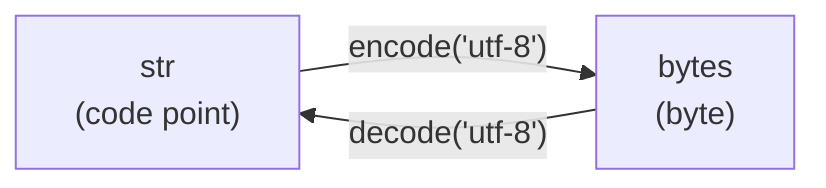

# Karakter, Unicode, dan Encoding UTF-8

!!! abstract "Info materi"
    **Tingkat kesulitan:** Pemula. **Estimasi waktu:** 60–90 menit.
    **Jenis kode:** snippet edukatif (`examples/level-2-preprocessing/01_karakter_unicode.py`).

## Tujuan pembelajaran

- [ ] Menjelaskan perbedaan karakter, *code point*, dan byte.
- [ ] Menjelaskan mengapa `len("🙏")` dan jumlah byte-nya berbeda.
- [ ] Mengenali dan memperbaiki teks rusak akibat encoding yang salah (*mojibake*).
- [ ] Memakai normalisasi Unicode (NFKC) untuk menyatukan huruf bergaya.
- [ ] Menemukan karakter tak terlihat yang membuat dua teks "tampak sama" tetapi tidak sama.

## Prasyarat

- [String dan Operasi Teks](../level-1-python/string-operasi-teks.md) (Level 1).
- [Membaca dan Menulis File Teks](../level-1-python/file-teks.md), terutama argumen `encoding`.

## Pengantar dan motivasi

Komputer hanya menyimpan angka. Agar angka bisa menjadi huruf, harus ada
**kesepakatan**: angka berapa mewakili huruf apa. Pada teks media sosial,
kesepakatan ini sering bermasalah karena satu postingan bisa memuat huruf
Latin, emoji, dan karakter bergaya sekaligus.

Bayangkan sebuah laporan: `Rumah warga terendam – tolong 🙏`. Jika file CSV
dibuka dengan encoding yang salah, tanda "–" dan emoji berubah menjadi
`â` dan `ð`. Model Anda lalu melihat "kata" yang tidak ada artinya. Memahami
karakter dan encoding adalah langkah pertama agar data tidak rusak sebelum
preprocessing dimulai.

## Konsep dasar

Tiga istilah yang sering tertukar:

| Istilah | Arti sehari-hari | Contoh |
|---|---|---|
| **Karakter** | Satu "simbol" yang Anda lihat | `T`, `é`, `🙏` |
| **Code point** | Nomor unik sebuah simbol dalam standar **Unicode** | `🙏` = U+1F64F (128591) |
| **Byte** | Satuan penyimpanan di file/jaringan (angka 0–255) | `é` menjadi 2 byte pada UTF-8 |

**Unicode** adalah daftar besar yang memberi nomor (*code point*) pada hampir
semua simbol tulisan di dunia, termasuk emoji. **Encoding** adalah aturan
mengubah nomor itu menjadi urutan byte. **UTF-8** adalah encoding yang paling
umum dipakai.

Di Python 3, tipe `str` menyimpan **code point**, sedangkan tipe `bytes`
menyimpan **byte**. Mengubah `str` menjadi `bytes` disebut *encode*; kebalikannya
*decode*.



## Penjelasan mendalam

### UTF-8 memakai jumlah byte yang berbeda-beda

UTF-8 hemat untuk huruf Latin dasar, tetapi memakai lebih banyak byte untuk
simbol lain:

| Rentang code point | Jumlah byte UTF-8 | Contoh |
|---|---|---|
| U+0000–U+007F | 1 | `a`, `T`, spasi |
| U+0080–U+07FF | 2 | `é` |
| U+0800–U+FFFF | 3 | `–` (tanda pisah panjang) |
| U+10000 ke atas | 4 | `🙏`, `🌊` |

Akibatnya, **panjang string (jumlah karakter) tidak sama dengan jumlah byte**.

### Mengapa teks bisa rusak (mojibake)

*Mojibake* terjadi bila byte yang ditulis dengan satu encoding **dibaca**
dengan encoding lain. Byte UTF-8 `0xE2 0x80 0x93` (tanda "–") dibaca sebagai
Latin-1 menjadi tiga karakter `â`, kontrol, kontrol. Kerusakan seperti ini
biasanya dapat dibalik asalkan tidak ada byte yang hilang.

### Normalisasi Unicode

Beberapa karakter tampak sama tetapi punya code point berbeda. Contoh:
huruf matematika tebal `𝐁𝐀𝐍𝐉𝐈𝐑` (sering dipakai untuk gaya "tebal" di media
sosial) dan huruf lebar penuh `ｇｅｍｐａ`. Bagi komputer, itu bukan
`BANJIR` dan `gempa`. Standar Unicode menyediakan empat bentuk normalisasi:
NFC, NFD, NFKC, NFKD. Bentuk berawalan **K** (*compatibility*) menyatukan
variasi gaya seperti contoh di atas. Untuk teks media sosial, **NFKC**
biasanya pilihan awal yang masuk akal, tetapi ia juga mengubah beberapa simbol
(misalnya `²` menjadi `2`), sehingga hasilnya perlu diperiksa.

### Karakter tak terlihat

Ada karakter yang tidak tampak di layar, misalnya *zero width space*
(U+200B). Dua string yang tampak identik bisa berbeda panjang dan tidak
dianggap sama oleh Python. Dalam pencocokan kata kunci, ini menyebabkan
kata "banjir" tidak ditemukan padahal terlihat jelas.

## Cara kerja atau alur proses

Dalam pipeline NLP, pengecekan encoding dilakukan paling awal:

1. Baca file dengan encoding yang **eksplisit** (`encoding="utf-8"`).
2. Periksa apakah ada tanda mojibake (`â`, `ð`, `Ã`) pada contoh teks.
3. Normalisasi Unicode (NFKC) dan buang karakter tak terlihat.
4. Lanjut ke langkah preprocessing berikutnya.

## Contoh sederhana

Kata `café` terdiri dari 4 karakter. Dengan UTF-8, huruf `é` memakai 2 byte,
sehingga `café` memakai 5 byte. Di Python:

```python
print(len("café"), len("café".encode("utf-8")))  # 4 5
```

## Contoh dalam konteks Twitter/X kebencanaan

Postingan sintetis ilustratif:

> `Rumah warga terendam – tolong 🙏`

Teks ini memuat tiga jenis karakter: huruf Latin (1 byte), tanda "–"
(3 byte), dan emoji (4 byte). Jika pipeline mengasumsikan "1 karakter = 1
byte", penghitungan panjang, pemotongan teks, dan pembacaan file akan keliru.

## Praktik Python

Seluruh potongan berikut berasal dari satu berkas,
`examples/level-2-preprocessing/01_karakter_unicode.py`. Baris pembuka berkas
itu menambahkan folder `examples/` ke `sys.path` agar paket `nlp_hub`
(`from nlp_hub.konsol import pakai_utf8`) dapat diimpor, dan memanggil
`pakai_utf8()` agar emoji dapat dicetak di konsol Windows.

!!! tip "Menjalankan dari mana pun"
    Jalankan dengan `python examples/level-2-preprocessing/01_karakter_unicode.py`
    dari folder utama repository. Di Windows, jika muncul
    `UnicodeEncodeError`, tambahkan `-X utf8`: `python -X utf8 skrip.py`.

### Bagian 1 — Karakter versus byte

```python title="Bagian 1: panjang string dan jumlah byte"
--8<-- "level-2-preprocessing/01_karakter_unicode.py:panjang"
```

- `teks = "Tolong 🙏"` membuat variabel `teks` bertipe `str`.
- `len(teks)` menghitung **karakter** (lebih tepat: code point).
- `teks.encode("utf-8")` mengubah `str` menjadi `bytes`; `len(...)` pada hasilnya menghitung **byte**.

```text title="Output nyata"
8
11
```

Interpretasi: "Tolong " memakai 7 karakter dan 7 byte; emoji 1 karakter tetapi
4 byte. Jadi 8 karakter, 11 byte. **Cara memeriksa:** 7 + 4 = 11.

### Bagian 2 — Nomor setiap karakter

```python title="Bagian 2: code point"
--8<-- "level-2-preprocessing/01_karakter_unicode.py:titik_kode"
```

- `for karakter in teks:` mengulang tiap karakter pada string.
- `repr(karakter)` menampilkan karakter dengan tanda kutip agar spasi terlihat.
- `ord(karakter)` memberi nomor *code point* (desimal); `hex(...)` mengubahnya ke heksadesimal.

```text title="Output nyata"
'T' 84 0x54
'o' 111 0x6f
'l' 108 0x6c
'o' 111 0x6f
'n' 110 0x6e
'g' 103 0x67
' ' 32 0x20
'🙏' 128591 0x1f64f
```

Interpretasi: huruf Latin bernomor kecil (di bawah 128); emoji bernomor 128591
(U+1F64F), jauh di atas batas 1 byte.

### Bagian 3 — Encode dan decode

```python title="Bagian 3: encode dan decode"
--8<-- "level-2-preprocessing/01_karakter_unicode.py:encode"
```

- `list(byte_utf8)` menampilkan tiap byte sebagai angka 0–255.
- `.decode("utf-8")` mengembalikan `bytes` menjadi `str`.

```text title="Output nyata"
[195, 169, 240, 159, 153, 143]
é🙏
```

Interpretasi: `é` menjadi dua byte (195, 169) dan `🙏` empat byte (240, 159, 153,
143). Hasil `decode` sama dengan teks awal, artinya proses bolak-balik tidak
kehilangan informasi selama encoding yang dipakai sama.

### Bagian 4 — Mojibake dan perbaikannya

```python title="Bagian 4: teks rusak"
--8<-- "level-2-preprocessing/01_karakter_unicode.py:mojibake"
```

- Baris pertama menyimulasikan kesalahan: byte UTF-8 dibaca sebagai `latin-1`.
- `ascii(rusak)` menampilkan karakter non-ASCII sebagai kode `\x..` agar tidak ambigu di terminal.
- Perbaikan: ubah kembali ke byte dengan encoding yang **salah dipakai** (`latin-1`), lalu decode dengan encoding yang **benar** (`utf-8`).

```text title="Output nyata"
'Rumah warga terendam \xe2\x80\x93 tolong \xf0\x9f\x99\x8f'
Rumah warga terendam – tolong 🙏
```

Interpretasi: tanda "–" menjadi tiga karakter (`\xe2\x80\x93`) dan emoji empat
karakter (`\xf0\x9f\x99\x8f`). Cara mengenali mojibake: muncul urutan seperti
`â€`, `ð\x9f`, atau `é` di tengah teks Indonesia.

### Bagian 5 — Normalisasi NFKC

```python title="Bagian 5: huruf bergaya"
--8<-- "level-2-preprocessing/01_karakter_unicode.py:normalisasi"
```

- `import unicodedata` memuat modul standar untuk data karakter Unicode.
- `unicodedata.normalize("NFKC", gaya)` mengubah huruf bergaya ke bentuk biasa.

```text title="Output nyata"
False
BANJIR gempa
True
```

Interpretasi: sebelum normalisasi, perbandingan `False`; sesudahnya `True`.
Tanpa langkah ini, kata "BANJIR" bergaya tidak akan pernah cocok dengan kata
"banjir" di kosakata.

### Bagian 6 — Karakter tak terlihat

```python title="Bagian 6: zero width space"
--8<-- "level-2-preprocessing/01_karakter_unicode.py:tak_terlihat"
```

- `"ban​jir"` menyisipkan U+200B di tengah kata.
- `c.isalpha()` bernilai `False` untuk karakter yang bukan huruf; daftar nama diambil dengan `unicodedata.name`.

```text title="Output nyata"
ban​jir 7 6
False
['ZERO WIDTH SPACE']
```

Interpretasi: di layar tampak "banjir", tetapi panjangnya 7, dan `== "banjir"`
bernilai `False`. Cara memeriksa: bandingkan `len()` atau cetak `ascii(teks)`.

### Skrip terpadu

Bagian-bagian di atas tidak saling bergantung, sehingga skrip lengkap hanyalah
penyambungan keenam potongan. Skrip siap jalan ada di berkas
`examples/level-2-preprocessing/01_karakter_unicode.py`. Versi siap pakai dari
langkah normalisasi dan pembuangan karakter tak terlihat ada di fungsi
`normalisasi_unicode` pada `examples/nlp_hub/preprocessing.py`, dan diuji di
`examples/tests/test_preprocessing.py`.

## Kesalahan umum dan debugging

| Gejala | Penyebab | Cara memperbaiki |
|---|---|---|
| `UnicodeDecodeError: 'utf-8' codec can't decode byte ...` | File bukan UTF-8 (mis. Excel lama menyimpan dalam cp1252) | Baca dengan `encoding="cp1252"` atau simpan ulang sebagai UTF-8 |
| `UnicodeEncodeError: 'charmap' codec can't encode character ...` | Konsol/berkas tujuan tidak mendukung karakter itu | `python -X utf8`, atau `open(..., encoding="utf-8")` |
| Muncul `â€` / `ð\x9f` dalam teks | Mojibake | `teks.encode("latin-1").decode("utf-8")` bila datanya utuh |
| Kata terlihat sama tetapi tidak cocok | Karakter tak terlihat atau beda bentuk Unicode | `ascii(teks)`, `unicodedata.normalize` |
| `len(teks)` tidak sesuai harapan untuk emoji | Satu emoji bisa terdiri dari beberapa code point (mis. `❤️` = U+2764 + U+FE0F) | Gunakan pustaka grapheme bila perlu; untuk klasifikasi cukup tangani per code point |

## Kelebihan dan keterbatasan

**Normalisasi NFKC**

- Kelebihan: menyatukan variasi gaya tanpa kamus; cepat dan ada di pustaka standar.
- Keterbatasan: mengubah sebagian simbol (`²`→`2`, `…`→`...`), sehingga informasi gaya hilang. Kerusakan mojibake yang sudah terjadi pada berkas yang disimpan ulang tidak selalu dapat dipulihkan.

**Perbaikan mojibake dengan `latin-1`**

- Hanya berhasil bila **semua** byte asli masih ada. Jika file pernah disimpan ulang dengan karakter pengganti (`�`), informasinya hilang permanen.

## Latihan bertahap

1. **Konseptual.** Berapa jumlah karakter dan jumlah byte UTF-8 untuk `"Gempa 🌊"`?
2. **Membaca kode.** Perkirakan hasil `len("é".encode("utf-8"))`, `len("é")`, dan `len(unicodedata.normalize("NFD", "é"))`.
3. **Debugging.** Teks berikut rusak: `'Banjir di Jl. Melati \xc3\xa9'` (sebagai `str`). Tulis satu baris yang memperbaikinya.
4. **Pemrograman kecil.** Tulis fungsi `hapus_tak_terlihat(teks)` yang membuang karakter berkategori Unicode `Cf` (format), lalu uji dengan `"ban​jir"`.
5. **Tantangan.** Hitung `len("❤️")` lalu jelaskan hasilnya. Apakah fungsi pada soal 4 membuang karakter kedua? Mengapa?

## Kunci jawaban dan pembahasan

??? success "Jawaban 1"
    7 karakter dan 10 byte. `"Gempa "` = 6 karakter = 6 byte; emoji 🌊 = 1 karakter = 4 byte. Total karakter 6 + 1 = 7; total byte 6 + 4 = 10. (Hasil sudah diperiksa dengan menjalankan kodenya.)

??? success "Jawaban 2"
    `2`, `1`, dan `2`. Huruf `é` pada bentuk gabungan (NFC) adalah satu code point tetapi dua byte UTF-8. Bentuk NFD memecahnya menjadi `e` ditambah tanda aksen terpisah, sehingga dua code point. Pembahasan: jumlah karakter bergantung pada **bentuk normalisasi**, bukan hanya pada tampilan.

??? success "Jawaban 3"
    `teks.encode("latin-1").decode("utf-8")`. Kesalahan terjadi karena byte UTF-8 dibaca sebagai Latin-1; membalikkannya berarti mengembalikan byte dengan encoding yang salah lalu membaca dengan encoding yang benar. Dua byte `\xc3\xa9` pada UTF-8 adalah `é`.

??? success "Jawaban 4"
    ```python
    import unicodedata

    def hapus_tak_terlihat(teks):
        return "".join(c for c in teks if unicodedata.category(c) != "Cf")

    print(hapus_tak_terlihat("ban​jir"))  # banjir
    ```
    Fungsi memeriksa kategori tiap karakter. U+200B dan U+FEFF berkategori `Cf`, sehingga dibuang. Hasil `banjir` (panjang 6) sudah diperiksa dengan eksekusi.

??? success "Jawaban 5"
    `len("❤️")` bernilai `2`: U+2764 (hati) ditambah U+FE0F (*variation selector* yang meminta tampilan emoji). Karakter kedua berkategori `Mn`, **bukan** `Cf`, sehingga fungsi soal 4 tidak membuangnya. Karena itu `nlp_hub.preprocessing` memakai tabel penerjemah yang menyebut U+FE0F secara eksplisit. Pelajaran: kategori umum tidak selalu cukup, dan Anda perlu memeriksa karakter yang sebenarnya muncul pada data.

## Kuis singkat

**1.** Mengapa `len("🙏")` bernilai 1 padahal emoji itu memakai 4 byte?

??? success "Jawaban"
    `len` pada `str` menghitung code point, bukan byte. Emoji itu satu code point yang pada UTF-8 disimpan dengan 4 byte.

**2.** Apa fungsi `encoding="utf-8"` pada `open(...)`?

??? success "Jawaban"
    Menentukan aturan yang dipakai untuk mengubah byte di file menjadi `str`. Tanpa itu, Python memakai encoding bawaan sistem yang dapat berbeda antar komputer.

**3.** Kapan NFKC sebaiknya tidak dipakai begitu saja?

??? success "Jawaban"
    Ketika simbol yang berubah membawa makna penting pada tugas Anda (misalnya pangkat atau satuan). Periksa dulu contoh hasilnya.

## Ringkasan

- Karakter ≠ byte. `str` menyimpan code point; `bytes` menyimpan byte.
- UTF-8 memakai 1–4 byte per karakter; emoji memakai 4 byte.
- Mojibake berasal dari salah baca encoding dan sering dapat dibalik.
- NFKC menyatukan huruf bergaya; karakter tak terlihat harus dibuang secara eksplisit.
- Selalu tulis `encoding="utf-8"` saat membaca/menulis file.

## Glosarium istilah baru

Unicode
:   Standar yang memberi nomor unik (*code point*) pada simbol tulisan dan emoji.

Code point
:   Nomor sebuah karakter dalam Unicode, ditulis misalnya U+1F64F.

Encoding
:   Aturan mengubah code point menjadi byte (dan sebaliknya).

UTF-8
:   Encoding Unicode yang memakai 1–4 byte per karakter; paling umum dipakai.

Mojibake
:   Teks rusak karena byte dibaca dengan encoding yang salah.

Normalisasi Unicode
:   Penyeragaman representasi karakter yang tampak sama (NFC, NFD, NFKC, NFKD).

## Referensi

- Dokumentasi Python, *Unicode HOWTO*: <https://docs.python.org/3/howto/unicode.html> (dokumentasi resmi).
- Unicode Consortium, *Unicode Standard Annex #15: Unicode Normalization Forms*: <https://unicode.org/reports/tr15/> (standar; definisi NFC/NFD/NFKC/NFKD).

## Materi berikutnya

[Token, Kalimat, dan Tokenisasi Kata](token-kalimat-tokenisasi.md)
