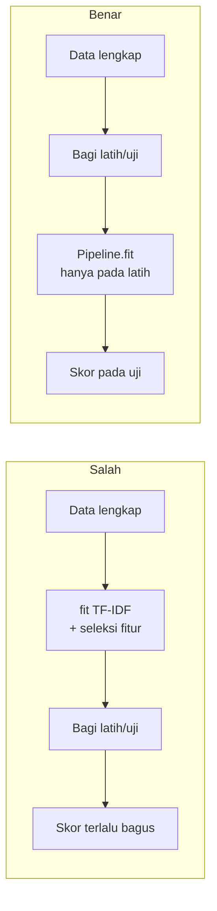

# Data Leakage akibat Preprocessing dan Pembagian Data

!!! abstract "Info materi"
    **Tingkat kesulitan:** Menengah–lanjut. **Estimasi waktu:** 90–120 menit.
    **Jenis kode:** **eksperimen** (`examples/level-2-preprocessing/11_leakage.py`). Angka berasal dari eksekusi nyata (scikit-learn 1.9.1).

## Tujuan pembelajaran

- [ ] Mendefinisikan *data leakage* dan menyebut sumber-sumber utamanya pada proyek teks.
- [ ] Membedakan preprocessing **tanpa state** (aman dilakukan di awal) dari preprocessing yang **mempelajari statistik data** (harus di dalam pipeline).
- [ ] Mengukur kebocoran seleksi fitur dengan percobaan label acak.
- [ ] Menjelaskan tiga tingkat pembagian data: acak, per kejadian, per templat.
- [ ] Mendeteksi duplikat persis antara data latih dan uji.

## Prasyarat

- [Perbandingan Pipeline Preprocessing](perbandingan-pipeline.md).
- Pemahaman dasar `train_test_split` dan validasi silang (dibahas penuh di [Level 4](../level-4-machine-learning/index.md)).

## Pengantar dan motivasi

Bayangkan ujian dengan kunci jawaban yang tak sengaja tertinggal di meja
peserta. Nilainya tinggi, tetapi tidak berarti peserta memahami materi.
**Data leakage** adalah hal yang sama pada pemodelan: informasi dari data uji
(atau dari masa depan) ikut memengaruhi pelatihan, sehingga skor evaluasi
terlalu optimistis. Pada sistem yang nantinya dipakai untuk mendeteksi pesan
darurat, skor yang terlalu optimistis berarti kita menaruh kepercayaan pada
model yang belum teruji.

## Konsep dasar

| Sumber kebocoran | Contoh pada proyek teks |
|---|---|
| Statistik korpus dihitung dari seluruh data | Kosakata dan bobot IDF dari data latih + uji |
| Seleksi fitur memakai label dari seluruh data | `SelectKBest` sebelum membagi data |
| Teks hampir sama di latih dan uji | Duplikat/*retweet*, templat yang sama |
| Kelompok yang saling terkait terpisah | Postingan satu kejadian di latih dan uji |
| Fitur yang sebenarnya turunan label | Hashtag `#Emergency` yang ditambahkan **setelah** pelabelan |
| Waktu | Melatih dengan data yang lebih baru daripada data uji |

## Penjelasan mendalam

### Preprocessing tanpa state vs dengan state

- **Tanpa state:** hasil hanya bergantung pada satu teks dan parameter tetap. Contoh: huruf kecil, ganti URL, kamus informal, stemming, tokenisasi. Fungsi di `nlp_hub/preprocessing.py` semuanya tanpa state. Karena ia tidak belajar dari data, melakukannya sebelum pembagian data **tidak** membocorkan apa pun.
- **Dengan state:** hasil bergantung pada seluruh korpus. Contoh: kosakata dan IDF dari `TfidfVectorizer`, stopword yang dipilih dari kata paling sering, `min_df`, seleksi fitur berdasarkan label, normalisasi skala. Semua ini harus dilakukan **hanya pada data latih**, dan dilakukan dengan menaruhnya di dalam `Pipeline` sehingga `fit` hanya melihat data latih pada tiap lipatan.

### Kebocoran vokabular dan IDF

Jika `TfidfVectorizer` dilatih pada seluruh data, kosakatanya memuat kata yang hanya ada di data uji, dan bobot IDF dihitung dengan memperhitungkan dokumen uji. Pengaruhnya pada skor sering kecil (terutama jika kata uji tidak pernah dilihat saat latih sehingga bobotnya nol pada model), tetapi prinsipnya tetap: uji harus benar-benar tak terlihat.

### Kebocoran seleksi fitur

Ini kebocoran paling berbahaya karena **menggunakan label**. Jika fitur dipilih
berdasarkan hubungannya dengan label menggunakan seluruh data, fitur yang
kebetulan cocok dengan label pada lipatan uji ikut terpilih, dan model tampak
pintar walau tidak ada hubungan sebenarnya. Cara mengukurnya: **acak label**.
Karena label acak tidak berhubungan dengan teks, skor yang benar adalah acak
(balanced accuracy ≈ 0,50). Skor di atas itu adalah kebocoran.

### Tiga tingkat pembagian data

1. **Acak:** setiap teks dialokasikan acak ke lipatan.
2. **Per kejadian (`event_id`):** semua teks satu kejadian di lipatan yang sama.
3. **Per templat (`template_id`):** semua teks dari templat yang sama di lipatan yang sama; hanya ada karena datanya sintetis, tetapi analoginya pada data nyata adalah kelompok teks yang hampir identik (utas, *retweet*, kampanye).

Makin ketat pembagiannya, makin jujur perkiraan performanya.

## Cara kerja atau alur proses



## Contoh sederhana

Seorang guru memilih soal ujian yang "paling membedakan murid pintar dan tidak"
dengan melihat jawaban **semua** murid, termasuk murid yang akan diuji, lalu
menguji model pada murid yang sama. Soal itu terpilih karena kebetulan cocok
dengan jawaban mereka. Itulah seleksi fitur yang bocor.

## Contoh dalam konteks Twitter/X kebencanaan

Dua postingan sintetis dari kejadian yang sama sering berbagi lokasi dan kata
kunci. Jika satu di data latih dan satu di data uji, model dapat "mengenali"
kejadian itu alih-alih memahami pola Emergency. Karena itu `event_id`
dipakai sebagai kelompok pada pembagian data di proyek ini.

## Praktik Python

Berkas: `examples/level-2-preprocessing/11_leakage.py`. Bagian awal berkas memuat
dataset (`df`), label 0/1 (`y`), dan teks yang sudah diproses tanpa state
(`bersih`). Memproses teks sekali di awal aman karena langkahnya tanpa state.

### Bagian 1 — Mengukur kebocoran seleksi fitur dengan label acak

```python title="Bagian 1"
--8<-- "level-2-preprocessing/11_leakage.py:label_acak"
```

Langkah demi langkah:

1. `np.random.RandomState(seed).permutation(y)` mengacak label sehingga **tidak ada hubungan** dengan teks.
2. `vektor()` mengubah teks menjadi fitur n-gram karakter: 5.973 fitur untuk hanya 564 teks. Jumlah fitur jauh melebihi jumlah contoh; itu yang membuat kebocoran seleksi fitur terukur.
3. **Cara salah:** `fit_transform` dan `SelectKBest(chi2, k=100)` dilakukan pada seluruh data **dengan label acak**, baru kemudian divalidasi silang.
4. **Cara benar:** TF-IDF dan seleksi fitur menjadi langkah dalam `Pipeline`, sehingga pada setiap lipatan keduanya hanya belajar dari data latih lipatan itu.
5. `scoring="balanced_accuracy"` membuat tebakan acak bernilai 0,5 walau kelas tidak seimbang.

```text title="Output nyata"
seed 42: salah=0.593  benar=0.495  fitur=5973
seed  1: salah=0.586  benar=0.498  fitur=5973
seed  2: salah=0.562  benar=0.515  fitur=5973
```

Interpretasi: pada cara yang benar, skor berada di sekitar 0,5 (0,495–0,515),
sesuai dugaan karena labelnya acak. Pada cara salah skor 0,562–0,593: model
tampak "belajar" dari label acak, yang sebenarnya hanya kebocoran. Selisihnya
sekitar 0,07–0,10 dari tiga seed.

!!! note "Percobaan awal yang tidak menunjukkan efek"
    Percobaan pertama memakai TF-IDF unigram (592 fitur), `LogisticRegression`
    bawaan, dan `k=20`. Hasilnya `salah=0.502` dan `benar=0.497`, yaitu tidak
    ada perbedaan, karena fiturnya tidak banyak lebih dari jumlah contoh dan
    model bawaan terlalu terregulasi sehingga tebakannya hampir selalu kelas
    mayoritas. Efek kebocoran seleksi fitur bergantung pada rasio fitur
    terhadap contoh dan kekuatan model. Percobaan di atas disusun agar efeknya
    terlihat, bukan untuk menyatakan bahwa kebocoran selalu sebesar ini. Hanya
    tiga seed; angka bukan estimasi yang presisi.

### Bagian 2 — Kebocoran vokabular

```python title="Bagian 2"
--8<-- "level-2-preprocessing/11_leakage.py:kosakata"
```

`bagi_latih_uji(df)` membagi data berdasarkan `event_id`. Tiga `TfidfVectorizer` dilatih pada: seluruh data, data latih saja, dan data uji saja (untuk mengetahui kata milik uji).

```text title="Output nyata"
kosakata fit-semua: 592
kosakata fit-latih: 582
kata hanya di uji : 10
contoh: ['30', '45', 'ajarin', 'bawah', 'dasar', 'deadlnie', 'material', 'meanngani']
```

Interpretasi: melatih pada seluruh data menambahkan 10 kata (592 − 582) yang
hanya ada di data uji, termasuk typo yang unik (`deadlnie`, `meanngani`). Pada
pipeline yang benar, kata-kata ini **tidak ada** di kosakata dan dianggap tidak
dikenal pada saat uji, persis seperti keadaan di dunia nyata. Pada dataset ini
perbedaan sepuluh kata dari 592 kecil; itu bukan alasan untuk tidak
menghindarinya.

### Bagian 3 — Duplikat persis antara latih dan uji

```python title="Bagian 3"
--8<-- "level-2-preprocessing/11_leakage.py:duplikat"
```

Menggunakan dataset **dengan** 10 duplikat (`hapus_duplikat=False`), lalu membagi acak 5 lipatan dengan 10 seed berbeda. `t in teks_latih` memeriksa apakah teks uji punya salinan persis di latih.

```text title="Output nyata"
teks uji yang punya salinan persis di data latih (10 seed): [3, 3, 3, 2, 4, 4, 5, 6, 2, 2]
```

Interpretasi: pada pembagian acak, 2 sampai 6 teks uji (dari sekitar 115) punya
kembaran persis di data latih. Model cukup menghafalnya. Pembagian per
`event_id` menghindari ini karena retweet berada di kejadian yang sama. Cara
lain: buang duplikat sebelum membagi data (seperti `muat_dataset()`).

### Bagian 4 — Tiga tingkat pembagian

```python title="Bagian 4"
--8<-- "level-2-preprocessing/11_leakage.py:strategi"
```

`skor_cv` menjalankan validasi silang manual dengan model yang sama (`PraprosesTeks` + TF-IDF + Logistic Regression) dan hanya mengganti pembagi data. `grup` hanya dipakai oleh pembagi berkelompok.

```text title="Output nyata"
acak          : 0.988 ± 0.012
per kejadian  : 0.984 ± 0.010
per templat   : 0.909 ± 0.085
```

Interpretasi: pembagian acak 0,988, per kejadian 0,984 (hampir sama), per
templat 0,909 dengan simpangan 0,085, jauh lebih lebar. Dua hal penting:

1. Pada data ini, memisahkan **kejadian** tidak banyak mengubah skor karena templat kalimat dipakai di banyak kejadian. Pemisahan kejadian saja belum menutup semua kebocoran.
2. Ketika **templat** dipisahkan, skor turun ke 0,909 dan sangat tidak stabil antar lipatan. Dan skor pada set tulis-tangan (0,68, halaman sebelumnya) bahkan lebih rendah. Semakin ketat pemisahan, semakin turun skor; perkiraan yang jujur ada di bagian yang lebih ketat.

Ini seluruhnya pelajaran tentang data sintetis; pada data nyata, definisikan
"kelompok yang saling terkait" berdasarkan kejadian, utas, penulis, atau
waktu, sesuai yang dibenarkan data dan privasi.

### Skrip terpadu

Pembagian per kejadian disediakan sebagai fungsi `bagi_latih_uji` di
`examples/nlp_hub/data.py` (diuji oleh `test_pembagian_tidak_membocorkan_kejadian`).
Bagian-bagian Praktik Python memakai berkas `11_leakage.py`, yang bisa
dijalankan langsung (sekitar 2 detik).

## Kesalahan umum dan debugging

| Gejala | Penyebab | Perbaikan |
|---|---|---|
| Skor sangat tinggi, turun drastis pada data baru | Kebocoran atau data terlalu mudah | Uji pada data berbeda; periksa kelompok dan duplikat |
| `fit_transform` pada seluruh data sebelum `train_test_split` | Statistik korpus bocor | Bagi dulu, atau pakai `Pipeline` |
| Seleksi fitur sebelum validasi silang | Label bocor | Taruh seleksi fitur di dalam `Pipeline` |
| Duplikat di latih dan uji | Pembagian acak tanpa dedup | Buang duplikat sebelum membagi |
| Perbedaan skor kecil dianggap bukti | Variasi acak | Ulangi dengan beberapa seed; laporkan simpangan |

## Kelebihan dan keterbatasan

**Kelebihan pendekatan di halaman ini:** semua langkah dapat diulang; uji label acak adalah cara sederhana mengukur kebocoran.
**Keterbatasan:** percobaan memakai tiga seed untuk label acak; dataset kecil; sebagian tingkat pembagian (`template_id`) hanya mungkin pada data sintetis; pada data nyata Anda harus menentukan sendiri kelompok yang relevan.

## Latihan bertahap

1. **Konseptual.** Mengapa skor 0,50 pada "cara benar" dengan label acak justru hasil yang baik?
2. **Membaca kode.** Mengapa `PraprosesTeks().transform(...)` boleh dijalankan pada seluruh data sebelum membagi?
3. **Debugging.** Kode berikut berisiko apa? `X = TfidfVectorizer().fit_transform(df.text); X_latih, X_uji = train_test_split(X, ...)`.
4. **Menghitung.** Jika ada 115 teks uji dan 5 punya salinan persis di data latih, berapa persen?
5. **Mini-proyek.** Ubah `k` pada Bagian 1 menjadi 20 dan 500. Bagaimana selisih "salah" dan "benar" berubah? Jelaskan kecenderungannya dengan hati-hati.

## Kunci jawaban dan pembahasan

??? success "Jawaban 1"
    Label diacak sehingga tidak ada hubungan antara teks dan label; model yang benar seharusnya tidak lebih baik daripada menebak. Skor ≈ 0,5 menunjukkan pipeline tidak mencurangi. Skor di atas 0,5 pada eksperimen seperti ini adalah tanda kebocoran.

??? success "Jawaban 2"
    Fungsi preprocessing kita tanpa state: hasil satu teks tidak bergantung pada teks lain dan tidak ada parameter yang dipelajari dari data. Menjalankannya pada seluruh data setara dengan menjalankannya terpisah pada latih dan uji.

??? success "Jawaban 3"
    `fit_transform` pada seluruh `df.text` mempelajari kosakata dan IDF dari data uji juga (kebocoran). Perbaikan: bagi teks dahulu, `fit` pada latih, `transform` pada uji, atau gunakan `Pipeline`.

??? success "Jawaban 4"
    5 / 115 ≈ 4,3%. (Pada Bagian 3, jumlah salinan per seed berkisar 2 sampai 6.)

??? success "Jawaban 5"
    Hasil bergantung pada data dan model, jadi jalankan dan amati. Hipotesis yang boleh diuji: semakin banyak fitur terpilih, semakin besar peluang bocor, tetapi pada `k` yang sangat besar model mendekati tanpa seleksi sehingga efeknya bisa mengecil. Laporkan hasil dari beberapa seed, bukan satu angka.

## Kuis singkat

**1.** Apakah mengganti URL dengan `tok_url` sebelum membagi data adalah kebocoran?

??? success "Jawaban"
    Bukan. Langkah itu tanpa state; ia tidak mempelajari apa pun dari data.

**2.** Mengapa uji label acak berguna?

??? success "Jawaban"
    Karena skor yang benar sudah diketahui (acak). Penyimpangan dari itu menunjukkan kebocoran.

**3.** Mengapa pembagian per `event_id` saja belum cukup pada dataset ini?

??? success "Jawaban"
    Templat kalimat yang sama dipakai oleh banyak kejadian, jadi teks yang hampir sama tetap muncul di latih dan uji (skor per templat 0,909 vs 0,984 per kejadian).

## Ringkasan

- Kebocoran membuat skor evaluasi terlalu optimistis.
- Preprocessing tanpa state aman di awal; yang mempelajari statistik data harus di dalam pipeline.
- Seleksi fitur yang bocor terukur lewat label acak: 0,56–0,59 (salah) vs 0,50–0,52 (benar).
- Pembagian acak 0,988, per kejadian 0,984, per templat 0,909: makin ketat, makin jujur.
- Duplikat persis menyebabkan 2–6 teks uji punya kembaran di data latih.

## Glosarium istilah baru

Data leakage
:   Informasi dari data uji atau masa depan ikut memengaruhi pelatihan.

Seleksi fitur
:   Memilih sebagian fitur yang paling berhubungan dengan label.

Balanced accuracy
:   Rata-rata recall setiap kelas; tebakan acak bernilai 0,5.

Preprocessing tanpa state
:   Langkah yang hasilnya hanya bergantung pada teks masuk, bukan pada data lain.

Kelompok (*group*)
:   Kumpulan contoh yang saling terkait dan harus berada pada sisi yang sama dari pembagian data.

## Referensi

- Kaufman, S., Rosset, S., Perlich, C., & Stitelman, O. (2012). Leakage in data mining: Formulation, detection, and avoidance. *ACM Transactions on Knowledge Discovery from Data*, 6(4), artikel 15. DOI: 10.1145/2382577.2382579 (makalah akademik; detail bibliografi diperiksa lewat pencarian daring, isi lengkap belum dibaca ulang).
- Dokumentasi scikit-learn, *Common pitfalls and recommended practices*, bagian 12.2 *Data leakage*: <https://scikit-learn.org/stable/common_pitfalls.html> (dokumentasi resmi; memuat percobaan serupa dengan `SelectKBest` dan target acak).

## Materi berikutnya

[Pipeline Preprocessing yang Dapat Diuji](pipeline-teruji.md)
