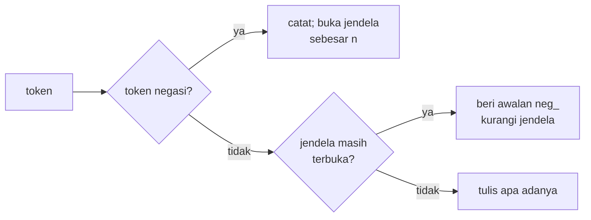

# Negasi: tidak, belum, bukan, jangan

!!! abstract "Info materi"
    **Tingkat kesulitan:** Menengah. **Estimasi waktu:** 60–90 menit.
    **Jenis kode:** snippet edukatif (`examples/level-2-preprocessing/08_negasi.py`).

## Tujuan pembelajaran

- [ ] Menjelaskan mengapa model *bag of words* tidak memahami negasi dengan sendirinya.
- [ ] Menandai kata di bawah cakupan negasi dengan awalan `neg_`.
- [ ] Menjelaskan perbedaan makna `belum`, `tidak`, `bukan`, dan `jangan` pada konteks darurat.
- [ ] Mengenali kapan penandaan negasi menghasilkan kesalahan.

## Prasyarat

- [Stopwords dan Keterbatasannya](stopwords.md).
- [Perulangan dan Kondisional](../level-1-python/perulangan.md) (Level 1).

## Pengantar dan motivasi

"Ada korban jiwa" dan "Tidak ada korban jiwa" memuat kata hampir sama. Model
yang menghitung kata (*bag of words*, Level 3) hanya melihat bahwa kata
`korban` dan `jiwa` ada; ia tidak tahu `tidak` membalik maknanya. Pada
klasifikasi darurat, kesalahan jenis ini serius: pesan tenang ("tidak ada
korban") dapat dikira laporan korban.

## Konsep dasar

| Kata negasi | Makna dasar | Contoh |
|---|---|---|
| `tidak` | Menyangkal kata kerja/sifat | "tidak ada listrik" |
| `belum` | Belum terjadi tetapi mungkin akan | "belum ada bantuan" |
| `bukan` | Menyangkal kata benda | "bukan gempa" |
| `jangan` | Larangan | "jangan panik" |

**Cakupan negasi** (*scope*) adalah bagian kalimat yang dipengaruhi kata
negasi. Penandaan negasi sederhana mengasumsikan cakupan = beberapa kata
berikutnya.

## Penjelasan mendalam

### Penandaan `neg_`

Teknik yang dikenal dari analisis sentimen: beri awalan `neg_` pada kata-kata
yang mengikuti kata negasi. Pang, Lee, dan Vaithyanathan (2002) memakai tag `NOT_` pada
setiap kata antara kata negasi dan tanda baca berikutnya pada ulasan film (teknik ini mereka adaptasi dari Das dan Chen, 2001), dan melaporkan bahwa menghapus tag itu
berefek dapat diabaikan dan rata-rata sedikit merugikan. Paket ini memakai
jendela tetap, bukan sampai tanda baca, sehingga tidak identik dengan metode mereka. `tidak ada korban jiwa` menjadi
`tidak neg_ada korban jiwa`. Fitur `neg_ada` berbeda dari `ada`, sehingga model
dapat belajar bahwa `neg_ada` berkorelasi dengan label tertentu.

### Ukuran jendela

Berapa kata setelah negasi yang diberi awalan? Satu kata (jendela = 1) aman
tetapi dangkal; tiga kata dapat menjangkau kata yang tidak terpengaruh.
Cakupan sebenarnya ditentukan sintaks dan tanda baca, yang tidak dilihat oleh
aturan sederhana ini. Perhatikan juga bahwa token tanda baca sudah dibuang
saat penandaan, sehingga negasi menembus batas klausa ("belum ada bantuan, air
terus naik" tetap hanya terpengaruh satu kata karena jendela = 1).

### Makna `belum` berbeda dari `tidak`

Dalam konteks darurat:

- "**Belum** ada bantuan, air terus naik" menandakan kebutuhan bantuan (cenderung Emergency).
- "**Tidak** ada korban jiwa" menenangkan (cenderung Non-Emergency).

Penandaan `neg_` membedakan kata yang dinegasikan, tetapi tidak menyampaikan
perbedaan `belum` versus `tidak` itu sendiri. Karena `belum` dan `tidak` tetap
ada sebagai token, model masih dapat belajar membedakannya, asalkan stopword
tidak membuangnya.

### Kapan penandaan salah

- "**tidak hanya** banjir tetapi juga longsor" berarti "bukan hanya", kata `hanya` tidak dinegasikan.
- "**jangan** panik" adalah larangan, bukan penyangkalan fakta.
- "**bukan** gempa, hanya truk lewat": cakupan negasi hanya `gempa`.

## Cara kerja atau alur proses



## Contoh sederhana

`['tidak', 'ada', 'korban', 'jiwa']` → `['tidak', 'neg_ada', 'korban', 'jiwa']`.

## Contoh dalam konteks Twitter/X kebencanaan

| Teks (sintetis) | Penandaan (jendela = 1) | Kecenderungan label |
|---|---|---|
| Belum ada bantuan, air terus naik | `belum neg_ada bantuan air terus naik` | Emergency |
| Tidak ada korban jiwa | `tidak neg_ada korban jiwa` | Non-Emergency |

Penandaan menunjukkan bahwa `ada` dinegasikan pada keduanya; yang
membedakan adalah kata lainnya (`air terus naik`).

## Praktik Python

Berkas: `examples/level-2-preprocessing/08_negasi.py`. Fungsi `tandai_negasi`
ada di `examples/nlp_hub/preprocessing.py`.

### Bagian 1 — Penandaan dasar

```python title="Bagian 1"
--8<-- "level-2-preprocessing/08_negasi.py:dasar"
```

```text title="Output nyata"
['tidak', 'ada', 'korban', 'jiwa']
['tidak', 'neg_ada', 'korban', 'jiwa']
```

Interpretasi: hanya `ada` yang mendapat awalan; `korban` tetap sama. Dengan
jendela = 1, penandaan konservatif.

### Bagian 2 — Pengaruh jendela

```python title="Bagian 2"
--8<-- "level-2-preprocessing/08_negasi.py:jendela"
```

```text title="Output nyata"
1 ['belum', 'neg_ada', 'bantuan', 'masuk', 'ke', 'desa']
2 ['belum', 'neg_ada', 'neg_bantuan', 'masuk', 'ke', 'desa']
3 ['belum', 'neg_ada', 'neg_bantuan', 'neg_masuk', 'ke', 'desa']
```

Interpretasi: semakin besar jendela, semakin banyak kata ditandai. Pada jendela
= 3, `masuk` ikut ditandai padahal kalimat "bantuan masuk" ada di dalam cakupan
`belum`. Ini bisa benar atau salah tergantung kalimat.

### Bagian 3 — Kata negasi tidak bermakna sama

```python title="Bagian 3"
--8<-- "level-2-preprocessing/08_negasi.py:beda_makna"
```

```text title="Output nyata"
Belum ada bantuan, air terus naik -> ['belum', 'neg_ada', 'bantuan', 'air', 'terus', 'naik']
Tidak ada korban jiwa -> ['tidak', 'neg_ada', 'korban', 'jiwa']
Jangan panik, tetap tenang -> ['jangan', 'neg_panik', 'tetap', 'tenang']
```

Interpretasi: `neg_panik` pada kalimat ketiga adalah larangan, bukan
penyangkalan kejadian. Fitur `neg_panik` berarti "panik yang dilarang"; model
mungkin tetap berguna, tetapi nama fiturnya menyesatkan bagi pembaca.

### Bagian 4 — Kegagalan

```python title="Bagian 4"
--8<-- "level-2-preprocessing/08_negasi.py:salah"
```

```text title="Output nyata"
['tidak', 'neg_hanya', 'banjir', 'tetapi', 'juga', 'longsor']
['bukan', 'neg_gempa', 'hanya', 'truk', 'lewat']
```

Interpretasi: pada kalimat pertama, `tidak hanya` adalah konstruksi "bukan
hanya"; `neg_hanya` tidak informatif, dan `banjir` yang menjadi inti pesan tidak
ditandai. Pada kalimat kedua penandaan benar: `neg_gempa` mewakili "bukan
gempa".

### Bagian 5 — Sebaran negasi pada dataset

```python title="Bagian 5"
--8<-- "level-2-preprocessing/08_negasi.py:korpus"
```

`Counter` menghitung kemunculan token negasi per kelas.

```text title="Output nyata"
Counter({'tidak': 5, 'belum': 4})
Counter({'tidak': 22, 'belum': 18, 'jangan': 14})
```

Interpretasi: negasi sangat jarang pada data sintetis ini (9 kemunculan pada
Emergency, 54 pada Non-Emergency; total 7124 token). `jangan` hanya muncul di
Non-Emergency pada data ini. Karena negasi jarang, jangan berharap penandaan
negasi memberi dampak besar pada dataset ini. Apakah ia berguna pada data nyata
harus diuji dengan data nyata.

### Skrip terpadu

`KonfigurasiPraproses(negasi=True)` mengaktifkan penandaan. Urutan dalam
`praproses_token`: normalisasi informal dahulu (`gak` → `tidak`), baru penandaan
negasi, baru stopword. Tes: `test_tandai_negasi_jendela_satu` dan
`test_tandai_negasi_jendela_dua`.

## Kesalahan umum dan debugging

| Gejala | Penyebab | Perbaikan |
|---|---|---|
| `gak ada listrik` tidak ditandai | Normalisasi informal belum dijalankan | Normalisasi dahulu agar `gak` → `tidak` |
| Penandaan hilang | Stopword membuang `tidak` | Jangan buang negasi |
| Awalan `neg_` pada token penanda (`neg_tok_url`) | Penandaan tidak memeriksa token khusus | Lewati `tok_`/`emo_` (sudah dilakukan fungsi) |
| Stem merusak awalan | Stemmer dijalankan pada `neg_ada` | Pisahkan awalan sebelum stem (sudah di `stem_token`) |
| Kosakata melonjak | Setiap kata menjadi dua fitur (`ada` dan `neg_ada`) | Pakai jendela kecil; ukur dampaknya |

## Kelebihan dan keterbatasan

**Kelebihan:** sederhana; tidak butuh parser; memberi model peluang membedakan
"ada korban" dari "tidak ada korban".
**Keterbatasan:** cakupan hanya dugaan; menambah ukuran kosakata; salah pada
konstruksi seperti "tidak hanya"; jarang bermanfaat jika negasi jarang dalam
data. Model berbasis urutan (Level 6) mempelajari cakupan negasi dari data.

## Latihan bertahap

1. **Konseptual.** Mengapa bag of words tidak membedakan "ada korban" dan "tidak ada korban"?
2. **Membaca kode.** Hasil `tandai_negasi(["tidak","ada","korban","jiwa"], jendela=2)`?
3. **Fill-in.** Tulis tes yang memastikan token `tok_url` setelah `tidak` tidak diberi awalan.
4. **Debugging.** `praproses("gak ada listrik", KonfigurasiPraproses(negasi=True))` menghasilkan apa, dan mengapa `gak` tidak masalah?
5. **Analisis.** Rancang cara memutuskan apakah penandaan negasi layak dipakai pada data Anda.

## Kunci jawaban dan pembahasan

??? success "Jawaban 1"
    Bag of words hanya mencatat kata mana yang ada dan berapa kali. Kedua kalimat berisi `ada`, `korban`, `jiwa`; satu-satunya selisih adalah kata `tidak`, yang dianggap fitur terpisah tanpa hubungan dengan kata sesudahnya.

??? success "Jawaban 2"
    `['tidak', 'neg_ada', 'neg_korban', 'jiwa']`. (Dicakup tes `test_tandai_negasi_jendela_dua` yang memakai kalimat serupa.)

??? success "Jawaban 3"
    ```python
    def test_negasi_tidak_menandai_token_penanda():
        assert pp.tandai_negasi(["tidak", "tok_url"]) == ["tidak", "tok_url"]
    ```
    Tes ini lolos. Namun perhatikan perilaku yang **tidak** diuji: `tandai_negasi(["tidak", "tok_url", "korban"])` menghasilkan `['tidak', 'tok_url', 'neg_korban']`, karena jendela tidak dihabiskan oleh token penanda sehingga kata berikutnya yang ditandai. Apakah itu yang Anda inginkan adalah keputusan desain; bila tidak, tambahkan tes untuk perilaku yang dikehendaki lalu ubah fungsinya. Pembahasan: tes yang baik mencakup kasus tepi, bukan hanya kasus yang mudah.

??? success "Jawaban 4"
    Hasilnya `tidak neg_ada listrik`. `gak` dinormalkan menjadi `tidak` oleh kamus sebelum penandaan, jadi aturan negasi bekerja. Jika normalisasi dimatikan (`informal=False`), `gak` tidak dikenali sebagai negasi.

??? success "Jawaban 5"
    Bandingkan dua konfigurasi yang hanya berbeda pada `negasi` dengan pembagian data dan model yang sama, lihat metrik kelas Emergency dan simpangan antar lipatan; periksa juga berapa teks yang mengandung negasi (jika sangat sedikit, perbedaan hampir pasti noise). Lihat [Perbandingan Pipeline](perbandingan-pipeline.md).

## Kuis singkat

**1.** Apa arti awalan `neg_`?

??? success "Jawaban"
    Penanda bahwa kata itu berada dalam cakupan negasi, sehingga `neg_ada` menjadi fitur berbeda dari `ada`.

**2.** Mengapa `jangan panik` bermasalah untuk penandaan negasi?

??? success "Jawaban"
    `jangan` adalah larangan, bukan penyangkalan fakta; fitur `neg_panik` menyesatkan walau tidak selalu merugikan.

**3.** Mengapa urutan normalisasi → negasi → stopword penting?

??? success "Jawaban"
    Normalisasi mengubah `gak` menjadi `tidak` agar dikenali; stopword tidak boleh membuang negasi sebelum ditandai.

## Ringkasan

- Bag of words tidak memahami negasi; `neg_` menyediakan fitur untuk kata yang dinegasikan.
- Jendela menentukan banyaknya kata ditandai; cakupan sebenarnya bergantung sintaks.
- `belum`, `tidak`, `bukan`, dan `jangan` berbeda makna.
- Pada dataset sintetis ini negasi sangat jarang, sehingga manfaatnya perlu diukur.

## Glosarium istilah baru

Negasi
:   Pernyataan yang membalik atau menyangkal makna.

Cakupan negasi (*scope*)
:   Bagian kalimat yang dipengaruhi kata negasi.

Jendela
:   Jumlah token setelah kata negasi yang diberi tanda.

## Referensi

- Pang, B., Lee, L., & Vaithyanathan, S. (2002). Thumbs up? Sentiment classification using machine learning techniques. *Proceedings of EMNLP 2002*, 79–86. <https://aclanthology.org/W02-1011/> (makalah akademik; penandaan negasi dijelaskan pada bagian 6.1, Experimental Set-up).

## Materi berikutnya

[Normalisasi Angka, Waktu, dan Lokasi](angka-waktu-lokasi.md)
