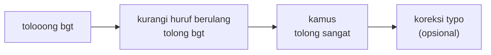

# Normalisasi Bahasa Informal, Huruf Berulang, dan Typo

!!! abstract "Info materi"
    **Tingkat kesulitan:** Menengah. **Estimasi waktu:** 90–120 menit.
    **Jenis kode:** snippet edukatif (`examples/level-2-preprocessing/05_normalisasi_informal.py`) dan fungsi di `nlp_hub.preprocessing`.

## Tujuan pembelajaran

- [ ] Menjelaskan mengapa bahasa informal memperbesar kosakata dan mengurangi sinyal.
- [ ] Menormalkan singkatan dengan kamus dan menjelaskan batasnya.
- [ ] Memendekkan huruf berulang dengan benar, termasuk kasus yang gagal.
- [ ] Mengoreksi typo dengan kemiripan string dan menjelaskan risikonya.
- [ ] Mengukur efek normalisasi pada ukuran kosakata.

## Prasyarat

- [Token, Kalimat, dan Tokenisasi Kata](token-kalimat-tokenisasi.md).
- [Case Folding, Tanda Baca, dan Pembersihan](case-folding-pembersihan.md).
- [Dasar Regex](../level-1-python/regex-dasar.md) dan [Dictionary](../level-1-python/list-tuple-set-dict.md).

## Pengantar dan motivasi

Dalam keadaan panik, orang menulis cepat: `tlg`, `udh`, `blm`, `tolooong`,
`banjri`. Bagi komputer, `tolong`, `tlg`, `tolg`, dan `tolooong` adalah empat
kata berbeda. Jika semuanya muncul hanya sekali dua kali di data latih, model
tidak mendapat cukup bukti bahwa semuanya "kata yang sama". Normalisasi
menyatukan variasi itu agar bukti terkumpul pada satu fitur.

## Konsep dasar

| Masalah | Contoh | Pendekatan |
|---|---|---|
| Singkatan dan bentuk gaul | `yg`, `udh`, `gak` | Kamus pemetaan (`KAMUS_INFORMAL`) |
| Huruf berulang | `tolooong`, `banjiiir` | Regex yang memendekkan huruf |
| Typo | `banjri`, `bnjir` | Kemiripan string terhadap kosakata |
| Variasi ejaan | `cepet` / `cepat` | Kamus |

## Penjelasan mendalam

### Kamus normalisasi

Cara paling transparan: dictionary `{"yg": "yang", "udh": "sudah", ...}`.
Kelebihan: jelas, dapat diperiksa, dapat diuji. Kelemahan: cakupan terbatas
karena variasi tak terbatas dan kamus harus dibuat dari data. Kamus pada paket
ini hanya sekitar 60 entri dan sengaja kecil.

Beberapa pemetaan tidak netral. `bgt` → `sangat` menyederhanakan nuansa
(`banget`, `bgt`, `sangat` tidak persis sama), dan `ga` bisa berarti "tidak"
atau potongan lain. Setiap entri adalah keputusan.

### Huruf berulang

Orang memanjangkan huruf untuk menekankan: `tolooong`. Aturannya: huruf yang
sama 3 kali atau lebih dipendekkan menjadi satu. Pola regex:

```text
([^\W\d_])\1{2,}
```

- `[^\W\d_]` : satu karakter yang **bukan** non-huruf; artinya hanya huruf. `\W` berarti bukan huruf/angka/underscore, `\d` angka, `_` underscore; tanda `^` di dalam kurung meniadakan himpunan itu. Hasilnya huruf saja.
- `(...)` : menangkap huruf itu sebagai kelompok 1.
- `\1{2,}` : kelompok 1 muncul lagi **dua kali atau lebih** (sehingga total tiga atau lebih).
- Pengganti `\1` : tinggalkan satu huruf.

Mengapa tidak `(\w)\1{2,}`? Karena `\w` mencakup angka dan `1000000` akan
rusak. Itu bug umum; Bagian 3 menunjukkannya.

Keterbatasan: kata yang aslinya memiliki huruf dobel seperti `saat` dan `maaf`
menjadi `sat` dan `maf` ketika dipanjangkan (`saaat`, `maaaf`). Solusi di paket
ini: tambahkan `sat → saat` dan `maf → maaf` ke kamus informal. Itu perbaikan
tambal sulam; ia hanya bekerja untuk kata yang sudah Anda ketahui.

### Koreksi typo

Pendekatan sederhana: bandingkan token dengan daftar kosakata domain dan ganti
dengan yang paling mirip jika kemiripannya melewati ambang. `difflib` pada
pustaka standar Python menghitung kemiripan 0–1. Rumusnya:

$$
\text{kemiripan} = \frac{2 M}{T}
$$

dengan $M$ jumlah karakter yang cocok dan $T$ total panjang kedua string.
Contoh: `bnjir` (5 huruf) dan `banjir` (6 huruf) cocok pada 5 huruf, sehingga
$2 \times 5 / (5+6) = 0{,}909$.

Risiko: ambang yang rendah menangkap lebih banyak typo tetapi juga mengubah
kata yang benar. Bagian 4–5 menunjukkan contohnya.

## Cara kerja atau alur proses

Urutan di `praproses_token`: huruf berulang dipendekkan pada string, kemudian
teks ditokenisasi, kemudian setiap token dicari di kamus, dan terakhir (opsional)
dikoreksi typonya.



## Contoh sederhana

`"gak bs keluar rmh"` → `"tidak bisa keluar rumah"` (kamus). Empat kata informal
menjadi bentuk baku, sehingga bentuk-bentuk yang sering muncul menyatu pada
fitur yang sama.

## Contoh dalam konteks Twitter/X kebencanaan

Postingan sintetis: `tlg bgt air udh naik, blm ada yg dtg`. Teks ini berisi
permintaan bantuan, tetapi memakai `tlg` (tolong) dan `udh` (sudah). Tanpa
normalisasi, model yang pernah melihat `tolong` ratusan kali tidak mengenali
`tlg` sama sekali.

## Praktik Python

Berkas: `examples/level-2-preprocessing/05_normalisasi_informal.py`.

### Bagian 1 — Kamus informal

```python title="Bagian 1"
--8<-- "level-2-preprocessing/05_normalisasi_informal.py:kamus"
```

`tokenisasi(kalimat)` memecah teks. Lalu list comprehension memanggil
`normalisasi_informal(t)` untuk tiap token; fungsi itu mengembalikan token
aslinya bila tidak ada di kamus (`dictionary.get(kunci, bawaan)`).

```text title="Output nyata"
['tlg', 'bgt', 'air', 'udh', 'naik', 'blm', 'ada', 'yg', 'dtg']
['tolong', 'sangat', 'air', 'sudah', 'naik', 'belum', 'ada', 'yang', 'dtg']
```

Interpretasi: delapan dari sembilan token dinormalkan. `dtg` (datang) tetap
karena belum ada di kamus; ini menunjukkan **cakupan kamus selalu tidak
lengkap**.

### Bagian 2 — Huruf berulang

```python title="Bagian 2"
--8<-- "level-2-preprocessing/05_normalisasi_informal.py:berulang"
```

```text title="Output nyata"
tolooong -> tolong
banjiiir -> banjir
beeeeterbangan -> beterbangan
saaat -> sat
maaaf -> maf
```

Interpretasi: tiga pertama benar. `saaat` dan `maaaf` salah karena kata
aslinya `saat` dan `maaf` memiliki huruf dobel. `beterbangan` kebetulan benar
(`atap beterbangan` memang ditulis dengan satu "e" setelah "b"). Kata-kata
salah itu sudah masuk kamus sebagai `sat → saat` dan `maf → maaf`.

### Bagian 3 — Bug klasik: `\w` merusak angka

```python title="Bagian 3"
--8<-- "level-2-preprocessing/05_normalisasi_informal.py:bug_angka"
```

```text title="Output nyata"
Rp10
Rp1000000
```

Interpretasi: pola `(\w)\1{2,}` menganggap `000000` sebagai huruf berulang dan
mengubah satu juta rupiah menjadi `Rp10`. Pola yang membatasi pada huruf
(`[^\W\d_]`) tidak menyentuh angka. **Cara mendeteksi bug seperti ini:** tulis
tes dengan angka (lihat `test_kurangi_huruf_berulang`).

### Bagian 4 — Kemiripan string

```python title="Bagian 4"
--8<-- "level-2-preprocessing/05_normalisasi_informal.py:typo_skor"
```

`SequenceMatcher(None, a, b).ratio()` mengembalikan kemiripan $2M/T$.

```text title="Output nyata"
bnjir    vs banjir   kemiripan=0.909
banjirr  vs banjir   kemiripan=0.923
banjri   vs banjir   kemiripan=0.833
banjar   vs banjir   kemiripan=0.833
```

Interpretasi: huruf yang **hilang** atau **berlebih** menghasilkan kemiripan
tinggi (>0,9). Huruf **tertukar** (`banjri`) turun ke 0,833, sama dengan kata
sah lain yang berbeda satu huruf (`banjar`).
Dengan ukuran kemiripan ini, tidak ada ambang yang menangkap `banjri` tetapi
melewatkan `banjar`.

### Bagian 5 — Koreksi typo dan harganya

```python title="Bagian 5"
--8<-- "level-2-preprocessing/05_normalisasi_informal.py:typo_koreksi"
```

Setiap baris mencetak kata, hasil dengan ambang bawaan 0,85, dan hasil dengan ambang 0,8.

```text title="Output nyata"
bnjir banjir banjir
banjri banjri banjir
banjar banjar banjir
rumah rumah rumah
```

Interpretasi: pada ambang 0,85, `bnjir` terkoreksi tetapi `banjri` tidak. Pada
ambang 0,8, `banjri` terkoreksi **dan** `banjar` ikut berubah menjadi `banjir`,
yaitu koreksi salah. `rumah` tidak berubah karena sudah ada di kosakata.
Karena itu `typo` dimatikan secara bawaan di `KonfigurasiPraproses`.

### Bagian 6 — Dampak pada kosakata dataset

```python title="Bagian 6"
--8<-- "level-2-preprocessing/05_normalisasi_informal.py:korpus"
```

Dua konfigurasi dibandingkan: tanpa normalisasi (`informal=False`, `huruf_berulang=False`) dan dengan normalisasi. `muat_dataset()` membuang duplikat persis.

```text title="Output nyata"
token : 7124 7124
tipe  : 685 596
posisi yang berubah: 376
```

Interpretasi: jumlah token tetap 7124 (normalisasi tidak menambah atau
membuang token), 376 token berubah, dan jumlah tipe turun dari 685 menjadi 596,
yaitu 89 tipe (13%) menyatu dengan tipe lain. Pengurangan kosakata ini adalah
manfaat yang dapat **diukur langsung**; apakah ia meningkatkan akurasi harus
diuji (lihat [Perbandingan Pipeline](perbandingan-pipeline.md)).

### Skrip terpadu

Pada `examples/nlp_hub/preprocessing.py`, fungsi `kurangi_huruf_berulang`,
`normalisasi_informal`, dan `koreksi_typo` dipanggil berurutan dari
`praproses_token`; kamusnya di `examples/nlp_hub/kamus.py`.

## Kesalahan umum dan debugging

| Gejala | Penyebab | Perbaikan |
|---|---|---|
| `Rp1000000` → `Rp10` | Pola `\w` mencakup angka | Gunakan `[^\W\d_]` |
| `saat` → `sat` | Huruf dobel sah dipendekkan | Tambah entri kamus atau periksa daftar kata yang diubah |
| Kata sah ikut "dikoreksi" | Ambang kemiripan terlalu rendah | Naikkan ambang, batasi pada kosakata kecil, atau matikan koreksi |
| `KeyError` pada kamus | Memakai `kamus[token]` | Pakai `kamus.get(token, token)` |
| Kamus tidak jalan pada `Gak` | Kunci kamus huruf kecil sedangkan token berhuruf kapital | Case folding dahulu |

## Kelebihan dan keterbatasan

**Kamus:** transparan, dapat diuji; cakupan terbatas dan harus dirawat.
**Huruf berulang:** otomatis; salah pada kata berhuruf dobel.
**Typo dengan kemiripan:** tanpa data latih; ambang sulit dan kata sah dapat berubah.

Alternatif lain: model pembelajar yang mengenali variasi ejaan (embedding
subkata) tidak butuh kamus, tetapi butuh data dan komputasi lebih banyak
(Level 6).

## Latihan bertahap

1. **Konseptual.** Mengapa menyatukan `tlg` dan `tolong` membantu model, terutama pada data kecil?
2. **Membaca kode.** Berapa hasil `praproses("gak bs keluar rmh")`?
3. **Fill-in.** Tambahkan entri kamus agar `dtg` menjadi `datang`. Di mana kamus itu ditulis, dan tes apa yang perlu ditambah?
4. **Debugging.** `praproses("maaaf, saaat itu")` seharusnya `maaf saat itu`. Mengapa hasilnya benar, padahal `kurangi_huruf_berulang` menghasilkan `maf` dan `sat`?
5. **Evaluasi.** Dapatkah ambang `batas` ditentukan sehingga `banjri` terkoreksi tetapi `banjar` tidak? Jelaskan.

## Kunci jawaban dan pembahasan

??? success "Jawaban 1"
    Pada data kecil, setiap kata hanya muncul beberapa kali. Menyatukan variasi mengumpulkan bukti pada satu fitur, sehingga bobot yang dipelajari lebih stabil. Pada eksperimen di halaman ini kosakata turun 89 tipe (685 → 596).

??? success "Jawaban 2"
    `tidak bisa keluar rumah`. Empat singkatan dinormalkan oleh kamus (hasil sudah dijalankan).

??? success "Jawaban 3"
    Tambahkan `"dtg": "datang"` ke `KAMUS_INFORMAL` di `examples/nlp_hub/kamus.py`, lalu tambahkan tes seperti `assert pp.normalisasi_informal("dtg") == "datang"` di `examples/tests/test_preprocessing.py`. Pembahasan: kamus adalah data; setiap perubahan harus punya tes agar tidak merusak entri lain.

??? success "Jawaban 4"
    Karena `sat` dan `maf` sudah dipetakan oleh kamus informal menjadi `saat` dan `maaf`. Perbaikannya terjadi di langkah kamus, bukan di langkah huruf berulang. Hasil `maaf saat itu` sudah dijalankan.

??? success "Jawaban 5"
    Tidak dengan ukuran ini. Kemiripan `banjri`–`banjir` dan `banjar`–`banjir` sama (0,833), jadi ambang apa pun memperlakukan keduanya sama. Pilihan lain: gunakan frekuensi kata (kata yang sering terlihat tidak dikoreksi), konteks, atau ukuran jarak yang menganggap transposisi sebagai satu kesalahan (misalnya Damerau–Levenshtein), atau tidak mengoreksi sama sekali.

## Kuis singkat

**1.** Mengapa `(\w)\1{2,}` berbahaya?

??? success "Jawaban"
    `\w` mencakup angka sehingga deretan angka yang sama (`000`) ikut dipendekkan.

**2.** Mengapa koreksi typo dimatikan secara bawaan?

??? success "Jawaban"
    Karena dapat mengubah kata yang benar (`banjar` → `banjir` pada ambang 0,8), dan manfaatnya perlu dibuktikan.

**3.** Apakah normalisasi menambah jumlah token?

??? success "Jawaban"
    Tidak untuk kamus dan huruf berulang pada eksperimen ini: 7124 token sebelum dan sesudah. Yang berkurang adalah jumlah tipe.

## Ringkasan

- Variasi informal memecah bukti statistik; normalisasi menyatukannya.
- Kamus transparan tetapi tidak lengkap; huruf berulang berisiko pada kata berhuruf dobel dan angka.
- Koreksi typo dengan kemiripan string tidak bisa membedakan typo dari kata sah yang mirip.
- Dampak normalisasi pada kosakata dapat diukur: 685 → 596 tipe pada dataset sintetis.

## Glosarium istilah baru

Normalisasi
:   Mengubah variasi penulisan menjadi satu bentuk standar.

Kamus normalisasi
:   Tabel pemetaan bentuk informal ke bentuk baku.

Typo (*typographical error*)
:   Kesalahan ketik.

Kemiripan string
:   Ukuran seberapa mirip dua string, mis. `SequenceMatcher.ratio()`.

Kosakata (*vocabulary*)
:   Himpunan tipe token yang muncul di korpus.

## Referensi

- Dokumentasi Python, `difflib`: <https://docs.python.org/3/library/difflib.html> (dokumentasi resmi).
- Dokumentasi Python, modul `re`: <https://docs.python.org/3/library/re.html>.

## Materi berikutnya

[Stopwords dan Keterbatasannya](stopwords.md)
