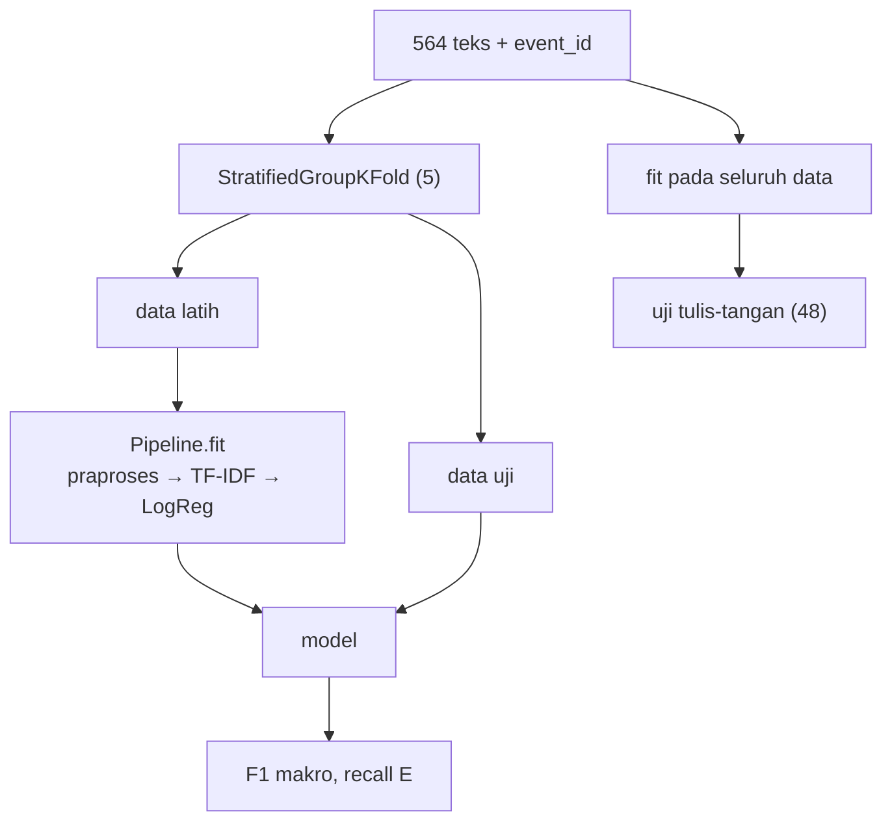

# Perbandingan Pipeline Preprocessing

!!! abstract "Info materi"
    **Tingkat kesulitan:** Menengah–lanjut. **Estimasi waktu:** 120 menit.
    **Jenis kode:** **eksperimen** (`examples/level-2-preprocessing/10_perbandingan_pipeline.py`). Semua angka pada halaman ini berasal dari eksekusi nyata (scikit-learn 1.9.1, seed 42).

## Tujuan pembelajaran

- [ ] Membandingkan beberapa konfigurasi preprocessing dengan eksperimen yang adil.
- [ ] Membaca hasil validasi silang sebagai rata-rata ± simpangan baku.
- [ ] Menjelaskan mengapa selisih kecil bukan bukti satu konfigurasi lebih baik.
- [ ] Menjelaskan mengapa skor pada data sintetis tidak mewakili data nyata.

## Prasyarat

- Seluruh halaman Level 2 sebelumnya.
- Pemahaman sepintas tentang TF-IDF dan Logistic Regression **tidak diwajibkan**. Keduanya dibahas di [Level 3](../level-3-representasi-teks/index.md) dan [Level 4](../level-4-machine-learning/index.md); di sini keduanya dipakai sebagai alat ukur.

## Pengantar dan motivasi

Sampai sini kita punya belasan pilihan preprocessing. Pertanyaan berikut tidak
bisa dijawab dengan intuisi: *apakah menghapus stopword membantu? apakah
stemming membantu?* CLAUDE.md dan spesifikasi proyek sepakat: **jangan
menetapkan satu strategi sebagai yang terbaik sebelum eksperimen**.
Halaman ini menjalankan eksperimen itu, lalu menunjukkan bagaimana membaca
hasilnya dengan jujur, termasuk ketika hasilnya "tidak ada pemenang".

## Konsep dasar

| Istilah | Arti singkat |
|---|---|
| **Konfigurasi** | Satu set pilihan preprocessing (`KonfigurasiPraproses`) |
| **Eksperimen adil** | Semua konfigurasi memakai data, pembagian, model, dan seed yang sama; hanya satu hal yang berubah |
| **Validasi silang berkelompok** | Data dibagi menjadi *k* lipatan; satu kejadian (`event_id`) selalu berada dalam satu lipatan |
| **F1 makro** | Rata-rata F1 kedua kelas; tidak berpihak pada kelas besar |
| **Recall Emergency** | Dari semua teks Emergency yang sebenarnya, berapa bagian yang berhasil ditemukan |

## Penjelasan mendalam

### Desain eksperimen

1. **Data:** 564 teks sintetis (duplikat persis dibuang).
2. **Model tetap:** TF-IDF unigram + Logistic Regression. Hanya preprocessing yang berubah.
3. **Evaluasi 1: validasi silang 5 lipatan** dengan `StratifiedGroupKFold`: proporsi kelas dijaga dan satu `event_id` tidak terpecah ke dua lipatan, sehingga postingan dari satu kejadian tidak muncul di latih dan uji sekaligus.
4. **Evaluasi 2: set uji tulis-tangan** (48 teks, 24 per kelas) yang tidak ikut pelatihan. Model dilatih pada seluruh 564 teks lalu diuji di sini.
5. **Pipeline scikit-learn:** preprocessing, TF-IDF, dan klasifikator berada dalam satu objek `Pipeline`. Pada setiap lipatan, `fit` hanya melihat data latih. Itu mencegah kebocoran (dibahas di halaman berikutnya).

### Cara membaca hasil

Setiap angka CV berbentuk `rata-rata ± simpangan baku` dari lima lipatan. Jika
selisih antara dua konfigurasi **lebih kecil daripada simpangan baku**, kita tidak
dapat membedakannya dari variasi acak. Pada set tulis-tangan ada hanya 24 teks
per kelas, sehingga setiap satu teks yang berubah menggeser recall sebesar
$1/24 \approx 0{,}042$.

## Cara kerja atau alur proses



## Contoh sederhana

Bayangkan dua resep kue yang hanya berbeda pada satu bahan. Untuk menilai
bahan itu, semua hal lain harus sama: oven, suhu, dan juri. Eksperimen ini
sama: dataset, model, dan seed tidak berubah; hanya konfigurasi preprocessing.

## Contoh dalam konteks Twitter/X kebencanaan

Pertanyaan konkret: apakah membuang stopword Sastrawi (yang memuat `tolong`,
`tidak`, `belum`) merusak pendeteksian Emergency? Kita ukur recall Emergency,
bukan hanya skor umum, karena pesan darurat yang terlewat adalah galat yang
paling mahal.

## Praktik Python

Berkas: `examples/level-2-preprocessing/10_perbandingan_pipeline.py`.
Daftar impor dan baris pembuka (menambahkan `examples/` ke `sys.path`) tidak
dibahas lagi; pola yang sama dijelaskan di halaman pertama Level 2.

### Bagian 1 — Daftar konfigurasi

```python title="Bagian 1"
--8<-- "level-2-preprocessing/10_perbandingan_pipeline.py:definisi"
```

Setiap entri `"nama": KonfigurasiPraproses(...)` memakai nilai bawaan kecuali
yang disebut. Konfigurasi **A** (dasar) adalah pembanding. Setiap konfigurasi
lain mengubah satu hal dari A, kecuali B (mematikan normalisasi).

### Bagian 2 — Model

```python title="Bagian 2"
--8<-- "level-2-preprocessing/10_perbandingan_pipeline.py:model"
```

- `Pipeline([...])` merangkai tiga langkah berurutan; keluaran satu langkah menjadi masukan langkah berikutnya. Setiap langkah punya nama (`"praproses"`, `"tfidf"`, `"klasifikasi"`).
- `PraprosesTeks(konfigurasi)` adalah pembungkus bagi fungsi preprocessing kita. Ia **tidak punya state**: `fit` tidak belajar apa pun.
- `TfidfVectorizer()` mengubah teks menjadi angka (Level 3). Ia **punya state**: ia mempelajari kosakata dan bobot IDF dari data yang diberikan ke `fit`.
- `LogisticRegression(max_iter=1000, random_state=42)` adalah pengklasifikasi (Level 4). `max_iter=1000` memberi batas iterasi pengoptimal; `random_state` menjaga hasil dapat diulang.

### Bagian 3 — Evaluasi

```python title="Bagian 3"
--8<-- "level-2-preprocessing/10_perbandingan_pipeline.py:evaluasi"
```

Langkah demi langkah:

1. `X`, `y`, `grup`: teks, label 0/1 (Emergency = 1), dan `event_id` per teks.
2. `lipatan.split(X, y, groups=grup)` menghasilkan lima pasang indeks (latih, uji).
3. Pada tiap lipatan, model **dibuat baru** (`buat_model`), dilatih pada data latih, dan dievaluasi pada data uji. Membuat model baru memastikan tidak ada informasi yang terbawa antar-lipatan.
4. Sesudah lima lipatan, satu model dilatih pada **seluruh** data dan diuji pada set tulis-tangan.
5. Hasil dikembalikan sebagai kamus yang akan menjadi satu baris tabel.

### Bagian 4 — Menjalankan dan menyusun tabel

```python title="Bagian 4"
--8<-- "level-2-preprocessing/10_perbandingan_pipeline.py:jalankan"
```

`if __name__ == "__main__":` berarti blok ini hanya berjalan bila berkas dijalankan langsung. `pd.DataFrame(baris).T` mengubah kamus-dalam-kamus menjadi tabel (`.T` menukar baris dan kolom). Hasil disimpan ke `hasil/perbandingan_pipeline.csv`.

### Hasil

Dijalankan dari folder utama repository dengan
`python examples/level-2-preprocessing/10_perbandingan_pipeline.py`
(sekitar 12 detik pada mesin penulis):

```text title="Output nyata"
scikit-learn 1.9.1, seed 42, latih/CV: 564 teks, tulis-tangan: 48 teks
                          F1 makro (CV)  Recall E (CV) F1 makro (tulis-tangan) Recall E (tulis-tangan)
A dasar                   0.984 ± 0.010  0.969 ± 0.030                   0.681                   0.417
B tanpa informal          0.980 ± 0.018  0.953 ± 0.048                   0.708                   0.458
C emoji dihapus           0.984 ± 0.010  0.969 ± 0.030                   0.681                   0.417
D hashtag dihapus         0.984 ± 0.013  0.969 ± 0.041                   0.681                   0.417
E + tanda seru            0.984 ± 0.010  0.969 ± 0.030                   0.681                   0.417
F + angka/waktu/lokasi    0.982 ± 0.024  0.959 ± 0.060                   0.681                   0.417
G + stopword konservatif  0.982 ± 0.016  0.969 ± 0.030                   0.625                   0.333
H + stopword Sastrawi     0.982 ± 0.013  0.974 ± 0.023                   0.625                   0.333
I + negasi                0.984 ± 0.010  0.969 ± 0.030                   0.708                   0.458
J + stemming              0.978 ± 0.016  0.948 ± 0.043                   0.681                   0.417
K + koreksi typo          0.984 ± 0.010  0.969 ± 0.030                   0.681                   0.417
```

### Interpretasi

**1. Pada validasi silang, tidak ada konfigurasi yang terbukti lebih baik.**
F1 makro berkisar 0,978 sampai 0,984, sedangkan simpangan baku antar lipatan
0,010 sampai 0,024. Rentang antar-konfigurasi (0,006) lebih kecil daripada
simpangan baku, jadi perbedaannya tidak dapat dibedakan dari noise.

**2. Skor tinggi ini mencurigakan, bukan menggembirakan.** F1 makro 0,98 pada
tugas dengan banyak kasus ambigu (lihat definisi label di Level 0) seharusnya membuat kita curiga. Penyebabnya sudah
dibahas: dataset dibuat dari templat; `di`, alamat, dan struktur kalimat
laporan sangat berkorelasi dengan label (halaman *Stopwords* dan *Angka, Waktu,
dan Lokasi*). CV antar-kejadian tidak menghilangkan kemiripan antar-templat,
karena satu templat dipakai di banyak kejadian.

**3. Pada set tulis-tangan, skornya jauh lebih rendah.** F1 makro 0,681 dan
recall Emergency 0,417 pada konfigurasi A. Artinya model hanya menemukan
sekitar 10 dari 24 teks Emergency tulis-tangan (0,417 × 24 = 10). Karena
`Recall E` adalah ukuran yang paling kita pedulikan, ini peringatan kuat:
model yang tampak sangat baik pada data bertemplat gagal pada teks dengan gaya
berbeda.

**4. Perbedaan antar-konfigurasi pada set tulis-tangan sangat kecil secara
absolut.** Selisih recall 0,417 → 0,333 (stopword) berarti **2 teks** dari 24;
selisih 0,417 → 0,458 (tanpa normalisasi, negasi) berarti **1 teks**. Dengan 24
teks per kelas dan satu kali percobaan, ini tidak cukup untuk menyatakan
pengaruh yang nyata. Hasil ini konsisten dengan kekhawatiran pada halaman
*Stopwords* (membuang `tolong`, `tidak`, dst. berpotensi merugikan), tetapi
**belum membuktikannya**.

**5. Konfigurasi yang identik tidak mengejutkan.** C (emoji dihapus) dan A
bernilai sama sampai tiga desimal; emoji pada data ini ditambahkan secara acak
dan tidak berkaitan dengan label. K (koreksi typo) juga identik dengan A pada
pembulatan. Pengecekan terpisah menunjukkan hanya 32 dari 7.124 token yang berubah
oleh koreksi typo. Sebagian benar (`letsuan` → `letusan`, `kebkaaran` → `kebakaran`,
`trejebak` → `terjebak`), sebagian salah (`tapi` → `api`, `karang` → `sekarang`).
Perubahan sedikit dan bercampur benar-salah, sehingga dampaknya hampir nol.

**Kesimpulan yang boleh ditarik:**

- Pada dataset sintetis ini, preprocessing yang dibandingkan **tidak mengubah hasil secara terdeteksi**.
- Kita tidak boleh menyimpulkan bahwa preprocessing "tidak penting" pada data nyata.
- Kita tidak boleh menyimpulkan konfigurasi mana pun sebagai yang terbaik.
- Kita **boleh** menyimpulkan bahwa jarak antara skor CV (≈0,98) dan skor tulis-tangan (≈0,68) menunjukkan skor CV tidak layak dijadikan perkiraan performa nyata.

### Skrip terpadu

Seluruh bagian di atas adalah satu berkas yang bisa dijalankan. Hasil CSV ada
di `examples/level-2-preprocessing/hasil/perbandingan_pipeline.csv`.

## Kesalahan umum dan debugging

| Gejala | Penyebab | Perbaikan |
|---|---|---|
| Skor hampir sempurna | Data sintetis atau bertemplat; kebocoran antar-templat | Uji pada data lain yang gayanya berbeda (di sini: set tulis-tangan) |
| Menyatakan konfigurasi terbaik dari selisih 0,002 | Mengabaikan simpangan baku | Bandingkan selisih dengan simpangan baku; ulangi dengan beberapa seed |
| Membandingkan konfigurasi pada pembagian data berbeda | Seed atau pembagian berbeda | Pakai pembagian yang sama |
| Preprocessing dijalankan sekali pada seluruh data sebelum CV | Kebocoran jika langkahnya mempelajari statistik data | Masukkan ke dalam `Pipeline` |
| Hanya memperhatikan akurasi | Kelas Emergency lebih kecil | Laporkan recall dan F1 per kelas |

## Kelebihan dan keterbatasan

**Kelebihan:** transparan, dapat diulang (seed, versi library tercatat), dan jujur tentang ketidakpastian.
**Keterbatasan:**

- Satu model (Logistic Regression), satu representasi (TF-IDF unigram), satu dataset sintetis kecil.
- Lima lipatan dengan satu seed; simpangan baku dari lima angka itu sendiri tidak stabil.
- 48 teks tulis-tangan dilabeli satu orang; tidak ada kesepakatan antaranotator.
- Tidak ada uji signifikansi formal. Dengan perbedaan sekecil ini, uji formal pun akan menyatakan "tidak ada perbedaan".

## Latihan bertahap

1. **Konseptual.** Mengapa kita memakai `StratifiedGroupKFold` dan bukan `KFold` biasa?
2. **Membaca tabel.** Berapa teks Emergency tulis-tangan yang ditemukan konfigurasi H? (Recall 0,333; 24 teks Emergency.)
3. **Membaca kode.** Mengapa model dibuat baru (`buat_model`) di setiap lipatan?
4. **Debugging.** Seorang pembaca menaruh `TfidfVectorizer` sebelum CV dan memanggil `fit_transform` pada seluruh data. Skornya naik sedikit. Mengapa skor itu tidak dapat dipercaya?
5. **Mini-proyek.** Tambahkan konfigurasi baru (misalnya negasi + stemming) ke `KONFIGURASI`, jalankan ulang, dan tulis satu paragraf kesimpulan yang jujur.

## Kunci jawaban dan pembahasan

??? success "Jawaban 1"
    `KFold` mengabaikan label dan kejadian. Dengan `StratifiedGroupKFold`, proporsi kelas tiap lipatan dijaga (penting untuk kelas yang lebih kecil) dan postingan satu `event_id` tidak terpecah, sehingga teks yang saling mirip karena satu kejadian tidak muncul di data latih dan uji bersamaan.

??? success "Jawaban 2"
    $0{,}333 \times 24 = 8$ teks. Konfigurasi H menemukan 8 dari 24; konfigurasi A menemukan 10 (0,417 × 24).

??? success "Jawaban 3"
    Agar tidak ada informasi dari lipatan sebelumnya yang terbawa. `TfidfVectorizer` menyimpan kosakata dan bobot IDF saat `fit`; memakainya ulang akan membawa informasi dari lipatan lain.

??? success "Jawaban 4"
    Karena `fit_transform` pada seluruh data membuat kosakata dan bobot IDF memuat kata dari data uji. Itu kebocoran data: model "melihat" statistik data uji sebelum diuji. Pada data kecil dampaknya mungkin kecil, tetapi tidak dapat dibuktikan tanpa membandingkan dengan cara yang benar. Bagian berikutnya mengukur efeknya.

??? success "Jawaban 5"
    Tidak ada jawaban tunggal. Contoh kesimpulan jujur: "Konfigurasi baru menghasilkan F1 makro CV X ± Y dan recall tulis-tangan Z. Selisihnya terhadap A lebih kecil daripada simpangan baku, sehingga tidak dapat disimpulkan lebih baik." Tuliskan juga bahwa data sintetis membatasi generalisasi.

## Kuis singkat

**1.** Selisih 0,006 antar-konfigurasi dengan simpangan baku 0,01. Apakah ada pemenang?

??? success "Jawaban"
    Tidak dapat disimpulkan; selisih lebih kecil daripada variasi antar-lipatan.

**2.** Mengapa recall Emergency dilaporkan secara terpisah?

??? success "Jawaban"
    Pesan darurat yang terlewat adalah galat yang mahal; skor makro dapat menyembunyikan kelemahan pada kelas ini.

**3.** Apa arti F1 makro CV 0,98 dengan F1 makro tulis-tangan 0,68?

??? success "Jawaban"
    Model bekerja baik pada data bergaya sama dengan data latih, tetapi gagal pada gaya berbeda. Skor CV tidak layak dijadikan perkiraan performa nyata.

## Ringkasan

- Bandingkan konfigurasi dengan data, model, seed, dan pembagian yang sama.
- Pada dataset sintetis ini, tidak ada konfigurasi preprocessing yang terbukti lebih baik: selisih ≤ 0,006 < simpangan baku.
- Skor validasi silang ≈ 0,98 tetapi skor tulis-tangan ≈ 0,68; recall Emergency tulis-tangan hanya 0,417.
- Jangan menarik kesimpulan yang tidak didukung data.

## Glosarium istilah baru

Validasi silang (*cross-validation*)
:   Membagi data menjadi beberapa lipatan dan bergantian memakai satu lipatan sebagai data uji.

Simpangan baku (*standard deviation*)
:   Ukuran sebaran nilai di sekitar rata-ratanya.

F1 makro
:   Rata-rata F1 per kelas dengan bobot sama.

Recall
:   Proporsi kasus positif sebenarnya yang berhasil ditemukan.

Pipeline (scikit-learn)
:   Rangkaian langkah pemrosesan dan model yang dijalankan berurutan sebagai satu objek.

## Referensi

- Dokumentasi scikit-learn, *Pipelines and composite estimators*: <https://scikit-learn.org/stable/modules/compose.html> (dokumentasi resmi).
- Dokumentasi scikit-learn, `StratifiedGroupKFold`: <https://scikit-learn.org/stable/modules/generated/sklearn.model_selection.StratifiedGroupKFold.html> (dokumentasi resmi).

## Materi berikutnya

[Data Leakage akibat Preprocessing](leakage-preprocessing.md)
