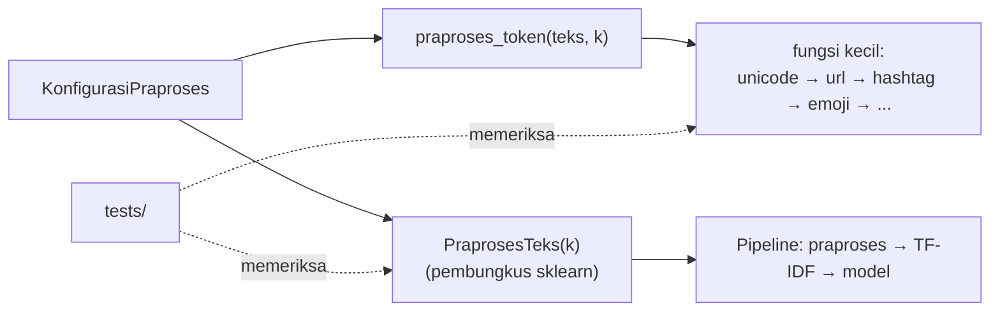

# Membuat Pipeline Preprocessing yang Dapat Diuji

!!! abstract "Info materi"
    **Tingkat kesulitan:** Menengah–lanjut. **Estimasi waktu:** 120 menit.
    **Jenis kode:** **siap pakai** (`examples/nlp_hub/preprocessing.py`, dengan tes di `examples/tests/`) dan snippet edukatif (`examples/level-2-preprocessing/12_pipeline_teruji.py`).

## Tujuan pembelajaran

- [ ] Menjelaskan mengapa preprocessing dipecah menjadi fungsi kecil dan murni.
- [ ] Menulis unit test untuk kasus normal, kasus tepi, galat, dan sifat umum (idempoten, tidak mengubah masukan).
- [ ] Membaca keluaran `pytest`, termasuk saat tes gagal.
- [ ] Memakai `KonfigurasiPraproses` dan `PraprosesTeks` di dalam `Pipeline`.
- [ ] Mengaudit hasil preprocessing pada seluruh dataset sebelum dipakai.

## Prasyarat

- Seluruh halaman Level 2 sebelumnya, terutama [Data Leakage](leakage-preprocessing.md).
- [Function dan Parameter](../level-1-python/function-parameter.md) dan [Debugging dan Pengujian](../level-1-python/debugging-pengujian.md) (Level 1).

## Pengantar dan motivasi

Selama Level 2, setiap fungsi baru kita pakai pada beberapa contoh lalu kita
lanjutkan. Itu cukup untuk belajar, tetapi tidak untuk proyek nyata. Dua
kasus dari pelajaran ini menunjukkan alasannya:

- Regex emoji awalnya **tidak mengenali `🆘`**. Itu baru terlihat saat dicoba pada contoh dari domain darurat.
- Pola angka awalnya merusak `Rp50.000` menjadi `Rp50. tok_angka`.

Keduanya sekarang dijaga oleh tes. Tes adalah cara menyimpan "pelajaran dari
bug" agar bug itu tidak kembali pada perubahan berikutnya.

## Konsep dasar

| Istilah | Arti |
|---|---|
| **Unit test** | Kode kecil yang memeriksa satu perilaku fungsi secara otomatis |
| **Fungsi murni** | Hasilnya hanya bergantung pada masukan, tanpa efek samping dan tanpa state tersembunyi |
| **Kasus tepi** | Masukan tak biasa: string kosong, hanya spasi, angka menempel pada huruf |
| **Idempoten** | Menjalankan dua kali menghasilkan hasil yang sama dengan sekali |
| **Konfigurasi** | Objek yang menyimpan semua pilihan preprocessing; membuat eksperimen dapat diulang |

## Penjelasan mendalam

### Rancangan paket `nlp_hub`

```text
examples/
├── nlp_hub/
│   ├── kamus.py          # data: kamus informal, stopword, emoji
│   ├── preprocessing.py  # fungsi kecil + KonfigurasiPraproses + PraprosesTeks
│   ├── data.py           # muat dataset, kodekan label, bagi latih/uji
│   └── konsol.py         # pembantu konsol
└── tests/
    ├── test_preprocessing.py
    └── test_data.py
```

Prinsip rancangan:

1. **Satu fungsi, satu tugas.** `ganti_url`, `proses_emoji`, `tokenisasi`, dll. dapat diuji sendiri.
2. **Data terpisah dari kode.** Kamus ada di `kamus.py`; mengubah kamus tidak perlu menyentuh logika.
3. **Konfigurasi sebagai objek.** `KonfigurasiPraproses` (sebuah `dataclass` beku) mencatat semua pilihan; dua eksperimen dibedakan oleh satu objek yang dapat dicetak dan disimpan.
4. **Pembungkus tipis untuk scikit-learn.** `PraprosesTeks` hanya memanggil `praproses`; tidak ada logika di dalamnya.

!!! info "Dataclass beku"
    `@dataclass(frozen=True)` membuat kelas yang kolomnya tidak bisa diubah
    setelah dibuat, dan otomatis memberi `__eq__` serta `__hash__`. Konfigurasi
    yang tidak berubah mencegah satu eksperimen "tak sengaja" mengubah
    konfigurasi eksperimen lain.

### Apa yang diuji

| Jenis tes | Pertanyaan | Contoh pada repo |
|---|---|---|
| Kasus normal | Apakah ia bekerja untuk masukan biasa? | `test_ganti_url` |
| Berparameter | Banyak pasangan masukan-keluaran sekaligus | `test_kurangi_huruf_berulang` |
| Kasus tepi | Apa yang terjadi di batas? | `test_praproses_string_kosong` |
| Galat | Apakah masukan salah ditolak dengan jelas? | `test_praproses_menolak_bukan_string` |
| Sifat umum | Apakah idempoten? Tidak mengubah masukan? | `test_praproses_idempoten_pada_konfigurasi_dasar` |
| Tanpa state | Apakah `fit` tidak mempelajari apa pun? | `test_transformer_tidak_belajar_dari_data` |
| Regresi dari bug | Apakah bug lama tidak kembali? | `test_emoji_sos_di_blok_berbeda_tetap_terdeteksi` |

## Cara kerja atau alur proses



## Contoh sederhana

Bila Anda mengubah `KAMUS_INFORMAL`, `pytest` akan segera memberi tahu jika
`praproses("TOLOOONG banjir bgt")` tidak lagi menghasilkan
`tolong banjir sangat`. Anda tahu seketika, tanpa membaca hasil secara manual.

## Contoh dalam konteks Twitter/X kebencanaan

Sebelum percobaan perbandingan pipeline, kita ingin yakin bahwa preprocessing
tidak mengosongkan teks darurat. Jika `stopword="sastrawi"` mengosongkan
postingan "Tolong!" menjadi string kosong, model tidak melihat apa pun untuk
pesan terpenting. Audit pada seluruh dataset (Bagian 2) memeriksa hal itu.

## Praktik Python

Berkas: `examples/level-2-preprocessing/12_pipeline_teruji.py`, dan tes pada
`examples/tests/test_preprocessing.py`.

### Bagian 1 — Melihat sebelum dan sesudah

```python title="Bagian 1"
--8<-- "level-2-preprocessing/12_pipeline_teruji.py:sebelum_sesudah"
```

`df["text"].iloc[[0, 1, 2, 3]]` mengambil empat teks pertama berdasarkan posisi. `lengkap` mengaktifkan lokasi, negasi, stopword konservatif, dan stemming.

```text title="Output nyata"
MENTAH : Tips menghadapi banjir: kenali jalur evakuasi dan kumpulkan nomor darurat.
DASAR  : tips menghadapi banjir kenali jalur evakuasi dan kumpulkan nomor darurat
LENGKAP: tips hadap banjir kenal jalur evakuasi kumpul nomor darurat

MENTAH : Musim pancaroba sudah dekat, waspada gempa ya semuanya. 😂
DASAR  : musim pancaroba sudah dekat waspada gempa ya semuanya emo_tertawa
LENGKAP: musim pancaroba sudah dekat waspada gempa semua emo_tertawa

MENTAH : Setelah gempa tadi, atap ruko di Gang Flamboyan RT 11 runtuh & ada yang tertimpa. https://contoh.example/11235
DASAR  : setelah gempa tadi atap ruko di gang flamboyan rt 11 runtuh dan ada yang tertimpa tok_url
LENGKAP: telah gempa tadi atap ruko tok_lokasi runtuh ada timpa tok_url

MENTAH : Konser semalam gila, penonton berteriak sampai getarannya terasa seperti gempa wkwk
DASAR  : konser semalam gila penonton berteriak sampai getarannya terasa seperti gempa wkwk
LENGKAP: konser malam gila tonton teriak sampai getar asa seperti gempa wkwk
```

Interpretasi: membaca contoh seperti ini adalah **tes manual yang paling murah**.
Beberapa hal terlihat:

- `terasa` → `asa` dan `setelah` → `telah`: stemming mengubah kata menjadi kata lain.
- `menghadapi` → `hadap`, `penonton` → `tonton`: wajar bagi stemmer, tetapi `tonton` dan `penonton` kini sama.
- `Gang Flamboyan RT 11` menjadi satu `tok_lokasi`.
- `& ada yang tertimpa` menjadi `ada timpa`: `dan` dan `yang` (stopword) hilang.

### Bagian 2 — Audit hasil pada seluruh data

```python title="Bagian 2"
--8<-- "level-2-preprocessing/12_pipeline_teruji.py:audit"
```

`audit` mengembalikan kamus berisi jumlah teks yang menjadi kosong dan rata-rata jumlah token. `sum(len(h) == 0 for h in hasil)` menjumlahkan nilai `True` (dihitung 1).

```text title="Output nyata"
dasar   : {'teks_kosong': 0, 'rata_token': 12.63}
lengkap : {'teks_kosong': 0, 'rata_token': 10.07}
sastrawi: {'teks_kosong': 0, 'rata_token': 10.33}
```

Interpretasi: tidak ada teks yang kosong pada ketiga konfigurasi, dan rata-rata
token turun dari 12,63 (dasar) menjadi 10,07 (lengkap). Pemeriksaan "tidak ada teks
kosong" adalah sanity check murah yang layak diotomatisasi sebagai tes pada data
nyata Anda: pada data sintetis ini selalu lolos karena semua teks panjang.

### Bagian 3 — Konfigurasi di dalam Pipeline

```python title="Bagian 3"
--8<-- "level-2-preprocessing/12_pipeline_teruji.py:pipeline"
```

- `model.steps` adalah daftar pasangan (nama, objek).
- `clone(model)` membuat salinan **belum dilatih** dengan parameter yang sama.
- `set_params(praproses__konfigurasi=...)` mengganti parameter bersarang; garis bawah ganda menunjuk langkah `praproses` lalu parameter `konfigurasi`.
- `.stem` membaca kolom `stem` pada konfigurasi.

```text title="Output nyata"
['praproses', 'tfidf', 'lr']
True False
```

Interpretasi: model asli memakai konfigurasi dengan `stem=True`, salinannya
`stem=False`. Perubahan salinan tidak memengaruhi model asli. Ini yang
membuat perbandingan konfigurasi pada halaman *Perbandingan Pipeline* dapat
dilakukan dengan aman.

### Bagian 4 — Contoh tes

Empat jenis tes dari berkas `test_preprocessing.py`:

```python title="Tes berparameter"
--8<-- "tests/test_preprocessing.py:berparameter"
```

`@pytest.mark.parametrize` menjalankan fungsi tes sekali untuk tiap pasangan
(masukan, keluaran). Perhatikan pasangan `("1000", "1000")` dan `("saaat", "sat")`:
yang pertama menjaga bug angka tidak kembali; yang kedua **mendokumentasikan
kelemahan yang sudah diketahui**.

```python title="Tes galat"
--8<-- "tests/test_preprocessing.py:galat"
```

`pytest.raises(TypeError, match="harus str")` memastikan masukan salah
(`None`) ditolak dengan pesan yang jelas. Tanpa itu, `None` akan memicu galat
yang membingungkan di dalam fungsi lain.

```python title="Tes sifat umum: idempoten"
--8<-- "tests/test_preprocessing.py:idempoten"
```

Memproses hasil `praproses` sekali lagi seharusnya tidak mengubahnya. Jika
gagal, ada langkah yang tidak stabil.

```python title="Tes tanpa state"
--8<-- "tests/test_preprocessing.py:tanpa_state"
```

Tes ini membuktikan klaim penting dari halaman *Data Leakage*:
`PraprosesTeks.fit` tidak mempelajari apa pun dari data, jadi hasil `transform`
tidak berubah meski `fit` dipanggil dengan data yang sangat berbeda.

### Bagian 5 — Menjalankan tes dan membaca hasil

Dari folder `examples/`:

```bash
python -m pytest -q
```

`-q` berarti ringkas. Pada saat halaman ini ditulis, seluruh tes yang ada untuk paket
`nlp_hub` (59 tes pada `test_preprocessing.py` dan `test_data.py`; 97 tes untuk seluruh folder `tests/` setelah Level 5) lolos; angka itu
bertambah di level berikutnya.

Apa yang terjadi bila tes gagal? Contoh nyata (berkas sementara di luar repository,
dengan harapan yang sengaja salah: menganggap `TOLOOONG` menjadi `tolooong`):

```text title="Output nyata: tes gagal"
F                                                                        [100%]
================================== FAILURES ===================================
_______________________ test_huruf_berulang_dipendekkan _______________________

    def test_huruf_berulang_dipendekkan():
>       assert praproses("TOLOOONG banjir") == "tolooong banjir"
E       AssertionError: assert 'tolong banjir' == 'tolooong banjir'
E         
E         - tolooong banjir
E         ?     --
E         + tolong banjir

test_contoh_gagal.py:7: AssertionError
=========================== short test summary info ===========================
FAILED test_contoh_gagal.py::test_huruf_berulang_dipendekkan - AssertionError...
1 failed in 1.05s
```

Cara membaca:

- Baris `>` menunjukkan `assert` yang gagal.
- Baris `E` menunjukkan nilai sebenarnya (`'tolong banjir'`) di kiri dan nilai yang diharapkan di kanan.
- Baris `?` dengan tanda `--` menunjukkan **huruf mana yang berbeda** (dua huruf `o` yang hilang).
- Pertanyaan berikutnya: apakah kode yang salah atau harapannya? Di sini harapannya yang salah, karena memendekkan huruf berulang adalah perilaku yang diinginkan.

### Skrip terpadu

Seluruh paket `nlp_hub` adalah versi terpadu dari semua langkah Level 2. Yang
perlu dipakai pembaca: `praproses(teks, KonfigurasiPraproses(...))` untuk
satu teks, dan `PraprosesTeks(konfigurasi)` di dalam `Pipeline` untuk data.

## Kesalahan umum dan debugging

| Gejala | Penyebab | Perbaikan |
|---|---|---|
| `ModuleNotFoundError: No module named 'nlp_hub'` | Folder `examples/` tidak ada di `sys.path` | Jalankan pytest dari `examples/`, atau tambahkan baris `sys.path.insert(...)` di skrip |
| Tes lolos tetapi data nyata tetap rusak | Tes hanya memakai contoh mudah | Tambahkan contoh dari data nyata (kasus yang pernah salah) |
| Tes berubah-ubah hasilnya | Bergantung pada acak atau urutan | Tetapkan `random_state`, hindari ketergantungan urutan |
| `DeprecationWarning` dari Sastrawi mengotori hasil | Versi Python baru dan Sastrawi lama | Saring di `pytest.ini` seperti yang dilakukan repository |
| Mengubah kamus lalu tes lain gagal | Tes mengunci perilaku tertentu | Periksa apakah tes atau kamus yang perlu diubah |

## Kelebihan dan keterbatasan

**Kelebihan:** perubahan aman; bug tidak kembali; perilaku terdokumentasi lewat tes.
**Keterbatasan:** tes hanya menangkap yang Anda pikirkan; tes lolos bukan bukti
preprocessing "benar" untuk data nyata; tes tidak menggantikan membaca contoh
hasil dengan mata manusia (Bagian 1).

## Latihan bertahap

1. **Konseptual.** Mengapa fungsi preprocessing sebaiknya tidak membaca file atau mengubah variabel global?
2. **Membaca kode.** Apa yang diperiksa `test_praproses_idempoten_pada_konfigurasi_dasar`?
3. **Fill-in.** Tulis tes untuk `case_folding("Banjir")`.
4. **Debugging.** Anda menambah `"dtg": "datang"` ke kamus. Tes `test_normalisasi_informal` tetap lolos, tetapi bagaimana memastikan kata baru bekerja?
5. **Mini-proyek.** Tulis tes yang memastikan tidak ada teks dataset yang menjadi kosong dengan konfigurasi `KonfigurasiPraproses()`.

## Kunci jawaban dan pembahasan

??? success "Jawaban 1"
    Fungsi yang bergantung pada file atau variabel global hasilnya dapat berubah tanpa perubahan masukan, sehingga sulit diuji dan sulit diulang. Fungsi murni menghasilkan keluaran yang sama untuk masukan yang sama.

??? success "Jawaban 2"
    Bahwa `praproses(praproses(x)) == praproses(x)`: hasil sudah "bersih" sehingga memprosesnya lagi tidak mengubahnya. Jika tidak, ada langkah yang bergantung pada urutan atau yang merusak hasil sebelumnya.

??? success "Jawaban 3"
    ```python
    def test_case_folding_huruf_kapital():
        assert pp.case_folding("Banjir") == "banjir"
    ```
    Pembahasan: tes kecil seperti ini murah, dan berguna bila nanti `case_folding` diubah (misalnya memakai `casefold()`).

??? success "Jawaban 4"
    Tambahkan tes baru, misalnya `assert pp.normalisasi_informal("dtg") == "datang"`. Tes yang ada hanya memeriksa `gak` dan `banjir`, jadi lolos walau kata baru salah ketik. Tes harus mengikuti setiap entri atau jenis entri baru.

??? success "Jawaban 5"
    ```python
    def test_tidak_ada_teks_kosong_pada_dataset():
        df = muat_dataset()
        assert all(pp.praproses(t).strip() for t in df["text"])
    ```
    `strip()` pada string kosong menghasilkan string kosong yang bernilai `False`, sehingga `all(...)` gagal bila ada teks kosong. Pembahasan: tes jenis ini memeriksa data, bukan hanya fungsi, dan layak dijalankan setiap kali dataset berubah.

## Kuis singkat

**1.** Apa arti tes yang idempoten pada preprocessing?

??? success "Jawaban"
    Memproses hasil preprocessing sekali lagi tidak mengubah hasilnya.

**2.** Mengapa menyimpan tes untuk bug yang sudah diperbaiki?

??? success "Jawaban"
    Agar bug yang sama tidak kembali ketika kode diubah di masa depan.

**3.** Apakah tes yang lolos membuktikan preprocessing benar pada data nyata?

??? success "Jawaban"
    Tidak. Tes hanya menjamin perilaku yang diuji; data nyata dapat memuat kasus yang belum terpikirkan.

## Ringkasan

- Fungsi kecil, murni, dan terpisah dari data mudah diuji.
- Konfigurasi sebagai objek membuat eksperimen dapat diulang.
- Jenis tes: normal, berparameter, tepi, galat, sifat umum, tanpa state, regresi bug.
- Baca contoh hasil dengan mata sendiri; stemming mengubah `terasa` menjadi `asa`.
- Audit sederhana (jumlah teks kosong, rata-rata token) adalah sanity check murah.

## Glosarium istilah baru

Unit test
:   Pemeriksaan otomatis atas satu perilaku kecil dalam kode.

Fungsi murni
:   Fungsi yang hasilnya hanya bergantung pada masukan, tanpa efek samping.

Idempoten
:   Operasi yang jika diulang tidak mengubah hasil lagi.

Dataclass
:   Kelas Python ringkas untuk menyimpan data; `frozen=True` membuatnya tidak dapat diubah.

Tes regresi
:   Tes yang menjaga agar bug yang sudah diperbaiki tidak muncul kembali.

## Referensi

- Dokumentasi pytest: <https://docs.pytest.org/> (dokumentasi resmi).
- Dokumentasi Python, modul `dataclasses`: <https://docs.python.org/3/library/dataclasses.html> (dokumentasi resmi).
- Dokumentasi scikit-learn, *Pipelines and composite estimators*: <https://scikit-learn.org/stable/modules/compose.html>.

## Materi berikutnya

Level 2 selesai. Lanjut ke [Level 3: Representasi Teks](../level-3-representasi-teks/index.md).
