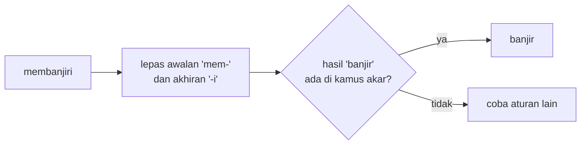

# Stemming dengan Sastrawi dan Lemmatization

!!! abstract "Info materi"
    **Tingkat kesulitan:** Menengah. **Estimasi waktu:** 90–120 menit.
    **Jenis kode:** snippet edukatif (`examples/level-2-preprocessing/07_stemming.py`).

## Tujuan pembelajaran

- [ ] Menjelaskan imbuhan dalam bahasa Indonesia (awalan, akhiran, sisipan, konfiks) dan mengapa stemming sulit.
- [ ] Menjalankan stemmer Sastrawi dan menafsirkan hasilnya.
- [ ] Mengidentifikasi *over-stemming* dan *under-stemming* dari contoh nyata.
- [ ] Membedakan stemming dan lemmatization.
- [ ] Memutuskan secara empiris apakah stemming dipakai.

## Prasyarat

- [Stopwords dan Keterbatasannya](stopwords.md).
- [Import dan Modul](../level-1-python/import-modul.md) (Level 1).

## Pengantar dan motivasi

Bahasa Indonesia memiliki banyak imbuhan: `banjir` → `kebanjiran`, `membanjiri`;
`ungsi` → `mengungsi`, `pengungsi`, `pengungsian`. Bagi komputer, tiap bentuk
adalah kata berbeda. **Stemming** memotong imbuhan untuk mendapatkan kata dasar
sehingga bentuk-bentuk itu menyatu. Sebagai imbalannya, stemming membuat
kesalahan, dan beberapa kesalahan menggabungkan kata yang artinya berbeda.

## Konsep dasar

| Istilah | Arti | Contoh |
|---|---|---|
| **Imbuhan** | Tambahan pada kata dasar | `me-`, `ke-an`, `-kan`, `pe-an` |
| **Kata dasar** (*root*) | Bentuk tanpa imbuhan | `banjir`, `ungsi` |
| **Stemming** | Memotong imbuhan dengan aturan; hasil belum tentu kata baku | `memadamkan` → `madam` |
| **Lemmatization** | Mengembalikan kata ke bentuk kamus (lemma) dengan memperhatikan tata bahasa | contoh bahasa Inggris: `ran` → `run` |

## Penjelasan mendalam

### Cara kerja Sastrawi

Sastrawi adalah stemmer bahasa Indonesia berbasis aturan yang menerapkan
algoritma *confix stripping* (Nazief dan Adriani, dikembangkan oleh Adriani dan
kolega). Prinsipnya: lepas imbuhan sesuai urutan aturan, lalu **periksa
hasilnya terhadap kamus kata dasar**. Jika hasilnya ada di kamus, berhenti.
Jika tidak, coba aturan lain. Kamus akar inilah yang membuatnya lebih baik
daripada memotong imbuhan membabi buta.

Versi Python dikemas sebagai paket `PySastrawi` (diimpor sebagai `Sastrawi`)
dengan lisensi MIT; kamus akarnya berasal dari Kateglo dengan lisensi
CC-BY-NC-SA 3.0 (periksa syarat lisensi ini bila Anda mendistribusikan ulang
kamusnya).

!!! info "Catatan versi"
    Tes dijalankan dengan Sastrawi 1.0.1 pada Python 3.14. Pada versi Python ini
    Sastrawi menampilkan `DeprecationWarning` karena memanggil `re.sub` dengan
    argumen `count` posisional. Peringatan itu berasal dari pustaka dan tidak
    memengaruhi hasil. Berkas `examples/pytest.ini` menyaringnya agar
    keluaran tes bersih.

### Kesalahan stemming

- **Over-stemming:** dua kata berbeda menjadi satu bentuk. Contoh pada hasil
  Bagian 2: `memadamkan` dan `pemadam` menjadi `madam`, padahal akarnya `padam`.
  Hasilnya bahkan menyerupai kata lain (`madam`).
- **Under-stemming:** kata yang sebenarnya satu akar tidak menyatu karena
  aturan tidak mengenali imbuhannya.
- **Bentuk satu akar tidak bertemu:** `padam` tetap `padam`, tetapi `memadamkan` menjadi `madam`. Dua bentuk dari akar yang sama berakhir di tempat berbeda.

### Stemming versus lemmatization

*Lemmatization* menghasilkan bentuk kamus yang sah. Pada bahasa dengan
perubahan bentuk tidak beraturan (Inggris: `ran`, `better`), lemmatizer
memerlukan kamus dan tata bahasa. Pada bahasa Indonesia, pembentukan kata
sebagian besar berupa imbuhan sehingga stemming berbasis kamus akar sudah
mirip lemmatization, tetapi **hasil stemmer tidak dijamin bentuk kamus**:
`pengungsian` → `ungsi`, `anggaran` → `anggar`. Paket ini tidak menyertakan
lemmatizer Indonesia; Bagian 5 hanya membandingkan hasil stemmer dengan contoh
bentuk kamus pilihan penulis untuk menjelaskan konsepnya.

## Cara kerja atau alur proses



## Contoh sederhana

`kebanjiran`, `membanjiri`, dan `banjir` → semuanya `banjir`. Tiga fitur menyatu
menjadi satu.

## Contoh dalam konteks Twitter/X kebencanaan

Postingan sintetis: "Warga mengungsi karena rumah kebanjiran." Setelah
stemming: `warga ungsi karena rumah banjir`. Bentuk `mengungsi`, `pengungsi`,
`pengungsian`, dan `ungsi` tidak lagi dianggap kata berbeda.

## Praktik Python

Berkas: `examples/level-2-preprocessing/07_stemming.py`. Fungsi `stem_kata`
membuat stemmer sekali (dengan `lru_cache`) dan menyimpan hasil per kata, karena
stemming relatif lambat.

### Bagian 1 — Kasus yang berhasil

```python title="Bagian 1"
--8<-- "level-2-preprocessing/07_stemming.py:dasar"
```

`f"{kata:12}"` memformat string dengan lebar 12 karakter agar kolom rapi.

```text title="Output nyata"
banjir       -> banjir
kebanjiran   -> banjir
membanjiri   -> banjir
mengungsi    -> ungsi
pengungsi    -> ungsi
pengungsian  -> ungsi
```

Interpretasi: enam bentuk menyatu menjadi dua akar. Ini manfaat stemming.

### Bagian 2 — Kasus yang bermasalah

```python title="Bagian 2"
--8<-- "level-2-preprocessing/07_stemming.py:masalah"
```

```text title="Output nyata"
memadamkan   -> madam
pemadam      -> madam
padam        -> padam
kebakaran    -> bakar
pembakaran   -> bakar
terbakar     -> bakar
korban       -> korban
bantuan      -> bantu
terjebak     -> jebak
```

Interpretasi:

- `memadamkan` dan `pemadam` menjadi `madam` bukan `padam`: **over-stemming**.
- `kebakaran` (peristiwa kebakaran), `pembakaran` (tindakan membakar, termasuk pembakaran sengaja), dan `terbakar` semuanya menjadi `bakar`. Pembedaan antara peristiwa dan tindakan hilang.
- `korban` dan `bantuan` berhasil dengan baik atau berubah menjadi kata dasar yang masih bermakna.

### Bagian 3 — Kata yang berbeda menyatu

```python title="Bagian 3"
--8<-- "level-2-preprocessing/07_stemming.py:kolaps"
```

`defaultdict(set)` adalah dictionary yang otomatis membuat himpunan kosong untuk kunci baru; kita mengelompokkan kata berdasarkan hasil stem-nya.

```text title="Output nyata"
bakar <- ['bakar', 'kebakaran', 'membakar', 'pembakaran', 'terbakar']
madam <- ['madam', 'memadamkan', 'pemadam']
padam <- ['padam']
```

Interpretasi: kelompok `madam` memuat kata `madam` (kata lain yang sah) dengan
`memadamkan` dan `pemadam`, sedangkan `padam` terpisah. Menyatukan `memadamkan`
dengan `padam` seharusnya terjadi, tetapi tidak. **Cara memeriksa stemmer:**
kelompokkan kata berdasarkan hasil stem dan baca kelompoknya dengan mata
manusia.

### Bagian 4 — Dampak pada kosakata dataset

```python title="Bagian 4"
--8<-- "level-2-preprocessing/07_stemming.py:korpus"
```

```text title="Output nyata"
tipe tanpa stem: 596
tipe dengan stem: 537
pasangan unik yang berubah: 166
[('anak-anak', 'anak'), ('anggaran', 'anggar'), ('antrean', 'antre'), ('aturan', 'atur'), ('bangunan', 'bangun'), ('bantuan', 'bantu'), ('belasan', 'bas'), ('bergerak', 'gerak')]
```

Interpretasi: stemming menurunkan tipe dari 596 menjadi 537 (59 tipe, sekitar
10%). Delapan contoh pertama menunjukkan manfaat dan masalah sekaligus:

- `bantuan` → `bantu`, `bergerak` → `gerak`, `aturan` → `atur`: wajar.
- `anak-anak` → `anak`: kata ulang disatukan dengan kata dasarnya, bisa diinginkan atau tidak.
- `bangunan` → `bangun`: "bangunan (gedung)" dan "bangun (terjaga)" menjadi satu bentuk.
- `anggaran` → `anggar`: akar yang berbeda artinya.
- `belasan` → `bas`: hasil yang tidak mengandung makna lagi.

### Bagian 5 — Stem versus bentuk kamus

```python title="Bagian 5"
--8<-- "level-2-preprocessing/07_stemming.py:lemma"
```

`LEMMA_CONTOH` adalah kamus kecil pilihan penulis, **bukan** keluaran lemmatizer
atau KBBI. Ia hanya menggambarkan perbedaan konsep.

```text title="Output nyata"
memadamkan   stem=madam      lemma_contoh=padam
pemadam      stem=madam      lemma_contoh=pemadam
kebakaran    stem=bakar      lemma_contoh=kebakaran
pengungsian  stem=ungsi      lemma_contoh=pengungsian
```

Interpretasi: stemmer memotong sedalam mungkin; sebuah lemmatizer
(bila ada) akan mempertahankan bentuk turunan yang berdiri sebagai entri kamus
(`kebakaran`) dan membenahi `memadamkan` ke `padam`. Perbedaannya adalah
tingkat pemotongan dan kepatuhan pada kamus.

### Skrip terpadu

Fungsi `stem_kata` dan `stem_token` ada di `examples/nlp_hub/preprocessing.py`.
`stem_token` melewati token khusus (`tok_url`, `emo_doa`) dan mempertahankan
awalan `neg_` (lihat [Negasi](negasi.md)). Tes: `test_stem_kata`,
`test_stem_token_menjaga_token_khusus`.

## Kesalahan umum dan debugging

| Gejala | Penyebab | Perbaikan |
|---|---|---|
| Proses sangat lambat | Stemmer dibuat ulang untuk setiap kata | Buat sekali dan simpan hasil (`lru_cache`) |
| Kata berbeda menyatu (`bangunan`/`bangun`) | Over-stemming | Kelompokkan hasil stem dan periksa; bila perlu tambahkan pengecualian |
| Token penanda ikut di-stem (`tok_url` berubah) | Stemmer dipanggil pada token buatan | Lewati token berawalan `tok_`/`emo_` |
| Stemming dijalankan sebelum normalisasi | `tlg` tidak dikenal | Normalisasi dahulu |
| `DeprecationWarning` dari Sastrawi | Versi Python baru | Abaikan atau saring; bukan galat kode Anda |

## Kelebihan dan keterbatasan

**Kelebihan:** menyatukan bentuk turunan; mengurangi kosakata (596 → 537 di sini);
berjalan tanpa data berlabel.
**Keterbatasan:** menghilangkan perbedaan makna; salah pada kata tertentu; lambat
dibandingkan langkah lain; tidak otomatis meningkatkan akurasi. Pada model
yang memakai tokenizer subkata (Level 6), stemming biasanya tidak diperlukan.

## Latihan bertahap

1. **Konseptual.** Mengapa stemming membantu klasifikasi pada data berukuran kecil?
2. **Membaca kode.** Berapa tipe yang hilang akibat stemming pada dataset (Bagian 4)? Berapa persen?
3. **Debugging.** `stem_kata("memadamkan")` menghasilkan `madam`. Tulis fungsi pembungkus yang memperbaikinya untuk `memadamkan` dan `pemadam`.
4. **Analisis.** Mengapa menyatukan `kebakaran` dan `pembakaran` menjadi `bakar` bisa merugikan tugas Emergency/Non-Emergency?
5. **Mini-proyek.** Pilih 30 kata dari dataset, jalankan `stem_kata`, dan tandai hasil yang menurut Anda salah. Hitung persentasenya.

## Kunci jawaban dan pembahasan

??? success "Jawaban 1"
    Pada data kecil, tiap bentuk kata hanya muncul sedikit kali. Menyatukan bentuk turunan mengumpulkan bukti pada satu fitur sehingga bobot lebih stabil.

??? success "Jawaban 2"
    596 − 537 = 59 tipe, sekitar 9,9%. (Dihitung dari keluaran Bagian 4.)

??? success "Jawaban 3"
    ```python
    KOREKSI = {"memadamkan": "padam", "pemadam": "padam"}

    def stem_aman(kata):
        return KOREKSI.get(kata, stem_kata(kata))
    ```
    Hasil yang dijalankan untuk `memadamkan`, `pemadam`, `kebakaran`, `bangunan`: `padam`, `padam`, `bakar`, `bangun`. Pembahasan: pengecualian ditaruh sebelum stemmer. Tidak ada cara otomatis mengetahui daftar pengecualian; ia berasal dari audit data seperti Bagian 3.

??? success "Jawaban 4"
    `kebakaran` biasanya melaporkan peristiwa, sedangkan `pembakaran` sering menyangkut tindakan sengaja atau topik lain (misalnya pembakaran sampah, kasus hukum). Jika dua istilah itu berkorelasi dengan label yang berbeda, penyatuan menghapus sinyal pembeda. Apakah ini terjadi pada data Anda harus diperiksa dengan data.

??? success "Jawaban 5"
    Tidak ada jawaban tunggal. Contoh kerangka: simpan 30 pasangan (kata, stem), tandai salah bila akar yang diharapkan berbeda, hitung `jumlah salah / 30`. Laporkan juga bahwa itu penilaian satu orang pada sampel kecil, bukan evaluasi stemmer yang sah.

## Kuis singkat

**1.** Apa risiko stemming pada kata `bangunan`?

??? success "Jawaban"
    Menjadi `bangun`, sehingga "gedung" dan "terjaga" tidak terbedakan.

**2.** Mengapa `stem_kata` memakai cache?

??? success "Jawaban"
    Stemming lambat, dan kata yang sama muncul berulang kali; hasil yang disimpan menghindari perhitungan ulang.

**3.** Apa beda stemming dan lemmatization?

??? success "Jawaban"
    Stemming memotong imbuhan dengan aturan dan hasilnya belum tentu kata baku; lemmatization mengembalikan bentuk kamus dengan memperhatikan tata bahasa.

## Ringkasan

- Stemming memotong imbuhan agar bentuk turunan menyatu: 596 → 537 tipe pada dataset ini.
- Sastrawi memakai kamus akar tetapi tetap membuat kesalahan (`memadamkan` → `madam`, `belasan` → `bas`).
- Stem bukan lemma; hasilnya tidak selalu kata baku.
- Apakah stemming dipakai ditentukan eksperimen.

## Glosarium istilah baru

Stemming
:   Memotong imbuhan sehingga bentuk turunan menyatu pada bentuk dasar.

Lemmatization
:   Mengembalikan kata ke bentuk kamus (lemma) dengan memperhatikan tata bahasa.

Kata dasar (*root*)
:   Bentuk kata tanpa imbuhan.

Over-stemming
:   Kata yang berbeda arti menyatu pada satu bentuk.

Under-stemming
:   Kata yang seharusnya menyatu tidak menyatu.

Confix stripping
:   Pendekatan stemming yang melepas awalan dan akhiran bersama (konfiks).

## Referensi

- Adriani, M., Asian, J., Nazief, B., Tahaghoghi, S. M. M., & Williams, H. E. (2007). Stemming Indonesian: A confix-stripping approach. *ACM Transactions on Asian Language Information Processing*, 6(4). (makalah akademik; algoritma yang melandasi Sastrawi)
- PySastrawi: <https://github.com/har07/PySastrawi> (dokumentasi pustaka; kode dan lisensi).

## Materi berikutnya

[Negasi](negasi.md)
