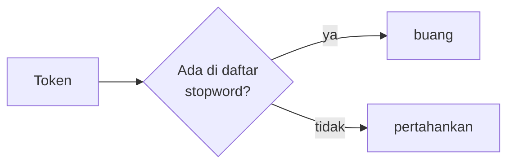

# Stopwords dan Keterbatasannya

!!! abstract "Info materi"
    **Tingkat kesulitan:** Pemula–menengah. **Estimasi waktu:** 60–90 menit.
    **Jenis kode:** snippet edukatif (`examples/level-2-preprocessing/06_stopwords.py`).

## Tujuan pembelajaran

- [ ] Menjelaskan apa itu stopword dan alasan tradisional membuangnya.
- [ ] Menunjukkan bahwa daftar stopword bawaan dapat membuang kata yang menentukan label.
- [ ] Menyusun daftar stopword konservatif untuk tugas Emergency/Non-Emergency.
- [ ] Memeriksa frekuensi kata per kelas sebelum membuangnya.

## Prasyarat

- [Token, Kalimat, dan Tokenisasi Kata](token-kalimat-tokenisasi.md).
- [Normalisasi Bahasa Informal](normalisasi-informal.md).

## Pengantar dan motivasi

*Stopword* adalah kata yang sangat sering muncul dan dianggap tidak membawa
makna topik: `yang`, `di`, `dan`, `itu`. Anggapan tradisional: membuangnya
mengurangi kosakata dan fokus pada kata isi. Anggapan itu muncul dari
pencarian dokumen (mencari topik), bukan dari klasifikasi tingkat urgensi,
tempat kata kecil seperti `tidak`, `belum`, dan `tolong` justru menentukan.

## Konsep dasar

| Istilah | Arti |
|---|---|
| **Stopword** | Kata umum yang dibuang saat preprocessing |
| **Daftar stopword** | Himpunan kata yang dibuang; bisa bawaan pustaka atau buatan sendiri |
| **Stopword konservatif** | Daftar pendek yang hanya berisi kata fungsi yang aman dibuang |

## Penjelasan mendalam

### Mengapa kata umum dibuang

1. Mengurangi dimensi fitur.
2. Kata umum muncul di hampir semua dokumen sehingga kurang membedakan kelas.

### Mengapa itu tidak selalu benar

Argumen kedua hanya berlaku bila kata itu muncul dengan **proporsi yang sama**
di semua kelas. Anda tidak boleh mengandalkan asumsi; periksa. Bagian 4 di
bawah menunjukkan bahwa pada dataset sintetis ini `di` muncul pada 148 dari
191 teks Emergency (77%) tetapi hanya 103 dari 373 teks Non-Emergency (28%).
Penyebabnya adalah templat kalimat laporan yang menyebut lokasi ("... di
Jl. Melati ..."). Ini artefak data sintetis, tetapi mengajarkan prinsip yang
benar: sebuah kata fungsi dapat membawa sinyal kelas.

### Daftar bawaan Sastrawi

Sastrawi menyediakan daftar bahasa Indonesia (123 kata unik pada versi 1.0.1
yang dipakai). Daftar itu dirancang untuk pencarian dan dokumen umum.
Pada pengujian, daftar itu memuat `tidak`, `belum`, `tolong`, `kami`, `ada`,
`masih`, dan `sudah`.

### Negasi dan permintaan tidak boleh hilang

- `Ada korban jiwa` dan `Tidak ada korban jiwa` bermakna berlawanan. Jika `tidak` dan `ada` dibuang, keduanya identik.
- `tolong` adalah salah satu penanda permintaan bantuan yang paling jelas.
- `kami` (kata ganti orang pertama jamak) sering menandai laporan dari pelaku langsung ("rumah kami terendam").

### Daftar konservatif

Daftar di `nlp_hub/kamus.py` (`STOPWORDS_KONSERVATIF`, 29 kata) hanya memuat kata
fungsi seperti `yang`, `di`, `ke`, `dari`, `dan`, `atau`, dan partikel
percakapan (`sih`, `dong`, `deh`). Ia sengaja tidak memuat negasi, kata
permintaan, kata ganti orang, dan kata keterangan waktu/keadaan.

!!! warning "Namun `di` ada di daftar konservatif"
    Perhatikan paradoksnya: `di` termasuk daftar konservatif tetapi pada data
    ini cukup informatif. Daftar "konservatif" bukan jaminan aman; ia hanya
    lebih aman daripada daftar bawaan. Satu-satunya cara memutuskan adalah
    eksperimen, yang kita lakukan di halaman
    [Perbandingan Pipeline](perbandingan-pipeline.md).

## Cara kerja atau alur proses



Stopword dihapus **setelah** tokenisasi dan normalisasi (agar `yg` sudah menjadi
`yang` sebelum dicocokkan), dan **sebelum** stemming.

## Contoh sederhana

`"tolong air yang tidak surut di rumah"` dengan daftar konservatif menjadi
`"tolong air tidak surut rumah"`; dengan daftar bawaan Sastrawi menjadi
`"air surut rumah"`, dan makna "tidak surut" berubah menjadi "surut".

## Contoh dalam konteks Twitter/X kebencanaan

| Teks (sintetis) | Daftar Sastrawi | Daftar konservatif |
|---|---|---|
| `Ada korban jiwa` | `korban jiwa` | `ada korban jiwa` |
| `Tidak ada korban jiwa` | `korban jiwa` | `tidak ada korban jiwa` |

Pada daftar Sastrawi, dua teks yang bermakna berlawanan menjadi identik.

## Praktik Python

Berkas: `examples/level-2-preprocessing/06_stopwords.py`.

### Bagian 1 — Isi daftar

```python title="Bagian 1"
--8<-- "level-2-preprocessing/06_stopwords.py:daftar"
```

`stopwords_sastrawi()` mengembalikan `frozenset` (himpunan yang tidak dapat diubah). `[k for k in penting if k in sastrawi]` menyaring kata penting yang ada di daftar.

```text title="Output nyata"
123 29
di Sastrawi  : ['tidak', 'belum', 'tolong', 'kami', 'ada', 'masih', 'sudah']
di konservatif: []
```

Interpretasi: tujuh dari dua belas kata penting ada di daftar Sastrawi; tidak
satu pun ada di daftar konservatif.

### Bagian 2 — Dampak pada makna

```python title="Bagian 2"
--8<-- "level-2-preprocessing/06_stopwords.py:efek"
```

```text title="Output nyata"
'Tolong, air belum surut dan listrik tidak ada'
  sastrawi   : air surut listrik
  konservatif: tolong air belum surut listrik tidak ada
'Ada korban jiwa'
  sastrawi   : korban jiwa
  konservatif: ada korban jiwa
'Tidak ada korban jiwa'
  sastrawi   : korban jiwa
  konservatif: tidak ada korban jiwa
```

Interpretasi: dengan Sastrawi, kalimat pertama kehilangan `tolong`, `belum`,
`tidak`; makna "air belum surut" menjadi "air surut". Teks kedua dan ketiga
menjadi sama persis. **Cara memeriksa:** bandingkan hasil untuk pasangan teks yang
maknanya berlawanan. Jika hasilnya identik, ada informasi penting yang hilang.

### Bagian 3 — Kata paling sering

```python title="Bagian 3"
--8<-- "level-2-preprocessing/06_stopwords.py:frekuensi"
```

`set(praproses_token(t))` menghitung kata unik per dokumen; `Counter` menghitung jumlah dokumen yang memuat tiap kata (*document frequency*). `most_common(12)` mengambil dua belas teratas.

```text title="Output nyata"
di          251 dokumen  sastrawi=True  konservatif=True
kelurahan   148 dokumen  sastrawi=False  konservatif=False
jalan       131 dokumen  sastrawi=False  konservatif=False
rt          128 dokumen  sastrawi=False  konservatif=False
dan         127 dokumen  sastrawi=True  konservatif=True
tok_url      80 dokumen  sastrawi=False  konservatif=False
tok_mention   79 dokumen  sastrawi=False  konservatif=False
tolong       77 dokumen  sastrawi=True  konservatif=False
rumah        77 dokumen  sastrawi=False  konservatif=False
bencana      73 dokumen  sastrawi=False  konservatif=False
ada          72 dokumen  sastrawi=True  konservatif=False
gempa        70 dokumen  sastrawi=False  konservatif=False
```

Interpretasi: kata paling sering di data ini bukan hanya kata fungsi. `kelurahan`,
`jalan`, dan `rt` sering muncul karena templat alamat. Frekuensi tinggi saja
bukan alasan membuang kata. Pendekatan "buang kata paling sering" (stopword
berbasis data) akan membuang `kelurahan` dan `jalan`, apakah itu diinginkan
perlu diuji.

### Bagian 4 — Sebaran per kelas

```python title="Bagian 4"
--8<-- "level-2-preprocessing/06_stopwords.py:per_kelas"
```

Untuk tiap kata, `zip` menjumlahkan dokumen Emergency (`e`) dan Non-Emergency (`n`) yang memuatnya.

```text title="Output nyata"
tolong   Emergency= 27/191  Non-Emergency= 50/373
yang     Emergency= 23/191  Non-Emergency= 38/373
di       Emergency=148/191  Non-Emergency=103/373
tidak    Emergency=  5/191  Non-Emergency= 15/373
air      Emergency= 25/191  Non-Emergency=  9/373
```

Interpretasi (hanya untuk dataset sintetis ini):

- `tolong`: 14% pada Emergency dan 13% pada Non-Emergency. Hampir sama, karena dataset memuat banyak teks Non-Emergency berisi "tolong" (pancingan seperti "Tolong follow akun saya"). Ini sesuai pesan CLAUDE.md: kata kunci bukan definisi.
- `di`: 77% versus 28%. Kata fungsi yang sangat membedakan kelas.
- `air`: 13% versus 2%. Kata isi yang membedakan.

Angka ini berasal dari data sintetis yang dibuat dengan templat dan tidak
boleh digeneralisasi.

### Skrip terpadu

Fungsi `hapus_stopword` dan `stopwords_sastrawi` ada di
`examples/nlp_hub/preprocessing.py`, dan opsi `stopword="sastrawi"` atau
`True` pada `KonfigurasiPraproses`. Tes yang menjaga perilaku ini:
`test_stopword_sastrawi_memuat_kata_yang_berbahaya_untuk_tugas_ini`.

## Kesalahan umum dan debugging

| Gejala | Penyebab | Perbaikan |
|---|---|---|
| Teks bermakna berlawanan menjadi identik | Negasi ikut dibuang | Keluarkan negasi dari daftar |
| Recall Emergency turun setelah stopword dibuang | Kata seperti `tolong`, `kami` ikut dibuang | Bandingkan kata yang dibuang per kelas |
| Daftar stopword dari bahasa Inggris dipakai pada teks Indonesia | Salah pilih daftar | Pakai daftar bahasa yang tepat |
| Stopword dibuang sebelum normalisasi | `yg` tidak cocok dengan `yang` | Normalisasi dahulu |
| Daftar disusun dari frekuensi **seluruh** data, termasuk uji | Kebocoran data | Hitung frekuensi hanya pada data latih |

## Kelebihan dan keterbatasan

**Kelebihan:** mengurangi dimensi; mempercepat latihan; mudah dipahami.
**Keterbatasan:** keputusan "kata ini tidak penting" bergantung tugas; daftar
bawaan dibuat untuk tujuan lain; pada pengklasifikasi modern berbasis
transformer, stopword biasanya dibiarkan karena konteks dipelajari model.

## Latihan bertahap

1. **Konseptual.** Mengapa `tidak` berbahaya jika dibuang pada tugas Emergency/Non-Emergency?
2. **Membaca kode.** Dari dua belas kata di variabel `penting`, berapa yang ada di daftar Sastrawi?
3. **Membaca kode.** Hasil `praproses("Tidak ada korban jiwa", KonfigurasiPraproses(stopword="sastrawi"))`?
4. **Pemrograman kecil.** Tulis `kata_terbuang(teks, stopwords)` yang mengembalikan daftar token yang akan dibuang. Uji pada `"Tolong, air belum surut dan listrik tidak ada"` dengan daftar Sastrawi.
5. **Tantangan.** Anda ingin menyusun stopword dari kata yang paling sering. Jelaskan dua risiko, termasuk satu risiko kebocoran data.

## Kunci jawaban dan pembahasan

??? success "Jawaban 1"
    `tidak` membalik makna ("tidak ada korban" versus "ada korban"). Membuangnya membuat kedua kalimat tampak sama bagi model, padahal labelnya bisa berbeda.

??? success "Jawaban 2"
    7: `tidak`, `belum`, `tolong`, `kami`, `ada`, `masih`, `sudah` (sesuai output Bagian 1).

??? success "Jawaban 3"
    `korban jiwa`. `tidak` dan `ada` keduanya ada di daftar Sastrawi, sehingga hasilnya sama dengan `Ada korban jiwa`.

??? success "Jawaban 4"
    ```python
    from nlp_hub.preprocessing import praproses_token, stopwords_sastrawi

    def kata_terbuang(teks, stopwords):
        return [t for t in praproses_token(teks) if t in stopwords]

    print(kata_terbuang("Tolong, air belum surut dan listrik tidak ada", stopwords_sastrawi()))
    ```
    Hasil yang dijalankan: `['tolong', 'belum', 'dan', 'tidak', 'ada']`. Pembahasan: mencetak kata yang dibuang adalah cara cepat mengaudit daftar stopword.

??? success "Jawaban 5"
    Risiko 1: kata yang sering belum tentu tidak informatif (di data ini `di` dan `kelurahan` sering dan berkaitan dengan kelas). Risiko 2 (kebocoran): bila frekuensi dihitung dari seluruh data termasuk data uji, daftar stopword mengandung informasi data uji. Hitung hanya dari data latih, dan lakukan di dalam pipeline (lihat [Data Leakage akibat Preprocessing](leakage-preprocessing.md)).

## Kuis singkat

**1.** Apakah semua stopword aman dibuang?

??? success "Jawaban"
    Tidak. Kata seperti `tidak`, `belum`, dan `tolong` ada di daftar bawaan Sastrawi tetapi penting untuk tugas ini.

**2.** Mengapa stopword dibuang setelah normalisasi?

??? success "Jawaban"
    Agar bentuk informal (`yg`) sudah menjadi bentuk baku (`yang`) saat dicocokkan dengan daftar.

**3.** Bolehkah daftar stopword dihitung dari seluruh dataset?

??? success "Jawaban"
    Tidak jika menyertakan data uji; itu kebocoran. Hitung dari data latih saja.

## Ringkasan

- Stopword adalah kata umum yang sering dibuang, tetapi manfaatnya bergantung tugas.
- Daftar bawaan Sastrawi (123 kata unik) memuat `tidak`, `belum`, `tolong`, dan `kami`.
- Membuang negasi dapat membuat dua teks berlawanan tampak identik.
- Periksa sebaran kata per kelas sebelum membuangnya.

## Glosarium istilah baru

Stopword
:   Kata yang sangat sering muncul dan dibuang pada tahap preprocessing.

Document frequency (DF)
:   Jumlah dokumen yang memuat suatu kata minimal sekali.

Frozenset
:   Himpunan Python yang tidak dapat diubah setelah dibuat.

## Referensi

- PySastrawi (port Python dari Sastrawi, lisensi MIT): <https://github.com/har07/PySastrawi> (kode dan dokumentasi pustaka).
- Dokumentasi Python, `collections.Counter`: <https://docs.python.org/3/library/collections.html#collections.Counter>.

## Materi berikutnya

[Stemming dan Lemmatization](stemming-lemmatization.md)
