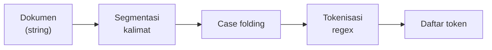

# Token, Kalimat, dan Tokenisasi Kata

!!! abstract "Info materi"
    **Tingkat kesulitan:** Pemula. **Estimasi waktu:** 75–100 menit.
    **Jenis kode:** snippet edukatif (`examples/level-2-preprocessing/02_tokenisasi.py`) dan fungsi siap pakai di `nlp_hub.preprocessing`.

## Tujuan pembelajaran

- [ ] Membedakan dokumen, kalimat, kata, token, dan tipe token.
- [ ] Menjelaskan mengapa `str.split()` tidak cukup untuk tokenisasi.
- [ ] Menulis tokenizer berbasis *regular expression* yang menjaga kata ulang berhubung (`hati-hati`).
- [ ] Memecah teks menjadi kalimat dan menjelaskan kapan aturan sederhana gagal.

## Prasyarat

- [Karakter, Unicode, dan Encoding UTF-8](karakter-unicode-encoding.md).
- [Dasar Regex dengan `re`](../level-1-python/regex-dasar.md) (Level 1).
- [List, Tuple, Set, dan Dictionary](../level-1-python/list-tuple-set-dict.md) (Level 1).

## Pengantar dan motivasi

Model tidak membaca kalimat utuh; ia bekerja pada satuan-satuan kecil. Mengubah
teks menjadi satuan-satuan itu disebut **tokenisasi**. Jika tokenisasi
mengacaukan `tolong!` menjadi satu satuan yang berbeda dari `tolong`, model
menganggap keduanya dua kata berbeda dan harus belajar dua kali dari data
yang sama. Pada data kebencanaan yang jumlahnya sedikit, pemborosan seperti ini
berarti kehilangan sinyal tentang kata yang sangat penting.

## Konsep dasar

| Istilah | Arti | Contoh pada `Banjir di Jl. Melati, tolong!` |
|---|---|---|
| **Dokumen** | Satu unit teks yang diklasifikasikan. Pada proyek ini: satu postingan | Seluruh kalimat |
| **Kalimat** | Rangkaian kata yang diakhiri tanda akhir kalimat | Satu kalimat |
| **Kata** | Satuan bermakna yang dipisah spasi dalam penulisan biasa | `Banjir`, `tolong` |
| **Token** | Satuan hasil tokenisasi; bisa kata, angka, tanda baca, atau potongan kata | `banjir`, `jl`, `melati` |
| **Tipe (*type*)** | Token yang berbeda; jumlah tipe = ukuran kosakata | `rumah` dan `rumah-rumah` dua tipe |

Perbedaan token dan tipe penting: kalimat "warga mengungsi, warga terendam"
memiliki 4 token tetapi 3 tipe (`warga` muncul dua kali).

## Penjelasan mendalam

### Mengapa `split()` tidak cukup

`teks.split()` hanya memecah pada spasi. Tanda baca menempel pada kata:
`Melati,`, `tolong!`, `naik.`. Akibatnya `tolong!` dan `tolong` menjadi dua
token berbeda. Menghapus tanda baca sebelum `split()` memperbaiki masalah itu,
tetapi merusak token seperti `hati-hati` dan angka seperti `4,1`.

### Tokenizer berbasis regex

Pendekatan pada paket ini: setelah teks diubah menjadi huruf kecil, ambil
semua urutan karakter yang berbentuk **huruf/angka/garis bawah**, boleh
disambung tanda hubung di tengah. Pola:

```text
[a-z0-9_]+(?:-[a-z0-9_]+)*
```

- `[a-z0-9_]+` : satu atau lebih huruf kecil, angka, atau garis bawah.
- `(?:-[a-z0-9_]+)*` : nol atau lebih kelompok "tanda hubung diikuti huruf/angka". `(?: ... )` adalah kelompok tanpa menyimpan; `*` berarti boleh berulang.

Pola ini sengaja bergantung pada huruf kecil: ia dipanggil setelah *case
folding* (halaman berikutnya).

!!! warning "Kata ulang dalam bahasa Indonesia"
    Kata ulang seperti `hati-hati` dan `rumah-rumah` ditulis dengan tanda hubung
    dan merupakan **satu kata**. Tokenizer yang menghapus semua tanda hubung
    akan memecahnya menjadi dua token `hati` dan `hati`, mengubah maknanya.

### Segmentasi kalimat

Tanda akhir kalimat (`.`, `!`, `?`) ambigu. Titik juga muncul pada singkatan
(`Jl.`, `No.`, `dr.`), angka desimal, dan URL. Pendekatan sederhana:
1. Lindungi titik pada daftar singkatan umum.
2. Pecah pada `.`, `!`, atau `?` yang **diikuti spasi**.
3. Kembalikan titik yang dilindungi.

Segmenter ini gagal bila kalimat tidak diikuti spasi (`naik.Tolong`), bila
ada singkatan yang tidak ada di daftar, atau bila titik tiga (`...`) muncul di
tengah kalimat.

## Cara kerja atau alur proses



## Contoh sederhana

`"hati-hati banjir"`:

- `split()` → `['hati-hati', 'banjir']` (benar, karena tidak ada tanda baca).
- `"hati-hati".split("-")` → `['hati', 'hati']` (salah untuk kata ulang).
- Tokenizer regex → `['hati-hati', 'banjir']`.

## Contoh dalam konteks Twitter/X kebencanaan

Postingan sintetis: `Banjir di Jl. Melati, tolong! Air hati-hati naik.`
(kalimat ini sengaja dibuat padat untuk menguji tokenizer). Pada pesan darurat,
tanda seru dan tanda tanya sering menempel pada kata kunci seperti `tolong!`
atau `siapa yang bisa bantu?`. Memisahkannya dengan benar menjaga kata kunci
tetap terhitung sebagai satu kata yang sama.

## Praktik Python

Berkas: `examples/level-2-preprocessing/02_tokenisasi.py`. Berkas itu
mengimpor `pisah_kalimat` dan `tokenisasi` dari `nlp_hub.preprocessing`.
Ketiga fungsi ini sudah diuji di `examples/tests/test_preprocessing.py`.

### Bagian 1 — `split()` biasa

```python title="Bagian 1"
--8<-- "level-2-preprocessing/02_tokenisasi.py:split_biasa"
```

`dokumen.split()` memecah pada spasi dan mengembalikan **list** string.

```text title="Output nyata"
['Banjir', 'di', 'Jl.', 'Melati,', 'tolong!', 'Air', 'hati-hati', 'naik.']
```

Interpretasi: `Melati,`, `tolong!`, dan `naik.` membawa tanda baca; huruf
kapital `Banjir` dan `Air` masih terpisah dari `banjir` dan `air`. Hasil ini
belum layak masuk model.

### Bagian 2 — Tokenizer regex

```python title="Bagian 2"
--8<-- "level-2-preprocessing/02_tokenisasi.py:regex"
```

`dokumen.lower()` menjalankan *case folding*, lalu `tokenisasi` menerapkan pola regex di atas.

```text title="Output nyata"
['banjir', 'di', 'jl', 'melati', 'tolong', 'air', 'hati-hati', 'naik']
```

Interpretasi: tanda baca hilang, `hati-hati` utuh. Namun `Jl.` menjadi `jl`,
sehingga informasi bahwa itu singkatan "jalan" ikut hilang; kamus normalisasi
(halaman berikutnya) menangani hal itu. **Cara memeriksa:** bandingkan jumlah
token dengan hitungan manual (8 kata, 8 token).

### Bagian 3 — Token versus tipe

```python title="Bagian 3"
--8<-- "level-2-preprocessing/02_tokenisasi.py:token_vs_tipe"
```

- `[t for d in korpus for t in tokenisasi(d.lower())]` adalah *list comprehension* bersarang: untuk tiap dokumen `d` di `korpus`, ambil setiap token `t`. Ia meratakan dua dokumen menjadi satu daftar.
- `set(semua_token)` membuang duplikat; `len(set(...))` menghitung tipe.

```text title="Output nyata"
['rumah-rumah', 'warga', 'terendam', 'warga', 'mengungsi', 'rumah', 'terendam']
7 5
```

Interpretasi: ada 7 token dan 5 tipe. Perhatikan `rumah-rumah` dan `rumah`
dihitung sebagai dua tipe berbeda; ini keputusan desain, dan pada tugas lain
Anda mungkin ingin memecah kata ulang.

### Bagian 4 — Memecah kalimat dengan `split(".")`

```python title="Bagian 4"
--8<-- "level-2-preprocessing/02_tokenisasi.py:kalimat_naif"
```

```text title="Output nyata"
['Banjir di Jl', ' Melati No', ' 5', ' Air naik! Tolong?']
```

Interpretasi: titik pada `Jl.` dan `No.` dianggap akhir kalimat sehingga satu
kalimat terpecah menjadi tiga potongan, sementara `!` dan `?` diabaikan.

### Bagian 5 — Segmenter dengan perlindungan singkatan

```python title="Bagian 5"
--8<-- "level-2-preprocessing/02_tokenisasi.py:kalimat_aturan"
```

`pisah_kalimat` melindungi singkatan di daftar `SINGKATAN_TITIK`, memecah pada tanda akhir diikuti spasi, lalu mengembalikan titik. `repr(...)` menampilkan tanda kutip supaya spasi di tepi terlihat.

```text title="Output nyata"
'Banjir di Jl. Melati No. 5.'
'Air naik!'
'Tolong?'
```

Interpretasi: tiga kalimat, sesuai harapan.

### Bagian 6 — Ketika aturan gagal

```python title="Bagian 6"
--8<-- "level-2-preprocessing/02_tokenisasi.py:kalimat_gagal"
```

```text title="Output nyata"
['Banjir tinggi.Tolong cepat']
['Lapor ke Sdr.', 'Andi.', 'Air naik']
['tolong banget...', 'air naik terus']
```

Interpretasi tiga kegagalan:

1. `tinggi.Tolong` tanpa spasi tidak dipecah (kalimat kurang).
2. `Sdr.` tidak ada di daftar singkatan sehingga dipecah keliru (kalimat lebih).
3. Titik tiga di tengah kalimat dianggap akhir kalimat.

Tidak ada aturan sederhana yang sempurna. Pilihan praktisnya: perbaiki daftar
singkatan dari data Anda, atau gunakan segmenter statistik. Untuk klasifikasi
**per postingan** (unit analisis proyek ini), segmentasi kalimat sering tidak
dibutuhkan sama sekali.

## Kesalahan umum dan debugging

| Gejala | Penyebab | Perbaikan |
|---|---|---|
| `tolong` dan `tolong!` jadi dua fitur | Tokenisasi hanya dengan `split()` | Pakai tokenizer regex |
| `hati-hati` menjadi `hati` ×2 | Tanda hubung dihapus sebelum tokenisasi | Jaga tanda hubung di antara huruf |
| `Rp50.000` menjadi `rp50` dan `000`; `M4.1` menjadi `m4` dan `1` | Pola hanya memahami huruf/angka | Normalisasi angka sebelum tokenisasi (halaman *Angka, Waktu, dan Lokasi*) |
| Token berisi huruf kapital | Tokenizer dipanggil sebelum *case folding* | Ubah ke huruf kecil dulu |
| Emoji hilang tanpa jejak | Pola tokenizer tidak mencakup emoji | Tangani emoji **sebelum** tokenisasi (halaman *Emoji*) |

## Kelebihan dan keterbatasan

**Tokenizer regex:** sederhana, cepat, dapat diuji, dan mudah disesuaikan.
Keterbatasan: tidak memahami morfologi (`terendam` dan `merendam` tetap dua
token), tidak menangani angka bersimbol atau emoji, dan bergantung pada
daftar singkatan buatan manusia untuk segmentasi kalimat.

Alternatif seperti tokenizer *subword* (dipakai model transformer) memotong kata
menjadi potongan lebih kecil dan tidak memerlukan daftar kata. Itu dibahas di
Level 6.

## Latihan bertahap

1. **Konseptual.** Berapa token dan berapa tipe pada `"tolong, air naik, tolong!!"` jika memakai `nlp_hub.preprocessing.tokenisasi`?
2. **Membaca kode.** Perkirakan `tokenisasi("hati-hati")` dan `"hati-hati".split("-")`.
3. **Debugging.** Mengapa `pisah_kalimat("Dr. Rina melapor. Air naik")` tidak terpecah di `Dr.`? Apa yang harus ditambahkan bila singkatannya `Ny.`?
4. **Pemrograman kecil.** Tulis fungsi `token_per_kalimat(teks)` yang mengembalikan pasangan (kalimat, jumlah token). Uji pada `"Banjir di Jl. Melati No. 5. Air naik! Tolong?"`.
5. **Tantangan.** Ubah `POLA_TOKEN` agar `4,1` dan `50.000` tetap satu token. Apa efek sampingnya?

## Kunci jawaban dan pembahasan

??? success "Jawaban 1"
    4 token dan 3 tipe: `['tolong', 'air', 'naik', 'tolong']`. Tanda koma dan seru tidak menjadi token. Pembahasan: token menghitung kemunculan, tipe menghitung kata unik (`tolong` muncul dua kali). Hasil ini sudah diperiksa dengan menjalankan kodenya.

??? success "Jawaban 2"
    `['hati-hati']` dan `['hati', 'hati']`. Tokenizer regex menjaga tanda hubung di antara huruf, sedangkan `split("-")` memecahnya.

??? success "Jawaban 3"
    `Dr.` sudah ada di `SINGKATAN_TITIK` (huruf besar/kecil diabaikan), sehingga titiknya dilindungi dan hasilnya `['Dr. Rina melapor.', 'Air naik']`. Untuk `Ny.` tambahkan `"ny."` ke `SINGKATAN_TITIK`. Pembahasan: segmenter bergantung pada daftar; singkatan baru harus ditambahkan manual.

??? success "Jawaban 4"
    ```python
    from nlp_hub.preprocessing import pisah_kalimat, tokenisasi

    def token_per_kalimat(teks):
        return [(k, len(tokenisasi(k.lower()))) for k in pisah_kalimat(teks)]
    ```
    Hasil yang dijalankan: `[('Banjir di Jl. Melati No. 5.', 6), ('Air naik!', 2), ('Tolong?', 1)]`. Kalimat pertama berisi enam token: `banjir di jl melati no 5`.

??? success "Jawaban 5"
    Salah satu pilihan: `[a-z0-9_]+(?:[-.,][a-z0-9_]+)*`. Pada percobaan, `4,1` dan `rp50.000` menjadi satu token. Efek samping: `naik.tolong` dan `tolong,air` (tanpa spasi) ikut tergabung menjadi satu token. Anda harus menguji ulang di tes unit sebelum memakainya. Pembahasan: setiap kelonggaran pola membuka kasus salah baru, jadi tulis tes yang mencakup kedua sisi.

## Kuis singkat

**1.** Apa beda token dan tipe?

??? success "Jawaban"
    Token adalah setiap kemunculan; tipe adalah token yang berbeda. "warga warga" punya 2 token tetapi 1 tipe.

**2.** Mengapa `hati-hati` dipertahankan sebagai satu token?

??? success "Jawaban"
    Kata ulang berhubung adalah satu kata dengan makna sendiri; memecahnya menghilangkan makna "waspada".

**3.** Apakah segmentasi kalimat diperlukan untuk klasifikasi satu postingan?

??? success "Jawaban"
    Sering tidak. Unit analisis adalah satu postingan, jadi kalimat hanya perlu dipisah bila fitur dihitung per kalimat.

## Ringkasan

- Dokumen → kalimat → token; tipe adalah token unik.
- `split()` meninggalkan tanda baca; tokenizer regex memperbaikinya.
- Jaga tanda hubung di antara huruf agar kata ulang tetap utuh.
- Segmentasi kalimat berbasis aturan memerlukan daftar singkatan dan tidak pernah sempurna.

## Glosarium istilah baru

Token
:   Satuan hasil tokenisasi, biasanya kata, angka, atau potongan kata.

Tipe (*type*)
:   Token yang unik. Jumlah tipe adalah ukuran kosakata.

Tokenisasi
:   Proses memecah teks menjadi token.

Segmentasi kalimat
:   Proses memecah teks menjadi kalimat.

Kata ulang
:   Kata yang dibentuk dengan pengulangan, ditulis dengan tanda hubung (`hati-hati`).

## Referensi

- Dokumentasi Python, modul `re`: <https://docs.python.org/3/library/re.html> (dokumentasi resmi).

## Materi berikutnya

[Case Folding, Tanda Baca, dan Pembersihan](case-folding-pembersihan.md)
