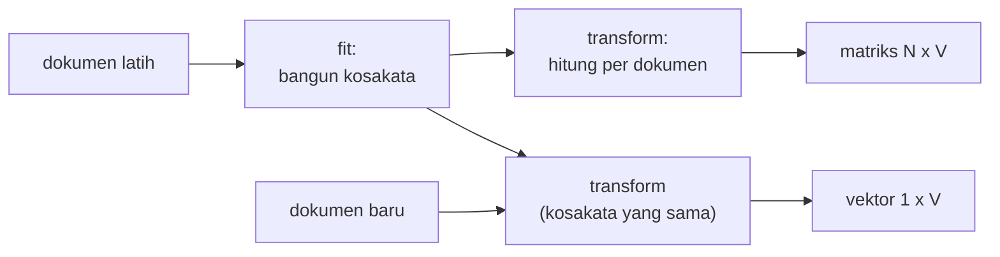

# Bag of Words

!!! abstract "Info materi"
    **Tingkat kesulitan:** Pemula–menengah. **Estimasi waktu:** 90 menit.
    **Jenis kode:** snippet edukatif (`examples/level-3-feature-engineering/03_bag_of_words.py`).

## Tujuan pembelajaran

- [ ] Menjelaskan ide *Bag of Words* (BoW): teks menjadi vektor hitungan kata.
- [ ] Membangun matriks dokumen-term dari beberapa kalimat dengan tangan, lalu dengan `CountVectorizer`.
- [ ] Menjelaskan bahwa BoW membuang urutan kata dan apa akibatnya.
- [ ] Menjelaskan kata di luar kosakata (OOV) dan mengapa kosakata hanya boleh dipelajari dari data latih.

## Prasyarat

- [Statistik Dasar Korpus](statistik-korpus.md) dan [n-gram](n-gram.md).
- [NumPy dasar](../level-1-python/numpy-dasar.md) (Level 1): array dan *shape*.

## Pengantar dan motivasi

Model machine learning bekerja dengan angka, bukan huruf. Kita perlu cara
mengubah setiap teks menjadi daftar angka berukuran tetap. Cara paling
sederhana: **hitung berapa kali tiap kata muncul**. Anggap setiap dokumen
sebuah kantong yang diisi kata-kata; urutan di dalam kantong diabaikan, hanya
isinya yang dihitung. Itulah *bag of words*.

## Konsep dasar

1. **Kosakata:** daftar semua kata unik di korpus latih, masing-masing diberi nomor kolom.
2. **Vektor dokumen:** untuk tiap dokumen, satu angka per kata kosakata: berapa kali kata itu muncul.
3. **Matriks dokumen-term:** tumpukan semua vektor; baris = dokumen, kolom = kata.

Jika ada $N$ dokumen dan kosakata berukuran $V$, matriksnya berukuran $N \times V$.
Elemen $x_{ij}$ adalah jumlah kemunculan kata ke-$j$ pada dokumen ke-$i$.

## Penjelasan mendalam

### Langkah membangun BoW

1. Pecah semua dokumen latih menjadi token (setelah preprocessing).
2. Kumpulkan token unik, urutkan, beri nomor: itulah kosakata.
3. Untuk tiap dokumen, hitung kemunculan tiap kata kosakata.

### Apa yang hilang

- **Urutan kata:** "air naik" dan "naik air" menghasilkan vektor yang sama.
- **Hubungan antarkata:** negasi tidak terkait dengan kata yang dinegasikan.
- **Kata baru:** kata yang tidak ada di kosakata latih (OOV, *out of vocabulary*) diabaikan pada saat transformasi.

### Hitungan versus biner

Pada teks pendek seperti postingan media sosial, sebuah kata hampir selalu
muncul sekali. Jadi hitungan jarang berbeda dari "ada/tidak ada". Opsi
`binary=True` mengubah semua hitungan positif menjadi 1. Pang dkk. (2002),
pada ulasan film, melaporkan bahwa fitur kehadiran (*presence*) dapat sama baik
atau lebih baik daripada frekuensi untuk klasifikasi sentimen. Apakah itu
berlaku pada data Anda harus diuji.

### Kosakata hanya dari data latih

`fit` mempelajari kosakata, `transform` memakainya. Jika `fit` dijalankan pada
seluruh data, kosakata memuat kata yang hanya ada di data uji
(*kebocoran vokabular*; lihat [Data Leakage](../level-2-fondasi-teks/leakage-preprocessing.md)).

## Cara kerja atau alur proses



## Contoh sederhana

Tiga dokumen: `banjir naik air naik`, `tolong air masuk rumah`, `gempa kuat`.

Kosakata (urut abjad): `air`, `banjir`, `gempa`, `kuat`, `masuk`, `naik`, `rumah`, `tolong`.
Vektor dokumen pertama: `air`=1, `banjir`=1, `naik`=2, sisanya 0 → `[1, 1, 0, 0, 0, 2, 0, 0]`.

## Contoh dalam konteks Twitter/X kebencanaan

Pada tiga kalimat di atas, kata `air` ada pada dokumen 1 dan 2. Model dapat
belajar bahwa `tolong` (kolom 8) berhubungan dengan permintaan bantuan. Tetapi
juga ingat bahwa `tolong` ada pada teks Non-Emergency seperti "Tolong follow
akun saya", sehingga satu kolom tidak cukup (halaman *Stopwords* menunjukkan
sebarannya).

## Praktik Python

Berkas: `examples/level-3-feature-engineering/03_bag_of_words.py`.

### Bagian 1 — Matriks dokumen-term kecil

```python title="Bagian 1"
--8<-- "level-3-feature-engineering/03_bag_of_words.py:kecil"
```

- `CountVectorizer()` membuat objek yang belum belajar apa pun.
- `fit_transform(dokumen)` melakukan `fit` (membangun kosakata) lalu `transform` (menghitung) sekaligus, dan mengembalikan **matriks jarang** (*sparse*, lihat halaman berikutnya).
- `get_feature_names_out()` memberi nama kolom; `X.shape` ukuran matriks.
- `X.toarray()` mengubah ke array biasa; `pd.DataFrame(..., columns=...)` memberi nama kolom agar tabel mudah dibaca.

```text title="Output nyata"
['air' 'banjir' 'gempa' 'kuat' 'masuk' 'naik' 'rumah' 'tolong']
(3, 8)
   air  banjir  gempa  kuat  masuk  naik  rumah  tolong
0    1       1      0     0      0     2      0       0
1    1       0      0     0      1     0      1       1
2    0       0      1     1      0     0      0       0
```

Interpretasi: tiga dokumen, delapan kata → matriks 3 × 8. Baris 0 memuat `naik` dua
kali. **Cara memeriksa:** jumlah baris sama dengan jumlah dokumen; jumlah kolom
sama dengan jumlah kata unik.

### Bagian 2 — Hitungan versus biner

```python title="Bagian 2"
--8<-- "level-3-feature-engineering/03_bag_of_words.py:biner"
```

```text title="Output nyata"
[1 1 0 0 0 1 0 0]
[1 1 0 0 0 2 0 0]
```

Interpretasi: baris pertama (biner) hanya menandai ada/tidak ada; kata `naik` menjadi 1.
Baris kedua (hitungan) menyimpan 2.

### Bagian 3 — Kata di luar kosakata

```python title="Bagian 3"
--8<-- "level-3-feature-engineering/03_bag_of_words.py:oov"
```

`cv.transform(baru)` memakai kosakata yang **sudah dipelajari** dari tiga dokumen; ia tidak menambah kata baru. `cv.vocabulary_` adalah kamus kata→nomor kolom.

```text title="Output nyata"
[[0 1 0 0 0 0 1 0]]
['setinggi', 'pinggang', 'di', 'kami']
```

Interpretasi: dari "banjir setinggi pinggang di rumah kami", hanya `banjir` dan
`rumah` (kolom 1 dan 6) yang dikenali. `setinggi`, `pinggang`, `di`, `kami`
diabaikan, termasuk `pinggang` yang sangat informatif. Inilah OOV: model hanya
tahu kata yang dilihat saat pelatihan. Pada kosakata ribuan kata, OOV lebih
jarang tetapi tidak pernah hilang.

### Bagian 4 — Pada dataset: latih dan uji

```python title="Bagian 4"
--8<-- "level-3-feature-engineering/03_bag_of_words.py:dataset"
```

- `bagi_latih_uji` membagi per `event_id` (tidak ada kejadian di kedua bagian).
- `PraprosesTeks().transform(...)` menerapkan preprocessing dasar (tanpa state).
- `vektor.fit_transform(teks_latih)` belajar kosakata dari **latih saja**; `vektor.transform(teks_uji)` memakai kosakata itu.
- `X_latih.nnz` adalah jumlah elemen yang tidak nol; `build_analyzer()` adalah fungsi yang dipakai vektor untuk memecah teks.

```text title="Output nyata"
latih: (452, 582) uji: (112, 582)
elemen tak nol (latih): 5650 kepadatan=2.148%
jumlah kata uji yang tidak ada di kosakata latih: 10
```

Interpretasi: 452 teks latih dan 112 teks uji, keduanya dengan 582 kolom (kosakata
dari latih). Hanya 2,1% elemen matriks yang bukan nol: tiap teks hanya memuat
sekitar 12 dari 582 kata. Sebanyak 10 kata dalam teks uji tidak ada di kosakata
latih; kata-kata itu diabaikan tanpa pesan galat.

### Skrip terpadu

Empat bagian tadi berdiri sendiri; gabungannya ada di berkas
`examples/level-3-feature-engineering/03_bag_of_words.py`. Bentuk siap pakai dengan
preprocessing di dalam pipeline ada di halaman
[Representasi dengan scikit-learn](representasi-sklearn.md).

## Kesalahan umum dan debugging

| Gejala | Penyebab | Perbaikan |
|---|---|---|
| Jumlah kolom matriks uji tidak sama dengan latih | `fit_transform` dipanggil pada data uji | Pakai `transform` pada data uji |
| `ValueError: empty vocabulary` | Semua token terbuang (mis. teks sangat pendek, stopword) | Periksa preprocessing dan `min_df` |
| Kata satu huruf hilang | `CountVectorizer` membuang token 1 karakter secara bawaan | Atur `token_pattern` bila perlu |
| Kata berhuruf besar menjadi fitur berbeda | `lowercase=False` atau pola salah | Biarkan `lowercase=True` (bawaan) atau preprocessing sudah huruf kecil |
| Mengira `toarray()` aman untuk data besar | Matriks padat memakan memori besar | Biarkan tetap sparse |

## Kelebihan dan keterbatasan

**Kelebihan:** sederhana, cepat, dapat ditafsirkan (tiap kolom = satu kata), dan
sering menjadi baseline yang kuat untuk klasifikasi teks.
**Keterbatasan:** tidak ada urutan, tidak ada makna kata (`banjir` dan `genangan` tidak
berhubungan), kata baru diabaikan, dan dimensi besar. Embedding (Level 6) mengatasi
sebagian keterbatasan ini.

## Latihan bertahap

1. **Konseptual.** Mengapa "air naik" dan "naik air" menghasilkan vektor yang sama?
2. **Membaca kode.** Tulis vektor BoW (dengan kosakata Bagian 1) untuk `banjir banjir naik`.
3. **Membaca output.** Mengapa matriks pada Bagian 1 berukuran (3, 8)?
4. **Debugging.** Matriks uji punya 585 kolom sedangkan latih 582. Apa yang kemungkinan salah?
5. **Mini-proyek.** Ubah Bagian 4 memakai `CountVectorizer(binary=True)`. Apakah jumlah elemen tak nol berubah? Jelaskan.

## Kunci jawaban dan pembahasan

??? success "Jawaban 1"
    BoW hanya mencatat kata mana yang ada dan berapa kali, bukan posisinya. Kedua kalimat berisi `air` dan `naik` sekali masing-masing.

??? success "Jawaban 2"
    Urutan kolom: `air, banjir, gempa, kuat, masuk, naik, rumah, tolong`. Vektornya `[0, 2, 0, 0, 0, 1, 0, 0]`. (Dicek dengan kosakata yang sama pada eksekusi Bagian 1.)

??? success "Jawaban 3"
    3 dokumen (baris) dan 8 kata unik (kolom): `air, banjir, gempa, kuat, masuk, naik, rumah, tolong`.

??? success "Jawaban 4"
    Penyebab paling mungkin: `fit` (atau `fit_transform`) dipanggil pada data uji, sehingga kosakata uji berbeda dari latih. Perbaikan: `fit` hanya pada latih, lalu `transform` pada uji, agar kolomnya sama.

??? success "Jawaban 5"
    Tidak berubah. `binary=True` hanya mengganti nilai positif menjadi 1; posisi elemen tak nol sama, sehingga `nnz` sama (5.650). Yang berubah hanya nilainya.

## Kuis singkat

**1.** Apa yang dimaksud OOV?

??? success "Jawaban"
    Kata pada data baru yang tidak ada di kosakata yang dipelajari saat pelatihan; ia diabaikan.

**2.** Mengapa `fit` hanya pada data latih?

??? success "Jawaban"
    Agar kosakata tidak memuat informasi dari data uji (kebocoran vokabular).

**3.** Apa ukuran matriks untuk 452 dokumen dan kosakata 582?

??? success "Jawaban"
    452 × 582.

## Ringkasan

- BoW mengubah teks menjadi vektor hitungan kata dari kosakata yang dipelajari pada data latih.
- Urutan kata dan hubungan antarkata hilang; kata baru diabaikan.
- Pada data ini, matriks latih 452 × 582 dengan kepadatan 2,1%.
- `fit` hanya pada latih; `transform` pada uji.

## Glosarium istilah baru

Bag of Words (BoW)
:   Representasi teks sebagai hitungan kata tanpa urutan.

Matriks dokumen-term
:   Matriks dengan baris dokumen dan kolom kata.

Kosakata (*vocabulary*)
:   Himpunan kata unik yang menjadi kolom matriks.

OOV (*out of vocabulary*)
:   Kata yang tidak ada di kosakata.

Kepadatan (*density*)
:   Proporsi elemen matriks yang bukan nol.

## Referensi

- Pang, B., Lee, L., & Vaithyanathan, S. (2002). Thumbs up? Sentiment classification using machine learning techniques. *Proceedings of EMNLP 2002*, 79–86. <https://aclanthology.org/W02-1011/> (makalah akademik; membandingkan fitur frekuensi dan kehadiran pada tabel hasilnya).
- Dokumentasi scikit-learn, *Text feature extraction*: <https://scikit-learn.org/stable/modules/feature_extraction.html#text-feature-extraction> (dokumentasi resmi).

## Materi berikutnya

[TF-IDF dan Intuisi Matematisnya](tfidf.md)
