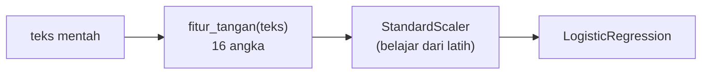

# Feature Engineering untuk Teks Kebencanaan

!!! abstract "Info materi"
    **Tingkat kesulitan:** Menengah–lanjut. **Estimasi waktu:** 120 menit.
    **Jenis kode:** **eksperimen** (`examples/level-3-feature-engineering/06_feature_engineering.py`) dan kode siap pakai (`examples/nlp_hub/features.py`, diuji di `tests/test_features.py`).

## Tujuan pembelajaran

- [ ] Menjelaskan *feature engineering* dan kapan fitur buatan tangan melengkapi fitur kata.
- [ ] Merancang fitur yang berkaitan dengan definisi operasional Emergency (waktu kejadian, permintaan bantuan, lokasi).
- [ ] Menganalisis perbedaan fitur antarkelas dan menafsirkan koefisien model dengan hati-hati.
- [ ] Mengenali risiko: fitur yang dirancang setelah melihat data uji, dan artefak data sintetis.

## Prasyarat

- [TF-IDF](tfidf.md) dan [Statistik Korpus](statistik-korpus.md).
- Definisi label di [Masalah Emergency vs Non-Emergency](../level-0-orientasi/masalah-emergency.md).

## Pengantar dan motivasi

BoW dan TF-IDF memperlakukan teks sebagai kumpulan kata. Namun definisi
operasional Emergency (Level 0) menyebut hal yang tidak selalu tertangkap
oleh satu kata: apakah kejadian **sedang berlangsung** atau sudah lampau,
apakah ada **permintaan bantuan**, apakah ada **lokasi**. *Feature
engineering* adalah menerjemahkan pengetahuan domain menjadi fitur numerik yang
dapat dihitung dari teks.

## Konsep dasar

Fitur buatan tangan dalam paket ini (16 fitur, semuanya dapat dihitung dari
satu teks):

| Kelompok | Fitur | Kaitan dengan definisi label |
|---|---|---|
| Ukuran | `n_karakter`, `n_token` | Panjang pesan |
| Gaya | `rasio_kapital`, `n_seru`, `n_tanya`, `n_emoji` | Urgensi emosi, pertanyaan (edukasi) |
| Metadata teks | `ada_url`, `ada_mention`, `n_hashtag` | Berita/promosi vs laporan langsung |
| Spesifik | `ada_angka`, `ada_waktu`, `ada_lokasi` | Laporan memuat angka, jam, alamat |
| Isyarat bahasa | `kata_permintaan`, `kata_baru_terjadi`, `kata_lampau`, `ada_negasi` | Permintaan bantuan; waktu kejadian; negasi |

Daftar kata isyarat (`KATA_PERMINTAAN`, `KATA_BARU_TERJADI`, `KATA_LAMPAU`) dibuat
tangan. Contoh `KATA_BARU_TERJADI`: `barusan`, `tadi`, `sekarang`, `masih`, `sedang`.

## Penjelasan mendalam

### Mengapa fitur seperti ini mungkin membantu

Definisi Emergency bergantung pada **waktu** ("sedang berlangsung atau baru
terjadi") dan **maksud** (melapor/meminta bantuan). Kata `kemarin` atau
`tahun lalu` menunjukkan informasi lama (Non-Emergency); `barusan` dan `masih`
menunjukkan kejadian berlangsung. Satu kata seperti `banjir` tidak menunjukkan
itu. Fitur isyarat waktu menangkap hal ini secara langsung, dan fitur seperti
ini lebih mudah menggeneralisasi ke kalimat bergaya lain daripada kata topik
tertentu.

### Mengapa fitur seperti ini berbahaya

1. **Heuristik bukan kebenaran.** `lalu` juga kata sambung ("lalu air naik"); `tadi` dipakai juga untuk kejadian yang sudah aman.
2. **Dirancang setelah melihat data.** Jika Anda menyusun daftar kata setelah membaca data uji, skor uji tidak lagi independen (*kebocoran perancangan*).
3. **Kolinearitas.** `n_karakter` dan `n_token` sangat berkorelasi; koefisien model linear pada fitur yang berkorelasi tidak dapat ditafsirkan satu per satu.
4. **Artefak data sintetis.** `ada_lokasi` hadir pada 100% teks Emergency karena cara templat dibuat.

### Fitur harus tanpa state, atau dipelajari pada latih

Semua fitur ini dihitung dari satu teks tanpa mempelajari apa pun dari korpus
(tanpa state), sehingga aman dari kebocoran. Namun `StandardScaler` (menyamakan
skala fitur) **punya state**: rata-rata dan simpangan baku dipelajari dari data;
ia ditaruh di dalam `Pipeline`.

## Cara kerja atau alur proses



## Contoh sederhana

`"TOLONG!! Air naik di Jl. Melati RT 08 🙏"` → `n_seru`=2, `n_emoji`=1,
`ada_lokasi`=1, `kata_permintaan`=1, `rasio_kapital`=0,44 (huruf kapital
dibanding semua huruf).

## Contoh dalam konteks Twitter/X kebencanaan

Dua teks sintetis: laporan ("TOLONG!! Air naik di Jl. Melati RT 08 🙏") dan informasi
lama ("Tidak ada korban jiwa, kejadian kemarin sudah berlalu"). Perbedaannya pada
fitur: laporan berisi permintaan, lokasi, angka; informasi lama berisi negasi dan
kata lampau (`kemarin`).

## Praktik Python

Berkas: `examples/level-3-feature-engineering/06_feature_engineering.py`. Fungsi
`fitur_tangan` ada di `examples/nlp_hub/features.py`.

### Bagian 1 — Fitur untuk dua teks

```python title="Bagian 1"
--8<-- "level-3-feature-engineering/06_feature_engineering.py:contoh"
```

`pd.DataFrame([...]).T` membuat satu baris per teks lalu memutarnya agar tiap fitur menjadi baris.

```text title="Output nyata"
                   laporan  info_lama
n_karakter           39.00  53.000000
n_token               9.00   8.000000
rasio_kapital         0.44   0.022222
n_seru                2.00   0.000000
n_tanya               0.00   0.000000
ada_url               0.00   0.000000
ada_mention           0.00   0.000000
n_hashtag             0.00   0.000000
n_emoji               1.00   0.000000
ada_angka             1.00   0.000000
ada_waktu             0.00   0.000000
ada_lokasi            1.00   0.000000
kata_permintaan       1.00   0.000000
kata_baru_terjadi     0.00   0.000000
kata_lampau           0.00   1.000000
ada_negasi            0.00   1.000000
```

Interpretasi: laporan bernilai 1 untuk `ada_angka`, `ada_lokasi`, `kata_permintaan`, dan
`n_emoji`; informasi lama bernilai 1 untuk `kata_lampau` dan `ada_negasi`.
Perhatikan `ada_waktu` = 0 pada laporan: "RT 08" tidak dianggap jam.

### Bagian 2 — Rata-rata fitur per kelas

```python title="Bagian 2"
--8<-- "level-3-feature-engineering/06_feature_engineering.py:per_kelas"
```

`tabel_fitur` menghitung fitur untuk seluruh teks; `groupby(label).mean()` merata-ratakan per kelas; selisih ditambahkan sebagai kolom.

```text title="Output nyata"
label              Emergency  Non-Emergency  selisih
n_karakter            96.592         81.056   15.536
n_token               14.974         11.432    3.542
rasio_kapital          0.174          0.116    0.058
n_seru                 0.031          0.043   -0.012
n_tanya                0.000          0.062   -0.062
ada_url                0.147          0.139    0.008
ada_mention            0.084          0.169   -0.085
n_hashtag              0.262          0.330   -0.068
n_emoji                0.194          0.201   -0.007
ada_angka              0.675          0.206    0.469
ada_waktu              0.000          0.051   -0.051
ada_lokasi             1.000          0.249    0.751
kata_permintaan        0.387          0.217    0.170
kata_baru_terjadi      0.440          0.035    0.405
kata_lampau            0.000          0.204   -0.204
ada_negasi             0.047          0.105   -0.058
```

Interpretasi: perbedaan terbesar ada pada `ada_lokasi` (+0,751), `ada_angka` (+0,469), dan
`kata_baru_terjadi` (+0,405); `kata_lampau` hanya muncul pada Non-Emergency (0,000 vs 0,204).
Fitur gaya (`n_seru`, `n_emoji`, `ada_url`) hampir tidak berbeda, sesuai
dugaan karena gaya informal ditambahkan acak. `kata_permintaan`
sedikit lebih tinggi pada Emergency (0,387 vs 0,217), tetapi tidak memisahkan kelas;
sebagian Non-Emergency memuat `tolong` atau `bantu` sebagai pancingan.

### Bagian 3 — Model hanya dengan 16 fitur

```python title="Bagian 3"
--8<-- "level-3-feature-engineering/06_feature_engineering.py:model"
```

Pipeline: `FiturTangan` → `StandardScaler` → `LogisticRegression`. Evaluasi sama dengan Level 2: validasi silang berkelompok per kejadian (5 lipatan), lalu pelatihan pada seluruh data dan uji pada 48 teks tulis-tangan.

```text title="Output nyata"
F1 makro (CV) : 0.952 ± 0.026
Recall E (CV) : 0.932 ± 0.042
F1 makro (tulis-tangan): 0.748
Recall E (tulis-tangan): 0.667
```

Interpretasi, dengan hati-hati:

- Pada validasi silang, 16 fitur buatan tangan mencapai F1 makro 0,952, sedikit di bawah TF-IDF unigram pada Level 2 (0,984).
- Pada set tulis-tangan, recall Emergency 0,667 (16 dari 24 teks) lebih tinggi daripada model TF-IDF Level 2 (0,417, atau 10 dari 24), dan F1 makro 0,748 vs 0,681.
- **Namun ini bukan bukti bahwa fitur buatan tangan lebih baik.** (1) Hanya 48 teks, dan satu teks mengubah recall 0,042. (2) Daftar kata isyarat disusun oleh penulis yang juga menulis kedua dataset dan mengetahui kata seperti `barusan`, `tadi`, `kemarin` ada di keduanya. Set tulis-tangan tidak independen dari rancangan fitur. (3) Satu kali percobaan, satu seed.
- Hal yang boleh disimpulkan: fitur berbasis definisi label **mungkin** lebih tahan terhadap perubahan gaya daripada kata topik, dan hipotesis ini layak diuji pada data yang ditulis dan dilabeli pihak lain.

### Bagian 4 — Koefisien terbesar

```python title="Bagian 4"
--8<-- "level-3-feature-engineering/06_feature_engineering.py:koefisien"
```

`np.argsort(-np.abs(koef))[:6]` mengurutkan fitur menurut besar mutlak koefisien dan mengambil enam teratas. Koefisien positif mendorong prediksi Emergency; negatif mendorong Non-Emergency (fitur sudah diskalakan).

```text title="Output nyata"
n_token            +2.85
ada_lokasi         +2.27
kata_lampau        -2.17
kata_baru_terjadi  +1.34
ada_angka          +1.25
n_karakter         -1.20
```

Interpretasi: `ada_lokasi`, `kata_baru_terjadi`, dan `ada_angka` mendorong Emergency;
`kata_lampau` mendorong Non-Emergency, sesuai logika definisi label. Namun
`n_token` (+2,85) dan `n_karakter` (−1,20) berlawanan tanda padahal keduanya
mengukur panjang dan sangat berkorelasi. Itu tanda kolinearitas: koefisien tidak
dapat dibaca sebagai "pengaruh sendiri-sendiri".

### Skrip terpadu

Seluruh bagian ada di berkas `06_feature_engineering.py`; modul fitur siap pakai ada di
`nlp_hub/features.py` dengan tes pada `tests/test_features.py` (kasus normal, tepi, galat, dan
sifat tanpa-state).

## Kesalahan umum dan debugging

| Gejala | Penyebab | Perbaikan |
|---|---|---|
| Skor uji melonjak setelah menambah fitur | Fitur dirancang dengan melihat data uji | Rancang pada data latih/validasi; uji pada data yang belum pernah dilihat |
| Koefisien berlawanan tanda untuk fitur serupa | Kolinearitas | Jangan menafsirkan per fitur; gunakan satu ukuran panjang |
| Model tidak konvergen | Skala fitur sangat berbeda | Pakai `StandardScaler` di dalam pipeline |
| `StandardScaler` dipasang pada seluruh data | Kebocoran statistik | Taruh di `Pipeline` |
| Kata isyarat salah cocok (`lalu`) | Kata bermakna ganda | Periksa contoh yang cocok; uji dengan tes |

## Kelebihan dan keterbatasan

**Kelebihan:** menerjemahkan definisi domain; sedikit fitur; mudah ditafsirkan dan diuji;
dapat melengkapi TF-IDF.
**Keterbatasan:** butuh pengetahuan domain dan perawatan; daftar kata terbatas pada bahasa yang
dipakai perancang; rawan bias perancang; tidak otomatis lebih baik daripada fitur kata.

## Latihan bertahap

1. **Konseptual.** Mengapa `kata_lampau` relevan dengan definisi operasional Emergency?
2. **Membaca tabel.** Fitur mana yang paling berbeda antarkelas, dan fitur mana yang hampir tidak berbeda?
3. **Membaca kode.** Mengapa `StandardScaler` berada di dalam `Pipeline` dan bukan dijalankan sekali pada seluruh data?
4. **Debugging.** Koefisien `n_token` positif dan `n_karakter` negatif. Apakah artinya teks yang lebih panjang lebih mungkin Emergency? Jelaskan.
5. **Mini-proyek.** Tambahkan fitur `ada_kata_korban` (ada `korban`/`terluka`/`tertimbun`), tulis dua tes, lalu jelaskan risiko menambah fitur setelah melihat hasil uji.

## Kunci jawaban dan pembahasan

??? success "Jawaban 1"
    Definisi menyebut kejadian "sedang berlangsung atau baru terjadi"; informasi lama (Non-Emergency) ditandai kata seperti `kemarin`, `tahun lalu`, `minggu lalu`. Fitur ini menerjemahkan syarat definisi menjadi angka.

??? success "Jawaban 2"
    Paling berbeda: `ada_lokasi` (+0,751), `ada_angka` (+0,469), `kata_baru_terjadi` (+0,405). Hampir tidak berbeda: `ada_url` (+0,008), `n_emoji` (−0,007), `n_seru` (−0,012).

??? success "Jawaban 3"
    `StandardScaler` mempelajari rata-rata dan simpangan baku dari data yang diberikan ke `fit`. Jika dijalankan pada seluruh data, statistik data uji ikut memengaruhi. Di dalam `Pipeline`, `fit` hanya melihat data latih pada tiap lipatan.

??? success "Jawaban 4"
    Tidak. `n_token` dan `n_karakter` sangat berkorelasi; pada model linear, koefisien saling mengimbangi dan tidak dapat ditafsirkan sendiri-sendiri. Yang bermakna adalah efek gabungan keduanya, bukan tanda masing-masing.

??? success "Jawaban 5"
    Contoh tes: satu teks berisi `korban` → fitur 1; satu teks tanpa kata itu → 0. Risiko: bila fitur ditambahkan karena Anda melihat bahwa kata itu menaikkan skor di data uji, skor uji tidak lagi independen. Tentukan fitur dari definisi dan data latih/validasi, lalu uji sekali pada data yang belum dilihat.

## Kuis singkat

**1.** Mengapa fitur buatan tangan dihitung tanpa state?

??? success "Jawaban"
    Nilai satu teks hanya bergantung pada teks itu, sehingga tidak ada informasi korpus yang bocor.

**2.** Apakah skor 0,667 recall tulis-tangan membuktikan fitur buatan tangan lebih baik?

??? success "Jawaban"
    Tidak: hanya 24 teks Emergency, satu percobaan, dan daftar kata dirancang oleh penulis yang juga menulis data.

**3.** Mengapa `StandardScaler` harus di dalam pipeline?

??? success "Jawaban"
    Karena ia mempelajari rata-rata dan simpangan baku; ia harus belajar hanya dari data latih.

## Ringkasan

- Fitur buatan tangan menerjemahkan definisi label (waktu, permintaan, lokasi) menjadi angka.
- 16 fitur sudah cukup untuk F1 makro CV 0,952 pada data sintetis.
- Pada 48 teks tulis-tangan, recall Emergency 0,667 (TF-IDF Level 2: 0,417), tetapi bukan bukti independen.
- Waspadai kolinearitas, heuristik yang salah cocok, dan fitur yang dirancang setelah melihat data uji.

## Glosarium istilah baru

Feature engineering
:   Merancang fitur numerik dari data mentah menggunakan pengetahuan domain.

Heuristik
:   Aturan praktis buatan manusia yang tidak dijamin selalu benar.

Kolinearitas
:   Dua fitur atau lebih yang sangat berkorelasi sehingga koefisiennya sulit ditafsirkan.

Standardisasi
:   Mengubah fitur agar memiliki rata-rata 0 dan simpangan baku 1.

Kebocoran perancangan
:   Skor uji terlalu baik karena fitur dirancang dengan melihat data uji.

## Referensi

- Dokumentasi scikit-learn, `StandardScaler`: <https://scikit-learn.org/stable/modules/generated/sklearn.preprocessing.StandardScaler.html> (dokumentasi resmi).
- Imran, M., Castillo, C., Diaz, F., & Vieweg, S. (2015). Processing social media messages in mass emergency: A survey. *ACM Computing Surveys*, 47(4), artikel 67. DOI: 10.1145/2771588 (survei akademik tentang pemrosesan pesan media sosial pada bencana; detail bibliografi diperiksa lewat pencarian daring).

## Materi berikutnya

[Representasi dengan scikit-learn](representasi-sklearn.md)
