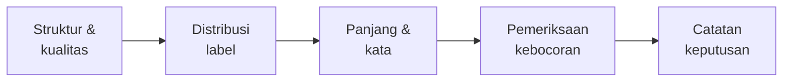

# Latihan: Analisis Dataset dan Pemeriksaan Kebocoran

!!! abstract "Info materi"
    **Tingkat kesulitan:** Menengah (mini-proyek terbimbing). **Estimasi waktu:** 2–3 jam.
    **Jenis kode:** kunci jawaban berupa skrip (`examples/level-3-feature-engineering/08_latihan_eda.py`) dan notebook (`examples/level-3-feature-engineering/03_eda_dan_fitur.ipynb`, sudah dieksekusi).

## Tujuan pembelajaran

- [ ] Menjalankan alur EDA lengkap untuk dataset klasifikasi teks (spesifikasi Tahap C).
- [ ] Menemukan kemungkinan kebocoran data: duplikat, templat yang dipakai ulang, kata yang hanya muncul pada satu kelas.
- [ ] Mengenali kolom yang diturunkan dari label.
- [ ] Menuliskan catatan keputusan EDA yang dapat dipertanggungjawabkan.

## Prasyarat

Seluruh halaman Level 3 sebelumnya.

## Pengantar dan motivasi

Halaman ini berbeda dari halaman lain: tidak ada konsep baru. Anda menerapkan
semuanya pada satu pekerjaan nyata, **menyiapkan laporan EDA untuk dataset
sebelum modeling**. Kerjakan tiap tugas sendiri, tulis jawaban Anda, baru
bandingkan dengan kunci pembahasan. Notebook
`03_eda_dan_fitur.ipynb` menjalankan versi ringkas dari alur ini.

## Konsep dasar

Daftar periksa EDA (dari spesifikasi proyek):

1. Membaca dataset dan memeriksa struktur serta tipe data.
2. Memeriksa nilai kosong dan duplikat.
3. Menghitung distribusi label dan ketidakseimbangan kelas.
4. Menganalisis panjang teks.
5. Menampilkan contoh teks secara aman (tanpa data pribadi).
6. Mengidentifikasi kemungkinan kebocoran data.

## Penjelasan mendalam

### Penampilan contoh secara aman

Pada data nyata, contoh teks yang ditampilkan di laporan atau notebook dapat memuat nama,
nomor telepon, atau lokasi pribadi. Sebelum menampilkan: ganti mention dan URL dengan token
(`ganti_mention`, `ganti_url`), jangan simpan ID pengguna, dan jangan menempelkan teks mentah
ke repository publik. Dataset sintetis di sini aman, tetapi kebiasaannya perlu dibangun sejak sekarang.

### Jenis kebocoran yang dicari

| Jenis | Pertanyaan |
|---|---|
| Duplikat | Apakah ada teks yang sama? Di split mana? |
| Kelompok | Apakah teks dari satu kejadian terpecah? |
| Templat/near-duplicate | Apakah kalimat hampir sama muncul di latih dan uji? |
| Kolom turunan label | Apakah ada kolom yang menentukan label? |
| Kata penanda artefak | Apakah ada kata yang hanya muncul pada satu kelas? |

## Cara kerja atau alur proses



## Contoh sederhana

Contoh pertanyaan dan alat: "Berapa persen teks Emergency?" → `value_counts(normalize=True)`.
"Adakah teks ganda?" → `duplicated().sum()`.

## Contoh dalam konteks Twitter/X kebencanaan

Pada sistem tanggap darurat, satu kejadian besar menghasilkan banyak
postingan hampir sama. Jika dipecah acak, model tampak sangat baik hanya karena
mengenali kejadian yang sama. Tugas 4 dan 5 memeriksa hal ini.

## Praktik Python

### Tugas

Kerjakan pada dataset sintetis (`muat_dataset(hapus_duplikat=False)` untuk tugas 1, lalu `muat_dataset()`):

1. **Struktur dan kualitas.** Berapa baris dan kolom? Adakah nilai kosong? Berapa duplikat persis? Apakah duplikat berada di kejadian yang sama, dan apa labelnya?
2. **Label.** Hitung proporsi kedua kelas. Apakah ada ketidakseimbangan yang perlu diperhatikan?
3. **Panjang.** Bandingkan median panjang teks antarkelas.
4. **Templat dan kejadian.** Berapa templat yang dipakai di lebih dari satu kejadian? Setelah `bagi_latih_uji`, adakah kejadian di kedua split? Berapa templat uji yang juga ada di latih?
5. **Kata penanda.** Kata mana (DF ≥ 10) yang hanya muncul di satu kelas? Apakah itu sifat nyata pesan darurat atau artefak?
6. **Kolom turunan label.** Bandingkan `post_type` dengan `label` (tabel silang). Bolehkah `post_type` dipakai sebagai fitur?
7. **Catatan keputusan.** Tulis lima keputusan yang Anda ambil sebelum modeling, dan alasannya.

### Kunci jawaban: kode

Kunci tugas 1, 4, 5, dan 6 ada di `08_latihan_eda.py`. Tugas 2 dan 3 dijawab di halaman
[Statistik Korpus](statistik-korpus.md).

```python title="Tugas 1: duplikat"
--8<-- "level-3-feature-engineering/08_latihan_eda.py:duplikat"
```

```text title="Output nyata"
baris yang terlibat duplikat: 20 | teks unik: 10
duplikat selalu satu kejadian: True
{'Emergency': 20}
```

```python title="Tugas 4: templat dan kejadian"
--8<-- "level-3-feature-engineering/08_latihan_eda.py:templat"
```

```text title="Output nyata"
templat: 110 | dipakai di >1 kejadian: 105
rata-rata kejadian per templat: 4.96
kejadian di latih dan uji sekaligus: 0
templat di latih dan uji sekaligus : 59 dari 61 templat uji
```

```python title="Tugas 5: kata penanda"
--8<-- "level-3-feature-engineering/08_latihan_eda.py:eksklusif"
```

```text title="Output nyata"
kata (DF>=10) hanya di Emergency    : [('barusan', 29), ('dari', 22), ('mohon', 21), ('setinggi', 19), ('menimpa', 19), ('asap', 18)]
kata (DF>=10) hanya di Non-Emergency: [('ini', 68), ('ya', 44), ('kayak', 39), ('saya', 35), ('wkwk', 30), ('hari', 28)]
```

```python title="Tugas 6: tabel silang"
--8<-- "level-3-feature-engineering/08_latihan_eda.py:silang"
```

```text title="Output nyata"
label          Emergency  Non-Emergency
post_type                              
bantuan               74              0
berita                 0             49
candaan                0             37
edukasi                0             43
info_lama              0             40
laporan              117              0
opini                  0             43
peringatan             0             39
tidak_terkait          0            122
```

### Kunci jawaban: pembahasan

??? success "Tugas 1 — struktur dan kualitas"
    574 baris dan 6 kolom, tanpa nilai kosong. Ada 10 teks yang dobel (20 baris terlibat: masing-masing 10 teks muncul dua kali), semuanya berlabel Emergency dan berada di satu kejadian yang sama. Karena satu kejadian, pembagian per kejadian tidak memisahkan mereka; yang tetap perlu dilakukan adalah **membuang duplikat sebelum modeling** (agar tidak menimbang laporan yang sama dua kali). Sisa 564 baris. (Bagian 1 halaman *Statistik Korpus*.)

??? success "Tugas 2 — label"
    Emergency 191 (33,9%) dan Non-Emergency 373 (66,1%) setelah duplikat dibuang; sebelum dibuang 35% dan 65%. Ketidakseimbangan sedang: akurasi akan memihak kelas mayoritas, jadi laporkan presisi, recall, dan F1 per kelas (Level 5). Proporsi ini dipilih pembuat data dan bukan perkiraan dunia nyata.

??? success "Tugas 3 — panjang"
    Median Emergency 95 karakter dan Non-Emergency 79 karakter. Selisih ini berasal dari templat (laporan memuat alamat); bukan temuan tentang pesan darurat nyata.

??? success "Tugas 4 — templat dan kejadian"
    Dari 110 templat, 105 dipakai di lebih dari satu kejadian (rata-rata sekitar 5 kejadian per templat). Pembagian per kejadian memastikan tidak ada kejadian di kedua split (0), **tetapi** 59 dari 61 templat uji juga ada di latih. Artinya pembagian per kejadian tidak mencegah kemiripan kalimat antara latih dan uji; itu sebabnya skor validasi silang tinggi, dan mengapa kita menyediakan set tulis-tangan serta pembagian per templat (halaman *Data Leakage*).

??? success "Tugas 5 — kata penanda"
    Hanya di Emergency: `barusan`, `mohon`, `setinggi`, `menimpa`, `asap`. Itu kata yang masuk akal untuk laporan (isyarat waktu dan kejadian), tetapi daftarnya juga mencerminkan kata dalam templat tertentu. Hanya di Non-Emergency: `ini`, `ya`, `kayak`, `saya`, `wkwk`, `hari`, yaitu kata percakapan atau opini. Kata `dari` hanya di Emergency adalah artefak templat ("terlihat dari jauh"), bukan sifat umum. Kesimpulan: sebagian sinyal sah, sebagian artefak; kita tidak dapat memisahkannya hanya dari data ini.

??? success "Tugas 6 — kolom turunan label"
    Tabel silang menunjukkan label ditentukan sepenuhnya oleh `post_type` (`laporan` dan `bantuan` selalu Emergency, sisanya selalu Non-Emergency). Karena label dibuat dari jenis templat, `post_type` **tidak boleh** dipakai sebagai fitur: itu membocorkan label (model akan mendapat akurasi 100% tanpa belajar apa pun). Kolom itu hanya ada untuk analisis. Pada data nyata, selalu periksa apakah ada kolom yang diturunkan dari proses pelabelan.

??? success "Tugas 7 — contoh catatan keputusan"
    1. Duplikat persis dibuang sebelum modeling (10 baris). 2. Pembagian per `event_id` dengan `StratifiedGroupKFold`. 3. Kolom `post_type` dan `template_id` tidak dipakai sebagai fitur. 4. Selain akurasi, laporkan recall Emergency dan F1 makro. 5. Skor pada dataset sintetis hanya untuk menguji kode; kesimpulan tentang performa menunggu data nyata dengan label dari beberapa anotator. (Jawaban Anda boleh berbeda selama alasannya jelas.)

## Kesalahan umum dan debugging

| Gejala | Penyebab | Perbaikan |
|---|---|---|
| Duplikat tidak terdeteksi | Hanya mencocokkan huruf yang berbeda kapital/spasi | Bandingkan setelah preprocessing dasar |
| Mengira pembagian per kejadian cukup | Templat dipakai ulang antar-kejadian | Periksa near-duplicate, bukan hanya ID |
| Memakai kolom turunan label sebagai fitur | Tidak menanyakan asal kolom | Periksa tabel silang kolom vs label |
| Menganggap kata eksklusif sebagai sifat bahasa | Tidak memeriksa asal data | Baca sampel teks; ketahui cara data dibuat |
| Menampilkan teks mentah berisi identitas | Tidak membersihkan contoh | Ganti mention/URL sebelum ditampilkan |

## Kelebihan dan keterbatasan

**Kelebihan:** menemukan masalah data sebelum modeling, murah, dan dapat diulang lewat notebook.
**Keterbatasan:** EDA tidak membuktikan hubungan sebab-akibat; pemeriksaan near-duplicate di sini
mengandalkan `template_id` yang hanya ada pada data sintetis (pada data nyata gunakan kemiripan teks).

## Latihan bertahap

Tugas 1–7 di atas adalah latihan bertahap itu sendiri. Setelah selesai:

1. **Tantangan A.** Hitung kemiripan teks (misalnya Jaccard n-gram karakter) untuk menemukan near-duplicate tanpa memakai `template_id`.
2. **Tantangan B.** Ulangi tugas 5 pada set tulis-tangan dan jelaskan mengapa kata-katanya berbeda.

## Kunci jawaban dan pembahasan

??? success "Tantangan A"
    Gagasan: ubah tiap teks menjadi himpunan trigram karakter, hitung Jaccard untuk pasangan teks, dan tandai pasangan di atas ambang (misalnya 0,8) sebagai near-duplicate. Pada data besar gunakan hashing (MinHash) agar tidak membandingkan semua pasangan. Karena hanya gagasan, jalankan dan periksa sendiri kualitas ambangnya.

??? success "Tantangan B"
    Pada set tulis-tangan jumlah teks hanya 48, sehingga DF ≥ 10 hampir tidak ada; turunkan ambang. Kata yang berbeda menunjukkan bahwa gaya dan kosakata di luar templat berbeda (sesuai cakupan kosakata 54–58% pada halaman *Representasi dengan scikit-learn*).

## Kuis singkat

**1.** Mengapa duplikat persis dibuang sebelum modeling?

??? success "Jawaban"
    Agar satu laporan tidak dihitung dua kali dan tidak jatuh di latih dan uji sekaligus.

**2.** Apa bahaya memakai `post_type` sebagai fitur?

??? success "Jawaban"
    Label ditentukan oleh kolom itu, sehingga model "belajar" label dari kolom turunannya (kebocoran).

**3.** Mengapa pembagian per kejadian saja tidak cukup pada dataset ini?

??? success "Jawaban"
    59 dari 61 templat uji juga ada di latih; kalimat hampir sama tetap muncul di kedua split.

## Ringkasan

- Alur EDA: struktur, kosong/duplikat, label, panjang, kata, kebocoran, catatan keputusan.
- Dataset ini: 10 duplikat disengaja, 105 dari 110 templat dipakai lintas kejadian, label = fungsi `post_type`.
- Pembagian per kejadian menghilangkan kebocoran kejadian, bukan kemiripan templat.
- Catat keputusan dan alasannya.

## Glosarium istilah baru

Near-duplicate
:   Teks yang hampir sama tetapi tidak persis sama.

Kolom turunan label
:   Kolom yang nilainya dihasilkan dari label atau proses pelabelan.

Tabel silang (*crosstab*)
:   Tabel jumlah kemunculan kombinasi dua variabel kategorik.

## Referensi

- Dokumentasi pandas, `pandas.crosstab`: <https://pandas.pydata.org/docs/reference/api/pandas.crosstab.html> (dokumentasi resmi).
- Gebru, T., Morgenstern, J., Vecchione, B., Vaughan, J. W., Wallach, H., Daumé III, H., & Crawford, K. (2021). Datasheets for datasets. *Communications of the ACM*, 64(12), 86–92. DOI: 10.1145/3458723 (makalah akademik tentang dokumentasi dataset; rujukan gagasan Kartu Data `DATA_CARD.md` pada proyek ini; detail bibliografi diperiksa lewat pencarian daring).

## Materi berikutnya

Level 3 selesai. Lanjut ke [Level 4: Machine Learning](../level-4-machine-learning/index.md).
