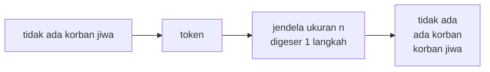

# Word n-gram dan Character n-gram

!!! abstract "Info materi"
    **Tingkat kesulitan:** Menengah. **Estimasi waktu:** 75–100 menit.
    **Jenis kode:** snippet edukatif (`examples/level-3-feature-engineering/02_ngram.py`).

## Tujuan pembelajaran

- [ ] Mendefinisikan *n-gram* kata dan karakter, dan menghitung banyaknya dari panjang teks.
- [ ] Menjelaskan bagaimana bigram menangkap sebagian urutan kata, misalnya `tidak ada`.
- [ ] Menjelaskan mengapa n-gram karakter lebih tahan terhadap typo dan variasi ejaan.
- [ ] Menilai harga yang dibayar: ukuran fitur membengkak.

## Prasyarat

- [Statistik Dasar Korpus](statistik-korpus.md).
- [List, Tuple, Set, Dict](../level-1-python/list-tuple-set-dict.md) dan [Perulangan](../level-1-python/perulangan.md) (Level 1).

## Pengantar dan motivasi

Representasi kata tunggal (*unigram*) membuang urutan. "Tidak ada korban" dan
"ada korban tidak" menghasilkan fitur yang sama. **N-gram** memperlakukan
urutan *n* item berurutan sebagai satu fitur, sehingga sebagian informasi
urutan dan frasa bertahan. Pada tingkat karakter, n-gram menjembatani variasi
ejaan: `tolong` dan `tolooong` tidak berbagi kata, tetapi berbagi banyak
potongan huruf.

## Konsep dasar

| Jenis | Satuan | Contoh untuk `tidak ada korban jiwa` |
|---|---|---|
| Unigram | 1 kata | `tidak`, `ada`, `korban`, `jiwa` |
| Bigram | 2 kata berurutan | `tidak ada`, `ada korban`, `korban jiwa` |
| Trigram | 3 kata berurutan | `tidak ada korban`, `ada korban jiwa` |
| Karakter n-gram | *n* karakter berurutan | trigram `tol`, `olo`, `lon`, `ong` untuk `tolong` |

**Banyaknya n-gram.** Jika teks memiliki *m* item, jumlah n-gram berukuran *n* adalah

$$
m - n + 1 \quad (\text{untuk } m \ge n)
$$

Contoh: 4 kata → 3 bigram, 2 trigram. Jika $m < n$, hasilnya kosong.

## Penjelasan mendalam

### Word n-gram menangkap frasa kecil

Bigram `tidak ada` adalah fitur yang berbeda dari kata `ada`. Model dapat
mempelajari bahwa `tidak ada` berhubungan dengan label tertentu. Ini
alternatif lain dari penandaan `neg_` ([Negasi](../level-2-fondasi-teks/negasi.md)):
bigram menangkap negasi yang berdekatan tanpa aturan buatan, tetapi
tidak dapat menjangkau negasi yang jauh dari kata yang dinegasikan.

### Character n-gram menjembatani variasi ejaan

Satu kata dipecah menjadi potongan karakter, dengan spasi di awal dan akhir
sebagai penanda batas kata. `tolong` → ` to`, `tol`, `olo`, `lon`, `ong`, `ng `.
Kata `tolooong` berbagi lima potongan dengan `tolong`. Kemiripan dapat diukur
dengan koefisien Jaccard:

$$
J(A, B) = \frac{|A \cap B|}{|A \cup B|}
$$

$A$ dan $B$ adalah himpunan n-gram dua kata; $|\cdot|$ jumlah elemen; $\cap$
irisan; $\cup$ gabungan. Nilainya antara 0 (tidak ada yang sama) dan 1 (sama).
Kelemahan: kata yang sangat singkat (`tlg`) tidak berbagi trigram dengan
`tolong` sama sekali.

### Harga: ukuran fitur membengkak

Setiap n-gram unik menjadi satu kolom. Karena sebagian besar n-gram hanya
muncul sekali dua kali, penambahan bigram dan trigram menambah ribuan fitur
yang jarang, sehingga model lebih mudah menghafal data latih (*overfitting*).
Pada data kecil, ini risiko nyata.

## Cara kerja atau alur proses



## Contoh sederhana

`"air naik cepat"`: unigram = 3 (`air`, `naik`, `cepat`); bigram = 2 (`air naik`,
`naik cepat`); trigram = 1 (`air naik cepat`).

## Contoh dalam konteks Twitter/X kebencanaan

Dua teks sintetis: "Tidak ada korban jiwa" dan "Ada korban jiwa". Pada
unigram, selisih fiturnya hanya `tidak`. Pada unigram + bigram, kalimat pertama
mendapat `tidak` dan `tidak ada`, sementara `ada korban` dan `korban jiwa`
ada di kedua kalimat. Bagian 2 menunjukkan kumpulan fitur sebenarnya.

## Praktik Python

Berkas: `examples/level-3-feature-engineering/02_ngram.py`.

### Bagian 1 — N-gram kata secara manual

```python title="Bagian 1"
--8<-- "level-3-feature-engineering/02_ngram.py:manual"
```

- `token[i:i + n]` mengambil potongan (*slice*) sepanjang *n* mulai posisi *i* (lihat [Indexing dan Slicing](../level-1-python/indexing-slicing.md)).
- `range(len(token) - n + 1)` menghasilkan semua posisi awal; itulah rumus $m - n + 1$.
- `" ".join(...)` menggabungkan potongan menjadi satu string.

```text title="Output nyata"
['tidak', 'ada', 'korban', 'jiwa']
['tidak ada', 'ada korban', 'korban jiwa']
['tidak ada korban', 'ada korban jiwa']
```

Interpretasi: 4 unigram, 3 bigram, 2 trigram, sesuai rumus.

### Bagian 2 — Bigram lewat `CountVectorizer`

```python title="Bagian 2"
--8<-- "level-3-feature-engineering/02_ngram.py:vectorizer"
```

`CountVectorizer(ngram_range=(1, 2))` membuat fitur untuk unigram dan bigram sekaligus; `fit` mempelajari kosakata dari kedua kalimat; `get_feature_names_out()` menampilkannya (urut abjad).

```text title="Output nyata"
['ada', 'ada korban', 'jiwa', 'korban', 'korban jiwa', 'tidak', 'tidak ada']
```

Interpretasi: tujuh fitur. Kalimat pertama memuat `tidak ada`, yang tidak ada pada
kalimat kedua. Fitur yang tidak muncul di salah satu kalimat bernilai 0 di sana.
Dengan unigram saja, perbedaan hanya `tidak`; dengan bigram ada tambahan
fitur `tidak ada` yang menyampaikan hubungan negasi dengan `ada`.
Perhatikan bahwa `ada korban` ada di **kedua** kalimat: bigram tidak otomatis
membedakan kalimat yang berlawanan makna, karena sebagian fitur tetap sama.

### Bagian 3 — N-gram karakter dan kemiripan

```python title="Bagian 3"
--8<-- "level-3-feature-engineering/02_ngram.py:karakter"
```

`ngram_karakter` menambahkan spasi di kedua sisi kata lalu mengambil semua potongan *n* karakter dalam bentuk himpunan (`set`). `&` adalah irisan himpunan dan `|` gabungan.

```text title="Output nyata"
tolong vs tolooong  3-gram bersama: [' to', 'ng ', 'olo', 'ong', 'tol']  Jaccard=0.56
tolong vs tlg       3-gram bersama: []  Jaccard=0.00
tolong vs banjir    3-gram bersama: []  Jaccard=0.00
```

Interpretasi: `tolooong` berbagi lima trigram dengan `tolong` (Jaccard 0,56),
tetapi `tlg` tidak berbagi satu pun, sama seperti kata `banjir` yang tidak
berhubungan. Jadi n-gram karakter membantu untuk perpanjangan huruf, tetapi
tidak untuk singkatan; singkatan ditangani kamus normalisasi (Level 2).
(Pada contoh di atas Jaccard dihitung dari himpunan 3-gram `tolong` = 6 dan
`tolooong` = 8 elemen, dengan irisan 5 dan gabungan 9.)

### Bagian 4 — Ukuran fitur

```python title="Bagian 4"
--8<-- "level-3-feature-engineering/02_ngram.py:ukuran"
```

Teks diproses dulu dengan `PraprosesTeks()` (konfigurasi dasar, tanpa state), lalu empat `CountVectorizer` dengan pengaturan berbeda dihitung ukuran kosakatanya. `analyzer="char_wb"` memakai n-gram karakter di dalam batas kata.

```text title="Output nyata"
kata 1-gram    fitur = 592
kata 1-2 gram  fitur = 2197
kata 1-3 gram  fitur = 4365
karakter 2-5   fitur = 5973
```

Interpretasi: menambah bigram melipatgandakan fitur sekitar 3,7 kali (592 → 2.197);
trigram 7,4 kali; karakter 2–5 sekitar 10 kali. Angka 592 (bukan 596 tipe)
karena `CountVectorizer` secara bawaan membuang token satu huruf. Pada 564
teks, 5.973 fitur berarti jumlah fitur sekitar sepuluh kali jumlah contoh.

### Skrip terpadu

Keempat potongan tidak saling bergantung. Gabungannya adalah berkas
`examples/level-3-feature-engineering/02_ngram.py`.

## Kesalahan umum dan debugging

| Gejala | Penyebab | Perbaikan |
|---|---|---|
| Daftar n-gram kosong | `n` lebih besar dari jumlah token | Periksa panjang teks; hasil kosong benar secara matematis |
| Kosakata meledak | `ngram_range` terlalu lebar pada data kecil | Batasi `(1, 2)`, tambahkan `min_df` |
| N-gram melewati batas dokumen | Menggabungkan dokumen sebelum memotong | Hitung n-gram per dokumen |
| `char` vs `char_wb` tertukar | Lupa bahwa `char` melintasi batas kata | Pakai `char_wb` bila ingin tetap di dalam kata |
| Menganggap bigram "memahami" negasi | Sebagian bigram tetap sama pada kalimat berlawanan | Uji dengan pasangan kalimat berlawanan |

## Kelebihan dan keterbatasan

**Word n-gram:** menangkap frasa pendek; mudah; tetapi menambah fitur dan tetap tidak memahami hubungan jauh.
**Character n-gram:** tahan terhadap perpanjangan huruf dan typo ringan, tidak butuh kamus; tetapi fitur sangat banyak, sulit ditafsirkan, dan tidak membantu singkatan.

## Latihan bertahap

1. **Konseptual.** Berapa bigram dan trigram dari `air belum surut` ditambah `tolong`? (empat kata: `tolong air belum surut`)
2. **Menghitung.** Berapa trigram karakter dari kata `api` dengan spasi pembatas?
3. **Membaca kode.** Apa hasil `ngram_kata(["air", "naik"], 3)`? Mengapa?
4. **Debugging.** Sebuah jawaban mengklaim bahwa bigram menyelesaikan masalah negasi. Berikan satu pasangan kalimat yang membantahnya.
5. **Mini-proyek.** Ubah `ngram_range` di Bagian 4 menjadi `(2, 2)` dan bandingkan ukurannya dengan `(1, 2)`.

## Kunci jawaban dan pembahasan

??? success "Jawaban 1"
    Empat kata → 3 bigram (`tolong air`, `air belum`, `belum surut`) dan 2 trigram (`tolong air belum`, `air belum surut`). Sesuai $m-n+1$: $4-2+1=3$ dan $4-3+1=2$.

??? success "Jawaban 2"
    Dengan spasi pembatas string menjadi `" api "` (5 karakter), sehingga trigramnya 5 − 3 + 1 = 3: `" ap"`, `"api"`, `"pi "`.

??? success "Jawaban 3"
    `[]`. Hanya ada 2 token sehingga tidak ada jendela berukuran 3 ($2-3+1=0$). `range(0)` tidak menghasilkan apa-apa.

??? success "Jawaban 4"
    Contoh: "tidak ada korban di sini tetapi ada korban di sana". Bigram `tidak ada` hadir, tetapi bigram `ada korban` juga hadir, dan model tidak tahu bahwa `tidak` hanya menegasi klausa pertama. Pembahasan: bigram hanya melihat pasangan bertetangga, bukan struktur klausa. Pada Bagian 2 kita lihat `ada korban` hadir pada kedua kalimat berlawanan.

??? success "Jawaban 5"
    Hasil yang dijalankan: `(2, 2)` menghasilkan 1.605 fitur, `(1, 2)` menghasilkan 2.197, dan unigram 592. Selisih 2.197 − 1.605 = 592 sama dengan jumlah unigram, sesuai dugaan karena `(1, 2)` = unigram + bigram dan tidak ada tumpang tindih nama fitur.

## Kuis singkat

**1.** Berapa bigram dari teks dengan 10 kata?

??? success "Jawaban"
    9 ($10-2+1$).

**2.** Mengapa n-gram karakter membantu `tolooong`?

??? success "Jawaban"
    Banyak potongan hurufnya sama dengan `tolong`, sehingga kedua kata berbagi fitur walau bukan kata yang sama.

**3.** Apa risiko menambah n-gram pada data kecil?

??? success "Jawaban"
    Ukuran fitur membengkak dan sebagian besar fitur sangat jarang, sehingga model mudah overfitting.

## Ringkasan

- N-gram adalah urutan *n* item berurutan; banyaknya $m-n+1$.
- Bigram menangkap sebagian frasa, tetapi tidak menyelesaikan negasi.
- N-gram karakter menjembatani perpanjangan huruf dan typo ringan, tetapi bukan singkatan.
- Fitur membengkak: 592 (unigram), 2.197 (1–2 gram), 4.365 (1–3 gram), 5.973 (karakter 2–5) pada dataset ini.

## Glosarium istilah baru

N-gram
:   Urutan *n* item (kata atau karakter) yang berurutan.

Unigram, bigram, trigram
:   N-gram berukuran 1, 2, dan 3.

Koefisien Jaccard
:   Ukuran kemiripan dua himpunan: irisan dibagi gabungan.

Overfitting
:   Model menghafal data latih sehingga buruk pada data baru.

## Referensi

- Dokumentasi scikit-learn, `CountVectorizer` (parameter `ngram_range` dan `analyzer`): <https://scikit-learn.org/stable/modules/generated/sklearn.feature_extraction.text.CountVectorizer.html> (dokumentasi resmi).

## Materi berikutnya

[Bag of Words](bag-of-words.md)
