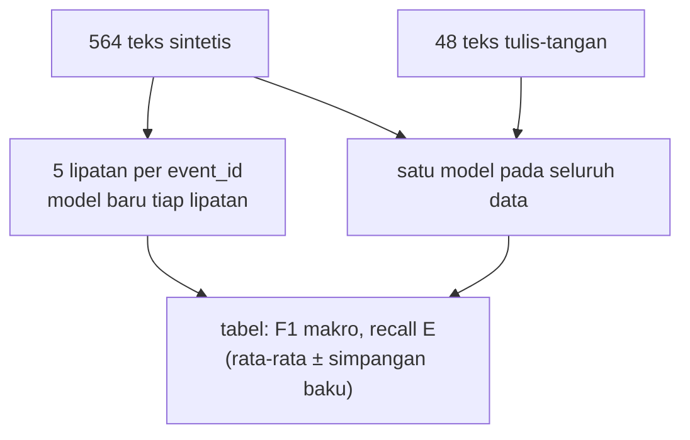

# Representasi Teks dengan scikit-learn, Perbandingan Fitur, dan Vocabulary Leakage

!!! abstract "Info materi"
    **Tingkat kesulitan:** Menengah–lanjut. **Estimasi waktu:** 150 menit.
    **Jenis kode:** **eksperimen** (`examples/level-3-feature-engineering/07_representasi_sklearn.py`). Semua angka dari eksekusi nyata (scikit-learn 1.9.1, seed 42). Protokol evaluasi ada di `examples/nlp_hub/eksperimen.py`.

## Tujuan pembelajaran

- [ ] Memakai parameter utama `CountVectorizer` dan `TfidfVectorizer` (`min_df`, `max_df`, `max_features`, `ngram_range`, `binary`).
- [ ] Membandingkan beberapa representasi dengan protokol evaluasi yang sama.
- [ ] Membandingkan fitur sebelum dan sesudah preprocessing.
- [ ] Mengukur *vocabulary leakage* dan menjelaskan hasilnya dengan jujur.
- [ ] Menjelaskan mengapa peringkat model pada validasi silang dapat berbeda dari peringkat pada data bergaya lain.

## Prasyarat

- Halaman Level 3 sebelumnya (BoW, TF-IDF, n-gram, fitur buatan tangan).
- [Data Leakage akibat Preprocessing](../level-2-fondasi-teks/leakage-preprocessing.md) dan [Perbandingan Pipeline](../level-2-fondasi-teks/perbandingan-pipeline.md).

## Pengantar dan motivasi

Kita punya banyak cara mengubah teks menjadi angka. Halaman ini menjawab
pertanyaan praktis: **pengaturan apa yang tersedia, dan seberapa besar
perbedaannya pada data kita?** Jawaban jujurnya akan bercabang, karena
dataset sintetis ini membuat sebagian besar perbedaan lenyap dalam
validasi silang, tetapi sebagian muncul kembali ketika teks bergaya lain.

## Konsep dasar

| Parameter | Arti | Efek |
|---|---|---|
| `ngram_range=(a, b)` | Ukuran n-gram dari *a* sampai *b* | Menambah fitur frasa |
| `min_df=k` | Buang kata yang muncul di kurang dari *k* dokumen | Membuang kata langka (typo) |
| `max_df=p` | Buang kata yang muncul di lebih dari proporsi *p* dokumen | Membuang kata sangat umum |
| `max_features=m` | Simpan hanya *m* kata paling sering | Membatasi ukuran |
| `binary=True` | Hitungan menjadi ada/tidak ada | Mengurangi pengaruh pengulangan |
| `sublinear_tf=True` | tf menjadi $1+\ln(\text{tf})$ | Meredam kata yang diulang |
| `analyzer="char_wb"` | N-gram karakter dalam batas kata | Tahan typo |

## Penjelasan mendalam

### `fit` versus `transform` dan Pipeline

`fit` mempelajari kosakata (dan IDF); `transform` memakai yang sudah dipelajari. Pada
`Pipeline`, `fit` hanya melihat data latih tiap lipatan. Pada kode
Bagian 2, kita sengaja membuat versi "bocor" (`fit` pada seluruh data) hanya untuk
mengukurnya.

### Apa yang dibandingkan

Sembilan kandidat, **semuanya memakai Logistic Regression yang sama** (algoritma ini
dijelaskan di Level 4); hanya representasi yang berbeda:

1. TF-IDF tanpa preprocessing (hanya huruf kecil bawaan vectorizer).
2. TF-IDF dengan preprocessing dasar Level 2.
3. TF-IDF dengan preprocessing lengkap (lokasi, negasi, stopword konservatif, stemming).
4. BoW hitungan.
5. BoW biner.
6. TF-IDF unigram + bigram, `min_df=2`.
7. TF-IDF karakter 2–5.
8. 16 fitur buatan tangan saja.
9. TF-IDF + 16 fitur buatan tangan (digabung dengan `FeatureUnion`).

Protokol (sama untuk semua): validasi silang 5 lipatan berkelompok per
`event_id` pada 564 teks sintetis, ditambah satu model pada seluruh data yang diuji pada 48 teks
tulis-tangan.

## Cara kerja atau alur proses



## Contoh sederhana

`TfidfVectorizer(min_df=2)` pada tiga dokumen kecil akan membuang semua kata yang
hanya muncul di satu dokumen. Untuk kata `air` (dua dokumen) ia tetap, untuk
`gempa` (satu dokumen) ia dibuang.

## Contoh dalam konteks Twitter/X kebencanaan

Typo seperti `kebkaaran` hanya muncul sekali. `min_df=2` menghapusnya dari
kosakata sehingga model tidak mencoba menghafalnya. Pertanyaan penelitian
yang lebih penting: **apakah representasi yang baik pada validasi silang tetap
baik pada teks yang ditulis dengan gaya lain?** Ini yang kita ukur dengan set
tulis-tangan.

## Praktik Python

Berkas: `examples/level-3-feature-engineering/07_representasi_sklearn.py`.

### Bagian 1 — Parameter dan ukuran kosakata

```python title="Bagian 1"
--8<-- "level-3-feature-engineering/07_representasi_sklearn.py:parameter"
```

Daftar pasangan (nama, vektorizer) diulang; `v.fit(teks)` mempelajari kosakata dari 564 teks yang sudah diproses, `len(v.vocabulary_)` menghitung fiturnya.

```text title="Output nyata"
bawaan                   fitur = 592
min_df=2                 fitur = 540
min_df=5                 fitur = 429
max_df=0.5               fitur = 592
max_features=100         fitur = 100
ngram (1,2) + min_df=2   fitur = 1580
```

Interpretasi: `min_df=2` membuang 52 kata (592 → 540), yaitu kata yang muncul di satu
dokumen; `min_df=5` memangkas hingga 429. `max_df=0.5` tidak mengubah apa-apa karena tidak ada
kata yang muncul di lebih dari separuh dokumen (`di` ada di sekitar 44%). Menambah bigram
dengan `min_df=2` menghasilkan 1.580 fitur; bandingkan dengan 2.197 tanpa `min_df` (halaman n-gram).

### Bagian 2 — Mengukur vocabulary leakage

```python title="Bagian 2"
--8<-- "level-3-feature-engineering/07_representasi_sklearn.py:bocor"
```

Pada tiap lipatan dua model dilatih. **Bocor:** vektorizer dilatih pada *seluruh* teks (latih + uji). **Benar:** hanya pada teks latih. Keduanya diuji pada lipatan uji yang sama.

```text title="Output nyata"
kata tambahan di kosakata bocor per lipatan: [10, 15, 16, 18, 13]
akurasi bocor: 0.9842  benar: 0.9859
```

Interpretasi: pada versi bocor, kosakata memuat 10 sampai 18 kata tambahan per lipatan
(yang hanya ada di data uji). Namun akurasinya **tidak lebih baik**: 0,9842 (bocor)
versus 0,9859 (benar). Pada dataset ini, kebocoran vokabular tidak
menaikkan skor secara terukur. Alasannya masuk akal: kata yang hanya ada di uji tidak pernah
dilihat oleh model saat latih, sehingga bobotnya nol dan tidak memengaruhi prediksi. Hasil ini
**tidak** berarti kebocoran vokabular tidak berbahaya secara umum. Ia hanya menunjukkan bahwa
pada data ini efeknya tidak terdeteksi. Kita tetap membuang kebiasaan ini karena (1) IDF
ikut terpengaruh oleh dokumen uji, dan (2) kita tidak dapat mengetahui sebelumnya kapan efeknya muncul.

### Bagian 3 — Seberapa jauh kosakata latih menjangkau teks lain

```python title="Bagian 3"
--8<-- "level-3-feature-engineering/07_representasi_sklearn.py:cakupan"
```

`cakupan` menghitung, untuk tiap teks, proporsi token yang ada di kosakata latih, lalu merata-ratakannya. Kosakata dipelajari dari data latih sintetis saja.

```text title="Output nyata"
uji sintetis (kejadian terpisah): 0.987
tulis-tangan, per kelas:
label
Emergency        0.584
Non-Emergency    0.541
```

Interpretasi: pada uji sintetis, 98,7% token dikenali. Pada teks tulis-tangan, hanya
sekitar 54–58% token dikenali. Hampir separuh token teks tulis-tangan **tidak ada**
di kosakata, jadi model tidak melihatnya sama sekali. Ini bukti langsung adanya
pergeseran kosakata (*vocabulary shift*), dan menjelaskan mengapa hasil pada kedua
set berbeda jauh. Kontras ini juga mengingatkan bahwa validasi silang pada data bertemplat
mengukur kemampuan mengenali templat, bukan memahami bahasa.

### Bagian 4 — Membandingkan sembilan representasi

```python title="Bagian 4"
--8<-- "level-3-feature-engineering/07_representasi_sklearn.py:bandingkan"
```

`KANDIDAT` adalah kamus nama → fungsi yang membuat model baru. `lambda: ...` adalah fungsi tanpa nama; `evaluasi_pipeline` memanggilnya untuk membuat model baru tiap lipatan. `FeatureUnion` menggabungkan keluaran beberapa transformer secara berdampingan (kolom TF-IDF dan kolom fitur buatan tangan). Hasil disimpan ke `hasil/perbandingan_representasi.csv`.

```text title="Output nyata"
                                   F1 makro CV    Recall E CV F1 makro tangan Recall E tangan Presisi E tangan
1 TF-IDF, tanpa preprocessing    0.982 ± 0.019  0.959 ± 0.053           0.708           0.458              1.0
2 TF-IDF, preprocessing dasar    0.984 ± 0.010  0.969 ± 0.030           0.681           0.417              1.0
3 TF-IDF, preprocessing lengkap  0.980 ± 0.021  0.953 ± 0.055           0.681           0.417              1.0
4 BoW hitungan (dasar)           0.990 ± 0.011  0.985 ± 0.031           0.564            0.25              1.0
5 BoW biner (dasar)              0.996 ± 0.005  0.995 ± 0.010           0.496           0.167              1.0
6 TF-IDF 1-2 gram, min_df=2      0.978 ± 0.017  0.969 ± 0.030           0.681           0.417              1.0
7 TF-IDF karakter 2-5            0.982 ± 0.018  0.954 ± 0.047           0.595           0.292              1.0
8 16 fitur tangan saja           0.952 ± 0.026  0.932 ± 0.042           0.748           0.667              0.8
9 TF-IDF + 16 fitur tangan       0.978 ± 0.010  0.979 ± 0.019           0.748           0.667              0.8
```

Waktu melatih satu model pada seluruh data (detik; **berubah-ubah** antar-eksekusi dan antar-mesin):

```text title="Output nyata, waktu berubah-ubah"
WAKTU LATIH (detik): {'1 TF-IDF, tanpa preprocessing': 0.009, '2 TF-IDF, preprocessing dasar': 0.014, '3 TF-IDF, preprocessing lengkap': 0.032, '4 BoW hitungan (dasar)': 0.021, '5 BoW biner (dasar)': 0.022, '6 TF-IDF 1-2 gram, min_df=2': 0.028, '7 TF-IDF karakter 2-5': 0.092, '8 16 fitur tangan saja': 0.893, '9 TF-IDF + 16 fitur tangan': 0.926}
```

### Interpretasi

**1. Validasi silang: semua representasi hampir sama.** F1 makro CV berkisar 0,952
sampai 0,996. Untuk TF-IDF (nomor 1, 2, 3, 6, 7) selisihnya 0,978–0,984, lebih kecil
daripada simpangan baku (0,010–0,021): tidak dapat dibedakan. Preprocessing lengkap
(nomor 3) tidak lebih baik daripada tanpa preprocessing (nomor 1), mengulang temuan
halaman [Perbandingan Pipeline](../level-2-fondasi-teks/perbandingan-pipeline.md).

**2. BoW biner tampak terbaik pada CV, tetapi terburuk pada teks tulis-tangan.** BoW biner
(nomor 5) mencapai F1 makro CV 0,996, tertinggi, tetapi pada tulis-tangan F1 makro 0,496
dan recall Emergency 0,167 (4 dari 24 teks), **terendah** dari sembilan.
BoW hitungan (nomor 4) mengikuti pola yang sama. **Peringkat terbalik.** Satu sumber
dugaan: BoW memberi bobot yang sama untuk semua kata, termasuk kata templat
yang sangat bersinyal; pada teks yang kosakatanya hanya dikenali 54–58%
(Bagian 3), model hampir tidak punya bukti dan jatuh pada kelas mayoritas. Dugaan ini
konsisten dengan data, tetapi belum diuji lebih jauh (misalnya dengan menelusuri
prediksi per teks).

**3. Presisi Emergency tulis-tangan 1,0 pada semua model TF-IDF dan BoW.** Mereka
hampir tidak pernah menandai teks Non-Emergency sebagai Emergency, tetapi menemukan
sedikit teks Emergency. Itu kegagalan jenis *recall rendah* (pesan darurat terlewat), yang
paling kita khawatirkan pada tugas ini.

**4. Fitur buatan tangan lebih tahan terhadap perubahan gaya** (recall tulis-tangan 0,667)
walau CV-nya lebih rendah (0,952). Syaratnya (sama seperti halaman sebelumnya): ini bukan bukti
independen karena daftar kata isyarat ditulis oleh pembuat kedua dataset. Menggabungkan
TF-IDF dengan fitur tangan (nomor 9) mempertahankan recall tulis-tangan 0,667 sambil
menaikkan F1 makro CV (0,978) dibanding fitur tangan saja (0,952). Presisi tulis-tangan
turun menjadi 0,8 (ada teks Non-Emergency yang dinyatakan Emergency).

**5. Waktu.** Semua model berlatih dalam kurang dari satu detik. Dua model dengan fitur buatan tangan
lebih lambat (sekitar 0,9 detik) karena fitur dihitung dengan kode Python per teks, bukan karena
algoritmanya.

**Kesimpulan yang boleh ditarik:**

- Pada validasi silang data sintetis, perbedaan antar-representasi TF-IDF tidak dapat dibedakan dari noise.
- Peringkat pada validasi silang **tidak** menjamin peringkat pada teks bergaya lain: BoW biner menjadi terbaik lalu terburuk.
- Skor validasi silang tinggi tidak boleh dipakai sebagai alasan memilih representasi untuk data nyata.
- Kita belum dapat menyatakan representasi "terbaik". Pilihan harus berdasarkan data yang mirip dengan penggunaan sebenarnya.

### Skrip terpadu

`07_representasi_sklearn.py` dijalankan langsung (sekitar 25 detik) dan memuat semua
bagian. Hasil tabel tersimpan di `examples/level-3-feature-engineering/hasil/perbandingan_representasi.csv`.

## Kesalahan umum dan debugging

| Gejala | Penyebab | Perbaikan |
|---|---|---|
| Menyimpulkan representasi terbaik dari CV | Tidak menguji pada gaya lain | Sediakan set uji bergaya berbeda |
| Vectorizer dilatih sebelum pembagian data | Kebocoran | Letakkan di `Pipeline` |
| Lupa model baru tiap lipatan | Informasi terbawa | Buat model baru dalam loop (`buat_model()`) |
| Hasil berubah tiap dijalankan | Seed tidak tetap | Tetapkan `random_state`, catat versi |
| `max_features` memotong kata penting | Pemilihan berdasarkan frekuensi | Gunakan `min_df` dan periksa kata yang terbuang |
| Waktu latih dianggap tetap | Waktu bergantung mesin | Laporkan sebagai perkiraan |

## Kelebihan dan keterbatasan

**Kelebihan pendekatan:** protokol yang sama untuk semua kandidat; hasil per kelas dan simpangan
dilaporkan; ada ukuran di luar distribusi (tulis-tangan).
**Keterbatasan:** satu model (Logistic Regression), satu seed, 564 teks, dan 48 teks tulis-tangan
yang dilabeli satu orang. Tidak ada uji signifikansi. Dugaan penyebab (Bagian 4, poin 2) tidak
diuji lebih jauh.

## Latihan bertahap

1. **Konseptual.** Mengapa `min_df=2` mengurangi 52 fitur pada dataset ini?
2. **Membaca tabel.** Representasi mana yang memiliki F1 makro CV tertinggi dan mana yang recall tulis-tangan tertinggi?
3. **Membaca kode.** Apa fungsi `lambda:` pada `KANDIDAT`, dan mengapa model dibuat ulang tiap lipatan?
4. **Debugging.** Hasil "bocor" 0,9842 tidak lebih tinggi dari "benar" 0,9859. Apakah ini berarti kebocoran vokabular aman? Jelaskan.
5. **Mini-proyek.** Tambahkan kandidat ke `KANDIDAT` (mis. `TfidfVectorizer(sublinear_tf=True)`), jalankan ulang, dan tulis kesimpulan jujur.

## Kunci jawaban dan pembahasan

??? success "Jawaban 1"
    Karena 52 kata muncul hanya di satu dokumen (592 − 540 = 52). `min_df=2` mensyaratkan minimal dua dokumen, sehingga kata-kata itu, umumnya typo atau kata unik, dibuang.

??? success "Jawaban 2"
    F1 makro CV tertinggi: nomor 5 BoW biner (0,996). Recall tulis-tangan tertinggi: nomor 8 dan 9 (0,667).

??? success "Jawaban 3"
    `lambda: ...` membuat fungsi tanpa nama yang mengembalikan model baru setiap dipanggil. Model dibuat ulang tiap lipatan agar tidak ada informasi (kosakata, bobot) yang terbawa dari lipatan sebelumnya.

??? success "Jawaban 4"
    Tidak. Hasilnya hanya menunjukkan bahwa pada data ini efek kebocoran tidak terdeteksi: kata yang hanya ada di uji tidak diberi bobot oleh model sehingga tidak memengaruhi prediksi, dan perubahan IDF kecil. Pada data lain (lebih kecil, fitur lebih banyak, atau langkah yang memakai label) kebocoran dapat berdampak besar. Praktik yang benar tetap `fit` hanya pada latih.

??? success "Jawaban 5"
    Tidak ada jawaban tunggal; jalankan sendiri. Kerangka kesimpulan jujur: sebutkan selisih terhadap nomor 2 pada CV dan pada tulis-tangan, bandingkan dengan simpangan baku, dan catat bahwa 48 teks tulis-tangan hanya menggeser recall 0,042 per teks.

## Kuis singkat

**1.** Apa yang dilakukan `min_df=5`?

??? success "Jawaban"
    Membuang kata yang muncul di kurang dari 5 dokumen.

**2.** Mengapa peringkat model pada CV dan pada tulis-tangan bisa berbeda?

??? success "Jawaban"
    CV pada data bertemplat mengukur pengenalan pola templat; teks tulis-tangan memakai kosakata yang hanya dikenali sekitar separuhnya, sehingga model yang paling cocok dengan templat belum tentu paling umum.

**3.** Apakah hasil "kebocoran vokabular tidak menaikkan skor" boleh dipakai sebagai alasan untuk tidak peduli kebocoran?

??? success "Jawaban"
    Tidak; ia hanya berlaku untuk data dan model ini.

## Ringkasan

- Parameter utama vektorizer: `ngram_range`, `min_df`, `max_df`, `max_features`, `binary`, `sublinear_tf`.
- `min_df=2` mengurangi kosakata 592 → 540.
- Kebocoran vokabular tidak menaikkan akurasi di sini (0,9842 vs 0,9859), tetapi tetap dihindari.
- Kosakata latih mengenali 98,7% token uji sintetis tetapi hanya 54–58% token tulis-tangan.
- Peringkat pada CV terbalik pada tulis-tangan: BoW biner terbaik lalu terburuk.

## Glosarium istilah baru

`min_df` / `max_df`
:   Batas bawah/atas document frequency untuk menyaring kata.

Vocabulary shift
:   Perubahan kosakata antara data latih dan data baru.

FeatureUnion
:   Menggabungkan beberapa transformer secara berdampingan menjadi satu matriks fitur.

Fitur kehadiran (*binary*)
:   Representasi ada/tidak ada, bukan hitungan.

## Referensi

- Dokumentasi scikit-learn, `TfidfVectorizer`: <https://scikit-learn.org/stable/modules/generated/sklearn.feature_extraction.text.TfidfVectorizer.html> (dokumentasi resmi).
- Dokumentasi scikit-learn, `FeatureUnion`: <https://scikit-learn.org/stable/modules/generated/sklearn.pipeline.FeatureUnion.html> (dokumentasi resmi).
- Salton, G., & Buckley, C. (1988). Term-weighting approaches in automatic text retrieval. *Information Processing & Management*, 24(5), 513–523. DOI: 10.1016/0306-4573(88)90021-0 (makalah akademik; membahas pembobotan biner dan lainnya untuk dokumen pendek).

## Materi berikutnya

[Latihan Analisis Dataset](latihan-analisis-dataset.md)
