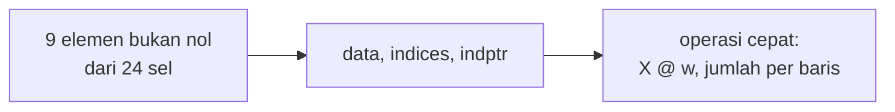

# Sparse Matrix, One-hot Encoding, dan Keterbatasannya

!!! abstract "Info materi"
    **Tingkat kesulitan:** Menengah. **Estimasi waktu:** 75–100 menit.
    **Jenis kode:** snippet edukatif (`examples/level-3-feature-engineering/05_sparse_onehot.py`).

## Tujuan pembelajaran

- [ ] Menjelaskan mengapa matriks teks hampir seluruhnya berisi nol dan apa itu *sparse matrix*.
- [ ] Membaca struktur CSR (`data`, `indices`, `indptr`) dari contoh kecil.
- [ ] Mengukur penghematan memori sparse dibanding matriks padat.
- [ ] Menjelaskan *one-hot encoding* dan keterbatasannya untuk makna kata.
- [ ] Membedakan one-hot untuk kata dan one-hot untuk fitur kategorik biasa.

## Prasyarat

- [Bag of Words](bag-of-words.md) dan [TF-IDF](tfidf.md).
- [NumPy dasar](../level-1-python/numpy-dasar.md) (Level 1).

## Pengantar dan motivasi

Matriks BoW untuk 564 teks dengan 592 kata tampak kecil, tetapi
teks nyata dapat berisi puluhan ribu kata unik dan jutaan dokumen. Tiap teks
hanya memuat segelintir kata, jadi hampir seluruh sel matriks bernilai 0.
Menyimpan semua nol itu boros. *Sparse matrix* hanya menyimpan elemen bukan nol
beserta lokasinya.

## Konsep dasar

| Istilah | Arti |
|---|---|
| **Padat (*dense*)** | Menyimpan semua elemen, termasuk nol |
| **Jarang (*sparse*)** | Menyimpan hanya elemen bukan nol dan posisinya |
| **Kepadatan** | Proporsi elemen bukan nol |
| **CSR** | *Compressed Sparse Row*: format sparse yang efisien untuk operasi per baris (dipakai scikit-learn) |
| **One-hot** | Vektor dengan satu elemen 1 dan sisanya 0 |

## Penjelasan mendalam

### Format CSR

CSR menyimpan tiga array:

- `data`: nilai semua elemen bukan nol, baris demi baris.
- `indices`: nomor kolom untuk tiap nilai di `data`.
- `indptr`: penunjuk awal tiap baris. Elemen baris ke-*i* berada di `data[indptr[i]:indptr[i+1]]`.

Contoh pada tiga dokumen kecil (Bagian 1): `indptr = [0, 3, 7, 9]` berarti baris 0
menempati `data[0:3]`, baris 1 `data[3:7]`, baris 2 `data[7:9]`.

### One-hot encoding

Untuk kosakata berukuran $V$, kata ke-$j$ direpresentasikan oleh vektor $V$
dimensi dengan 1 pada posisi $j$ dan 0 di tempat lain. BoW adalah **penjumlahan
vektor one-hot semua kata dalam dokumen** (Bagian 4).

### Keterbatasan one-hot untuk kata

1. **Dimensi besar:** satu kata = satu dimensi.
2. **Tidak ada kemiripan:** perkalian titik (*dot product*) dua vektor one-hot berbeda selalu 0. `banjir` dan `genangan` sama tak berhubungannya dengan `banjir` dan `gempa`.
3. **Tidak ada kata baru:** kata di luar kosakata tidak punya vektor.

Embedding (Level 6) memberi tiap kata vektor padat berdimensi kecil yang
dapat mencerminkan kemiripan makna.

### One-hot untuk fitur kategorik

One-hot masuk akal untuk fitur kategorik **berukuran kecil dan tetap**,
misalnya `post_type` (9 kategori). Itu tidak sama dengan memakainya sebagai
representasi kata.

## Cara kerja atau alur proses



## Contoh sederhana

Matriks 3 × 8 pada Bagian 1 memiliki 24 sel, tetapi hanya 9 yang bukan nol. CSR
menyimpan 9 nilai, 9 nomor kolom, dan 4 penunjuk baris.

## Contoh dalam konteks Twitter/X kebencanaan

`banjir` dan `genangan` sering dipakai bergantian. One-hot memperlakukan
keduanya sama jauhnya dengan pasangan `banjir` dan `gempa`. Model yang hanya melihat `banjir` di
latih tidak dapat menggeneralisasi ke `genangan` di data baru.

## Praktik Python

Berkas: `examples/level-3-feature-engineering/05_sparse_onehot.py`.

### Bagian 1 — Membaca struktur CSR

```python title="Bagian 1"
--8<-- "level-3-feature-engineering/05_sparse_onehot.py:struktur"
```

`CountVectorizer().fit_transform(...)` mengembalikan objek `csr_matrix`. `X.nnz` adalah jumlah elemen bukan nol.

```text title="Output nyata"
csr_matrix (3, 8) elemen tak nol: 9
data   : [1 2 1 1 1 1 1 1 1]
indices: [1 5 0 0 7 4 6 2 3]
indptr : [0 3 7 9]
```

Interpretasi: baris 0 = `data[0:3] = [1, 2, 1]` di kolom `[1, 5, 0]`. Kosakata
(urut abjad) adalah `air, banjir, gempa, kuat, masuk, naik, rumah, tolong`, jadi
kolom 1 = `banjir` (1), kolom 5 = `naik` (2), kolom 0 = `air` (1), tepat
dokumen `banjir naik air naik`. Baris 1 menempati `data[3:7]` (empat kata) dan
baris 2 menempati `data[7:9]` (dua kata).

### Bagian 2 — Mengukur memori

```python title="Bagian 2"
--8<-- "level-3-feature-engineering/05_sparse_onehot.py:memori"
```

`padat.nbytes` adalah ukuran array padat. Ukuran sparse adalah jumlah ukuran tiga array CSR (`data`, `indices`, `indptr`).

```text title="Output nyata"
bentuk: (564, 592) | tipe data: int64
padat  : 2671104 byte
sparse : 87016 byte
rasio  : 30.7x
```

Interpretasi: matriks padat memakai 2.671.104 byte ($564 \times 592 \times 8$), sedangkan
sparse hanya 87.016 byte, sekitar 31 kali lebih kecil. Pada korpus
besar, selisihnya menentukan apakah data muat di memori.

### Bagian 3 — One-hot dan kemiripan

```python title="Bagian 3"
--8<-- "level-3-feature-engineering/05_sparse_onehot.py:onehot_kata"
```

`np.eye(4)` membuat matriks identitas 4 × 4: baris ke-*j* adalah vektor one-hot untuk kata ke-*j*. `@` adalah perkalian titik.

```text title="Output nyata"
banjir    [1 0 0 0]
genangan  [0 1 0 0]
gempa     [0 0 1 0]
kuat      [0 0 0 1]
banjir . genangan = 0
banjir . banjir   = 1
```

Interpretasi: perkalian titik `banjir`·`genangan` = 0, sama dengan pasangan kata
tak berhubungan mana pun. Ini yang dimaksud one-hot tidak mengenal makna.

### Bagian 4 — BoW = jumlah vektor one-hot

```python title="Bagian 4"
--8<-- "level-3-feature-engineering/05_sparse_onehot.py:bow_penjumlahan"
```

Generator `sum(... for t in token)` menjumlahkan vektor one-hot setiap token.

```text title="Output nyata"
[1 2 0]
```

Interpretasi: `banjir naik naik` menghasilkan `[1, 2, 0]` (kolom `banjir`, `naik`, `air`), sama
dengan vektor BoW.

### Bagian 5 — One-hot untuk fitur kategorik

```python title="Bagian 5"
--8<-- "level-3-feature-engineering/05_sparse_onehot.py:kategori"
```

`OneHotEncoder(sparse_output=False)` menghasilkan array padat. `categories_` menyimpan urutan kategori yang dipelajari.

```text title="Output nyata"
['bantuan', 'berita', 'candaan', 'edukasi', 'info_lama', 'laporan', 'opini', 'peringatan', 'tidak_terkait']
(564, 9) [0 0 0 1 0 0 0 0 0]
edukasi
```

Interpretasi: sembilan jenis postingan menjadi sembilan kolom; baris pertama
berjenis `edukasi`, kolom keempat (indeks 3) bernilai 1. Ini pemakaian one-hot yang
wajar, karena kategorinya sedikit dan tetap.

!!! warning "`post_type` hanya ada di data sintetis"
    Kolom `post_type` diketahui karena kita membangkitkan datanya dan
    **menentukan label dari jenis postingan**. Menjadikannya fitur akan
    membocorkan label. Contoh ini hanya untuk memperlihatkan mekanisme
    one-hot, bukan fitur yang boleh dipakai model.

### Skrip terpadu

Kelima bagian bersifat terpisah; skrip lengkapnya ada di
`examples/level-3-feature-engineering/05_sparse_onehot.py`.

## Kesalahan umum dan debugging

| Gejala | Penyebab | Perbaikan |
|---|---|---|
| `MemoryError` saat `toarray()` | Mengubah matriks besar menjadi padat | Biarkan sparse; model scikit-learn menerimanya |
| `TypeError: sparse matrix length is ambiguous` | Memakai `len(X)` pada sparse | Pakai `X.shape[0]` |
| `OneHotEncoder` galat pada kategori baru | Kategori di uji tidak dikenal saat latih | `handle_unknown="ignore"` |
| `sparse=False` tidak dikenali | Nama argumen berubah (`sparse_output` pada versi baru) | Cek versi library |
| Fitur kategorik membocorkan label | Kolom diturunkan dari label | Periksa asal kolom |

## Kelebihan dan keterbatasan

**Sparse:** hemat memori dan cepat; tidak semua operasi didukung (mis. pengindeksan elemen tertentu lebih lambat).
**One-hot:** sederhana, tanpa asumsi; dimensi tinggi, tanpa makna, tanpa kata baru.

## Latihan bertahap

1. **Konseptual.** Mengapa matriks BoW teks hampir seluruhnya nol?
2. **Menghitung.** Matriks 1.000 × 10.000 dengan kepadatan 1% memiliki berapa elemen bukan nol?
3. **Membaca kode.** Pada `indptr = [0, 3, 7, 9]`, berapa elemen bukan nol pada baris 1?
4. **Debugging.** `len(X)` pada matriks sparse menimbulkan galat. Mengapa dan apa gantinya?
5. **Analisis.** Mengapa one-hot untuk 3 kategori `post_type` wajar, tetapi untuk 50.000 kata kurang baik sebagai satu-satunya representasi?

## Kunci jawaban dan pembahasan

??? success "Jawaban 1"
    Tiap teks hanya memuat segelintir kata dari ribuan kata di kosakata; kolom kata lain bernilai 0.

??? success "Jawaban 2"
    $1.000 \times 10.000 = 10.000.000$ sel; 1% di antaranya = 100.000 elemen bukan nol.

??? success "Jawaban 3"
    $7 - 3 = 4$ elemen bukan nol (`data[3:7]`).

??? success "Jawaban 4"
    Panjang sparse tidak terdefinisi tunggal (jumlah baris atau jumlah elemen?). Gunakan `X.shape[0]` untuk jumlah baris atau `X.nnz` untuk elemen bukan nol.

??? success "Jawaban 5"
    Kategori sedikit dan tetap tidak menimbulkan masalah dimensi dan tidak membutuhkan kemiripan. Untuk 50.000 kata, dimensi sangat besar, tidak ada kemiripan antar-kata, dan kata baru tidak terwakili; itu sebabnya embedding dipakai pada model lanjut.

## Kuis singkat

**1.** Apa isi `indptr` pada CSR?

??? success "Jawaban"
    Penunjuk posisi awal elemen tiap baris di dalam `data`.

**2.** Berapa perkalian titik dua vektor one-hot berbeda?

??? success "Jawaban"
    0.

**3.** Berapa kali lebih kecil memori sparse dibanding padat pada dataset ini?

??? success "Jawaban"
    Sekitar 31 kali (87.016 byte vs 2.671.104 byte).

## Ringkasan

- Matriks teks hampir seluruhnya nol; sparse menyimpan hanya elemen bukan nol (CSR: `data`, `indices`, `indptr`).
- Pada dataset ini sparse sekitar 31× lebih hemat memori.
- One-hot tidak mengenal kemiripan makna; BoW adalah jumlah vektor one-hot.
- One-hot cocok untuk fitur kategorik kecil dan tetap, tetapi hati-hati dengan kebocoran label.

## Glosarium istilah baru

Sparse matrix
:   Matriks yang sebagian besar elemennya nol dan hanya menyimpan yang bukan nol.

CSR
:   *Compressed Sparse Row*, format sparse per baris.

One-hot encoding
:   Representasi kategori sebagai vektor dengan satu elemen 1.

Dot product
:   Jumlah hasil kali elemen-elemen yang bersesuaian dari dua vektor.

## Referensi

- Dokumentasi SciPy, *Sparse arrays* (`scipy.sparse`): <https://docs.scipy.org/doc/scipy/reference/sparse.html> (dokumentasi resmi).
- Dokumentasi scikit-learn, `OneHotEncoder`: <https://scikit-learn.org/stable/modules/generated/sklearn.preprocessing.OneHotEncoder.html> (dokumentasi resmi).

## Materi berikutnya

[Feature Engineering untuk Teks Kebencanaan](feature-engineering-kebencanaan.md)
