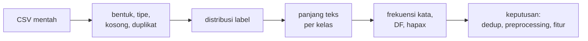
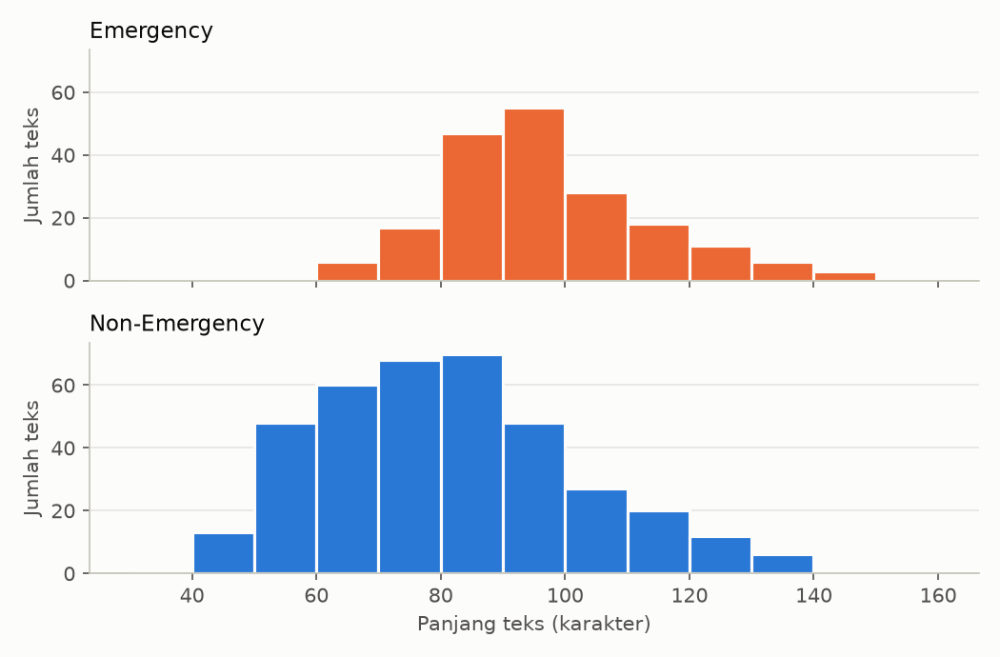

# Statistik Dasar Korpus, Panjang Teks, Frekuensi Kata, dan Vocabulary

!!! abstract "Info materi"
    **Tingkat kesulitan:** Pemula–menengah. **Estimasi waktu:** 90–120 menit.
    **Jenis kode:** snippet edukatif (`examples/level-3-feature-engineering/01_statistik_korpus.py`) dan pembuat gambar (`gambar_level3.py`). Semua angka dari eksekusi nyata pada dataset sintetis.

## Tujuan pembelajaran

- [ ] Menjelaskan istilah korpus, token, tipe, *term frequency*, dan *document frequency*.
- [ ] Memeriksa struktur dataset: tipe kolom, nilai kosong, duplikat, dan distribusi label.
- [ ] Menganalisis distribusi panjang teks per kelas.
- [ ] Menghitung frekuensi kata dan kata yang muncul hanya sekali (*hapax*).
- [ ] Menafsirkan perbedaan antarkelas dengan hati-hati, termasuk kemungkinan artefak data.

## Prasyarat

- [Level 2](../level-2-fondasi-teks/index.md), terutama tokenisasi dan *Pipeline yang Dapat Diuji*.
- [Dasar pandas](../level-1-python/pandas-dasar.md) dan [Missing Values dan Duplikasi](../level-1-python/missing-values-duplikasi.md) (Level 1).

## Pengantar dan motivasi

Sebelum memilih model, kenali datanya. *Exploratory data analysis* (EDA)
menjawab pertanyaan sederhana yang menentukan semua keputusan berikutnya:
berapa banyak data? apakah kelasnya seimbang? apakah ada nilai kosong atau
duplikat? seberapa panjang teksnya? kata apa yang paling sering? Banyak
kegagalan proyek NLP berasal dari kesalahan yang sebenarnya terlihat sejak
EDA, misalnya duplikat yang menyebabkan kebocoran, atau satu kelas yang jauh
lebih kecil.

## Konsep dasar

| Istilah | Arti | Contoh |
|---|---|---|
| **Korpus** | Kumpulan seluruh dokumen | 564 teks sintetis (setelah duplikat dibuang) |
| **Token** | Satu kemunculan kata | 7.124 token |
| **Tipe / kosakata** | Kata unik | 596 tipe |
| **Term frequency (TF)** | Berapa kali kata muncul (total atau di satu dokumen) | `di`: 268 kali |
| **Document frequency (DF)** | Di berapa dokumen kata muncul (minimal sekali) | `di`: 251 dokumen |
| **Hapax** | Kata yang muncul tepat sekali di korpus | 52 kata |
| **Type-token ratio** | Tipe ÷ token | 596 ÷ 7.124 ≈ 0,084 |

**Mengapa DF dan TF berbeda?** Sebuah kata dapat muncul beberapa kali dalam satu
dokumen. TF menghitung semua kemunculan, DF menghitung dokumen. Pada
representasi TF-IDF (halaman berikutnya), keduanya berperan.

## Penjelasan mendalam

### Urutan pemeriksaan data

1. **Bentuk dan tipe:** berapa baris dan kolom; apakah `text` bertipe string?
2. **Nilai kosong dan duplikat:** `isna().sum()` dan `duplicated().sum()`.
3. **Distribusi label:** apakah ada ketidakseimbangan kelas?
4. **Panjang teks:** per kelas, karena perbedaan panjang dapat menjadi fitur sekaligus artefak.
5. **Kata paling sering:** semuanya dan per kelas.
6. **Kata langka:** hapax menunjukkan seberapa banyak kosakata hanya terlihat sekali.

### Mengapa panjang teks penting

Panjang teks memengaruhi pemilihan struktur model (misalnya batas panjang pada
model transformer, Level 6) dan dapat menjadi fitur sendiri. Namun
perbedaan panjang antarkelas bisa merupakan **artefak pengumpulan data**. Pada
dataset sintetis ini, laporan dan permintaan bantuan memuat alamat sehingga
lebih panjang; itu karakteristik templat, bukan hukum bahwa pesan darurat
lebih panjang.

### Kata langka dan batas pembelajaran

Kata yang muncul sekali hampir tidak dapat dipelajari: tidak ada cukup contoh
untuk menghubungkannya dengan label. Banyak hapax biasanya typo, nama unik, atau
angka. Proporsi hapax yang besar menandakan data yang "berisik" atau
preprocessing yang kurang menyatukan variasi.

## Cara kerja atau alur proses



## Contoh sederhana

Tiga dokumen kecil: `"banjir naik"`, `"banjir surut"`, `"gempa kuat"`.

| Kata | TF total | DF |
|---|---|---|
| banjir | 2 | 2 |
| naik | 1 | 1 |
| surut | 1 | 1 |
| gempa | 1 | 1 |
| kuat | 1 | 1 |

Token = 6, tipe = 5, hapax = 4 (`naik`, `surut`, `gempa`, `kuat`).

## Contoh dalam konteks Twitter/X kebencanaan

Pada dataset sintetis: 574 baris termasuk 10 duplikat persis (meniru
*retweet*). Dua pertanyaan EDA yang paling berguna adalah *apakah ada duplikat
yang akan bocor antara latih dan uji?* dan *apakah ada kelas yang sangat
kecil?*. Keduanya dijawab oleh Bagian 1.

## Praktik Python

Berkas: `examples/level-3-feature-engineering/01_statistik_korpus.py`.

### Bagian 1 — Bentuk, tipe, kosong, duplikat, label

```python title="Bagian 1"
--8<-- "level-3-feature-engineering/01_statistik_korpus.py:dasar"
```

- `muat_dataset(hapus_duplikat=False)` membaca data **apa adanya** agar duplikat dapat dilihat.
- `df.dtypes` menampilkan tipe kolom; `df.isna().sum()` menghitung nilai kosong per kolom.
- `duplicated().sum()` menghitung teks yang sudah muncul sebelumnya.
- `value_counts()` menghitung per label; `normalize=True` mengubahnya menjadi proporsi.

```text title="Output nyata"
(574, 6)
source_id      str
event_id       str
post_type      str
template_id    str
text           str
label          str
source_id      0
event_id       0
post_type      0
template_id    0
text           0
label          0
duplikat teks: 10
label
Non-Emergency    373
Emergency        201
label
Non-Emergency    0.65
Emergency        0.35
```

Interpretasi: 574 baris, 6 kolom, tidak ada nilai kosong, 10 duplikat. Tipe `str`
adalah tipe teks bawaan pandas 3 (pada pandas 2 akan tertulis `object`).
Emergency 35% dan Non-Emergency 65% menunjukkan **ketidakseimbangan sedang**,
sehingga akurasi saja tidak cukup untuk menilai model (dibahas di Level 5).
Pada langkah berikutnya duplikat dibuang (`muat_dataset()`), sehingga tersisa
564 baris (191 Emergency dan 373 Non-Emergency).

### Bagian 2 — Panjang teks per kelas

```python title="Bagian 2"
--8<-- "level-3-feature-engineering/01_statistik_korpus.py:panjang"
```

- `str.len()` menghitung karakter; `len(tokenisasi(...))` menghitung token.
- `groupby("label")[[...]].describe()` menghitung ringkasan statistik per kelas.
- `.round(1).T` membulatkan dan memutar tabel agar muat.

```text title="Output nyata"
label             Emergency  Non-Emergency
n_karakter count      191.0          373.0
           mean        96.6           81.1
           std         16.4           20.8
           min         63.0           40.0
           25%         85.0           66.0
           50%         95.0           79.0
           75%        104.0           93.0
           max        148.0          145.0
n_token    count      191.0          373.0
           mean        14.9           11.4
           std          2.6            2.7
           min         10.0            6.0
           25%         13.0            9.0
           50%         15.0           11.0
           75%         16.0           13.0
           max         24.0           20.0
```

Interpretasi: teks Emergency rata-rata lebih panjang (96,6 karakter, 14,9 token)
daripada Non-Emergency (81,1 karakter, 11,4 token), dan teks Emergency terpendek
(63 karakter) lebih panjang daripada Non-Emergency terpendek (40).
Perbedaan itu nyata pada data ini, tetapi **berasal dari cara data dibuat**:
templat laporan menyebut alamat. Pada data nyata, perbedaannya bisa berbeda arah.



Dua panel dipisah (bukan ditumpuk) agar bentuk masing-masing sebaran terlihat.
Gambar dibuat oleh `gambar_level3.py`, dengan warna oranye/biru yang telah
dicek terpisah untuk dapat dibedakan oleh pembaca buta warna merah-hijau.

### Bagian 3 — Frekuensi kata

```python title="Bagian 3"
--8<-- "level-3-feature-engineering/01_statistik_korpus.py:frekuensi"
```

`praproses_token(t)` dari Level 2 menghasilkan token tiap teks (konfigurasi dasar). `Counter` menghitung kemunculan; `most_common(10)` mengambil sepuluh teratas.

```text title="Output nyata"
token: 7124 tipe: 596
[('di', 268), ('jalan', 152), ('kelurahan', 148), ('dan', 134), ('rt', 128), ('tok_url', 80), ('tok_mention', 79), ('tolong', 77), ('rumah', 77), ('bencana', 73)]
```

Interpretasi: kata teratas adalah kata fungsi (`di`, `dan`) dan kata pembentuk
alamat (`jalan`, `kelurahan`, `rt`). `jalan` bernilai 152, lebih besar daripada
kemunculan kata "jalan" yang ditulis lengkap, karena normalisasi
informal mengubah `jl` menjadi `jalan`. Token penanda (`tok_url`,
`tok_mention`) sudah masuk 10 teratas, dan itu wajar karena sekitar 14% teks
memuat masing-masing.

### Bagian 4 — Document frequency dan hapax

```python title="Bagian 4"
--8<-- "level-3-feature-engineering/01_statistik_korpus.py:df_kata"
```

`set(d)` mengambil kata unik per dokumen sehingga `Counter` menghitung dokumen (DF), bukan kemunculan. Hapax diambil dari kata dengan jumlah kemunculan total 1.

```text title="Output nyata"
kata yang muncul tepat 1x (hapax): 52 (8.7% dari tipe)
kata di >= 5 dokumen: 432
DF tertinggi: [('di', 251), ('kelurahan', 148), ('jalan', 131), ('rt', 128), ('dan', 127)]
```

Interpretasi: hanya 52 dari 596 tipe (8,7%) yang muncul sekali. Sebanyak 432 tipe
(72%) muncul di setidaknya lima dokumen. `di` ada di 251 dari 564 teks (44%);
bandingkan dengan TF 268: ada dokumen yang memuat `di` lebih dari sekali.
Proporsi hapax yang kecil ini ciri data bertemplat: kosakatanya berulang
jauh lebih banyak daripada teks media sosial nyata.

### Bagian 5 — Kata teratas per kelas

```python title="Bagian 5"
--8<-- "level-3-feature-engineering/01_statistik_korpus.py:per_kelas"
```

```text title="Output nyata"
Emergency    : [('di', 148), ('rt', 120), ('jalan', 114), ('dan', 77), ('kelurahan', 71), ('rumah', 65), ('warga', 46), ('butuh', 43)]
Non-Emergency: [('di', 103), ('kelurahan', 77), ('ini', 68), ('tok_mention', 63), ('sudah', 58), ('bencana', 57), ('gunung', 53), ('tok_url', 52)]
```


Interpretasi: `di`, `rt`, dan `jalan` ada di sebagian besar teks Emergency
(`di` pada 148 dari 191 teks, yaitu 77%), sedangkan pada Non-Emergency tidak ada kata yang melewati
28% (`di`: 103 dari 373 teks). Dua panel memakai skala sumbu yang sama sehingga tinggi batang
dapat dibandingkan langsung. **Pola ini hasil templat**
(kalimat laporan selalu menyebut alamat); ia penting untuk disadari karena
model apa pun akan memanfaatkannya, dan itu tidak akan berlaku pada data nyata.

### Skrip terpadu

Karena setiap bagian membaca data yang sama dan menghasilkan ringkasan yang
berdiri sendiri, skrip lengkap hanyalah penyambungan kelima bagian. Skrip siap jalan:
`examples/level-3-feature-engineering/01_statistik_korpus.py`.

## Kesalahan umum dan debugging

| Gejala | Penyebab | Perbaikan |
|---|---|---|
| `KeyError: 'text'` | Nama kolom salah | Cetak `df.columns` |
| Jumlah baris tidak cocok dengan dokumentasi | Duplikat sudah dibuang atau belum | Periksa argumen `hapus_duplikat` |
| Kata teratas hanya kata fungsi | Hanya melihat frekuensi total | Lihat DF per kelas, dan periksa kata isi |
| Menyimpulkan "pesan darurat lebih panjang" | Mengabaikan artefak data | Bandingkan dengan data lain; jelaskan asal data |
| `DF` dan `TF` tertukar | Menghitung kata per dokumen tanpa `set` | Pakai `set(dokumen)` untuk DF |

## Kelebihan dan keterbatasan

**Kelebihan:** murah dan cepat; menemukan duplikat, ketidakseimbangan, dan artefak sebelum modeling.
**Keterbatasan:** statistik deskriptif tidak membuktikan hubungan sebab-akibat;
pada dataset kecil, angka kata langka tidak stabil; EDA pada seluruh data harus dibedakan dari analisis
pada data latih saja (statistik yang memengaruhi keputusan model tidak boleh memakai data uji).

!!! warning "EDA dan data uji"
    Melihat statistik seluruh data untuk memahami datanya boleh. Namun
    keputusan yang dipelajari dari data (misalnya memilih kata untuk fitur)
    harus memakai data latih saja, seperti dijelaskan di halaman
    [Representasi dengan scikit-learn](representasi-sklearn.md).

## Latihan bertahap

1. **Konseptual.** Apa beda TF dan DF? Berikan satu contoh kata dengan TF lebih besar daripada DF.
2. **Menghitung.** Hitung *type-token ratio* korpus ini (tipe ÷ token).
3. **Membaca kode.** Mengapa `Counter(k for d in token_per_teks for k in set(d))` menghasilkan DF, bukan TF?
4. **Pemrograman kecil.** Hitung persentase teks yang memuat kata `tolong`.
5. **Mini-proyek.** Hitung median panjang teks (karakter) per kelas, lalu jelaskan satu alasan mengapa selisihnya tidak boleh dianggap sifat nyata pesan darurat.

## Kunci jawaban dan pembahasan

??? success "Jawaban 1"
    TF menghitung kemunculan; DF menghitung dokumen. Contoh: `di` punya TF 268 tetapi DF 251, karena sebagian dokumen memuat `di` lebih dari sekali.

??? success "Jawaban 2"
    596 ÷ 7.124 ≈ 0,0837. Nilai kecil berarti kosakata sering diulang; teks nyata biasanya punya rasio yang berbeda dan bergantung pada ukuran korpus.

??? success "Jawaban 3"
    `set(d)` membuang duplikat di dalam satu dokumen, sehingga setiap kata dihitung paling banyak sekali per dokumen. `Counter` lalu menjumlahkan jumlah dokumen.

??? success "Jawaban 4"
    ```python
    ada = [("tolong" in praproses_token(t)) for t in df["text"]]
    print(sum(ada) / len(ada))
    ```
    Hasil yang dijalankan: DF `tolong` = 77 dari 564 teks, yaitu 13,7%. Pembahasan: `tolong` bukan kata mayoritas, dan (halaman *Stopwords*) tersebar hampir sama di kedua kelas.

??? success "Jawaban 5"
    Median Emergency 95 karakter dan Non-Emergency 79 karakter (hasil dijalankan). Alasan: teks Emergency pada dataset ini dibuat dari templat yang menyebut alamat, sehingga lebih panjang. Itu artefak pembangkit data, bukan temuan tentang pesan darurat nyata.

## Kuis singkat

**1.** Apa arti hapax?

??? success "Jawaban"
    Kata yang muncul tepat sekali di seluruh korpus.

**2.** Mengapa melihat DF per kelas berguna?

??? success "Jawaban"
    Menunjukkan kata yang lebih banyak dipakai pada satu kelas, sehingga kita dapat mengenali kata penanda dan juga artefak data.

**3.** Mengapa perbedaan panjang teks antarkelas tidak boleh langsung disimpulkan sebagai sifat nyata?

??? success "Jawaban"
    Perbedaan itu dapat berasal dari cara data dikumpulkan atau (di sini) dibuat.

## Ringkasan

- EDA mengenali data sebelum modeling: bentuk, kosong, duplikat, distribusi label, panjang teks, frekuensi kata.
- TF menghitung kemunculan; DF menghitung dokumen; hapax muncul sekali.
- Dataset sintetis: 564 teks bersih, 7.124 token, 596 tipe, kelas Emergency 35%.
- Pola antarkelas (panjang, alamat) berasal dari templat; jangan digeneralisasi.

## Glosarium istilah baru

Korpus
:   Kumpulan dokumen yang dianalisis.

Term frequency (TF)
:   Jumlah kemunculan sebuah kata.

Document frequency (DF)
:   Jumlah dokumen yang memuat sebuah kata.

Hapax
:   Kata yang hanya muncul satu kali di korpus.

Type-token ratio
:   Jumlah tipe dibagi jumlah token.

EDA
:   *Exploratory data analysis*: pemeriksaan data untuk memahami strukturnya.

## Referensi

- Dokumentasi pandas, *User Guide*: <https://pandas.pydata.org/docs/user_guide/index.html> (dokumentasi resmi).
- Dokumentasi Python, `collections.Counter`: <https://docs.python.org/3/library/collections.html#collections.Counter>.

## Materi berikutnya

[Word n-gram dan Character n-gram](n-gram.md)
