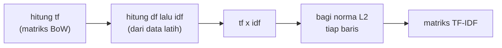

# TF-IDF dan Intuisi Matematisnya

!!! abstract "Info materi"
    **Tingkat kesulitan:** Menengah. **Estimasi waktu:** 120 menit.
    **Jenis kode:** snippet edukatif (`examples/level-3-feature-engineering/04_tfidf.py`). Perhitungan manual dicocokkan dengan scikit-learn.

## Tujuan pembelajaran

- [ ] Menjelaskan intuisi TF-IDF: kata yang sering di satu dokumen tetapi jarang di korpus lebih informatif.
- [ ] Menghitung TF-IDF dengan tangan, termasuk normalisasi L2, dari contoh kecil.
- [ ] Membedakan rumus IDF buku teks dan rumus "smooth" milik scikit-learn.
- [ ] Menjelaskan mengapa IDF "punya state" dan harus dipelajari hanya dari data latih.

## Prasyarat

- [Bag of Words](bag-of-words.md) dan [Statistik Dasar Korpus](statistik-korpus.md) (TF dan DF).
- Logaritma dan akar kuadrat pada tingkat sekolah menengah. Setiap simbol dijelaskan di bawah.

## Pengantar dan motivasi

Pada BoW, setiap kata bernilai sama: `di` yang ada di mana-mana setara
dengan `pinggang` yang jarang. Padahal `pinggang` jauh lebih informatif.
Pikirkan sebuah kata sebagai saksi: saksi yang bicara pada setiap kasus
(`di`) tidak membantu membedakan kasus. Saksi yang hanya muncul pada kasus
tertentu (`pinggang`, `evakuasi`) lebih berharga. TF-IDF memberi bobot lebih
besar kepada kata yang sering muncul di dokumen tetapi jarang di seluruh korpus.

## Konsep dasar

TF-IDF merupakan hasil kali dua bagian:

- **TF (*term frequency*)**: berapa kali kata $t$ muncul di dokumen $d$.
- **IDF (*inverse document frequency*)**: seberapa jarang kata $t$ di seluruh korpus.

$$
\text{tf-idf}(t, d) = \text{tf}(t, d) \times \text{idf}(t)
$$

Simbol: $t$ adalah kata (*term*); $d$ adalah dokumen; $\text{tf}(t,d)$ jumlah kemunculan $t$ di $d$.

### IDF versi scikit-learn

$$
\text{idf}(t) = \ln\!\left(\frac{1 + n}{1 + \text{df}(t)}\right) + 1
$$

- $n$ : jumlah dokumen di korpus.
- $\text{df}(t)$ : jumlah dokumen yang memuat $t$ (*document frequency*).
- $\ln$ : logaritma natural.
- Angka $1$ di pembilang dan penyebut (*smoothing*) mencegah pembagian dengan nol bila ada kata yang tidak muncul di dokumen mana pun; angka $+1$ di luar logaritma membuat kata yang muncul di semua dokumen tetap memiliki bobot 1, bukan 0.

Rumus ini yang dipakai `TfidfVectorizer` secara bawaan (`smooth_idf=True`).
Rumus buku teks paling sederhana, $\text{idf}(t) = \ln(n / \text{df}(t))$, memberi bobot 0 pada kata yang
ada di semua dokumen; rumus scikit-learn memberi 1.

### Normalisasi L2

Dokumen panjang punya hitungan yang lebih besar daripada dokumen pendek. Agar
panjang dokumen tidak mendominasi, tiap vektor dibagi **norma L2**-nya
(panjang vektor):

$$
v_{\text{norm}} = \frac{v}{\lVert v \rVert_2}, \qquad \lVert v \rVert_2 = \sqrt{v_1^2 + v_2^2 + \dots + v_V^2}
$$

Setelah normalisasi, setiap dokumen punya panjang vektor 1.

## Penjelasan mendalam

### Contoh numerik langkah demi langkah

Korpus kecil dengan $n = 3$ dokumen:

1. `banjir naik air naik`
2. `tolong air masuk rumah`
3. `gempa kuat`

Kata `air` muncul di dua dokumen ($\text{df}=2$); kata lain di satu dokumen ($\text{df}=1$).

- $\text{idf}(\text{air}) = \ln(4/3) + 1 = 0{,}2877 + 1 = 1{,}2877$
- $\text{idf}(\text{banjir}) = \ln(4/2) + 1 = 0{,}6931 + 1 = 1{,}6931$

Dokumen 1: `banjir`=1, `naik`=2, `air`=1.

| Kata | tf | idf | tf × idf |
|---|---|---|---|
| air | 1 | 1,2877 | 1,2877 |
| banjir | 1 | 1,6931 | 1,6931 |
| naik | 2 | 1,6931 | 3,3863 |

Norma: $\sqrt{1{,}2877^2 + 1{,}6931^2 + 3{,}3863^2} = \sqrt{15{,}99} \approx 3{,}999$.
Setelah normalisasi: `air` = 0,322; `banjir` = 0,423; `naik` = 0,847.

Perhatikan: `air` (ada di 2 dari 3 dokumen) mendapat bobot paling rendah per
kemunculan, dan `naik` yang muncul dua kali dengan IDF tinggi paling besar.

### Mengapa IDF "punya state"

IDF dihitung dari seluruh dokumen yang diberikan ke `fit`. Jadi ia adalah
statistik korpus. Bila `fit` dilakukan pada seluruh data (termasuk uji), data
uji memengaruhi bobot (kebocoran; lihat [Data Leakage](../level-2-fondasi-teks/leakage-preprocessing.md)).
IDF tidak memakai label, tetapi prinsipnya tetap: uji harus tak terlihat.

### Pilihan lain

- `sublinear_tf=True`: mengganti tf dengan $1 + \ln(\text{tf})$ sehingga kata yang diulang tidak mendominasi.
- `use_idf=False`: hanya tf (dan normalisasi).
- `norm=None`: tanpa normalisasi.

Pada teks pendek, tf hampir selalu 1, sehingga efek `sublinear_tf` kecil.

## Cara kerja atau alur proses



## Contoh sederhana

Lihat contoh numerik di atas. Bagian 1–3 pada Praktik Python mereproduksi
setiap angka dengan kode.

## Contoh dalam konteks Twitter/X kebencanaan

Pada teks latih sintetis, kata dengan IDF terendah adalah kata yang ada di
hampir setiap teks (`di`), dan kata dengan IDF tertinggi adalah yang muncul
sekali (typo seperti `kebkaaran`). Hal ini wajar secara matematis, tetapi
mengingatkan kita bahwa **IDF tinggi tidak sama dengan informatif**: typo
sekali muncul tidak berguna untuk menggeneralisasi. Itulah mengapa ambang
`min_df` dipakai (halaman *Representasi dengan scikit-learn*).

## Praktik Python

Berkas: `examples/level-3-feature-engineering/04_tfidf.py`.

### Bagian 1 — Menghitung IDF dengan tangan

```python title="Bagian 1"
--8<-- "level-3-feature-engineering/04_tfidf.py:idf"
```

- `cv.fit_transform(dokumen).toarray()` memberi matriks hitungan (`tf`).
- `(tf > 0).sum(axis=0)` menghitung, per kolom (kata), jumlah dokumen yang memuat kata itu (DF).
- `np.log` adalah logaritma natural; baris `idf = ...` menerjemahkan rumus scikit-learn secara langsung.

```text title="Output nyata"
  kata  df    idf
   air   2 1.2877
banjir   1 1.6931
 gempa   1 1.6931
  kuat   1 1.6931
 masuk   1 1.6931
  naik   1 1.6931
 rumah   1 1.6931
tolong   1 1.6931
```

Interpretasi: `air` (df = 2) mendapat IDF 1,2877; kata lain (df = 1) mendapat 1,6931,
sama dengan perhitungan tangan di atas.

### Bagian 2 — TF × IDF dan normalisasi L2

```python title="Bagian 2"
--8<-- "level-3-feature-engineering/04_tfidf.py:manual"
```

`tf[0] * idf` mengalikan dua array elemen demi elemen (dokumen pertama dengan IDF tiap kata). `norma` adalah akar jumlah kuadrat. Hanya kata yang bernilai positif yang dicetak.

```text title="Output nyata"
air     tf*idf=1.2877  setelah L2=0.3220
banjir  tf*idf=1.6931  setelah L2=0.4234
naik    tf*idf=3.3863  setelah L2=0.8468
norma L2 mentah: 3.999 | panjang hasil: 1.0
```

Interpretasi: angkanya sama dengan tabel di bagian penjelasan. Panjang vektor hasil
tepat 1,0, itulah arti normalisasi L2.

### Bagian 3 — Mencocokkan dengan scikit-learn

```python title="Bagian 3"
--8<-- "level-3-feature-engineering/04_tfidf.py:cocok"
```

`np.allclose(a, b)` memeriksa bahwa dua array sama dalam toleransi kecil (angka desimal tidak perlu persis).

```text title="Output nyata"
idf sama dengan sklearn : True
vektor sama dengan sklearn: True
```

Interpretasi: perhitungan manual sama dengan `TfidfVectorizer`. Menurunkan rumus dan
mencocokkannya dengan pustaka adalah cara terbaik untuk yakin bahwa kita memahami
apa yang dilakukan pustaka.

### Bagian 4 — Pada dataset

```python title="Bagian 4"
--8<-- "level-3-feature-engineering/04_tfidf.py:dataset"
```

Vektorizer dilatih **hanya** pada teks latih (`v.fit(teks_latih)`). `np.argsort` mengurutkan indeks menurut nilai; `[::-1]` membalik urutan; `[:5]` mengambil lima teratas.

```text title="Output nyata"
IDF terendah : [('di', 1.82), ('kelurahan', 2.34), ('rt', 2.47), ('dan', 2.47), ('jalan', 2.47)]
IDF tertinggi: [('lambat', 6.42), ('kebkaaran', 6.42), ('kyaak', 6.42)]
tips menghadapi banjir kenali jalur evakuasi dan kumpulkan nomor darurat
[('darurat', 0.362), ('nomor', 0.355), ('tips', 0.355), ('kumpulkan', 0.355), ('menghadapi', 0.326)]
```

Interpretasi:

- IDF terendah: `di` (1,82), kata yang ada di hampir setiap teks.
- IDF tertinggi 6,42, yaitu $\ln(453/2)+1$ untuk kata dengan $\text{df}=1$ dari $n=452$ teks latih; di antaranya typo (`kebkaaran`, `kyaak`).
- Pada teks contoh, kata dengan bobot terbesar adalah `darurat`, `nomor`, `tips`, `kumpulkan`: kata yang jarang. `banjir` tidak masuk lima besar (IDF 3,35, bobot 0,262) karena lebih sering muncul daripada kata-kata itu. Ini contoh bagaimana TF-IDF menurunkan bobot kata topik yang umum di korpus.

### Skrip terpadu

Gabungan keempat bagian ada di `examples/level-3-feature-engineering/04_tfidf.py`.
Versi siap pakai dalam `Pipeline` ada di halaman berikutnya.

## Kesalahan umum dan debugging

| Gejala | Penyebab | Perbaikan |
|---|---|---|
| Hasil manual tidak sama dengan sklearn | Memakai rumus IDF buku teks tanpa smoothing | Pakai $\ln\frac{1+n}{1+\text{df}}+1$ |
| Norma bukan 1 | Lupa normalisasi L2 | Bagi vektor dengan norma |
| `fit` pada seluruh data | Kebocoran statistik korpus | `fit` pada latih; gunakan `Pipeline` |
| Kata typo memiliki bobot sangat tinggi | IDF tinggi = langka, bukan informatif | `min_df` ≥ 2 |
| Menyamakan TF-IDF dengan "kepentingan sebenarnya" | Bobot hanya statistik frekuensi | Evaluasi dengan model dan data |

## Kelebihan dan keterbatasan

**Kelebihan:** meredam kata umum tanpa daftar stopword; sederhana; sering menjadi
baseline yang kuat; hasilnya dapat ditafsirkan.
**Keterbatasan:** tidak memahami makna/urutan; kata langka dapat diberi bobot
berlebihan (typo); IDF bergantung pada korpus sehingga berubah bila korpus berubah;
tidak memakai label sama sekali.

## Latihan bertahap

1. **Konseptual.** Mengapa kata yang muncul di semua dokumen tidak membantu membedakan dokumen?
2. **Menghitung.** Pada korpus 3 dokumen di atas, hitung $\text{idf}(\text{gempa})$ dengan rumus scikit-learn.
3. **Menghitung.** Berapa panjang (norma L2) vektor `[3, 4]`? Setelah dinormalisasi, berapa nilainya?
4. **Debugging.** Seseorang menghitung IDF dengan $\ln(n/\text{df})$ lalu membandingkan dengan scikit-learn dan hasilnya berbeda. Mengapa?
5. **Mini-proyek.** Ubah Bagian 4 memakai `TfidfVectorizer(min_df=2)`. Kata apa yang kini tidak lagi muncul di IDF tertinggi?

## Kunci jawaban dan pembahasan

??? success "Jawaban 1"
    Kata yang ada di setiap dokumen tidak membedakan satu dokumen dari yang lain: kehadirannya tidak memberi informasi. IDF memberinya bobot paling rendah.

??? success "Jawaban 2"
    $\text{df}(\text{gempa}) = 1$, $n = 3$: $\ln(4/2)+1 = 0{,}6931 + 1 = 1{,}6931$, sesuai tabel Bagian 1.

??? success "Jawaban 3"
    $\sqrt{3^2 + 4^2} = \sqrt{25} = 5$. Setelah dinormalisasi: $[3/5, 4/5] = [0{,}6;\ 0{,}8]$. Cek: $0{,}6^2 + 0{,}8^2 = 1$.

??? success "Jawaban 4"
    Scikit-learn memakai rumus dengan smoothing: $\ln\frac{1+n}{1+\text{df}}+1$, bukan $\ln(n/\text{df})$. Untuk $n=3$, $\text{df}=2$, rumus buku teks memberi $\ln 1{,}5 = 0{,}405$, sedangkan scikit-learn memberi $1{,}2877$.

??? success "Jawaban 5"
    Hasil yang dijalankan: dengan `min_df=2`, kosakata latih menjadi 526 kata, `kebkaaran` dan `kyaak` hilang (karena DF = 1), dan IDF tertinggi menjadi 6,02, yaitu $\ln(453/3)+1$ untuk kata dengan $\text{df}=2$. Pembahasan: `min_df` membuang kata yang terlalu langka untuk dipelajari.

## Kuis singkat

**1.** Apa yang dicapai normalisasi L2?

??? success "Jawaban"
    Setiap vektor dokumen berpanjang 1, sehingga panjang dokumen tidak mendominasi.

**2.** Apakah IDF memakai label kelas?

??? success "Jawaban"
    Tidak, tetapi ia dihitung dari korpus, sehingga `fit` hanya pada data latih.

**3.** Mengapa IDF scikit-learn memakai "+1" di luar logaritma?

??? success "Jawaban"
    Agar kata yang muncul di semua dokumen tetap berbobot 1, bukan 0.

## Ringkasan

- TF-IDF = tf × idf; kata sering di dokumen tetapi jarang di korpus mendapat bobot besar.
- Scikit-learn: $\text{idf} = \ln\frac{1+n}{1+\text{df}} + 1$, lalu normalisasi L2.
- Perhitungan manual (1,2877 / 1,6931 / 0,322 / 0,423 / 0,847) sama dengan `TfidfVectorizer`.
- IDF dipelajari dari korpus: `fit` hanya pada data latih.

## Glosarium istilah baru

TF-IDF
:   Pembobotan kata: frekuensi di dokumen dikali kelangkaan di korpus.

IDF
:   *Inverse document frequency*: ukuran kelangkaan kata di korpus.

Smoothing
:   Penambahan konstanta kecil agar perhitungan stabil.

Norma L2
:   Panjang vektor (akar jumlah kuadrat elemen).

Logaritma natural
:   Logaritma berbasis $e \approx 2{,}718$, ditulis $\ln$.

## Referensi

- Spärck Jones, K. (1972). A statistical interpretation of term specificity and its application in retrieval. *Journal of Documentation*, 28(1), 11–21. DOI: 10.1108/eb026526 (makalah akademik; asal gagasan IDF).
- Salton, G., & Buckley, C. (1988). Term-weighting approaches in automatic text retrieval. *Information Processing & Management*, 24(5), 513–523. DOI: 10.1016/0306-4573(88)90021-0 (makalah akademik; ulasan skema pembobotan).
- Dokumentasi scikit-learn, bagian *Tf–idf term weighting*: <https://scikit-learn.org/stable/modules/feature_extraction.html#tfidf-term-weighting> (dokumentasi resmi; rumus yang dipakai).

## Materi berikutnya

[Sparse Matrix dan One-hot Encoding](sparse-matrix-one-hot.md)
