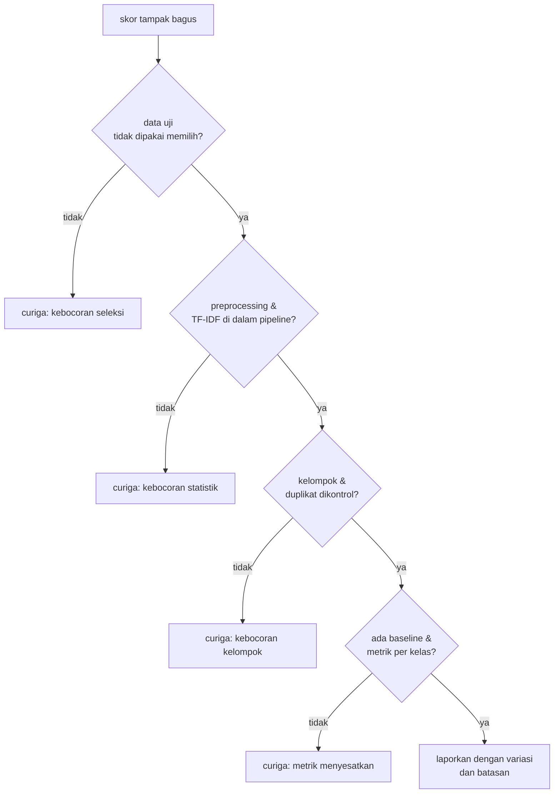

# Kesalahan Umum dalam Training dan Cara Memperbaikinya

!!! abstract "Info materi"
    **Tingkat kesulitan:** Menengah. **Estimasi waktu:** 90 menit.
    **Jenis kode:** snippet edukatif (`examples/level-4-classification/10_kesalahan_umum.py`). Setiap galat sengaja dipicu dan pesan asli dicetak dari eksekusi nyata.

## Tujuan pembelajaran

- [ ] Mengenali pesan galat yang paling sering muncul saat memuat data dan melatih model.
- [ ] Membedakan galat yang **berhenti** (ada pesan) dari galat **sunyi** (hasil salah tanpa pesan).
- [ ] Menjelaskan overfitting dan menunjukkannya dengan jarak skor latih-uji.
- [ ] Menjelaskan jebakan metrik pada kelas tidak seimbang.
- [ ] Memiliki daftar periksa sebelum mempercayai skor.

## Prasyarat

Seluruh halaman Level 4 sebelumnya.

## Pengantar dan motivasi

Galat yang menghentikan program melelahkan tetapi aman: Anda tahu ada yang salah. Yang
berbahaya adalah kesalahan sunyi: program berjalan, skor muncul, dan skor itu tidak benar
(kebocoran data, label terbalik, metrik salah). Halaman ini mengumpulkan keduanya.

## Konsep dasar

| Jenis | Ciri | Contoh |
|---|---|---|
| **Galat berhenti** | Program berhenti dengan pesan | `KeyError`, `FileNotFoundError` |
| **Galat sunyi** | Program berjalan, hasil menyesatkan | Kebocoran, label terbalik, akurasi pada data tidak seimbang |
| **Peringatan** | Program berjalan, pustaka memberi tahu | `ConvergenceWarning` |

## Penjelasan mendalam

### Cara membaca traceback

1. Baca **baris terakhir** dahulu: jenis galat dan pesannya.
2. Cari baris pertama dari **kode Anda** (bukan pustaka) pada jejak.
3. Periksa nilai variabel di baris itu (`print(type(x), x.shape)`).

### Daftar kesalahan dan ciri pengenalnya

| # | Kesalahan | Cara mengenali | Perbaikan |
|---|---|---|---|
| 1 | Path file salah | `FileNotFoundError` | Pakai jalur relatif terhadap skrip; periksa `Path.cwd()` |
| 2 | Nama kolom salah | `KeyError` | Cetak `df.columns` |
| 3 | Nilai kosong pada teks | `np.nan is an invalid document` | Isi atau buang baris sebelum vektorisasi |
| 4 | Tipe data salah | `TypeError` | Pastikan `str` (paket ini menolak non-`str` dengan pesan jelas) |
| 5 | API versi lama | `unexpected keyword argument` | Baca dokumentasi versi yang terpasang |
| 6 | Jumlah `X` dan `y` berbeda | `inconsistent numbers of samples` | `len(X) == len(y)` |
| 7 | Ukuran fitur berbeda | `X has N features, but ... expecting M` | Pakai satu pipeline; jangan `fit` vektorizer terpisah pada uji |
| 8 | Kebocoran data | **Sunyi**; skor terlalu bagus | Pipeline, pembagian per kelompok, uji label acak |
| 9 | Label terbalik | **Sunyi**; recall aneh | Pemetaan eksplisit, `pos_label` |
| 10 | Overfitting | Skor latih ≫ skor uji | Data lebih banyak, regularisasi, validasi silang |
| 11 | Akurasi pada kelas tidak seimbang | **Sunyi**; akurasi tinggi tanpa recall | Metrik per kelas, baseline |

### Overfitting

Overfitting terjadi saat model menghafal data latih (termasuk noise) sehingga buruk pada
data baru. Tanda utama: **jarak** antara skor latih dan skor uji. Penyebab umum: data terlalu sedikit,
model terlalu fleksibel, regularisasi terlalu lemah.

## Cara kerja atau alur proses

Daftar periksa sebelum mempercayai skor:



## Contoh sederhana

Seorang murid mengerjakan 30 soal latihan sampai hafal. Nilai latihan 100, nilai ujian
soal berbeda jauh lebih rendah. Itu overfitting.

## Contoh dalam konteks Twitter/X kebencanaan

Seorang pengembang melaporkan akurasi 95% untuk "detektor darurat". Setelah diperiksa, hanya 5%
data yang Emergency; model yang selalu menjawab Non-Emergency juga 95%, dengan recall Emergency 0.
Skor itu tidak menunjukkan apa pun tentang kemampuan menemukan pesan darurat.

## Praktik Python

Berkas: `examples/level-4-classification/10_kesalahan_umum.py`. Fungsi `tampil(judul, fungsi)` menjalankan
`fungsi` dan mencetak jenis serta pesan pertama galat bila terjadi.

### Bagian 1 — Galat yang berhenti

```python title="Bagian 1"
--8<-- "level-4-classification/10_kesalahan_umum.py:galat"
```

Setiap baris memicu satu kesalahan. `lambda:` membungkus pemanggilan agar bisa dijalankan di dalam `tampil`.

```text title="Output nyata"
1 path salah       : FileNotFoundError: [Errno 2] No such file or directory: 'data/tidak_ada.csv'
2 kolom salah      : KeyError: 'teks'
3 nilai kosong     : ValueError: np.nan is an invalid document, expected byte or unicode string.
4 tipe data salah  : TypeError: teks harus str, bukan int
5 API lama         : TypeError: OneHotEncoder.__init__() got an unexpected keyword argument 'sparse'
6 label tak cocok  : ValueError: Found input variables with inconsistent numbers of samples: [335, 330]
```

Interpretasi per baris:

1. `FileNotFoundError`: berkas tidak ada pada jalur yang diberikan; periksa direktori kerja.
2. `KeyError: 'teks'`: kolom bernama `text`, bukan `teks`.
3. Nilai kosong (`NaN`) di teks: vektorizer menolaknya. Periksa `df["text"].isna().sum()` lebih dulu.
4. Pesan Bahasa Indonesia berasal dari fungsi `praproses` buatan kita (`TypeError: teks harus str`): pesan jelas lebih baik daripada galat membingungkan di dalam pustaka.
5. Argumen `sparse` sudah diganti `sparse_output` pada scikit-learn versi baru; contoh lama di internet bisa gagal.
6. Jumlah `X` = 335 dan `y` = 330 (lima label dipotong sengaja): jumlah harus sama.

### Bagian 2 — Ukuran fitur berbeda

```python title="Bagian 2"
--8<-- "level-4-classification/10_kesalahan_umum.py:bentuk"
```

Model dilatih dengan kosakata latih (652 fitur) lalu diberi fitur dari kosakata uji yang dipelajari terpisah.

```text title="Output nyata"
7 bentuk fitur beda: ValueError: X has 421 features, but LogisticRegression is expecting 652 features as input.
```

Interpretasi: kosakata uji (421) berbeda dari latih (652), sehingga kolom tidak cocok. Galat ini
justru menolong. Bila jumlah kolom kebetulan sama, kolom akan salah susun tanpa galat dan
prediksi menjadi sampah (galat sunyi). Pakai `Pipeline` agar kosakata latih selalu dipakai.

### Bagian 3 — Overfitting

```python title="Bagian 3"
--8<-- "level-4-classification/10_kesalahan_umum.py:overfit"
```

Model dilatih pada hanya 30 teks dengan `C=1000` (regularisasi sangat lemah), lalu dievaluasi pada data latih itu dan pada 112 teks uji.

```text title="Output nyata"
pelatihan 30 teks:  F1 latih = 1.0 | F1 uji = 0.858
```

Interpretasi: model "sempurna" pada 30 teks latih (F1 makro 1,0), tetapi 0,858 pada uji. Jarak
0,142 inilah overfitting. Tanpa data uji terpisah, skor latih 1,0 akan terlihat seperti prestasi.

### Bagian 4 — Jebakan akurasi

```python title="Bagian 4"
--8<-- "level-4-classification/10_kesalahan_umum.py:metrik"
```

```text title="Output nyata"
tulis-tangan (seimbang), selalu 0: akurasi = 0.5
data 5% Emergency, selalu 0       : akurasi = 0.95 | recall Emergency = 0.0
```

Interpretasi: pada data seimbang, selalu menjawab satu kelas menghasilkan akurasi 0,5, tolok ukur
tebakan. Pada data yang hanya 5% Emergency, jawaban "selalu Non-Emergency" mencapai akurasi 0,95 dengan
recall Emergency 0. Pada tugas darurat, akurasi pada data tidak seimbang tidak informatif.

### Skrip terpadu

`10_kesalahan_umum.py` menjalankan seluruh pemicu dan berjalan dalam sekitar 2 detik.

## Kesalahan umum dan debugging

Seluruh halaman ini adalah daftar kesalahan umum; tabel pada bagian *Penjelasan mendalam* adalah
rujukan cepatnya. Tiga kebiasaan yang paling menghemat waktu:

1. Cetak `type` dan `shape` setiap variabel kunci sebelum `fit`.
2. Mulai dari data kecil (30 baris) untuk memastikan alur berjalan, lalu perbesar.
3. Jalankan uji label acak (Level 2) bila skor tampak terlalu bagus.

## Kelebihan dan keterbatasan

**Pendekatan "pemicu galat":** mengenali pesan sebelum bertemu di proyek nyata; tidak
menggantikan membaca dokumentasi. Daftar ini tidak lengkap: pesan galat bergantung versi pustaka.

## Latihan bertahap

1. **Konseptual.** Mengapa galat sunyi lebih berbahaya daripada galat yang menghentikan program?
2. **Membaca pesan.** Apa arti `X has 421 features, but LogisticRegression is expecting 652 features as input`?
3. **Membaca kode.** Mengapa `lambda:` dipakai pada `tampil`?
4. **Debugging.** Anda mendapat `KeyError: 'label'`. Tiga hal apa yang Anda periksa?
5. **Mini-proyek.** Tambahkan pemicu ke-8: memanggil `predict` pada pipeline yang belum dilatih. Catat jenis galat dan pesannya, lalu jelaskan perbaikannya.

## Kunci jawaban dan pembahasan

??? success "Jawaban 1"
    Galat sunyi tidak memberi tanda; Anda dapat melaporkan skor yang salah dan mengambil keputusan berdasarkan itu tanpa pernah tahu.

??? success "Jawaban 2"
    Model dilatih dengan 652 kolom, tetapi data yang diberikan saat prediksi memiliki 421 kolom. Penyebab khas: vektorizer kedua dilatih pada data berbeda. Perbaikan: pakai vektorizer/pipeline yang sama untuk latih dan uji.

??? success "Jawaban 3"
    Agar pemanggilan yang berpotensi galat tertunda sampai di dalam `try` pada `tampil`. Tanpa `lambda`, galat akan terjadi saat argumen dievaluasi, di luar `try`.

??? success "Jawaban 4"
    (1) Cetak `df.columns` untuk nama sebenarnya (spasi, kapitalisasi). (2) Pastikan Anda membaca berkas yang benar. (3) Periksa bahwa kolom tidak hilang akibat langkah sebelumnya (misalnya hanya memilih sebagian kolom).

??? success "Jawaban 5"
    Tidak ada pesan yang dicetak dari halaman ini; jalankan sendiri. Pada scikit-learn biasanya `NotFittedError` dengan pesan bahwa estimator belum dilatih. Perbaikan: panggil `fit` sebelum `predict`.

## Kuis singkat

**1.** Tanda utama overfitting?

??? success "Jawaban"
    Skor latih jauh lebih tinggi daripada skor uji.

**2.** Mengapa akurasi 95% bisa tidak berguna?

??? success "Jawaban"
    Jika 95% data satu kelas, model yang selalu menjawab kelas itu juga 95% tanpa menemukan kelas minoritas.

**3.** Mengapa satu pipeline menghindari galat ukuran fitur?

??? success "Jawaban"
    Pipeline memakai kosakata yang dipelajari dari latih untuk semua data sesudahnya.

## Ringkasan

- Galat berhenti punya pesan; galat sunyi menghasilkan skor menyesatkan: kebocoran, label terbalik, metrik.
- Pesan nyata: `KeyError: 'teks'`, `np.nan is an invalid document`, `X has 421 features, but ... 652`.
- Overfitting terlihat dari jarak skor latih (1,0) dan uji (0,858) pada model 30 contoh.
- Akurasi 0,95 pada data 5% Emergency dicapai tanpa menemukan satu pun Emergency.

## Glosarium istilah baru

Traceback
:   Jejak pemanggilan fungsi yang ditampilkan saat galat terjadi.

Galat sunyi
:   Kesalahan yang tidak menghentikan program tetapi menghasilkan hasil salah.

Overfitting
:   Model menghafal data latih sehingga buruk pada data baru.

`NotFittedError`
:   Galat scikit-learn bila estimator dipakai sebelum dilatih.

## Referensi

- Dokumentasi scikit-learn, *Common pitfalls and recommended practices*: <https://scikit-learn.org/stable/common_pitfalls.html> (dokumentasi resmi).
- Dokumentasi Python, *Errors and Exceptions*: <https://docs.python.org/3/tutorial/errors.html> (dokumentasi resmi).

## Materi berikutnya

Level 4 selesai. Lanjut ke [Level 5: Evaluasi](../level-5-evaluasi/index.md).
