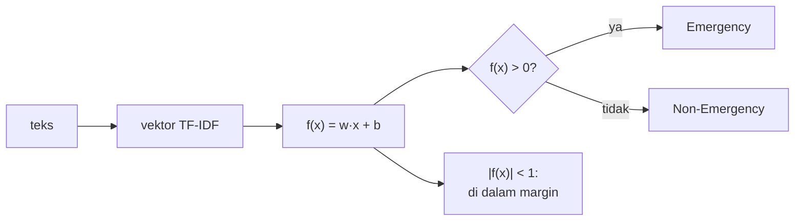

# Linear Support Vector Machine

!!! abstract "Info materi"
    **Tingkat kesulitan:** Menengah (dengan matematika dasar). **Estimasi waktu:** 100 menit.
    **Jenis kode:** snippet edukatif dan eksperimen kecil (`examples/level-4-classification/06_linear_svm.py`).

## Tujuan pembelajaran

- [ ] Menjelaskan ide *margin* dan hyperplane pemisah pada SVM linear.
- [ ] Menjelaskan *hinge loss* dan peran parameter `C`.
- [ ] Membaca `decision_function` dan menjelaskan bahwa itu **bukan probabilitas**.
- [ ] Menjelaskan mengapa `LinearSVC` tidak memiliki `predict_proba`.
- [ ] Membandingkan SVM linear dengan Logistic Regression secara konseptual.

## Prasyarat

- [Logistic Regression](logistic-regression.md): skor linear $z = w \cdot x + b$, regularisasi, dan `C`.

## Pengantar dan motivasi

Logistic Regression mencari bobot yang membuat peluang tebakan sesuai label.
SVM linear mencari **garis (hyperplane) pemisah dengan jarak terbesar ke contoh terdekat dari kedua kelas**.
Gambaran: dua kelompok titik di bidang; ada banyak garis yang memisahkannya, tetapi garis
yang berada di tengah dengan ruang kosong selebar mungkin lebih aman terhadap titik baru yang
sedikit bergeser. Pada teks, SVM linear sering menjadi baseline sangat kuat karena ruang
fiturnya berdimensi tinggi.

## Konsep dasar

Untuk vektor fitur $x$, bobot $w$, dan bias $b$, SVM linear menghitung skor

$$
f(x) = w \cdot x + b
$$

dan memprediksi Emergency bila $f(x) > 0$. Dengan label $y \in \{-1, +1\}$ (di sini Non-Emergency $= -1$,
Emergency $= +1$):

- **Margin**: jarak antara hyperplane $f(x)=0$ dan titik terdekat. Titik yang tepat berada pada $f(x) = \pm 1$ menentukan margin.
- **Hinge loss** untuk satu contoh:

$$
\ell(y, f) = \max\bigl(0,\; 1 - y\,f(x)\bigr)
$$

$y\,f(x)$ besar dan positif berarti contoh benar dan jauh dari batas: kerugian 0. Bila
$y\,f(x) < 1$ (di dalam margin, atau salah sisi), kerugian positif.

Tujuan pelatihan (SVM *soft-margin*) adalah menyeimbangkan dua hal: margin lebar
(bobot $w$ kecil) dan sedikit pelanggaran:

$$
\min_{w,b}\;\; \tfrac{1}{2}\lVert w \rVert^2 \;+\; C \sum_{i=1}^{n} \ell\bigl(y_i, f(x_i)\bigr)
$$

$C$ besar → pelanggaran dihukum berat (margin sempit, mencocokkan data latih lebih keras);
$C$ kecil → margin lebar, lebih toleran. Perhatikan bahwa $C$ di sini mengalikan **kerugian**; pada
Logistic Regression scikit-learn, $C$ juga berperan sebagai kebalikan kekuatan regularisasi; keduanya
berarti serupa: $C$ kecil = lebih sederhana.

## Penjelasan mendalam

### Hinge loss dibandingkan log-loss

Log-loss pada Logistic Regression selalu positif dan terus menurun saat contoh makin
yakin benar. Hinge loss menjadi **tepat 0** begitu contoh berada di luar margin: contoh yang
sudah aman tidak lagi memengaruhi pelatihan. Yang memengaruhi garis hanya contoh di dalam
margin atau salah sisi.

### `decision_function` bukan probabilitas

Skor $f(x)$ adalah **jarak bertanda terhadap hyperplane** (dalam satuan $1/\lVert w \rVert$),
bukan peluang. Skor 0,9 bukan "90% yakin". Karena itu `LinearSVC` **tidak menyediakan**
`predict_proba`. Kita boleh memakai skor sebagai peringkat keyakinan, tetapi tidak boleh melaporkannya sebagai
probabilitas. Bila probabilitas dibutuhkan, harus dikalibrasi (misalnya dengan
`CalibratedClassifierCV`) dan divalidasi (Level 5 dan 7).

### `LinearSVC` dan kernel

`LinearSVC` hanya memakai batas linear dan efisien pada data besar. SVM dengan kernel non-linear
(`SVC`) tidak dibahas di sini: pada teks berdimensi tinggi, batas linear umumnya cukup.

## Cara kerja atau alur proses



## Contoh sederhana

Dua kata: `tolong` ($w=1{,}5$), `promo` ($w=-2$), $b=-0{,}2$. Teks dengan `tolong` ber-TF-IDF 0,6: $f=1{,}5 \times 0{,}6 - 0{,}2 = 0{,}7$ → Emergency, tetapi $|f| < 1$ sehingga di dalam
margin: keputusan belum "aman". Teks dengan `promo` (0,6): $f=-1{,}4$ → Non-Emergency, di luar margin.

## Contoh dalam konteks Twitter/X kebencanaan

Untuk pesan darurat, skor $f(x)$ yang positif tetapi kecil menandakan pesan yang dekat
perbatasan. Dalam sistem nyata pesan seperti ini patut diprioritaskan untuk peninjauan manusia,
bukan diputuskan otomatis. Tetapi **ambang peninjauan harus ditetapkan melalui evaluasi dan
validasi**, bukan ditebak (Level 5).

## Praktik Python

Berkas: `examples/level-4-classification/06_linear_svm.py`. Data dibagi per kejadian
(latih/validasi/uji); SVM dilatih pada latih.

### Bagian 1 — Hinge loss

```python title="Bagian 1"
--8<-- "level-4-classification/06_linear_svm.py:hinge"
```

```text title="Output nyata"
y=+1, f=+2.0: hinge = 0.0
y=+1, f=+1.0: hinge = 0.0
y=+1, f=+0.5: hinge = 0.5
y=+1, f=-1.0: hinge = 2.0
```

Interpretasi: untuk contoh Emergency ($y=+1$), skor 2,0 dan 1,0 tidak memberi kerugian
(di luar atau tepat pada margin). Skor 0,5 benar tetapi di dalam margin: kerugian 0,5. Skor
$-1{,}0$ salah sisi: kerugian 2,0.

### Bagian 2 — `decision_function`

```python title="Bagian 2"
--8<-- "level-4-classification/06_linear_svm.py:keputusan"
```

`model.decision_function(X)` melewati semua langkah pipeline dan mengembalikan skor $f(x)$ per teks. `np.abs(skor) < 1` menghitung teks yang berada dalam jarak 1 dari hyperplane.

```text title="Output nyata"
[-0.878 -0.999 -0.854  0.986 -0.958  0.799]
[0 0 0 1 0 1] [0 0 0 1 0 1]
tanda skor sama dengan prediksi: True
teks validasi dengan |skor| < 1 (dekat/di dalam margin): 98 dari 117
```

Interpretasi: skor negatif untuk kelas 0 dan positif untuk kelas 1; prediksi sama dengan tanda
skor pada seluruh 117 teks validasi. Sebagian besar skor (98 dari 117) berada dalam rentang
$(-1, 1)$, wajar untuk SVM soft-margin pada fitur TF-IDF yang sudah dinormalisasi: margin
tidak "keras", sehingga banyak titik berada di dalamnya walau diklasifikasikan benar.
Jadi `|skor| < 1` **bukan** tanda salah prediksi.

### Bagian 3 — Tidak ada probabilitas

```python title="Bagian 3"
--8<-- "level-4-classification/06_linear_svm.py:tanpa_proba"
```

```text title="Output nyata"
AttributeError: This 'Pipeline' has no attribute 'predict_proba'
```

Interpretasi: pipeline dengan `LinearSVC` tidak memiliki `predict_proba`. Galat ini menjaga kita dari
menyebut skor keputusan sebagai probabilitas. Jika kode di API (Level 7) menampilkan "skor", beri nama
`decision_score`, bukan `probability`.

### Bagian 4 — Efek `C`

```python title="Bagian 4"
--8<-- "level-4-classification/06_linear_svm.py:regularisasi"
```

```text title="Output nyata"
C=0.01  F1 latih=0.399  F1 validasi=0.397
C=0.1   F1 latih=1.000  F1 validasi=0.991
C=1     F1 latih=1.000  F1 validasi=0.991
C=10    F1 latih=1.000  F1 validasi=0.991
C=100   F1 latih=1.000  F1 validasi=0.991
```

Interpretasi: `C=0.01` menyebabkan underfitting ekstrem (F1 makro ≈ 0,4, semua prediksi pada
kelas mayoritas). Mulai `C=0.1`, F1 latih 1,000 dan validasi 0,991 tidak berubah.
Pada data ini SVM pindah dari underfit ke "cocok sempurna" dalam satu langkah `C`, karena datanya
mudah dipisahkan secara linear. Pada data nyata, kurva ini jauh lebih landai.

### Bagian 5 — Koefisien

```python title="Bagian 5"
--8<-- "level-4-classification/06_linear_svm.py:koefisien"
```

```text title="Output nyata"
mendorong Non-Emergency: [('kemarin', -0.9), ('sudah', -0.7), ('kembali', -0.67), ('lancar', -0.57), ('ini', -0.5)]
mendorong Emergency    : [('rt', 1.57), ('rumah', 1.33), ('jalan', 1.26), ('barusan', 1.09), ('butuh', 1.03)]
```

Interpretasi: pola mirip Logistic Regression (`kemarin`, `sudah`, `kembali` untuk informasi
lama; `rt`, `rumah`, `jalan`, `barusan` untuk laporan). Kemiripan itu wajar karena keduanya model linear
pada fitur yang sama. Peringatan yang sama berlaku: sebagian kata adalah artefak templat.

### Skrip terpadu

`buat_pipeline("svm", C=...)` di `examples/nlp_hub/modeling.py` membuat versi siap pakai (`LinearSVC`,
`random_state=42`).

## Kesalahan umum dan debugging

| Gejala | Penyebab | Perbaikan |
|---|---|---|
| `AttributeError: ... no attribute 'predict_proba'` | `LinearSVC` tidak punya probabilitas | Pakai `decision_function`; kalibrasi bila perlu |
| Skor keputusan disebut "probabilitas" | Salah menafsirkan | Beri nama yang benar; jangan menampilkan sebagai persen |
| `ConvergenceWarning` pada `LinearSVC` | Iterasi kurang | Naikkan `max_iter`, periksa skala fitur |
| Semua prediksi satu kelas | `C` terlalu kecil | Naikkan `C` |
| Margin "keras" diharapkan | Data nyata tidak terpisah sempurna | Pakai soft-margin dan validasi `C` |

## Kelebihan dan keterbatasan

**Kelebihan:** sering sangat baik pada teks berdimensi tinggi; cepat; sedikit parameter; tahan overfitting bila `C` tepat.
**Keterbatasan:** tidak ada probabilitas bawaan; skor sulit ditafsirkan sebagai keyakinan; batas
linear; sensitif pada skala fitur dan pada artefak data.

## Latihan bertahap

1. **Konseptual.** Apa itu margin dan mengapa margin lebar dianggap baik?
2. **Menghitung.** Hitung hinge loss untuk $y=-1$ dan $f=0{,}3$.
3. **Membaca output.** Mengapa 98 dari 117 teks validasi berskor $|f|<1$ tidak berarti 98 salah prediksi?
4. **Debugging.** Aplikasi mencetak `0.98` sebagai "probabilitas Emergency" dari `decision_function`. Apa yang salah dan bagaimana memperbaikinya?
5. **Mini-proyek.** Jalankan Bagian 4 dengan `C=0.03` dan `C=0.3`. Di mana peralihan underfit → cocok terjadi?

## Kunci jawaban dan pembahasan

??? success "Jawaban 1"
    Margin adalah jarak hyperplane ke contoh terdekat. Margin lebar berarti batas yang lebih tahan terhadap sedikit perubahan data baru, sehingga cenderung menggeneralisasi lebih baik.

??? success "Jawaban 2"
    $\max(0,\ 1 - (-1)(0{,}3)) = \max(0,\ 1{,}3) = 1{,}3$. Contoh bukan-Emergency dengan skor positif 0,3 berada di sisi yang salah, sehingga kerugiannya 1,3.

??? success "Jawaban 3"
    Karena $|f|<1$ hanya berarti berada di dalam margin, bukan salah sisi. Prediksi sama dengan tanda $f$; ia benar atau salah tergantung label, dan pada Bagian 2 enam prediksi pertama semuanya sama dengan label.

??? success "Jawaban 4"
    `decision_function` bukan probabilitas; ia jarak bertanda. Perbaikan: namai `decision_score`, atau kalibrasi (mis. `CalibratedClassifierCV`) lalu validasi kalibrasinya sebelum menyebutnya probabilitas.

??? success "Jawaban 5"
    Tidak dijawab dari halaman ini; jalankan sendiri. Dari tabel, peralihan terjadi di antara `C=0.01` (F1 0,397) dan `C=0.1` (F1 0,991); `C=0.03` dan `C=0.3` akan menunjukkan di mana tepatnya, dan hasilnya kemungkinan landai pada data nyata tetapi sangat curam pada data mudah ini.

## Kuis singkat

**1.** Mengapa `LinearSVC` tidak punya `predict_proba`?

??? success "Jawaban"
    Skornya adalah jarak ke hyperplane, bukan probabilitas; model tidak dilatih untuk mengeluarkan peluang.

**2.** Berapa hinge loss untuk contoh benar dengan $y f \ge 1$?

??? success "Jawaban"
    0.

**3.** Apa efek `C` kecil pada SVM?

??? success "Jawaban"
    Margin lebar dan toleransi pelanggaran besar; model sederhana (pada ekstrem: underfit).

## Ringkasan

- SVM linear mencari hyperplane dengan margin besar; skor $f(x)=w \cdot x+b$, prediksi Emergency bila $f>0$.
- Hinge loss bernilai 0 untuk contoh di luar margin.
- `decision_function` bukan probabilitas; `LinearSVC` tidak memiliki `predict_proba`.
- Pada dataset ini: `C=0.01` underfit (F1 ≈ 0,4); `C ≥ 0.1` memberi F1 validasi 0,991.

## Glosarium istilah baru

Hyperplane
:   Bidang pemisah pada ruang fitur; pada dua dimensi berupa garis.

Margin
:   Jarak antara hyperplane dan contoh terdekat.

Hinge loss
:   $\max(0, 1 - y f(x))$: kerugian yang 0 bila contoh di luar margin.

Soft-margin
:   Variasi SVM yang membolehkan sebagian contoh berada di dalam margin atau salah sisi.

`decision_function`
:   Skor jarak bertanda terhadap hyperplane.

## Referensi

- Joachims, T. (1998). Text categorization with Support Vector Machines: Learning with many relevant features. *Machine Learning: ECML-98*, Lecture Notes in Computer Science 1398, 137–142. DOI: 10.1007/BFb0026683 (makalah akademik; detail bibliografi diperiksa lewat pencarian daring).
- Pang, B., Lee, L., & Vaithyanathan, S. (2002). Thumbs up? Sentiment classification using machine learning techniques. *Proceedings of EMNLP 2002*, 79–86. <https://aclanthology.org/W02-1011/> (bagian 5.3 menjelaskan SVM untuk teks).
- Dokumentasi scikit-learn, *Support Vector Machines*: <https://scikit-learn.org/stable/modules/svm.html> (dokumentasi resmi).

## Materi berikutnya

[Perbandingan Algoritma dan Eksperimen yang Adil](perbandingan-model.md)
