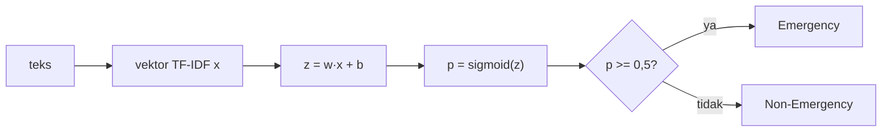

# Logistic Regression

!!! abstract "Info materi"
    **Tingkat kesulitan:** Menengah (dengan matematika dasar). **Estimasi waktu:** 120 menit.
    **Jenis kode:** snippet edukatif dan eksperimen kecil (`examples/level-4-classification/05_logistic_regression.py`).

## Tujuan pembelajaran

- [ ] Menjelaskan model Logistic Regression: skor linear, fungsi sigmoid, dan probabilitas.
- [ ] Menghitung prediksi dengan tangan dari bobot, bias, dan fitur, lalu mencocokkannya dengan scikit-learn.
- [ ] Menjelaskan *log-loss* dan regularisasi L2 serta arti parameter `C`.
- [ ] Menafsirkan koefisien dengan hati-hati.
- [ ] Menjelaskan underfitting akibat regularisasi terlalu kuat.

## Prasyarat

- [Pipeline](pipeline-sklearn.md) dan [TF-IDF](../level-3-representasi-teks/tfidf.md).
- Fungsi eksponensial dan logaritma dasar.

## Pengantar dan motivasi

Naive Bayes menghitung peluang dengan asumsi kata saling bebas. Logistic
Regression mengambil pendekatan berbeda: memberi **bobot** pada setiap
kata (positif jika mendorong Emergency, negatif jika mendorong Non-Emergency),
menjumlahkan bobot kata yang ada pada teks, dan mengubah jumlahnya menjadi peluang.
Bobot dipelajari dari data agar tebakan sesuai label. Ia sederhana, cepat,
dan hasilnya dapat dibaca.

## Konsep dasar

### Skor linear dan sigmoid

Untuk vektor fitur $x$ (TF-IDF satu teks), bobot $w$, dan bias $b$:

$$
z = w \cdot x + b = \sum_j w_j x_j + b
\qquad
p = \sigma(z) = \frac{1}{1 + e^{-z}}
$$

- $x_j$: nilai TF-IDF kata ke-$j$ pada teks ini; $w_j$: bobot kata itu.
- $b$ (*bias*/*intercept*): skor dasar ketika semua $x_j=0$.
- $z$: skor mentah (bisa negatif atau positif besar).
- $\sigma(z)$ (**sigmoid**): memetakan skor apa pun ke rentang 0–1 sehingga dapat dibaca sebagai peluang Emergency.

Beberapa nilai sigmoid (dari Bagian 1): $\sigma(-4)=0{,}018$; $\sigma(-2)=0{,}119$; $\sigma(0)=0{,}5$; $\sigma(2)=0{,}881$; $\sigma(4)=0{,}982$.

Aturan keputusan bawaan: prediksi Emergency bila $p \ge 0{,}5$ (yaitu $z \ge 0$).
Ambang 0,5 hanyalah bawaan; pada Level 5 kita membahas mengubahnya.

### Log-loss (cross-entropy)

Untuk satu contoh dengan label benar $y \in \{0, 1\}$ dan peluang tebakan $p$:

$$
\ell(y, p) = -\,y \ln p \;-\; (1-y)\ln(1-p)
$$

Bila $y=1$, kerugiannya $-\ln p$: $p=0{,}9$ → 0,105; $p=0{,}5$ → 0,693; $p=0{,}1$ → 2,303.
Kerugian membesar tajam ketika model yakin tetapi salah. Pelatihan mencari $w, b$ yang
meminimalkan rata-rata kerugian ini.

### Regularisasi L2 dan parameter `C`

Tanpa pembatas, model dapat memberi bobot sangat besar pada kata yang kebetulan
sempurna memisahkan data latih (menghafal). **Regularisasi L2** menghukum bobot
besar. Dokumentasi scikit-learn menuliskan tujuan yang diminimalkan sebagai (dengan bobot contoh sama):

$$
\min_{w,b}\;\; \frac{1}{n}\sum_{i=1}^{n}\ell(y_i, p_i) \;+\; \frac{1}{2nC}\,\lVert w \rVert_2^2
$$

- $n$: jumlah contoh latih; $\lVert w \rVert_2^2 = \sum_j w_j^2$: jumlah kuadrat bobot.
- $C$: **kebalikan** dari kekuatan regularisasi. $C$ kecil → hukuman kuat → bobot kecil (model sederhana). $C$ besar → hukuman lemah → bobot boleh besar.

## Penjelasan mendalam

### Menafsirkan koefisien

Koefisien positif untuk kata $t$ berarti kehadiran $t$ menaikkan skor Emergency
(dengan fitur lain tetap). Karena fitur TF-IDF telah dinormalisasi, besar koefisien
bergantung pada skala TF-IDF. Tafsirkan sebagai **petunjuk**, bukan sebab-akibat,
dan hati-hati dengan fitur yang berkorelasi (koefisien dibagi di antara mereka).

### Underfitting dan overfitting

- $C$ terlalu kecil: model tidak sempat belajar (**underfitting**), skor rendah di latih maupun validasi (Bagian 4: $C = 0{,}01$ dan $0{,}1$).
- $C$ terlalu besar: model dapat menghafal (**overfitting**), skor latih tinggi tetapi validasi tidak mengikuti. Pada dataset yang mudah ini selisihnya kecil, tetapi pada data nyata biasanya lebih besar.

### Mengapa model linear cocok untuk teks

Ruang fitur teks berdimensi tinggi dan data berukuran kecil; pada situasi itu,
pemisah linear sering sudah cukup, dan model linear lebih tahan terhadap overfitting
dibanding model yang lebih fleksibel.

## Cara kerja atau alur proses



## Contoh sederhana

Misalkan hanya dua kata: `tolong` dengan $w=2{,}0$ dan `promo` dengan $w=-3{,}0$; $b=-0{,}5$. Teks dengan
`tolong` (TF-IDF 0,6) saja: $z = 2{,}0 \times 0{,}6 - 0{,}5 = 0{,}7$; $p = \sigma(0{,}7) = 0{,}668$ → Emergency.
Teks dengan `promo` (0,6): $z = -3{,}0 \times 0{,}6 - 0{,}5 = -2{,}3$; $p = 0{,}091$ → Non-Emergency.

## Contoh dalam konteks Twitter/X kebencanaan

Satu teks validasi: "Puting beliung di Kelurahan Cibening minggu lalu merusak belasan atap, kini
sudah diperbaiki gotong royong." Skor $z$ negatif karena kata seperti `sudah` dan `lalu`
mendorong Non-Emergency (informasi lama).

## Praktik Python

Berkas: `examples/level-4-classification/05_logistic_regression.py`. Data dibagi per kejadian
menjadi latih, validasi, dan uji (`bagi_latih_val_uji`); model dilatih pada latih.

### Bagian 1 — Sigmoid dan log-loss

```python title="Bagian 1"
--8<-- "level-4-classification/05_logistic_regression.py:sigmoid"
```

```text title="Output nyata"
z=-4  sigmoid=0.0180
z=-2  sigmoid=0.1192
z=+0  sigmoid=0.5000
z=+2  sigmoid=0.8808
z=+4  sigmoid=0.9820
y=1, p=0.9: log-loss = 0.105
y=1, p=0.5: log-loss = 0.693
y=1, p=0.1: log-loss = 2.303
```

Interpretasi: sigmoid bernilai 0,5 pada $z=0$ dan mendekati 0 atau 1 pada $|z|$ besar.
Kerugian untuk $y=1$ naik dari 0,105 ($p=0{,}9$) menjadi 2,303 ($p=0{,}1$).

### Bagian 2 — Prediksi manual

```python title="Bagian 2"
--8<-- "level-4-classification/05_logistic_regression.py:manual"
```

`model[:-1].transform([teks])` memberi vektor TF-IDF (sparse). `x @ w` adalah perkalian titik dengan bobot; `[0]` mengambil elemen tunggal; `+ b` menambah bias. `predict_proba(...)[0, 1]` adalah peluang kelas 1 (Emergency).

```text title="Output nyata"
Puting beliung di Kelurahan Cibening minggu lalu merusak belasan atap, kini sudah diperbaiki gotong royong.
z = w.x + b = -1.2582   sigmoid(z) = 0.2213
predict_proba Emergency: 0.2213
label sebenarnya: 0
```

Interpretasi: $z=-1{,}2582$ menghasilkan $\sigma(z)=0{,}2213$, sama dengan `predict_proba`.
Peluang Emergency 22%, di bawah 0,5, sehingga diprediksi Non-Emergency, sesuai label
sebenarnya (0).

### Bagian 3 — Koefisien terbesar

```python title="Bagian 3"
--8<-- "level-4-classification/05_logistic_regression.py:koefisien"
```

```text title="Output nyata"
mendorong Non-Emergency: [('ini', -0.92), ('sudah', -0.83), ('siaga', -0.77), ('ya', -0.71), ('kemarin', -0.7)]
mendorong Emergency    : [('rt', 2.46), ('jalan', 2.18), ('rumah', 2.09), ('di', 1.58), ('barusan', 1.44)]
bias: -1.308
```

Interpretasi: kata `sudah` dan `kemarin` (informasi lama) mendorong Non-Emergency, sesuai definisi
operasional. Koefisien terbesar untuk Emergency adalah `rt`, `jalan`, `rumah`, `di`,
yaitu kata pembentuk alamat dan lokasi. Ini mencerminkan artefak data sintetis (setiap templat laporan
menyebut alamat), bukan pengetahuan umum tentang pesan darurat. Model yang dilatih pada data nyata
tidak akan memiliki daftar yang sama. Koefisien terbesar tidak otomatis "kata paling penting
dalam dunia nyata".

### Bagian 4 — Efek `C`

```python title="Bagian 4"
--8<-- "level-4-classification/05_logistic_regression.py:regularisasi"
```

Untuk tiap nilai `C`, model dilatih pada data latih dan F1 makro dihitung pada data latih dan validasi; `|koefisien| maks` adalah bobot mutlak terbesar.

```text title="Output nyata"
C=0.01   F1 latih=0.399  F1 validasi=0.397  |koefisien| maks=0.1
C=0.1    F1 latih=0.399  F1 validasi=0.397  |koefisien| maks=0.6
C=1      F1 latih=0.997  F1 validasi=0.991  |koefisien| maks=2.5
C=10     F1 latih=1.000  F1 validasi=0.991  |koefisien| maks=5.3
C=100    F1 latih=1.000  F1 validasi=0.991  |koefisien| maks=8.5
C=1000   F1 latih=1.000  F1 validasi=0.991  |koefisien| maks=12.1
```

Interpretasi:

- **$C=0{,}01$ dan $0{,}1$: underfitting yang ekstrem.** F1 makro 0,399–0,397 di latih dan validasi: bobot terlalu kecil (maks 0,1 dan 0,6) sehingga semua prediksi jatuh pada kelas mayoritas. F1 makro sekitar 0,4 adalah ciri model yang selalu menjawab satu kelas (F1 salah satu kelas = 0).
- **$C \ge 1$:** F1 latih naik dari 0,997 ke 1,000 dan F1 validasi tetap 0,991. Bobot membesar (2,5 → 12,1) tanpa manfaat di validasi.
- Selisih latih-validasi sangat kecil karena data mudah; pada data nyata, $C$ besar sering menaikkan F1 latih sambil menurunkan atau tidak menaikkan F1 validasi.

### Skrip terpadu

`buat_pipeline("lr", C=...)` di `examples/nlp_hub/modeling.py` membuat versi siap pakai
(`max_iter=1000`, `random_state=42`, solver bawaan `lbfgs`).

## Kesalahan umum dan debugging

| Gejala | Penyebab | Perbaikan |
|---|---|---|
| `ConvergenceWarning: lbfgs failed to converge` | Iterasi kurang | Naikkan `max_iter`; periksa skala fitur |
| Semua prediksi satu kelas | `C` terlalu kecil atau kelas sangat tidak seimbang | Naikkan `C`; periksa confusion matrix |
| Menafsirkan koefisien sebagai sebab | Korelasi ≠ sebab | Baca sebagai petunjuk; uji dengan data lain |
| Menganggap `predict_proba` sudah terkalibrasi | Tidak diuji | Periksa kurva kalibrasi (Level 5/7) |
| `C` tertukar dengan kekuatan regularisasi | `C` adalah kebalikannya | `C` kecil = regularisasi kuat |

## Kelebihan dan keterbatasan

**Kelebihan:** sederhana, cepat, memberi probabilitas yang biasanya lebih masuk akal daripada
Naive Bayes, koefisien dapat dibaca, kuat sebagai baseline.
**Keterbatasan:** batas keputusan linear; tidak menangkap interaksi kata kecuali n-gram;
koefisien dipengaruhi korelasi fitur; peluang tidak otomatis terkalibrasi; sensitif pada artefak data.

## Latihan bertahap

1. **Konseptual.** Mengapa sigmoid dipakai pada akhir model?
2. **Menghitung.** Jika $z = 1{,}0$, berapa $\sigma(z)$ (perkiraan)? ($e^{-1} \approx 0{,}368$.)
3. **Membaca output.** Pada Bagian 4, mengapa F1 makro 0,399 mengindikasikan model hanya memilih satu kelas?
4. **Debugging.** Anda memakai `C=0.01` dan semua prediksi `0`. Apa penyebab dan perbaikannya?
5. **Mini-proyek.** Tambahkan `C=3` dan `C=30` ke Bagian 4. Apakah ada nilai yang jelas lebih baik di validasi? Jelaskan dengan memperhatikan ukuran data validasi.

## Kunci jawaban dan pembahasan

??? success "Jawaban 1"
    Skor linear $z$ bisa bernilai berapa pun; sigmoid memetakannya ke rentang 0–1 sehingga dapat dibaca sebagai peluang dan dipakai dalam log-loss.

??? success "Jawaban 2"
    $\sigma(1) = 1/(1 + 0{,}368) = 0{,}731$.

??? success "Jawaban 3"
    Bila model selalu menjawab satu kelas, F1 untuk kelas yang tak pernah diprediksi adalah 0, dan F1 kelas lain mendekati 0,8 (untuk Non-Emergency, 66% data). Rata-ratanya sekitar 0,4. Nilai 0,399 konsisten dengan hal itu.

??? success "Jawaban 4"
    Regularisasi terlalu kuat: bobot terlalu kecil sehingga $z$ selalu negatif (dikuasai bias dan kelas mayoritas). Perbaikan: naikkan `C` (mis. 1 atau 10) dan pilih lewat validasi silang.

??? success "Jawaban 5"
    Tidak dijawab dari halaman ini; jalankan sendiri. Hampir pasti selisihnya sangat kecil (F1 validasi untuk `C ≥ 1` sama, 0,991); validasi hanya 117 teks, sehingga satu teks mengubah skor sekitar 0,01. Jangan menyatakan pemenang tanpa validasi silang.

## Kuis singkat

**1.** Apa arti `C` kecil pada Logistic Regression scikit-learn?

??? success "Jawaban"
    Regularisasi kuat: bobot dipaksa kecil, model sederhana.

**2.** Apa nilai $\sigma(0)$?

??? success "Jawaban"
    0,5.

**3.** Apakah koefisien terbesar menunjukkan kata yang paling penting di dunia nyata?

??? success "Jawaban"
    Tidak. Ia menunjukkan pola pada data latih tertentu (di sini sebagian artefak templat).

## Ringkasan

- Logistic Regression: $z = w \cdot x + b$, $p = \sigma(z)$; prediksi Emergency bila $p \ge 0{,}5$.
- Dilatih dengan meminimalkan log-loss ditambah penalti L2; `C` adalah kebalikan kekuatan penalti.
- Perhitungan manual ($z=-1{,}2582$, $p=0{,}2213$) sama dengan `predict_proba`.
- `C=0,01–0,1` menyebabkan underfitting (F1 makro ≈ 0,4); `C ≥ 1` menghasilkan F1 validasi 0,991.

## Glosarium istilah baru

Sigmoid
:   Fungsi $1/(1+e^{-z})$ yang memetakan skor ke rentang 0–1.

Log-loss (cross-entropy)
:   Ukuran kerugian untuk peluang tebakan terhadap label sebenarnya.

Regularisasi L2
:   Hukuman pada jumlah kuadrat bobot agar model tidak menghafal.

Bias (*intercept*)
:   Konstanta yang ditambahkan pada skor linear.

Underfitting
:   Model terlalu sederhana sehingga buruk bahkan pada data latih.

## Referensi

- Dokumentasi scikit-learn, *Logistic regression* (rumus fungsi tujuan dan arti `C`): <https://scikit-learn.org/stable/modules/linear_model.html#logistic-regression> (dokumentasi resmi).
- Pang, B., Lee, L., & Vaithyanathan, S. (2002). Thumbs up? Sentiment classification using machine learning techniques. *Proceedings of EMNLP 2002*, 79–86. <https://aclanthology.org/W02-1011/> (membandingkan Naive Bayes, maximum entropy (setara Logistic Regression multinomial), dan SVM untuk teks).

## Materi berikutnya

[Linear Support Vector Machine](linear-svm.md)
